<!-- source: 89a0aafb -->
# Región, copiar y pegar

Cambia todo lo que hay dentro de un recuadro o un polígono de una vez: nivela o pinta su suelo, elige sus objetos para
eliminarlos o reemplazarlos, cópialo y pégalo, o devuélvelo a como era: el suelo generado, una copia de seguridad, la
propia naturaleza del juego.

**Dónde:** barra de herramientas, sección **EDITAR** · **Tecla:** `B` · **Funciona en:** mundos guardados, en vivo

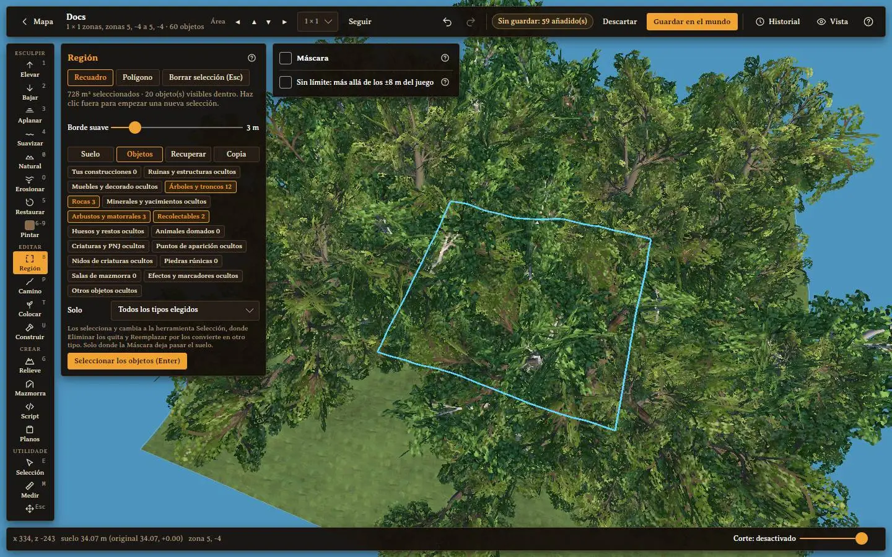
*Un recuadro arrastrado alrededor de un grupo de árboles con **Objetos** elegido: las fichas de tipo cuentan los
árboles, rocas, arbustos y recolectables que hay dentro. Aún no ha cambiado nada: el botón de abajo los selecciona.*

## Úsala

1. En la barra de herramientas, haz clic en **Región** (`B`).
2. Arriba del panel, elige **Recuadro** o **Polígono** y dibuja la selección sobre el suelo.
3. Elige un grupo: **Suelo**, **Objetos**, **Recuperar** o **Copia**. Suelo y Recuperar ofrecen entonces sus
   acciones en la lista **Acción**. El panel muestra solo los ajustes de la acción elegida y una línea que dice lo que
   hace.
4. Pulsa el botón de abajo, o `Enter`. Su etiqueta nombra la acción: **Aplanar (Enter)**, **Seleccionar los objetos
   (Enter)**, **Regenerar la naturaleza (Enter)**…
5. ¿No ha quedado bien? `Ctrl+Z` lo deshace: cada acción es un paso en el Historial. **Guardar en el mundo** (o
   **Aplicar en vivo**) lo conserva.

| Grupo | Qué contiene |
|---|---|
| **Suelo** | [Acciones de suelo](#acciones-de-suelo): Aplanar, Elevar, Bajar, Suavizar, Natural, Erosionar, Pintar y [Mapa de alturas](#mapa-de-alturas). |
| **Objetos** | [Seleccionar objetos](#acciones-de-objetos): los objetos de dentro, por tipo, entregados a la herramienta Selección para eliminarlos, reemplazarlos o moverlos. |
| **Recuperar** | [Lo que había](#recuperar-lo-que-había), de vuelta: [Volver al suelo generado](#volver-al-suelo-generado), [Regenerar la naturaleza](#regenerar-la-naturaleza), [Volver a una copia de seguridad](#volver-a-una-copia-de-seguridad), [Restablecer zonas](#restablecer-zonas). |
| **Copia** | [Copiar y pegar](#copiar-y-pegar), y [planos](#planos). |

La acción elegida se recuerda, y cada grupo vuelve a la última acción en la que estaba. La [Máscara](masks.md), en su
propia tarjeta junto al panel, limita las acciones de suelo, Seleccionar objetos, Regenerar la naturaleza y Volver a
una copia de seguridad al suelo que deja pasar.

## Ajustes

| Ajuste | Qué hace |
|---|---|
| **Recuadro** | Arrastra un rectángulo sobre el suelo. Un recuadro de menos de un metro se descarta. Arrastrar en otro sitio empieza un recuadro nuevo. |
| **Polígono** | Haz clic en las esquinas. Un doble clic o `Enter` cierra la forma (tres esquinas como mínimo); `Backspace` quita la última esquina. Hacer clic una vez cerrada empieza una nueva. |
| **Borrar selección (Esc)** | Borra la selección, para empezar una nueva. |
| **Borde suave** | De 0 a 20 m (3 m al principio). Las acciones de suelo se atenúan a lo largo de esos metros dentro del contorno, para que el resultado se funda con el terreno de alrededor. En **0** el borde es nítido y sigue en línea recta un contorno inclinado. |
| **Suelo**, **Objetos**, **Recuperar**, **Copia** | El grupo de acciones que se muestra (ver la tabla de arriba). |
| **Acción** | Las acciones del grupo, para Suelo y Recuperar. Objetos y Copia tienen una acción cada uno, así que no hay lista. |

La línea bajo los botones da la superficie y cuántos objetos visibles hay dentro («1250 m² seleccionados · 84
objeto(s) visible(s) dentro»). La selección solo se dibuja en la herramienta Región y mientras pegas; se conserva
cuando usas otra herramienta.

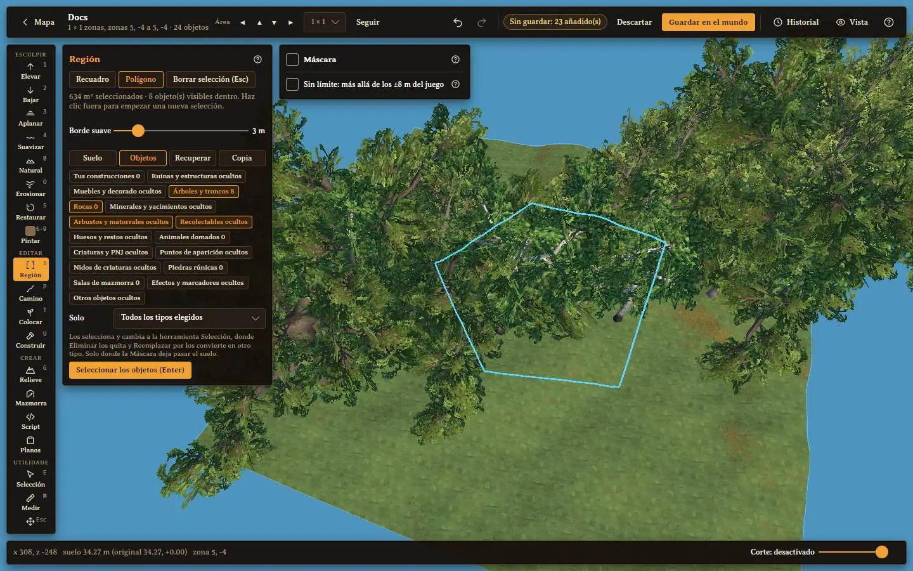
*Un polígono cerrado alrededor de parte de un bosque, con **Objetos** elegido.*

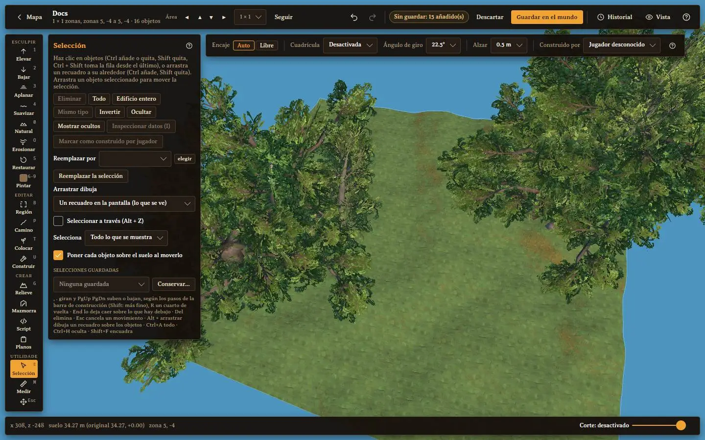
*Después de **Seleccionar los objetos (Enter)** y luego `Del` en la herramienta Selección: los árboles dentro del
polígono han desaparecido, los de fuera siguen en pie.*

## Acciones de suelo

Cada punto se atenúa según el **Borde suave** y la Máscara. Son las acciones de los [pinceles](terrain.md) y de la
herramienta [Camino](path.md), con los mismos nombres: aquí se aplican a toda la selección de una vez.

| Acción | Qué hace |
|---|---|
| **Aplanar** | Nivela el suelo de dentro a **Altura** (m). **media** pone en Altura la altura media del suelo de dentro. |
| **Elevar** / **Bajar** | Levanta / excava el suelo de dentro en **Cantidad** (m). |
| **Suavizar** | Suaviza los desniveles: cada punto se acerca a la media del suelo en 3 m a la redonda. |
| **Natural** | El suelo se suaviza y luego se le añaden desniveles naturales. Debajo aparecen **Amplitud**, **Anchura** y **Nuevo patrón**: son los del pincel [Natural](terrain.md#natural), con los mismos valores dondequiera que los ajustes. |
| **Erosionar** | Desgasta el suelo de una vez: las pendientes se asientan, la lluvia abre cárcavas y deja conos de derrubios, y las pendientes se vuelven a asentar. Debajo aparece **Ángulo de reposo**: el del pincel [Erosionar](terrain.md#erosionar), con el mismo valor dondequiera que lo ajustes. |
| **Pintar** | Pinta el suelo de dentro con **Tierra**, **Cultivado**, **Pavimento** o **Quitar pintura** (la lista de debajo). |
| **Mapa de alturas** | El suelo como una imagen en escala de grises, hacia fuera y de vuelta: ver [Mapa de alturas](#mapa-de-alturas). |

Para devolver el suelo a como lo creó el mundo, elige **Recuperar** y luego
[Volver al suelo generado](#volver-al-suelo-generado).

Las acciones de suelo se mantienen dentro de los ±8 m del juego salvo que **Sin límite: más allá de los ±8 m del
juego** esté marcado en la tarjeta **Máscara** junto al panel: el único interruptor para todas las herramientas de
suelo, que sigue activado hasta que lo desactives. Consulta [Sin límite](terrain.md#sin-límite).

Bajo **Aplanar**, **Elevar** y **Bajar**:

| Ajuste | Qué hace |
|---|---|
| Línea de desmonte y relleno | Cuánto suelo movería la acción («Aplanar a 35 m: excavar 120 m³, rellenar 340 m³») y, para Aplanar, lo que queda fuera de alcance («(40 m³ fuera de alcance: límite de ±8 m)»; con Sin límite activado, solo lo que pasa de sus ±400 m). La segunda línea, «Suelo de dentro: … elevado, … excavado desde que se generó», compara con el mundo tal como se generó. Ambas siguen cada cambio, el borde suave y la Máscara. |

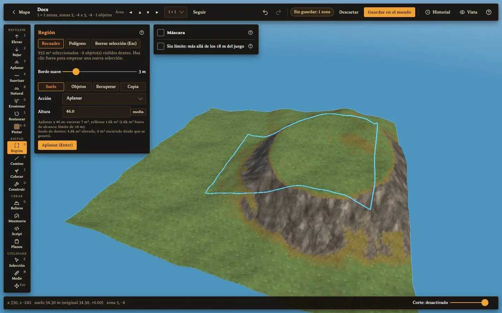
*Un recuadro sobre una colina con **Aplanar** a 46 m y **Sin límite** desactivado: «Aplanar a 46 m: excavar 0 m³,
rellenar 1.5k m³ (2.2k m³ fuera de alcance: límite de ±8 m)», y debajo el suelo ya elevado dentro desde que se generó
el mundo.*

### Mapa de alturas

Exporta el suelo como una imagen en escala de grises, cámbiala en un editor de imágenes (GIMP, Krita…) o en una
herramienta de terrenos (Gaea, World Machine…) y vuelve a traerla.

| Ajuste | Qué hace |
|---|---|
| **Exportar** | Escribe el suelo del rectángulo de la selección, o de toda el área abierta si no hay nada seleccionado, como un PNG de 16 bits en escala de grises: el negro es su punto más bajo, el blanco el más alto, el norte arriba, un píxel por metro (un área entera de 3 × 3 son 193 × 193 píxeles). Va a la carpeta `heightmaps` de la carpeta de datos del editor; la barra de estado dice dónde. Un polígono se exporta como el rectángulo que lo rodea. |
| **Importar…** | Lee un PNG (en escala de grises o en color, de 8 o 16 bits) y lo ajusta al rectángulo de la selección, o a toda el área si no hay nada seleccionado. |
| **Más bajo** / **Más alto** | Las alturas del negro y del blanco. Una imagen que exportó el editor trae las suyas, así que una imagen sin cambios devuelve el suelo exactamente. |
| **Hundirlo en el suelo** | Pone el suelo a las alturas de la imagen, en un solo paso de deshacer. Dentro de una selección, el **Borde suave** lo funde. Se aplican la Máscara y el límite de ±8 m (salvo que Sin límite esté activado): los puntos que no pueden llegar a su altura se ponen en rojo, y la barra de estado los cuenta. |
| **Cancelar** | Olvida la imagen sin cambiar el suelo. |

Usa 16 bits cuando puedas: una imagen de 8 bits solo tiene 256 escalones entre Más bajo y Más alto (escalones de
20 cm en 50 m).

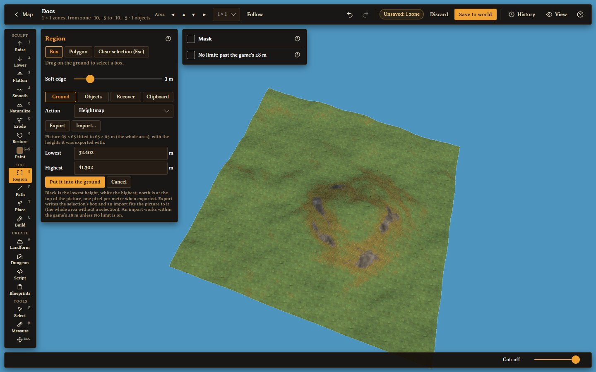
*Sin nada seleccionado, después de **Exportar** y luego **Importar…** de la misma imagen: «Imagen de 65 × 65 ajustada
a 65 × 65 m (toda el área), con las alturas con las que se exportó», y **Más bajo** y **Más alto** leídos de ella. No
cambia nada hasta **Hundirlo en el suelo**.*

## Acciones de objetos

La herramienta Región elige **qué** objetos: los que están dentro de la selección, de los tipos que actives, donde la
Máscara deja pasar el suelo. La herramienta [Selección](select.md) hace luego cosas **con** ellos: eliminar,
reemplazar, mover, girar, copiar, ocultar.

Una fila de **fichas de tipo** elige los tipos. Cada ficha muestra cuántos objetos de su tipo hay dentro («Árboles y
troncos 42»). Al principio están activadas **Árboles y troncos**, **Rocas**, **Arbustos y matorrales** y
**Recolectables**; elige **Tus construcciones** para las piezas construidas por jugadores, **Minerales y
yacimientos** para el cobre, el estaño, la plata y similares. Las mismas fichas eligen los tipos para
[Regenerar la naturaleza](#regenerar-la-naturaleza) y [Volver a una copia de seguridad](#volver-a-una-copia-de-seguridad).

Una ficha que dice «ocultos» es un tipo desactivado en el [panel Vista](editor-basics.md): sus objetos no se cuentan y
no se tocan, salvo con **Volver a una copia de seguridad**.

| Ajuste | Qué hace |
|---|---|
| Fichas de tipo | Los tipos de objetos que se toman. |
| **Solo** | **Todos los tipos elegidos** los toma todos. O elige un objeto entre los de dentro, listados con cuántos hay, primero los más comunes («Beech1 (42)»): solo se toman esos. La lista sigue a las fichas. |
| **Seleccionar los objetos (Enter)** | Los selecciona y cambia a la herramienta Selección. La barra de estado dice cuántos. Cuando no hay nada de los tipos elegidos dentro, lo dice y la herramienta Región se queda. |

Después, en la herramienta Selección:

| Para | Haz esto |
|---|---|
| Quitarlos | Pulsa `Del` (o **Eliminar**). Un paso en el Historial; `Ctrl+Z` los recupera. Un grupo enlazado (el barco de un mod) se va entero. |
| Reemplazarlos por otro tipo | Elige el tipo en **Reemplazar por** (o tómalo del mundo con **elegir**) y luego **Reemplazar la selección**. Para reemplazar solo las hayas de un bosque, elígelas antes en **Solo**. Consulta [Selección](select.md#ajustes). |
| Moverlos, girarlos, copiarlos, ocultarlos | Como cualquier selección: ver [Selección](select.md). |
| Volver | Pulsa `B`: el recuadro o el polígono siguen ahí. |

## Recuperar lo que había

Cuatro formas de recuperar lo que había, de la más ligera a la más radical.

| Acción | Qué recupera |
|---|---|
| **Volver al suelo generado** | El suelo de dentro tal como lo generó el mundo. Los objetos se quedan. |
| **Regenerar la naturaleza** | Los árboles, rocas, arbustos y recolectables que el juego hace crecer aquí, sobre el suelo tal como está ahora. |
| **Volver a una copia de seguridad** | El suelo y los objetos de dentro tal como estaban en una copia de seguridad de este mundo. |
| **Restablecer zonas** | Zonas enteras, que el juego vuelve a crear la próxima vez que alguien va allí. |

### Volver al suelo generado

El suelo de dentro vuelve a como lo generó el mundo: su altura (incluido el suelo elevado o excavado con Sin límite) y
su pintura. Se atenúa según el **Borde suave** y la Máscara, como las [acciones de suelo](#acciones-de-suelo). Hace para
un recuadro o un polígono lo que el pincel [Restaurar](terrain.md#restaurar) hace bajo el cursor.

### Regenerar la naturaleza

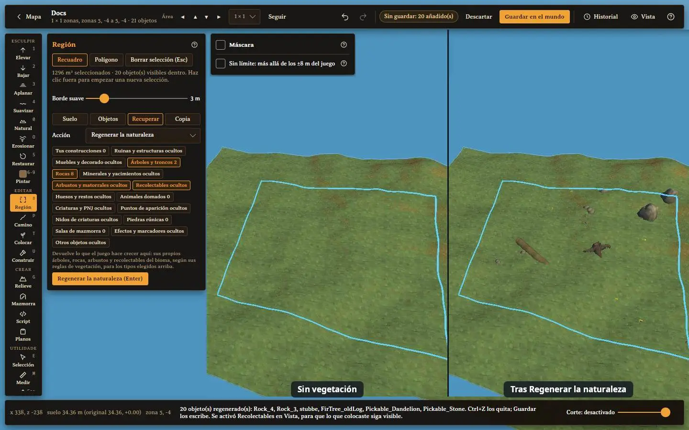
*Izquierda: un recuadro sobre suelo pelado. Derecha: el mismo recuadro después de **Regenerar la naturaleza**: los
árboles y rocas propios del juego para el bioma, y la barra de estado dice lo que ha crecido.*

Regenerar la naturaleza devuelve los árboles, rocas, arbustos, recolectables y minerales que el juego hace crecer aquí,
para los tipos elegidos con las [fichas de tipo](#acciones-de-objetos), dentro de la selección y donde la Máscara lo
permite. Úsala para deshacer la tala de un bosque, o para vestir un suelo que remodelaste.

- **Sigue las propias reglas del juego** y la semilla del mundo: sobre suelo aún tal como se generó, recuperas los
  mismos árboles en los mismos sitios. Los biomas alternativos (Praderas oscuras, Selva Negra rocosa…) reciben lo que
  añaden.
- **Usa el suelo tal como está ahora**: una colina que elevaste recibe lo que crece a su nueva altura y pendiente.
- **No duplica lo que ya está en pie**: no crece nada a menos de 1 m de un objeto, 3 m de uno del mismo tipo o 4 m de
  una pieza de construcción, ni donde una ubicación (una aldea, una entrada de mazmorra) mantiene su suelo despejado.
- **Hasta 16 zonas a la vez** (256 × 256 m): elige una selección más pequeña para más.
- Si un tipo que ha hecho crecer está oculto en Vista, lo activa, para que lo que ha crecido siga visible.

Las reglas completas: [Reglas de crecimiento](concepts/objects.md#reglas-de-crecimiento).

### Volver a una copia de seguridad

Devuelve la selección a como estaba en una copia de seguridad de este mundo, para deshacer un acto de vandalismo, un
mal asalto o una edición de la que te arrepientes, sin hacer retroceder todo el mundo. Paso a paso:
[Restaurar un área desde una copia de seguridad](guides/restore-from-backup.md).

| Ajuste | Qué hace |
|---|---|
| **Respaldo** | Las copias de seguridad junto a la carpeta del mundo, primero las más recientes: las del propio juego («Juego · fecha») y las del editor de versiones anteriores («Editor · fecha»). **Otra carpeta…** elige cualquier otra copia del mismo mundo, como una copia de seguridad de un servidor copiada a este equipo; en vivo, la lista está vacía, así que esa es la forma. Una copia de otro mundo (otra semilla) se rechaza. La línea de debajo dice qué guardado es y cuántos objetos contiene. |
| **Suelo (altura y pintura)** | El suelo de dentro vuelve exactamente como en la copia de seguridad, incluido el suelo de Sin límite; dentro del **Borde suave** se funde. Se aplica la Máscara. |
| **Objetos de los tipos elegidos arriba** | Los objetos de los tipos elegidos con las [fichas de tipo](#acciones-de-objetos) vuelven con todos sus datos: un cofre restaurado tiene su contenido. Elige **Tus construcciones** para recuperar construcciones. |
| **Volver a la copia de seguridad (Enter)** | Lo hace: un paso en el Historial. |

Un objeto que es igual en ambos (mismo tipo, sitio y orientación) no se toca. Cualquier otro objeto de los tipos
elegidos que haya dentro se quita, aunque esté oculto en Vista, y cada objeto de la copia de seguridad sin pareja
vuelve. Las piedras rúnicas nunca se tocan. Cuando no hay ninguna diferencia, la barra de estado dice «Nada que
restaurar: la selección está como en la copia de seguridad.»

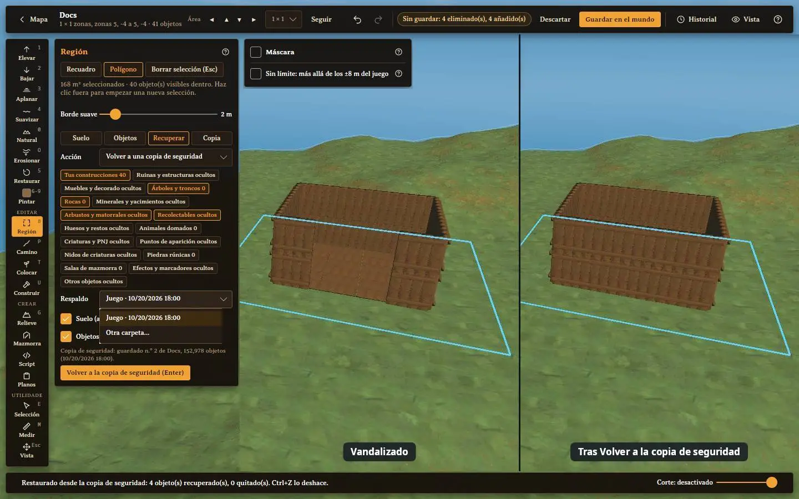
*Izquierda: un polígono alrededor de una cabaña a la que le falta parte de la pared cercana, con **Volver a una copia de
seguridad** elegido, la lista **Respaldo** abierta sobre la copia del juego y **Tus construcciones**
activado. Derecha: después de **Volver a la copia de seguridad (Enter)**, la pared vuelve a estar entera; la línea
sobre el botón nombra el guardado de la copia, y la barra de estado cuenta lo que ha vuelto.*

### Restablecer zonas

Marca las zonas bajo la selección para que el juego las vuelva a generar: árboles, rocas, minerales y ubicaciones
nuevos. Para elegir zonas en todo el mundo por bioma o por distancia a las construcciones, usa el
[mapa del mundo](map.md#restablecer-zonas-en-todo-el-mundo), que tiene los mismos dos interruptores y marca de la misma forma;
paso a paso: [Volver a generar zonas](guides/reset-zones.md).

| Ajuste | Qué hace |
|---|---|
| **Conservar mis construcciones** | Los objetos construidos por jugadores en las zonas se conservan. Activado al principio. Desactivado, las construcciones de las zonas también se van. |
| **Deshacer también sus ediciones del suelo** | Deshace también las ediciones del suelo de las zonas: altura (también el suelo de Sin límite) y pintura. La vista muestra el suelo de vuelta tal como se generó en cuanto las zonas quedan marcadas. Activado al principio. |
| **Restablecer zonas… (Enter)** | Marca para restablecer cada zona bajo la selección (contorno rojo), tras preguntar. |
| **Desmarcar estas zonas** | Desmarca las zonas bajo la selección: no se restablecen. |
| **Quitar todas las marcas** | Desmarca todas las zonas marcadas para restablecer, también las marcadas en el mapa y fuera del área abierta. Un paso en el Historial. |

Una zona cuenta cuando el contorno abarca al menos uno de sus puntos de suelo, sea cual sea el borde suave: una zona
que queda fuera de la selección no se restablece. El restablecimiento se hace al guardar (sin conexión) o al aplicar
en vivo (WorldEditorBridge 0.10.0 o posterior).

> [!CAUTION]
> **Una vez guardado o aplicado, un restablecimiento no se puede deshacer.** Desaparecen todos los árboles, rocas,
> ruinas, entradas de mazmorra, criaturas y objetos tirados de las zonas; las lápidas de los jugadores se quedan. Los
> animales domados no tienen constructor, así que también desaparecen: sácalos antes.

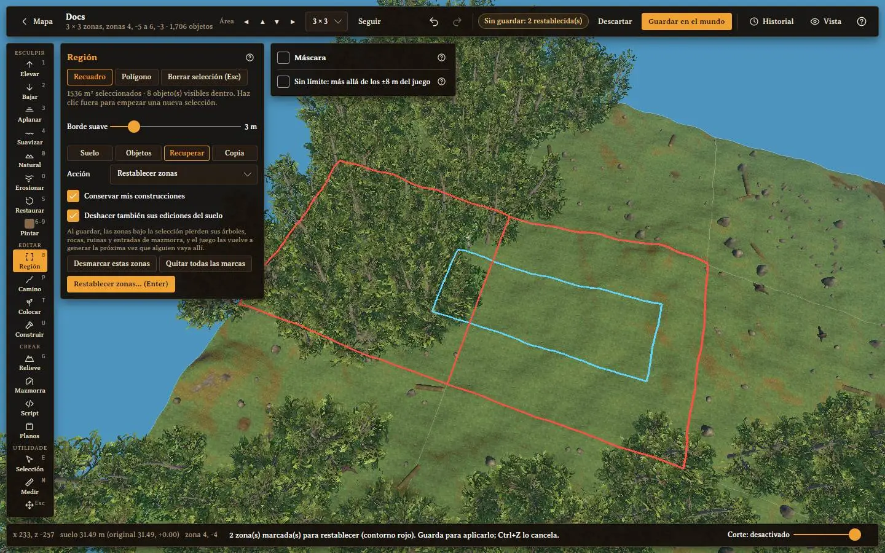
*Un recuadro sobre dos zonas, **Restablecer zonas** con **Conservar mis construcciones** y **Deshacer también sus
ediciones del suelo** activados, después de **Restablecer zonas… (Enter)**: ambas zonas con contorno rojo, y la barra
de estado contándolas. No se restablece nada hasta que guardas.*

## Copiar y pegar

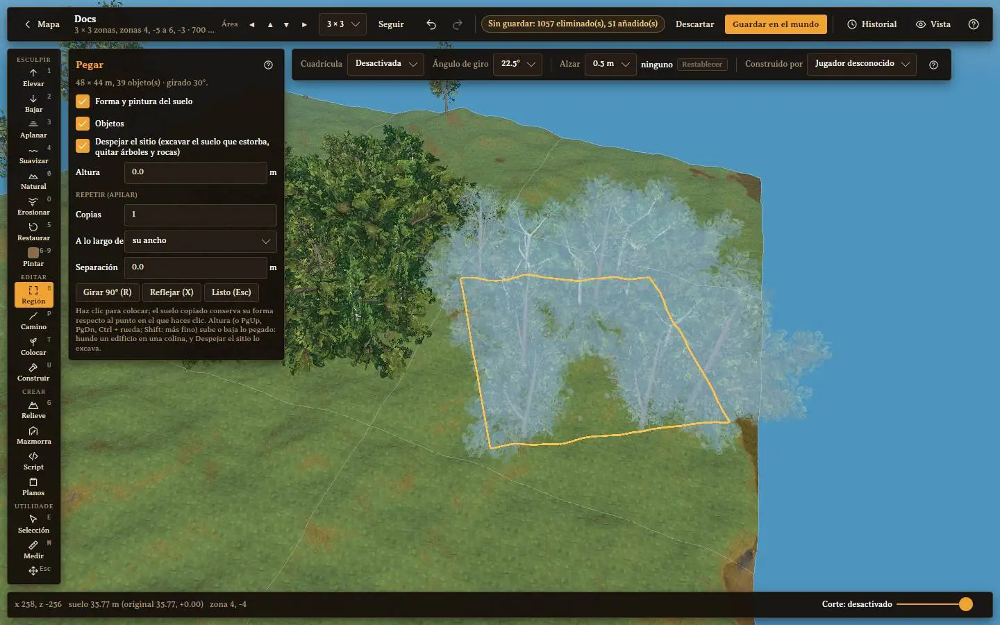
*Un bosque copiado de unas decenas de árboles y rocas siguiendo al cursor, transparente y girado 30°; la línea de
arriba del panel Pegar dice qué hay en el portapapeles. Un clic lo coloca.*

El grupo **Copia** muestra estos botones. `Ctrl+C` y `Ctrl+X` funcionan con cualquier acción de la herramienta
Región (y en la herramienta Selección); `Ctrl+V` funciona en cualquier herramienta.

| Ajuste | Qué hace |
|---|---|
| **Copiar (Ctrl+C)** | Copia todos los objetos visibles de dentro (digan lo que digan las fichas de tipo), y el suelo sobre el que se alzan sus construcciones. Al pegarlos, los árboles, rocas y similares conservan su altura sobre el suelo donde cae cada uno; las piezas de construcción conservan la forma del edificio. Los tipos que el mundo no puede crear se dejan fuera. La copia se recuerda: pégala en otra área, en otro mundo o después de reiniciar el editor. |
| **Cortar (Ctrl+X)** | La misma copia, y luego los objetos copiados salen del mundo (`Ctrl+Z` los recupera), así que pegar los mueve. El suelo se queda. |
| **Pegar (Ctrl+V)** | Empieza a pegar: la copia sigue al cursor; haz clic para colocarla. Pega tantas como quieras; `Esc` termina. |
| **Guardar plano…** / **Planos…** | Ver [Planos](#planos). |

La línea bajo los botones dice qué hay en el portapapeles («Portapapeles: 24 × 18 m, 54 objeto(s).», con el nombre
del plano cuando viene de la biblioteca). Una selección sin objetos visibles dentro no copia nada (su suelo solo va
con las construcciones): la barra de estado lo dice, y el portapapeles conserva lo que tenía.

Una copia contiene:

- **Los objetos, con todos sus datos**: el contenido de un cofre, el texto de un cartel, su salud, quién los construyó.
- **Solo el suelo bajo las construcciones**: bajo cada pieza de construcción más 1 m, atenuándose a lo largo de 3
  metros más. El resto del suelo de la selección no se copia, así que un pueblo pegado se asienta en el terreno donde
  cae.
- **Alturas de dos maneras.** Los árboles, rocas y demás naturaleza conservan su altura sobre el suelo y siguen el
  suelo donde cae cada uno. Las piezas de construcción y las partes de un grupo enlazado (el barco de un mod) conservan
  la forma del edificio, medida desde el suelo medio de la copia, que va a la altura del suelo donde haces clic.

La copia de la herramienta [Selección](select.md) contiene solo los objetos que seleccionaste, y el suelo bajo sus
piezas de construcción sin su pintura. Se pega de la misma forma.

### Pegar

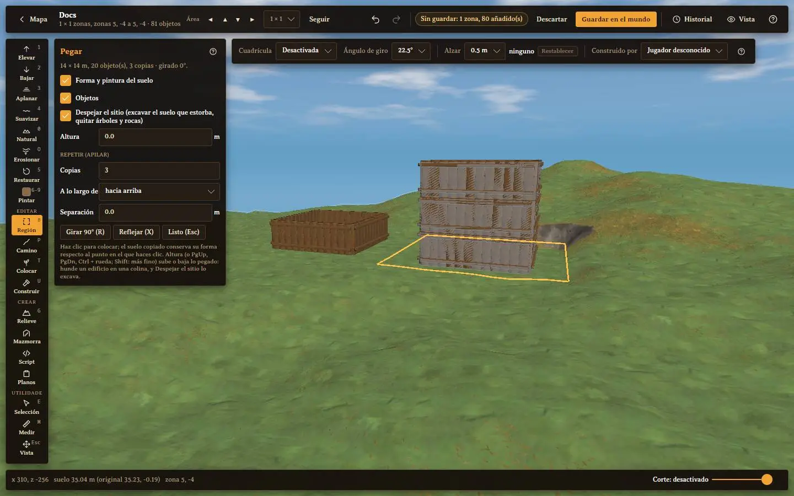
*Un clic con **Copias** en 3 y **A lo largo de** en hacia arriba, visto desde el suelo: junto a la cabaña original, tres
copias apiladas en tres plantas (el contorno es el siguiente pegado, que sigue al cursor).*

Lo pegado debe caber en el área abierta: su contorno se pone rojo cuando no cabe, y un clic ahí lo dice. Abre antes un
área más grande (la lista de tamaño del área en la barra superior, o el [mapa](map.md)).

| Ajuste | Qué hace |
|---|---|
| **Forma y pintura del suelo** | Pega el suelo bajo las construcciones, manteniendo su forma respecto al punto donde haces clic, más allá de los ±8 m del juego cuando hace falta. Un edificio se alza sobre el suelo en el que se construyó. |
| **Objetos** | Pega los objetos copiados. |
| **Despejar el sitio (excavar el suelo que estorba, quitar árboles y rocas)** | Activado al principio. Excava el suelo que estorba a las piezas de construcción pegadas hasta la pieza más baja (nunca eleva el suelo), y quita los árboles, rocas, minerales, arbustos y recolectables de su huella. Las construcciones y las criaturas se quedan. |
| **Altura** | Sube o baja lo pegado (m); `PgUp`, `PgDn` y `Ctrl` + rueda también. Baja un edificio dentro de una colina y Despejar el sitio lo excava. |

Bajo **REPETIR (APILAR)**:

| Ajuste | Qué hace |
|---|---|
| **Copias** | Cuántas copias coloca un clic, de 1 a 50, todas en un solo paso de deshacer. |
| **A lo largo de** | En qué dirección se suceden: **su ancho** o **su profundidad** (estos giran y se reflejan con lo pegado), o **hacia arriba** (plantas apiladas). |
| **Separación** | Espacio entre dos copias (m); un valor negativo las superpone. Hacia arriba, el tamaño de una copia es su altura más un metro. |

Abajo del panel:

| Ajuste | Qué hace |
|---|---|
| **Girar 90° (R)** | Un cuarto de vuelta. `,` y `.` giran según el paso **Ángulo de giro** de la barra de construcción (`Shift`: 1°). |
| **Reflejar (X)** | Refleja lo pegado de este a oeste, antes de girar. |
| **Listo (Esc)** | Termina de pegar y vuelve a la herramienta Región. |

Mientras pegas, [la barra de construcción](build.md#la-barra-de-construcción) aparece junto al panel, la misma que usan
Construir y Selección: **Cuadrícula** (lo pegado se ajusta a ella), **Ángulo de giro** y **Alzar** (los pasos de `,`
`.` y de `PgUp` `PgDn`; la barra muestra la altura, **Restablecer** la devuelve a cero) y **Construido por**.

Las copias una al lado de otra se asientan cada una sobre el suelo donde caen; apiladas hacia arriba, solo la primera
da forma al suelo. La línea de arriba del panel dice qué hay en el portapapeles: nombre, tamaño, objetos, copias, giro,
reflejado. La barra de estado dice lo que hizo el pegado: «Pegado con el suelo, 54 objeto(s), 7 árbol(es), roca(s) y
similares retirados del sitio.»

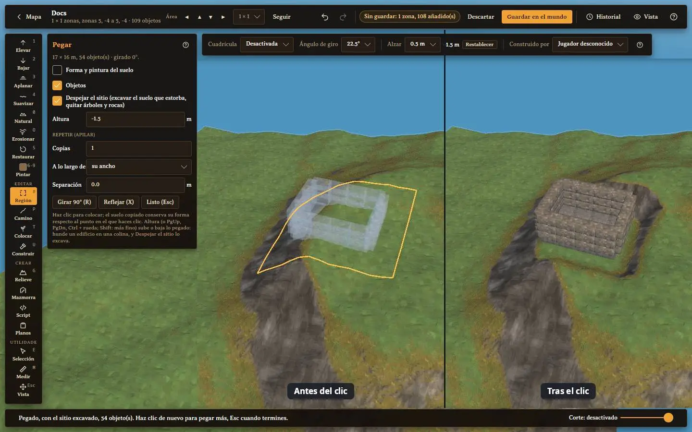
*Con **Despejar el sitio** activado (**Forma y pintura del suelo** desactivado, **Altura** -1.5 m): a la izquierda, la
copia transparente hundida en la ladera de un montículo; a la derecha, después del clic, el suelo excavado alrededor de
sus paredes.*

## Planos

Un plano es una construcción guardada como archivo, para pegarla en cualquier mundo o construirla en el juego con
[Homestead](https://thunderstore.io/c/valheim/p/sighsorry/Homestead/). La biblioteca, el Taller y la comprobación de
soporte están en [El Taller](workshop.md).

| Ajuste | Qué hace |
|---|---|
| **Guardar plano…** | Guarda los objetos del portapapeles (lo último que copiaron Región o Selección) como un plano de Homestead, con un nombre, una descripción y etiquetas, e indicando si es una mazmorra (consulta [Mazmorras](dungeons.md)). El suelo y los constructores no se conservan. Un plano con el mismo nombre se reemplaza, tras preguntar. |
| **Planos…** | Abre la biblioteca (también **Planos** en la barra de herramientas). **Pegar** pone un plano en el portapapeles y empieza a pegar. |

Las piezas pegadas conservan lo que contiene el plano (textos de carteles, objetos en soportes, contenido de cofres) y
quedan construidas por el jugador elegido en **Construido por** en [la barra de construcción](build.md#la-barra-de-construcción)
(las piezas que no construyó nadie siguen así). Los tipos que el juego no conoce (mods no instalados) se dejan fuera, y
el editor dice cuáles. Un plano de mazmorra va 5000 m hacia arriba, detrás de una entrada en el suelo donde haces clic,
como el juego guarda sus mazmorras.

## Atajos

| Tecla o ratón | Qué hace |
|---|---|
| `B` | Elegir Región. |
| Arrastrar (Recuadro) / clic en las esquinas (Polígono) | Dibujar la selección. |
| Doble clic o `Enter` | Cerrar el polígono. |
| `Backspace` | Quitar la última esquina del polígono. |
| `Enter` | Hacer la acción elegida. |
| `Enter`, luego `Del` | Con **Objetos** elegido: seleccionar los objetos de dentro y luego eliminarlos (en la herramienta Selección). |
| `Esc` | Borrar la selección; un segundo `Esc` sale de la herramienta. |
| `Ctrl+C` / `Ctrl+X` / `Ctrl+V` | Copiar / cortar la selección / pegar. |
| Mientras pegas: `R`, `X` | Girar 90°, reflejar. |
| Mientras pegas: `,` `.` o `Alt`+rueda | Girar según el paso **Ángulo de giro** de la barra de construcción, 22.5° al principio (`Shift`, más fino: 1°). |
| Mientras pegas: `PgUp` / `PgDn` o `Ctrl`+rueda | Altura según el paso **Alzar** de la barra de construcción, 0.5 m al principio (`Shift`, más fino: una quinta parte). |
| Mientras pegas: `Esc` | Listo. |

## Consejos y límites

- **Dibuja la selección unos metros más ancha que las construcciones**: el suelo copiado se atenúa dentro del **Borde
  suave**, así que una construcción cerca del contorno se lleva menos de su suelo.
- **Un pueblo grande necesita un área grande**: elige 9 × 9 o más en la lista de tamaño del área antes de pegar.
- **Los objetos pegados son objetos nuevos** con todos los datos copiados, así que un pegado también funciona en otro
  mundo. Los grupos enlazados (el barco de un mod) reciben ids nuevos propios. En vivo, un **Cortar** pegado después
  mueve los objetos en el juego en marcha cuando puede (consulta [Modo en vivo](live-mode.md)).
- **Ninguna acción toca la línea de puntos más exterior del área** (ver
  [El borde bloqueado](concepts/areas-and-zones.md#el-borde-bloqueado)).
- **Para deshacer una acción**, `Ctrl+Z`, también después de guardar (luego vuelve a guardar: el
  [Historial](concepts/saving-and-history.md#historial) se mantiene); para un cambio más antiguo que el historial,
  [Restaurar un área desde una copia de seguridad](guides/restore-from-backup.md).

## Relacionado

- [Despejar árboles y rocas y nivelar un solar](guides/clear-an-area.md)
- [Restaurar un área desde una copia de seguridad](guides/restore-from-backup.md)
- [Mover o copiar un edificio](guides/move-a-building.md)
- [Volver a generar zonas](guides/reset-zones.md)
- [Objetos](concepts/objects.md), [Copias de seguridad](concepts/saving-and-history.md#copias-de-seguridad)
- [Cómo despeja su sitio un pegado](concepts/objects.md#cómo-despeja-su-sitio-un-pegado), [cómo decide Regenerar lo que crece](concepts/objects.md#cómo-decide-regenerar-lo-que-crece)
