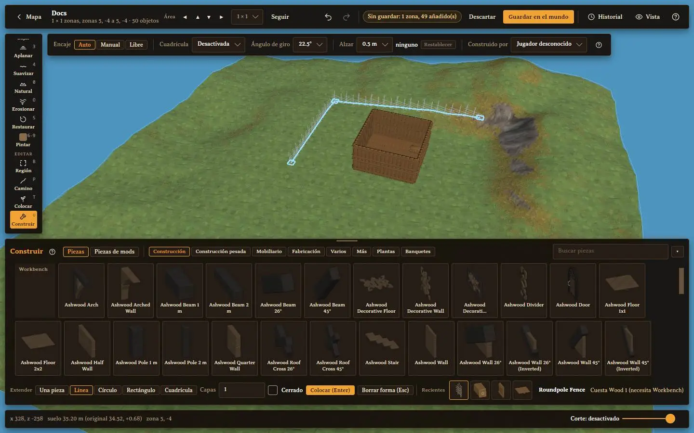
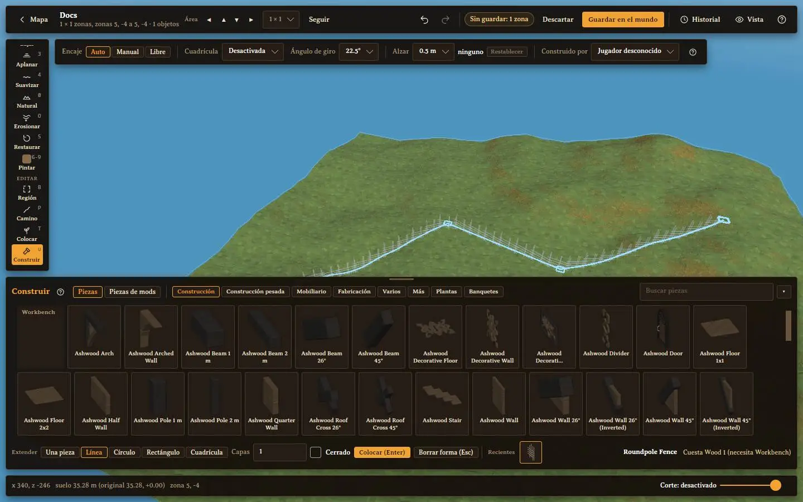
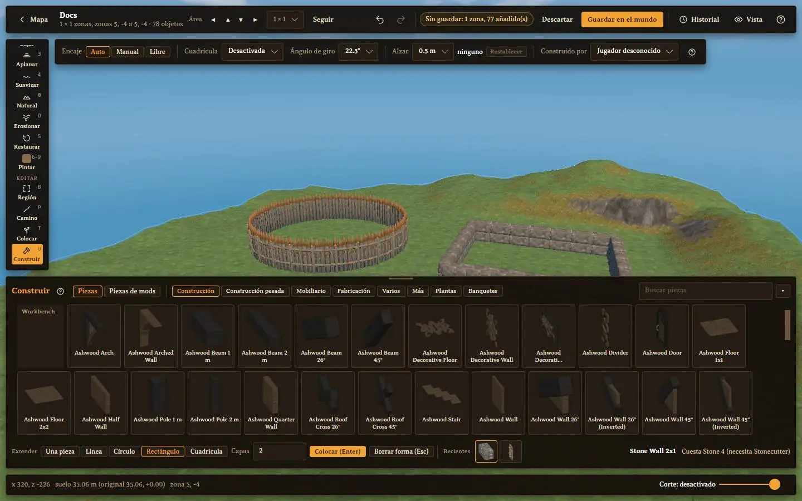
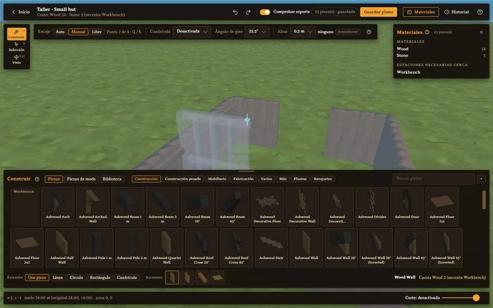

<!-- source: 1f261984 -->
# Construir

Coloca las piezas que construyen los jugadores (paredes, suelos, tejados, vallas, muebles, estaciones de fabricación),
de una en una como con el martillo del juego, o a lo largo de una línea, alrededor de un círculo o de un rectángulo, o
en cuadrícula.

**Dónde:** barra de herramientas, sección **EDITAR** · **Tecla:** `U` (en el Taller, también `T`) · **Funciona en:**
mundos guardados, en vivo, el [Taller](workshop.md) y las salas de una mazmorra con [Construir aquí](dungeons.md)

*Construir en un mundo: una cabaña levantada en suelo nivelado y una valla de troncos que se extiende a lo largo de una
línea de tres puntos (**Extender** en **Línea**, mostrada antes de **Colocar (Enter)**). Abajo: el panel Construir con
las piezas de la pestaña **Construcción** y la fila **Extender**. Arriba: la barra de construcción, con **Encaje**,
**Cuadrícula**, **Ángulo de giro**, **Alzar** y **Construido por**.*

## Úsala

Para levantar una pared y una valla en un mundo:

1. Pulsa `U`. El panel **Construir** se abre a lo largo de la parte inferior de la ventana, y
   [la barra de construcción](#la-barra-de-construcción) junto a la barra de herramientas.
2. En el panel, haz clic en una pieza (busca `wall`). Sigue al puntero, transparente, donde la pondría el martillo.
3. Apunta al suelo o a una pieza: la pieza se encaja con las piezas que ya hay. Haz clic para colocarla.
4. Pulsa `,` o `.` para girar la siguiente, y `PgUp` o `PgDn` para subirla o bajarla.
5. Para una valla, elígela; luego, al pie del panel, elige **Extender** → **Línea**, haz clic en puntos del suelo y
   pulsa `Enter`.

Cada clic, fila o `Enter` es un paso de deshacer (`Ctrl+Z`). No se escribe nada en el mundo hasta que pulsas
**Guardar en el mundo** (o **Aplicar en vivo**). Para mover, girar o eliminar piezas, usa [Selección](select.md), que
comparte la barra de construcción.

Los árboles, las rocas, los cultivos por campos y los puntos de aparición se colocan con [Colocar](place.md), no con
Construir.

## El panel Construir

El panel ocupa la parte inferior de la ventana. Sus pestañas, su búsqueda, **Recientes**, el costo de la pieza y los
atajos (arrastrar una fila, `Shift` + clic derecho para quitar una pieza, clic central para construir con el tipo de
una pieza) son iguales en todas partes: consulta [El panel Construir](workshop.md#el-panel-construir) en la página del
Taller.

Lo que cambia según el lugar:

| Dónde | El panel |
|---|---|
| El terreno abierto de un mundo | **Piezas** y **Piezas de mods**. Sin **Biblioteca**: pega un plano con el [panel Planos](workshop.md#panel-planos). La [Máscara](masks.md) no se aplica a Construir. |
| El Taller | **Piezas**, **Piezas de mods** y **Biblioteca**; **Materiales** cuenta lo que cuesta la construcción. Sin **Construido por**: un plano no guarda constructor. |
| Una mazmorra (**Construir aquí**) | **Piezas** y **Piezas de mods**, de una en una: las líneas y la cuadrícula de **Extender** se dibujan en el suelo, muy por debajo de las salas de una mazmorra. |

La barra de herramientas y los paneles de la derecha terminan encima del panel; la barra de herramientas se desplaza
con la rueda. Pliega el panel con **▾** para tener más espacio.

## Extender piezas a lo largo de una línea o en cuadrícula

**Extender**, al pie del panel, elige cómo se coloca la pieza elegida. Se conserva para la próxima vez.

| Extender | Qué hace |
|---|---|
| **Una pieza** | Una pieza donde apuntas, como con el martillo. Arrastra para extender una fila. |
| **Línea** | Haz clic en puntos del suelo: la pieza se extiende una tras otra por tramos rectos entre ellos, cada una unida a la anterior por sus puntos de encaje (una valla, una pared, un camino de suelos). Arrastra un punto para moverlo, arrastra la línea para añadir uno, `Ctrl` + clic quita uno, `Backspace` el último. **Cerrado** vuelve al primer punto, para vallar un patio. |
| **Círculo** | Pulsa en el centro y arrastra hacia fuera. El tamaño se redondea para que piezas enteras cierren el anillo. |
| **Rectángulo** | Pulsa en una esquina y arrastra hasta la opuesta. Los lados se rellenan desde las esquinas para que las esquinas se unan. |
| **Cuadrícula** | Pulsa en una esquina y arrastra hasta la otra: una pieza en el centro de cada celda, separadas por **Espaciado** (2 m para los suelos de 2 m del juego), tantas celdas enteras como quepan. `,` y `.` giran toda la cuadrícula. |

| Ajuste | Qué hace |
|---|---|
| **Capas** | Línea, Círculo y Rectángulo: la línea apilada de 1 a 20 piezas de alto (una pared de 3 de alto, una valla doble). |
| **Espaciado** | Cuadrícula: la distancia entre piezas, de centro a centro, de 0.5 a 30 m. |
| **Colocar (Enter)** | Coloca lo que muestra la vista previa transparente, como un solo paso de deshacer. Un doble clic en el último punto de una línea hace lo mismo. |
| **Borrar forma (Esc)** | Quita la línea, la figura o el rectángulo dibujado. Se queda después de colocar, con la vista previa vacía, hasta que la borras. |

*Una valla extendida pieza tras pieza a lo largo de una línea que pasa por cuatro puntos, transparente hasta que
`Enter` la coloca.*

*Un **Círculo** (un anillo de empalizadas) y un **Rectángulo** (muros de piedra, **Capas** 2), cada uno colocado con
`Enter`.*

- Una línea que empieza a menos de 1 m de una pieza ya colocada la continúa, a su altura (con **Encaje** en **Auto**
  o **Manual**).
- En una pendiente, las piezas se mantienen niveladas y suben o bajan por escalones con el suelo, como una valla que
  sube una colina. Para una pared uniforme, aplana antes el suelo a lo largo de la línea ([Camino](path.md), Aplanar).
- El alzado (`PgUp`, `PgDn`) eleva toda la línea o la cuadrícula sobre el suelo: un suelo extendido a 2 m de altura es
  un tejado.
- Como mucho 2000 piezas por línea o cuadrícula.

## La barra de construcción

La barra junto a la barra de herramientas contiene los ajustes de construcción. Es una sola barra para **Construir**,
[Selección](select.md) y [Pegar](area.md#copiar-y-pegar): lo que ajustas en una vale en las demás, y se conserva para
la próxima vez. Cada herramienta muestra las partes que usa. En una ventana estrecha, la barra pasa a dos filas.

| Ajuste | Construir | Selección | Pegar |
|---|---|---|---|
| **Encaje** | **Auto** (el valor predeterminado): la pieza se encaja con las piezas que ya hay, como con el martillo. **Manual**: solo uno de sus puntos de encaje se une a los demás, con un alcance de 1.5 m; `Q` y `E` eligen cuál, marcado en la pieza (`Punto 2 de 8 · Q / E`). **Libre**: se queda donde toca lo que apuntas. | **Auto**: las piezas movidas se encajan con las piezas de alrededor, a menos de 0.75 m. **Libre**: se quedan donde las arrastras. | No se usa. |
| **Cuadrícula** | **Desactivada** (como en el juego), **0.5 m**, **1 m** o **2 m**: un punto del suelo se redondea a esta cuadrícula, contada desde el centro del área. Una pieza apuntada a otra pieza se encaja como siempre. | Las piezas arrastradas por el suelo que no se encajan siguen la cuadrícula. | Lo pegado sigue la cuadrícula. |
| **Ángulo de giro** | Cuánto giran la pieza `,` y `.` (o `Alt` + rueda): **1°**, **15°**, **22.5°** (el paso del juego, el valor predeterminado), **45°** o **90°**. | Las mismas teclas giran la selección. | Las mismas teclas giran lo pegado. |
| **Alzar** | Cuánto suben la pieza `PgUp`, `PgDn` o `Ctrl` + rueda: **0.1 m**, **0.25 m**, **0.5 m** (el valor predeterminado) o **1 m**. La barra muestra el alzado (`+1.5 m`); **Restablecer** lo devuelve a cero. | Las mismas teclas suben la selección. | Las mismas teclas suben o bajan lo pegado (su **Altura**); **Restablecer** lo devuelve a cero. |
| **Construido por** | El jugador que se escribe como constructor de las piezas que colocas. | El constructor que escriben **Marcar como construido por jugador** y **Reemplazar**. | El constructor de las piezas pegadas. |

**`Shift` siempre hace un paso más fino**, en las tres herramientas: `,` y `.` giran 1°, y el alzado avanza una quinta
parte de su paso (0.1 m con 0.5 m). `R` gira un cuarto de vuelta en las tres, sea cual sea el paso.

Mantén `Alt` mientras construyes para colocar una pieza de cuarto en cuarto de metro, sin encaje, sea cual sea el
ajuste de **Encaje** (como al mantener `Alt` en el juego, con un paso). Consulta [Encaje](concepts/objects.md#encaje).

***Encaje** en **Manual**, `E` pulsada una vez: la barra indica `Punto 2 de 4 · Q / E`, y la pared transparente que
sigue al puntero se une a la pared de la cabaña por su esquina superior, marcada con una cruz.*

### Construido por

**Construido por** enumera los jugadores que construyeron en este mundo (con su número de piezas), los jugadores
nombrados en camas, guardas y lápidas, y los personajes de este equipo, marcados con «(este equipo)». Al principio
elige al jugador con más piezas; si no hay, tu propio personaje; si no, un jugador nombrado en el mundo. **Otro id de
jugador…** pide cualquier id (un número entero). **Nadie (no construido por jugador)** coloca las piezas sin
constructor, como partes de una ruina. Si no se conoce ningún jugador, las piezas reciben **Jugador desconocido** (id
1): las guardas y los cofres privados no obedecen entonces a nadie, así que elige tu propio id cuando puedas. La
elección se recuerda para cada mundo.

No está en la barra en el Taller: un plano no guarda constructor, y sus piezas reciben el suyo cuando se pega. Por qué
importa el constructor: consulta [Piezas construidas por jugadores](concepts/objects.md#piezas-construidas-por-jugadores).

## Atajos

| Tecla o ratón | Qué hace |
|---|---|
| `U` | Abre Construir (en el Taller, también `T`). |
| Clic | Coloca la pieza (**Una pieza**); añade un punto (**Línea**). |
| Arrastrar | **Una pieza**: una fila de la pieza. **Círculo**, **Rectángulo**, **Cuadrícula**: lo dibuja. |
| `,` `.` o `Alt` + rueda | Gira la pieza según el **Ángulo de giro** de la barra (`Shift`: 1°). En **Cuadrícula**: toda la cuadrícula. |
| `R` | Gira lo mismo un cuarto de vuelta. |
| `PgUp` / `PgDn` o `Ctrl` + rueda | Sube o baja la pieza según el **Alzar** de la barra (`Shift`: una quinta parte). |
| `Alt` (mantenida) | Coloca de cuarto en cuarto de metro, sin encaje. |
| `Q` / `E` | Encaje **Manual**: el punto de encaje anterior / siguiente de la pieza. |
| `Shift` + clic derecho | Quita la pieza que hay bajo el puntero. |
| Clic central | Construye con el tipo de la pieza que hay bajo el puntero. |
| `Enter` | Coloca la línea, la figura o la cuadrícula. |
| `Backspace` | Quita el último punto de la línea. |
| `Esc` | Borra la línea, la figura o la cuadrícula; si no hay nada dibujado, vuelve a **Vista**. |
| `Ctrl+Z` | Deshace la última pieza, fila o línea. |

Todas las teclas del editor están en [Atajos](help/shortcuts.md).

## Consejos y límites

- **Deshacer:** `Ctrl+Z` deshace una pieza, una fila o una línea entera, también después de guardar (luego guarda de
  nuevo). Consulta [Deshacer cambios](guides/undo-changes.md).
- Las piezas solo van dentro del área abierta, no en su línea de puntos más exterior.
- El editor no comprueba que las piezas se sostengan en un mundo: usa la [comprobación de
  soporte](workshop.md#comprobación-de-soporte) del Taller para una construcción que quieras conservar, o constrúyela allí y
  pégala.
- Las piezas nuevas están como nuevas: salud completa, cofres vacíos. Para llenar un cofre, consulta
  [Cambiar lo que contiene un cofre](guides/fill-a-chest.md).
- La pestaña **Plantas** contiene los retoños y los cultivos del cultivador, de uno en uno o en **Cuadrícula**;
  [Colocar](place.md) también los tiene, con su pincel, y respeta el espacio que necesitan para crecer.

## Relacionado

- [Diseñar una casa y guardarla como plano](start/first-build.md)
- [Taller](workshop.md): la parcela, la Biblioteca, Materiales, la comprobación de soporte
- [Selección](select.md) · [Colocar](place.md) · [Región, copiar y pegar](area.md)
- [Encaje](concepts/objects.md#encaje) · [Piezas construidas por jugadores](concepts/objects.md#piezas-construidas-por-jugadores)
