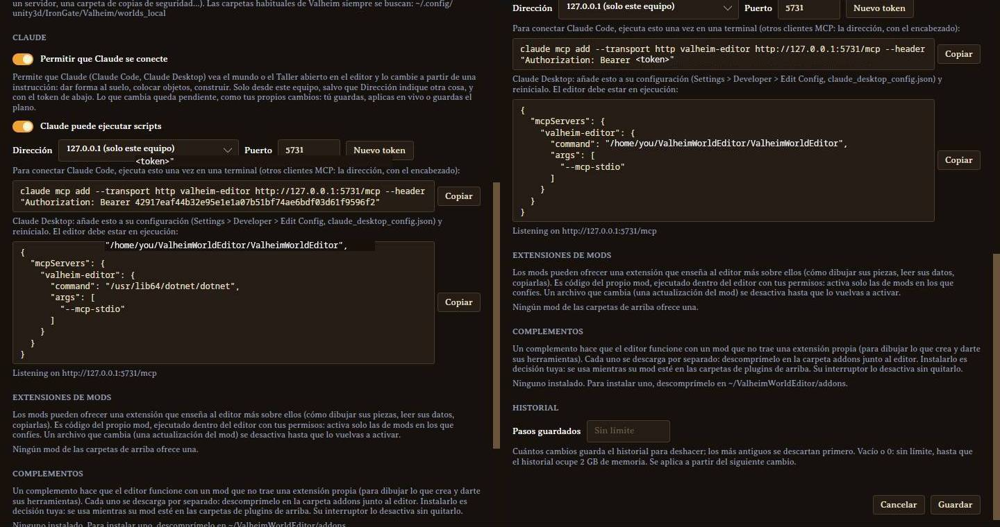
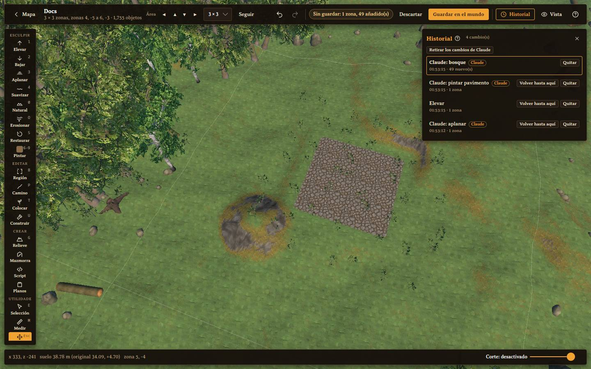

<!-- source: 3de08343 -->
# Claude

Deja que Claude (en Claude Code, Claude Desktop u otro cliente MCP) dé forma al suelo, plante, construya y genere
mazmorras en el mundo o el Taller que tienes abierto, a partir de una instrucción, mientras lo ves en la vista 3D.

**Dónde:** página de inicio, **Configuración** → **Claude** · **Tecla:** ninguna · **Funciona en:** mundos guardados,
en vivo (con **Auto** desactivado), el Taller


*Izquierda: la sección **Claude** activada y a la escucha; copia el comando en una terminal (Claude Code) o las líneas
en la configuración de Claude Desktop. Derecha: el final de Configuración, con **Guardar**. Tu comando lleva tu propio
token donde esta imagen dice `<token>`, y las líneas la ruta de tu propio programa.*

Todo lo que cambia Claude queda **pendiente**, como tus propios cambios: un paso del Historial cada uno (`Ctrl+Z` lo
deshace), contado en la barra superior. Claude nunca guarda un mundo ni aplica nada a un juego en vivo: lo haces tú,
cuando te gusta lo que ves. Para configurarlo paso a paso, ver [Dejar que Claude modele o construya](guides/connect-claude.md).

## Úsalo

1. En **Configuración**, en la página de inicio, activa **Permitir que Claude se conecte** y pulsa **Guardar**.
2. Añade el editor a Claude una vez: ejecuta el comando que muestra Configuración (Claude Code), o añade sus líneas a
   la configuración de Claude Desktop.
3. Abre un área de un mundo o el Taller (o pide a Claude que abra uno).
4. Pide a Claude lo que quieras ([Pedir](#pedir)) y mira cómo trabaja en la vista 3D.
5. Conserva lo que te guste: **Guardar en el mundo**, **Aplicar en vivo** o **Guardar plano**. Deshaz lo que no te
   guste con `Ctrl+Z`, **Descartar** o **Retirar los cambios de Claude** en el Historial.

## Ajustes

En **Configuración** (en la página de inicio), sección **Claude**:

| Ajuste | Qué hace |
|---|---|
| **Permitir que Claude se conecte** | Activado: el editor acepta las peticiones de Claude, solo desde este equipo (salvo que **Dirección** diga otra cosa), de quien tenga el token. Desactivado: nada puede conectarse. |
| **Claude puede ejecutar scripts** | Activado: Claude puede ejecutar scripts de C#, como hace la herramienta [Script](scripting.md), y cada uno se te muestra antes para que lo ejecutes o lo rechaces. Un script es un programa con tus permisos en este equipo, incluidos tus archivos. Desactivado (por defecto): los scripts de Claude se rechazan; sus demás herramientas siguen funcionando. |
| **Dirección** | Desde dónde puede conectarse Claude: elige una de la lista o escribe una dirección. `127.0.0.1 (solo este equipo)`, la predeterminada; `0.0.0.0 (todas las redes)`; o una de las redes de este equipo con su dirección (`192.168.1.20 (Ethernet)`): solo esa red. Con todas las redes, una línea bajo el comando da las direcciones que usa otro equipo: el nombre de este equipo (`http://my-pc.local:5731/mcp`), si la red responde a nombres `.local` (mDNS), y su dirección en cada red (`http://192.168.1.20:5731/mcp`), que siempre funciona pero cambia cuando la red le asigna otra. Consulta [Seguridad](#seguridad). |
| **Puerto** | El puerto al que se conecta Claude: 5731 al principio, de 1024 a 65535. Cámbialo si otro programa usa el 5731. |
| **Nuevo token** | Crea otro token. En cuanto pulsas **Guardar**, el antiguo deja de funcionar: vuelve a añadir el editor a Claude con el nuevo comando. |
| Comando de Claude Code, **Copiar** | El comando que añade el editor a Claude Code. Contiene el token: no lo compartas. |
| Líneas de Claude Desktop, **Copiar** | Las líneas que hay que añadir a la configuración de Claude Desktop. |

Después de **Guardar**, la sección muestra «Listening on http://127.0.0.1:5731/mcp» (a la escucha en esa dirección; en
otra dirección, «Listening on 0.0.0.0:5731, from other computers too», también desde otros equipos), o por qué no pudo
(«Could not listen on 127.0.0.1:5731: …», no se pudo escuchar, cuando el puerto está ocupado, o cuando una dirección de
red ya no es de este equipo).

## Añadir el editor a Claude

**Claude Code:** ejecuta una vez en una terminal el comando que muestra Configuración. Se parece a esto, con tu token:

```sh
claude mcp add --transport http valheim-editor http://127.0.0.1:5731/mcp --header "Authorization: Bearer <token>"
```

En Claude Code, `/mcp` lista entonces **valheim-editor** como conectado mientras el editor está en ejecución.

**Claude Desktop** arranca un programa en lugar de conectarse a una dirección. Añade las líneas que muestra
Configuración a su configuración (Claude Desktop → Settings → Developer → Edit Config, `claude_desktop_config.json`) y
reinícialo:

```json
{
  "mcpServers": {
    "valheim-editor": { "command": "/path/to/ValheimWorldEditor", "args": ["--mcp-stdio"] }
  }
}
```

`--mcp-stdio` no abre ninguna ventana: pasa los mensajes de Claude al editor que está en ejecución (con **Permitir que
Claude se conecte** activado), con el token de su configuración.

**Otros clientes MCP** se conectan a la dirección (HTTP en streaming) con el mismo encabezado `Authorization`.

El editor debe estar en ejecución para que Claude llegue a él.

## Qué puede hacer Claude

Las herramientas de Claude llaman al mismo código que las herramientas y botones del propio editor, así que lo que
crea sigue las mismas reglas del juego que tus ediciones: el límite de 8 m del suelo del juego (solo un script propio
lo supera), el encaje de las piezas de construcción, las zonas, las ubicaciones.
Cada paso que hace se llama «Claude: …» en el Historial y lleva una etiqueta **Claude**. Comprueba su trabajo con
imágenes de la vista 3D y del mapa, y con la comprobación de soporte.

| Claude puede | Sus herramientas |
|---|---|
| Ver lo que está abierto, los mundos de este equipo y las alturas, biomas, agua y objetos de un área; abrir un área de 1 a 17 zonas; buscar en todo el mundo un tipo, un artículo de un cofre o el texto de un cartel; listar el inicio, los comerciantes, los altares y las entradas de mazmorra | `editor_state`, `list_worlds`, `open_world`, `open_area`, `describe_area`, `list_objects`, `ground_at`, `search_world`, `list_locations` |
| Mirar su trabajo: imágenes de la vista 3D (cualquier cámara, o cuatro vistas de un sitio a la vez) o del mapa, un mapa del área desde arriba con una cuadrícula en metros, la comprobación de soporte (qué piezas se caerían) | `screenshot`, `area_map`, `support_check` |
| Usar tu selección, y mostrarte lo que entiende de ella | `get_selection`, `select_objects` |
| Ajustar cualquier control como lo harías tú (los interruptores de Vista, el Corte de la barra de estado, los ajustes de las herramientas, la barra de herramientas) | `list_controls`, `set_control` |
| Consultar las piezas del juego y cómo encajan | `find_prefabs`, `piece_info`, `building_guide`, `list_blueprints` |
| Ver el mundo de una semilla (biomas, inicio, comerciantes, jefes) y crear un mundo nuevo con un nombre y una semilla | `preview_seed`, `create_world` |
| Nivelar, pintar, suavizar, naturalizar, erosionar, restaurar, elevar o bajar el suelo; estampar un sello o una imagen de mapa de alturas; excavar un río, un foso o una rampa a lo largo de una línea, o aplanar, elevar, bajar, suavizar, naturalizar, erosionar o restaurar el suelo a lo largo de ella; trazar una calzada; marcar zonas para restablecer; regenerar los árboles y rocas del juego | `flatten`, `paint_area`, `shape_ground`, `stamp`, `import_heightmap`, `dig_path`, `road`, `reset_zones`, `regrow_nature` (la mayoría aceptan una [Máscara](masks.md)) |
| Plantar árboles o rocas, colocar piezas y objetos (encajan como con el martillo), copiar objetos una vez o en fila o en anillo, cambiar objetos por otro tipo, quitar objetos | `forest`, `place_pieces`, `copy_objects`, `replace_objects`, `remove_objects` |
| Construir un suelo, paredes con puertas y un tejado a dos aguas (26° o 45°, de paja o de tablillas) sobre un rectángulo; abrir el Taller; añadir un plano a la parcela o a un área; guardar la parcela como plano | `build_floor`, `build_walls`, `build_roof`, `place_pieces`, `open_workshop`, `add_blueprint`, `save_blueprint` |
| Mover y girar objetos en grupo, o colocar, inclinar y dar tamaño a cada uno con exactitud; llenar un cofre, vestir un soporte de armadura o un soporte de objetos, escribir un cartel, dar estrellas a una criatura; cambiar la etiqueta de un portal, un constructor, los jugadores permitidos de una guarda, la salud, el combustible, el nivel de una criatura o si está domada | `move_objects`, `set_transform`, `get_object`, `set_object_data`, `set_contents` |
| Generar una mazmorra en la parcela o sobre un punto del mundo detrás de su entrada; listar las salas de una mazmorra del juego; añadir una sala en un extremo abierto, quitar una, cerrar todos los extremos abiertos, poner una puerta | `generate_dungeon`, `list_dungeons`, `dungeon_rooms`, `add_dungeon_room`, `remove_dungeon_room`, `close_dungeon_ends`, `set_dungeon_door` |
| Ejecutar un script (con tu permiso) | `run_script`, `script_reference` |
| Deshacer y rehacer | `undo`, `redo` |

Unas pocas reglas que conviene saber:

- `open_world` se rechaza mientras el mundo abierto o el Taller tienen cambios sin guardar.
- `save_blueprint` guarda la construcción del Taller solo cuando se le pide, y nunca reemplaza un plano salvo que se le
  indique. Volver a guardar un plano conserva su descripción y sus etiquetas.
- `generate_dungeon` rechaza un bioma, un estilo o un material de pared que no conoce, y lista los que sí conoce.
- `move_objects` conserva la forma de una construcción, y una parte de un grupo enlazado de un mod (un barco y sus
  piezas) arrastra a todo su grupo, también en copias y eliminaciones.
- Una mazmorra que Claude genera en la parcela del Taller forma parte de la construcción de la parcela, pendiente como
  el resto; no se añade a tu biblioteca.
- Cuando Claude se conecta, el editor le da una breve guía para trabajar en él, y dos instrucciones listas para usar:
  *build_in_workshop* y *shape_area*.

## Pedir

Abre tú el mundo o el Taller, o pide a Claude que lo haga. Después, por ejemplo:

- «Abre el área alrededor de 1200, -340 y haz un valle con un río que corra hacia el norte, con abedules a lo largo.»
- «Aplana un cuadrado de 40 m en el centro del área, paviméntalo y pon un anillo de antorchas alrededor.»
- «En el Taller, construye una pequeña casa comunal: suelo de piedra, paredes de madera con dos puertas, tejado de
  paja a 45°. Comprueba que se sostiene.»
- «Abre el área alrededor de 800, 950 y genera encima una cripta del Pantano de dos niveles.»
- «Estos árboles que he seleccionado: reemplázalos por hayas.» (Selecciónalos antes; Claude lee tu selección.)

El trabajo del suelo, los bosques y las mazmorras son lo más fácil de pedir. Las construcciones detalladas colocadas
pieza a pieza pueden llevar unas cuantas rondas («el tejado sobresale por el lado este, arréglalo»), o empezar a
partir de uno de tus planos.


*Los pasos de Claude se llaman «Claude: …» y llevan la etiqueta **Claude**; tu propio **Elevar** queda entre ellos. **Retirar los cambios de Claude**, arriba, quita los pasos de Claude y conserva los tuyos.*

## Retirar los cambios de Claude

- `Ctrl+Z` deshace el último paso, sea de Claude o tuyo.
- En el **Historial**, **Quitar** en un paso con la etiqueta **Claude** saca ese paso y conserva todo lo hecho después.
- **Retirar los cambios de Claude** (arriba del Historial, mientras haya cambios de Claude) quita todos los pasos que
  hizo Claude en el historial del área abierta, empezando por el más reciente, y conserva los tuyos, incluso los hechos
  después de los de Claude. La barra de estado dice cuántos se retiraron y cuántos pasos de Claude hechos en otras
  áreas se conservan: abre esas áreas para retirarlos también (ver
  [El historial pertenece al mundo](concepts/saving-and-history.md#el-historial-pertenece-al-mundo)).
- **Descartar** tira todo lo no guardado, también lo tuyo.

Esto también funciona después de guardar o aplicar: el siguiente **Guardar en el mundo** o **Aplicar en vivo** lo
escribe. Consulta [Deshacer un paso, retirar un cambio o descartarlo todo](guides/undo-changes.md).

## Seguridad

- **Solo este equipo.** El editor escucha en `127.0.0.1` (u otra dirección de bucle local que escribas, como `::1`) y
  rechaza cualquier petición dirigida a otro nombre, así que una página web que visites no puede llegar a él. Con otra
  **Dirección**, los equipos de esa red también pueden llegar a él, con cualquiera de los nombres de este equipo y con
  el token. Solo las redes propias de este equipo: un equipo cuya dirección no es local (`10.x`, `172.16`–`172.31`,
  `192.168.x`, de enlace local, IPv6 `fc00::/7`) o que no está en la red en la que escucha el editor se rechaza, así
  que internet nunca llega a él, ni siquiera por IPv6. Con `0.0.0.0`, esas redes son las que tienen una puerta de
  enlace (no las propias de Docker, WSL o Hyper-V, ni un túnel VPN). Una VPN como Tailscale, cuyas direcciones van de
  `100.64.x.x` a `100.127.x.x`, también se acepta cuando este equipo está en ella: escucha en su dirección de Tailscale
  o en `0.0.0.0`, y el otro equipo se conecta a esa dirección. La VPN cifra el trayecto, así que el token no se puede
  leer en la red.
- **Scripts solo desde este equipo.** A un Claude de otro equipo se le rechazan los scripts (`run_script`, el
  Ejecutar de la herramienta Script) aunque **Claude puede ejecutar scripts** esté activado: de lo contrario, quien
  leyera el token en la red podría ejecutar programas con tus permisos. Sus demás herramientas funcionan como aquí.
- **Sin cifrar fuera de este equipo.** La conexión es HTTP simple: con otra **Dirección**, cualquiera en esa red puede
  leer el token y todo lo que se envían el editor y Claude, y con el token, usar el editor. Es un trato razonable en
  una red doméstica de confianza, y Configuración lo dice bajo la dirección en cuanto eliges una. En cualquier otro
  lugar, deja `127.0.0.1` y accede desde otro equipo mediante un túnel SSH, que lo cifra:
  `ssh -L 5731:127.0.0.1:5731 you@this-computer`.
- **El token.** Cada petición debe llevar el token (48 caracteres aleatorios creados para tu editor). **Nuevo token**
  crea otro.
- **Solo cambios pendientes.** Claude nunca guarda, aplica en vivo, descarta, recarga, escribe ni elimina tus
  archivos, ni se conecta a un juego en vivo: ninguna herramienta hace estas cosas, y `set_control` rechaza esos
  controles.
- **Cada script necesita tu permiso.** `run_script` (también las pruebas en seco) y **Ejecutar** de la herramienta
  Script se rechazan hasta que activas **Claude puede ejecutar scripts**. Entonces cada script que escribe Claude se te
  muestra antes de ejecutarse: **Ejecutarlo** o **Rechazar** (Enter y Esc rechazan). Una prueba en seco seguida de la
  ejecución del mismo script en la misma área pregunta una sola vez; cualquier otra ejecución vuelve a preguntar. Las
  demás herramientas de Claude (`flatten`, `road`, `forest`…) ejecutan el propio código del editor y no preguntan.
- **Lo que dice un mundo no es una orden.** Los carteles, las etiquetas de portal y los nombres los escriben los
  jugadores, y un plano o los datos de un mod los escriben otros: a Claude se le indica que los trate como datos. Un
  cartel que intenta dar órdenes a Claude no puede ejecutar un script sin que tú lo veas antes.
- **En vivo con Auto activado: nada.** Mientras el mundo abierto está en vivo con **Auto** activado, cada cambio
  llegaría al juego al instante, así que Claude no cambia nada salvo el panel Vista y te pide que desactives Auto.
- **Desactivado es desactivado.** Desactiva **Permitir que Claude se conecte** y nada podrá conectarse.

Más en [Scripts y Claude](concepts/safety.md#scripts-y-claude).

## Atajos

Claude no añade teclas. `Ctrl+Z` y `Ctrl+Y` deshacen y rehacen sus pasos como los tuyos.

## Consejos y límites

- El editor debe estar en ejecución, con **Permitir que Claude se conecte** activado, para que Claude llegue a él. Si
  no puede, ver [Claude no puede conectarse](help/troubleshooting.md#claude-no-se-puede-conectar).
- Después de **Nuevo token** y **Guardar**, vuelve a ejecutar el nuevo comando de Claude Code (el token antiguo deja de
  funcionar). Claude Desktop lee el nuevo token por sí solo.
- Claude solo ve el área abierta. Pídele que abra otra área, o una más grande, para obras más grandes.

### La habilidad de construcción (Claude Code)

Opcional, para construcciones que deben parecer hechas a mano: el repositorio del editor tiene una habilidad (skill) de
Claude Code, [`.claude/skills/valheim-build`](../../.claude/skills/valheim-build/SKILL.md). Con ella, Claude busca
construcciones reales de Valheim para inspirarse, escribe un breve encargo de diseño, da forma al suelo, prueba las
piezas que no conoce en una pequeña maqueta, construye por fases con ayudantes probados (ventanas en arco, cornisas,
almenas, torres redondas, tejados de teja, salones con entramado de madera) y luego revisa su propio trabajo en busca
de ventanas tapadas, piezas duplicadas y uniones defectuosas. Los interiores reciben estructura, iluminación y
mobiliario; el exterior recibe caminos, luces y plantas.

Claude Code la carga por sí solo cuando trabajas en el repositorio. Para tenerla en todas partes, copia la carpeta a
tus propias habilidades: `cp -r .claude/skills/valheim-build ~/.claude/skills/`. Luego pide como siempre, por ejemplo
«Construye un castillo gótico con foso en el Taller». Lo que sabe de las piezas está en su `references/pieces.md`; las
correcciones son bienvenidas ahí.

## Relacionado

- [Dejar que Claude modele o construya](guides/connect-claude.md)
- [Deshacer un paso, retirar un cambio o descartarlo todo](guides/undo-changes.md)
- [Seguridad](concepts/safety.md#scripts-y-claude): scripts y Claude
- [Script](scripting.md): lo que ejecuta `run_script`
