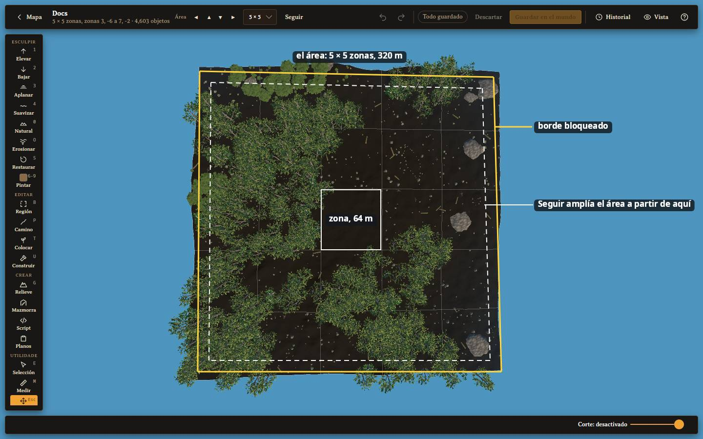

<!-- source: 24741409 -->
# Áreas y zonas

Valheim divide su mundo en **zonas** cuadradas de 64 m, y el editor abre un bloque de ellas a la vez, el **área**.
Esto explica por qué algunos lugares todavía no se pueden guardar, por qué el borde del área nunca se mueve y por qué un
área grande es lenta.


*El área es un bloque de zonas. Su línea exterior de puntos del suelo (amarilla) nunca cambia; con **Seguir**
activado, se añaden zonas cuando el punto que miras cruza la línea discontinua, 12 m hacia dentro.*

## Zonas

Una zona es un cuadrado de 64 × 64 m. La barra de estado nombra la zona bajo el ratón (`zone 20, -6`), **Vista →
Bordes de zona** dibuja sus líneas en 3D y la **Cuadrícula de zonas** del mapa las dibuja en el mapa.

El juego crea una zona la primera vez que un jugador se acerca a ella: sus árboles, rocas y mineral, y la ubicación que
contiene (una aldea, la entrada de una mazmorra). Esto se llama **generar** la zona. Hasta entonces los archivos del
mundo no contienen nada ahí, ni siquiera el suelo. Para ti esto significa:

- **Las ediciones en una zona que nadie ha visitado no se pueden guardar.** El mensaje de guardado las enumera. Pasa
  antes por el lugar en el juego y luego edítalo.
- **Un mundo nuevo está vacío.** El editor puede mostrar el terreno de una semilla antes de que nadie lo juegue, pero no
  hay nada que editar hasta que el juego haya creado las zonas (consulta [Un mundo nuevo](../new-world.md)).
- **El juego decide por zonas.** Dispone una mazmorra por zona, restablece zonas enteras (más abajo), y la línea de
  pendientes cuenta las zonas cuyo suelo cambiaste.

Cada zona contiene 65 × 65 puntos del suelo, uno por metro; las zonas vecinas comparten los puntos de su borde común.
Consulta [Cómo se guarda el suelo](ground-limits.md#cómo-se-guarda-el-suelo).

## El área

El área es el bloque de zonas abierto en el editor 3D: de 3 × 3 a 17 × 17 zonas alrededor del punto que elegiste en el
[mapa](../map.md).

| Tamaño | De lado | Adecuado para |
|---|---|---|
| 3 × 3 | 192 m | Una casa, un campo, ediciones rápidas; el más rápido de abrir. |
| 5 × 5 (el predeterminado) | 320 m | Una base y sus alrededores. |
| 7 × 7, 9 × 9 | 448 m, 576 m | Una aldea, un camino largo, pegar un pueblo. |
| 13 × 13, 17 × 17 | 832 m, 1088 m | Una cordillera, una costa. Lentos de abrir y de dibujar. |

El editor dibuja cada objeto y cada punto del suelo del área, por eso abre un bloque y no el mundo entero. Todo lo que
haces ocurre dentro de él: un pegado, una montaña o un script deben caber en el área abierta, así que abre una más
grande antes de un trabajo grande.

**Tus cambios pertenecen al mundo, no al área.** El editor guarda un único conjunto de cambios pendientes para todo el
mundo. Mueve el área, cambia su tamaño o vuelve al mapa y abre otro lugar: lo que hiciste en otra parte sigue esperando
y se guarda con lo demás. El historial también te acompaña (consulta [Historial](saving-and-history.md#historial)).

Las flechas de la barra superior mueven el área una zona (64 m) cada vez, y la cámara se queda donde está en el mundo.
La lista de tamaños vuelve a abrir el área con otro tamaño alrededor de la misma zona central. Ambas esperan a lo mismo
que espera Seguir y descartan lo mismo que descarta (consulta [Seguir](#seguir)). Abrir otra área vuelve a mostrar los
objetos ocultos.

## El borde bloqueado

La línea exterior de puntos del suelo del área nunca cambia. Ningún pincel, camino, acción de Región, pegado ni script
la mueve, y la herramienta Colocar no pone nada sobre ella.

El motivo: esos puntos se comparten con las zonas justo fuera del área, que el editor no ha cargado. Si el editor los
moviera, el suelo de fuera se encontraría con un escalón o un acantilado que no puede ver. Con el borde bloqueado, el
área siempre se une al terreno que la rodea sin costura. Un script que escribe ahí no se detiene: el cambio simplemente
se omite.

```text
 fuera     │ bloqueado │        lo que puedes editar      │ bloqueado │   fuera
 ──────────┼───────────┼──────────────────────────────────┼───────────┼──────────
           │    1 m    │  todo lo demás del área          │    1 m    │
```

Para trabajar cerca de un borde, mueve el área con las flechas, elige un tamaño mayor o activa **Seguir**.

## Seguir

Con **Seguir** activado (en la barra superior), el área crece sola a medida que trabajas hacia su borde. Cuando el
punto que miras llega a menos de 12 m del borde, se añade una fila de zonas por ese lado, o por los dos cerca de una
esquina. Un área de 3 × 3 pasa a 4 × 3, luego a 4 × 4, y así sucesivamente.

Seguir solo añade zonas, nunca quita ninguna, así que nada de lo que estás trabajando sale del área. Se detiene en 17
zonas en cada dirección (alrededor de 1 km) y lo avisa; entonces mueve el área con las flechas o abre otro lugar desde
el mapa.

Seguir espera, y la barra de estado dice por qué, mientras crecer haría perder algo: el mundo se está guardando o
leyendo, hay objetos seleccionados, hay un trazo de pincel en curso, hay un camino dibujado y sin aplicar, o todavía se
están enviando cambios a un juego en vivo. No espera por un recuadro de Región, una línea, cuadrícula o polígono de
Colocar ni una medición: al crecer se descartan.

## Restablecer zonas

Un restablecimiento hace que el juego vuelva a generar una zona, como si nadie hubiera estado nunca allí. Úsalo para
tener el contenido nuevo de una actualización de Valheim en lugares donde nadie ha construido, o para recuperar un
bosque o una mazmorra. Marcas las zonas con la herramienta [Región](../area.md) o en todo el mundo desde el
[mapa](../map.md); no ocurre nada hasta que guardas o aplicas en vivo.

Cuando se escribe el restablecimiento:

- **Todo lo que hay en la zona desaparece**: árboles, rocas, mineral, recolectables, ruinas, entradas de mazmorra y sus
  salas, generadores, objetos tirados y criaturas, incluidos los animales domados (sácalos antes).
- **Algunas cosas se quedan**: las lápidas de los jugadores, siempre; las piezas construidas por jugadores con
  **Conservar mis construcciones** activado (en el mapa, las zonas que contienen alguna se omiten entonces por completo;
  desactivado, las construcciones desaparecen con lo demás); las ediciones del suelo, salvo que elijas deshacerlas
  también.
- **El juego la vuelve a crear** la próxima vez que un jugador se acerca: vegetación nueva, y su ubicación construida de
  nuevo en su sitio, con botín y criaturas nuevos. En vivo, una zona con un jugador cerca se vuelve a crear al instante.

Una zona cuenta como seleccionada cuando el contorno de la selección abarca al menos uno de sus puntos del suelo, sea
cual sea el borde suave, así que una selección que entra en una zona, aunque sea un poco, la restablece.

Un restablecimiento no se puede deshacer una vez guardado o aplicado; hasta entonces, cancela o deshaz la marca. Después
de escribir un restablecimiento, el editor vuelve a leer el mundo, y el historial se conserva sin lo que hizo en las
zonas restablecidas (consulta [Lo que un paso no puede retirar](saving-and-history.md#lo-que-un-paso-no-puede-retirar)).
