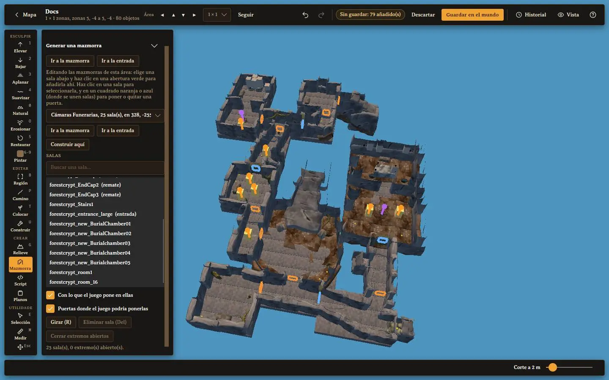

<!-- source: 5e6370cb -->
# Mazmorras

Valheim guarda sus mazmorras de una forma poco habitual: muy arriba en el cielo, como una lista de salas que el juego
construye cuando alguien se acerca. Saberlo explica por qué una mazmorra que nadie ha visitado se ve vacía en el editor,
por qué una mazmorra editada no necesita ningún mod y por qué una mazmorra de piezas de construcción se sostiene a
5000 m de altura. La herramienta [Mazmorra](../dungeons.md) se basa en ello.

## Cómo guarda el juego las mazmorras

**Las mazmorras no están excavadas en el suelo.** Cada una es una **ubicación** en la superficie (el túmulo de una
cámara funeraria, la boca de una Cueva de Escarcha) cuya puerta te teletransporta a la propia mazmorra, **5000 m por
encima** de ella, donde el juego lo trata todo como interior. En el editor la cámara deja de seguir el suelo ahí
arriba, y **Vista → Salas de mazmorra** muestra u oculta las salas.

```text
   5000 m  ┌───────────────┐  las salas de la mazmorra
           │ ▢─▢─▢─▢       │  ◄── su puerta lleva de vuelta abajo
           └───────────────┘
              ▲  teletransporte
   suelo   ───┴─── la entrada (una ubicación: túmulo, boca de cueva, mina)
```

**Una mazmorra del juego es una lista de salas.** El juego construye sus mazmorras con salas prefabricadas. En el
guardado, una mazmorra es un objeto que contiene su **lista de salas**: qué sala, dónde y con qué giro. Cuando un
jugador se acerca, el juego construye las salas a partir de esa lista, contenga lo que contenga, sin comprobarla con sus
propias reglas. Por eso una mazmorra editada funciona en el juego de todos los jugadores sin ningún mod: el editor solo
cambia la lista.

**Hasta que un jugador se ha acercado, la lista está vacía.** El juego dispone una mazmorra la primera vez que alguien
llega, así que antes de eso el editor no tiene salas que mostrar ni editar. Visítala en el juego y luego vuelve a abrir
el área. Las aldeas fuling y las granjas de las Praderas se disponen igual, sobre el suelo.

### Salas, aberturas y remates


*Una mazmorra del juego a 5000 m de altura, sin techos: cada sala es una entrada de la lista. Los cuadrados marcan
dónde se unen dos salas: azules con puerta, naranjas sin ella.*

Cada sala tiene **aberturas**, los vanos por donde se une a la siguiente, y cada abertura es de un tipo: una Cueva de
Escarcha tiene aberturas de cueva normales, aberturas de hielo, aberturas de santuario y otras. El juego solo une
aberturas del mismo tipo, aunque algunas salas (un pasillo de hielo) unen un tipo con otro. Un **remate** es una sala
pequeña que cierra una abertura, para que nada lleve fuera de la mazmorra.

El juego impide que sus salas se solapen y las mantiene dentro del espacio de la mazmorra (en la mayoría de los tipos,
64 × 64 m alrededor del centro de su zona). Una lista que escribe el editor se construye de todos modos, así que el
editor solo avisa cuando una sala rompe esas reglas.

**Qué hay en las salas.** Cuando el juego dispone una mazmorra por primera vez, sortea lo que va en cada sala: cofres,
generadores de criaturas, antorchas, braseros, hielo, decoración. Cada parte tiene su probabilidad, a partir de la
semilla del mundo, el lugar de la sala, el tema de la mazmorra y la altura de la sala. El editor los sortea de la misma
forma, así que una sala que añade viene con lo que el juego habría puesto en ella. Algunas cosas (carámbanos, cristales,
peces) se asientan en la superficie más cercana en el juego, así que pueden quedar un poco distintas de donde las
muestra el editor.

**Puertas.** Donde se unen dos salas, el juego a veces pone una puerta, según su propia probabilidad: las cortinas de
tela y los muros de hielo de una Cueva de Escarcha, las rejas de una cripta, las puertas de las minas. Cada tipo de
mazmorra tiene las suyas para cada tipo de abertura, y la puerta queda en la abertura de la sala que estaba primero.

### Entradas, una por zona

El juego dispone **una mazmorra por zona**, y mantiene libre el espacio sobre una entrada incluso antes de disponer la
mazmorra. Por eso el editor coloca una mazmorra detrás de la entrada del juego solo donde todavía no hay nada ahí
arriba; si no, pon la entrada en otra zona. Una mazmorra de las Llanuras, a la que se llega por un portal, se apila más
arriba en saltos de 50 m cuando el espacio está ocupado.

La entrada de una mazmorra colocada es la ubicación propia del juego para el bioma, escrita como el juego escribe una
ubicación, así que el juego crea su puerta, sus piedras y su acceso cada vez que se carga la zona. La mazmorra va donde
el juego pone la de esa entrada (la de una Cueva de Escarcha, en el centro de su zona), girada para que un jugador que
cruza la puerta llegue mirando hacia dentro. Las Llanuras no tienen mazmorra propia: allí un par de portales enlazados
hace de entrada, uno en el suelo y su gemelo donde llegan los jugadores.

El juego dibuja las mazmorras oscuras, iluminadas solo por sus antorchas. El editor las ilumina como el exterior, para
que veas lo que editas.

## Cómo dispone el generador una mazmorra

El generador puede hacer una mazmorra de dos cosas: **las salas propias del juego** o **piezas de construcción**.

**Con las salas propias del juego**, las une a la manera del juego. Elige la mazmorra del bioma (una cámara funeraria
en las Praderas y la Selva Negra, una cripta hundida en el Pantano, una Cueva de Escarcha en la Montaña y el Extremo
Norte, una mina infestada en las Tierras de niebla), empieza por una de sus salas de entrada y añade salas en las
aberturas libres, con los pesos que usa el juego, donde caben, hasta tener unas 8, 14, 20 o 26 salas según el tamaño.
Remata cada extremo abierto, llena cada sala como lo haría el juego y pone puertas donde se unen las salas según la
probabilidad del juego. El resultado es un objeto de mazmorra con su lista de salas, exactamente como los del juego.
Colocada en el mundo, las salas se disponen a partir del objeto de mazmorra allí donde lo pone la entrada y se mantienen
dentro del espacio de esa zona, como hace el juego: el lugar de su zona en que está la entrada y hacia dónde mira
cambian qué salas caben.

**Con piezas de construcción**, planifica la mazmorra en una cuadrícula de casillas de 2 m, nivel a nivel, y luego la
construye y la amuebla. Las mismas opciones y la misma semilla siempre dan la misma mazmorra. Cada nivel se dispone en
este orden:

| | Qué se dispone |
|---|---|
| **Vestíbulo de entrada** | Abre el primer nivel. Los jugadores llegan ante su muro del fondo, con el nombre de la mazmorra en un cartel a su lado. |
| **El recorrido** | Unas dos de cada cinco salas son, por turnos, las salas principales del estilo (el gran salón, el crucero, la galería y la capilla de una cripta), cada una unida a la anterior, casi siempre en línea recta. |
| **Abajo, o el jefe** | Cada nivel menos el último termina en un hueco de escalera (8 × 24 m) que baja al nivel inferior, 6 m más abajo. El último termina en una antecámara, la arena del jefe (24 × 24 m) y la cámara del tesoro tras ella. |
| **Salas laterales y alas** | Las salas laterales se ramifican, sobre todo desde cruceros y salones largos, elegidas según los pesos del estilo. Una sala lateral suele crecer desde la anterior y tiende a ir con ella: una cocina junto al salón de banquetes, celdas junto a la sala de guardia, una forja junto al taller. |
| **Gemelas** | Las salas laterales suelen tener una gemela reflejada al otro lado de su salón (un templo casi siempre, una madriguera de goblins rara vez), para que la planta se lea como un edificio, con ejes. |
| **Rodeos** | Las salas separadas por tres o más a lo largo del recorrido que quedan cerca se unen, para que haya más de un camino. |
| **Callejones sin salida y alijos** | Uno o dos pasillos no llevan más que a un alijo. Un alijo oculto (dos a partir de 20 salas) queda junto a una sala lateral, tras un muro agrietado o un tapiz. |
| **La llave** | Con el jefe tras una reja, la llave va en un cofre de la sala lateral más alejada de la arena. |
| **Puertas** | La reja del jefe pide la llave; la cámara del tesoro está tras una reja; las celdas tienen rejas más a menudo; las salas nobles tienen a veces grandes rejas dobles; el resto sigue el estilo. Donde bajan escaleras, un vano abierto se convierte en reja, para que lo que vive abajo se quede abajo. |

Las salas varían dentro de esto. Su **tamaño** depende de su tipo (un almacén puede medir 8 × 8 m; un gran salón, de 12
a 20 m de ancho y de 20 a 32 m de largo). Algunas tienen esquinas recortadas, un ábside al fondo o una esquina que
falta. Los **pasillos** van rectos o giran, y algunas salas se tocan muro con muro. Las salas miden 4 m de alto, pero los
grandes salones, las capillas, los salones del trono y la arena pueden subir 10 m, atravesando el nivel de arriba. Las
salas largas pueden tener **hornacinas** en sus lados.

### Por qué se sostiene a 5000 m de altura

En el juego, toda pieza de construcción necesita soporte del suelo, y ahí arriba no hay suelo. Por eso una mazmorra de
piezas de construcción se apoya en **losas de suelo de mármol negro** (8 × 8 m), el suelo y el techo de cada parte en
uso: la única pieza cuyo soporte el juego nunca comprueba (consulta [La comprobación de soporte](objects.md#la-comprobación-de-soporte)).
Todo lo demás se apoya en ellas. Lo que se apoya en un suelo se eleva 5 cm, porque una pieza cuyo centro está justo
sobre una superficie no recibe soporte de ella. Para hacer tu propia mazmorra de piezas, haz lo mismo: suelos de mármol
negro y todo encima de ellos.

Nada de lo que coloca el generador tiene constructor, como en las mazmorras propias del juego, así que el juego lo toma
por una ruina (consulta [Piezas construidas por jugadores](objects.md#piezas-construidas-por-jugadores)).

## Mobiliario, luz y guardianes

Una mazmorra de piezas de construcción se decora sala a sala. **Luz** y **Ruina** sacan sus propios números
aleatorios, así que cambiarlos no cambia nada más de la mazmorra.

**Cada sala se amuebla según su función**, de una de entre dos y cuatro formas elegidas por la semilla:

| Sala | Parte de su mobiliario |
|---|---|
| Salones | Columnatas con un altar; un salón de hidromiel alrededor de un fuego con mesas de caballetes; un salón de los muertos con un sarcófago sobre un estrado; un salón vacío de pilares caídos. |
| Capillas | Bancos frente a un altar entre estatuas; un altar elevado en un anillo de braseros; una nave de alfombras y velas. |
| Cámaras funerarias, osarios, galerías | Filas de sarcófagos o una tumba sobre un estrado; huesos a lo largo de los muros o amontonados; nichos, estatuas, telarañas. |
| Barracones, almacenes, estudios | Camas o petates alrededor de un fuego; provisiones a lo largo de los muros o estanterías en filas; escritorios y estanterías. |
| Salones de banquetes, salones del trono | Mesas largas, o una mesa presidencial sobre un estrado; columnatas, una sala de guerra, columnas caídas alrededor del estrado. |
| Arenas, santuarios | Un anillo de columnas alrededor del jefe, un trono sobre calaveras o un foso hundido bajo unas cornisas. |
| Cocinas, forjas, talleres | Las estaciones reales del juego: hornos, calderos, fermentadores, fundiciones, la forja negra. |

**Más en el interior.** Una sala noble de piedra puede tener un altillo sobre postes encima de la entrada; una cámara
funeraria puede contener una cripta interior; las hornacinas y los nichos contienen un sarcófago, una estatua o un
barril. Las esquinas reciben pequeños grupos acordes con la sala (un campamento, una comida, el escritorio de un
escriba, una armería), y las salas grandes pueden recibir una **pieza estrella** que aparece una sola vez en toda la
mazmorra: un dolmen, la calavera de un gigante, una fuente de fuegos fatuos. Cada bioma añade sus propias cosas (raíces
en los bosques, lodo y alquitrán en el pantano, carámbanos en la montaña, la plaga de los buscadores en las minas,
pinchos en las Tierras de ceniza), y los pasillos varían: medio derrumbados, flanqueados de huesos, alfombrados,
cerrados por una reja a mitad de camino o con una trampa. Alrededor de una de cada doce salas sencillas queda casi vacía,
con una pieza y una luz en la oscuridad. Con **Mobiliario** en Amueblada o Lujosa, las salas nobles de piedra reciben
baldosas de mármol negro y las estancias de vivienda, tablas de madera, cada una la mitad de las veces.

**Luz según la función.** Las salas se iluminan con antorchas, apliques o braseros con las luces propias del bioma: una
cada 5 m de muro con **Luminosa**, cada 8 m con **Tenue**, cada 12 m con **Oscura** (y entonces solo en las salas que
importan). Las salas nobles se iluminan más de cerca; las salas de los muertos, las celdas, los almacenes y los alijos,
más espaciadas. En catacumbas y prisiones algunos pasillos quedan a oscuras entre salas iluminadas.

**Más hondo es más rico y más peligroso.** Cada nivel hacia abajo tiene una quinta parte más de los monstruos y el
botín del nivel superior: el segundo nivel, 1.2 veces el superior; el sexto, el doble; el decimosexto, cuatro veces.

**Guardianes.** Una sala recibe alrededor de un monstruo por cada 75 m² de suelo según la proporción habitual de su
tipo, por **Monstruos**, por su profundidad, situados lejos de la entrada y mirando hacia ella. El cofre de la llave lo
guarda una de las élites del bioma, las tumbas contienen una y el salón del trono, dos. El **jefe** se coloca siempre
una vez en la arena, como la propia criatura: sin estrellas con **Monstruos** en ninguno, una estrella con × 1, dos
estrellas con × 2 o más. Con **Los monstruos reaparecen** activado, los demás salen de los generadores del juego y
vuelven un tiempo después de morir (consulta [Puntos de aparición](objects.md#puntos-de-aparición)); las salas propias del juego
siempre traen generadores.

**Botín.** Los cofres, el tesoro tirado por ahí y las monedas y lingotes del metal del bioma de la cámara del tesoro
aumentan con **Botín** y con la profundidad. El cofre de la llave contiene la llave de la cripta y algunos objetos de
valor, escritos en el cofre para que el juego no lo llene con su propio botín, y la reja de la llave lleva un cartel:
*Sealed. The key lies within these halls.*

Construida en el juego con Homestead, un plano de mazmorra es solo sus piezas: sin llave en el cofre, sin jefe.
