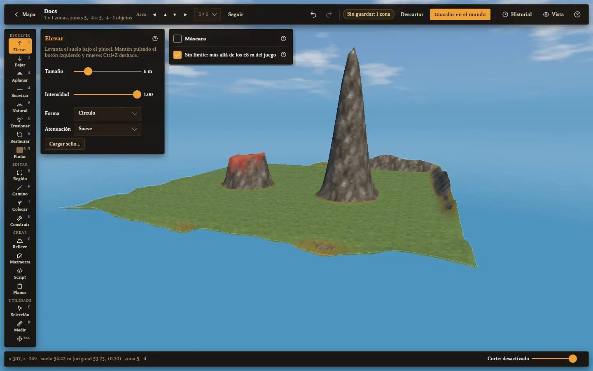
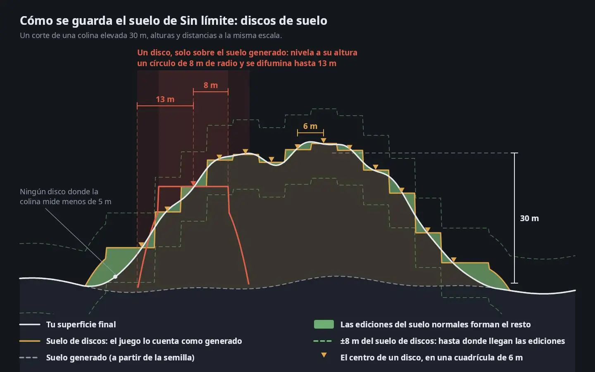
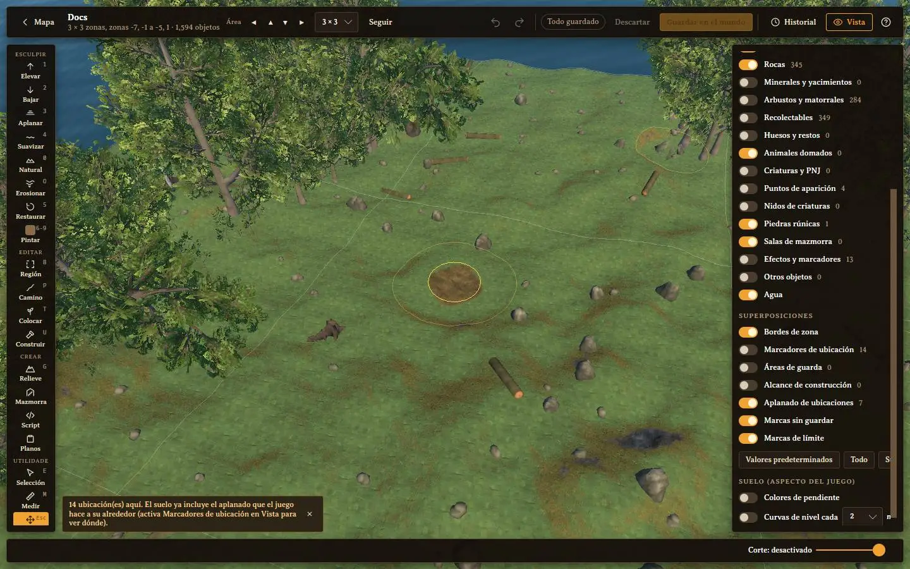

<!-- source: d97e56fa -->
# Límites del suelo

El juego permite que el suelo se mueva como mucho 8 m hacia arriba o hacia abajo respecto a donde lo generó el mundo.
El editor respeta esa regla, así que cada mundo que guarda se carga en el juego de cada jugador, incluidos los de
consola, sin ningún mod. **Sin límite** va más allá de una forma que el propio juego entiende. Esta página explica el
límite, cómo lo sortea Sin límite y cómo dan forma al suelo las ubicaciones del juego.

## El límite de 8 m del juego

El juego no guarda la altura del suelo. Guarda la **semilla** del mundo, calcula a partir de ella el suelo generado y
guarda solo tus **cambios** sobre él: para cada punto del suelo, cuánto se subió o se excavó. Ese cambio puede ser
como mucho de **±8 m** (más un cambio de suavizado de como mucho ±1 m, el que hace la azada del juego). Todo lo que va
más allá se descarta cuando el juego carga la zona. El editor aplica la misma regla, así que un punto que llega al
límite se detiene ahí.

Lo que esto significa en la práctica:

- **Se mide desde el suelo generado, no desde donde está el suelo ahora.** Una colina subida 8 m no puede subir más, y
  un suelo excavado 8 m no puede bajar más, llegues como llegues. La barra de estado muestra ambas alturas bajo el
  ratón: `suelo 41.20 m (original 35.00, +6.20)`.
- **Las grandes obras lo alcanzan primero**: una explanada para construir excavada en una ladera, un río que atraviesa
  terreno alto (necesita su lecho por debajo del mar, consulta [Cómo se guarda el
  suelo](#cómo-se-guarda-el-suelo)), una montaña.
- **Las propias herramientas del juego también lo respetan.** La azada y el pico de un jugador trabajan dentro de ±8 m
  del suelo generado, en el juego igual que en el editor.

```text
        ┌──────────────────────── +8 m: lo más alto que conserva el juego
        │      ╭──╮  el suelo elevado se detiene aquí
  ──────┼─────╯    ╰──────────── suelo generado (la altura «original»)
        │
        └──────────────────────── −8 m: lo más hondo que conserva el juego
```

## Sin límite

El interruptor **Sin límite: más allá de los ±8 m del juego** permite a las herramientas de suelo mover el suelo hasta
400 m respecto al suelo generado: montañas, acantilados, cañones, fosos profundos. Es un único interruptor, en la
tarjeta **Máscara** junto al panel de cada herramienta que controla (los pinceles de esculpir, las fórmulas e imágenes
de Relieve, Camino y Región), y está desactivado cada vez que se inicia el editor. Las montañas de la herramienta
[Relieve](../landform.md) y pegar una copia siempre van más allá del límite cuando lo necesitan, y los scripts también,
salvo que se les indique lo contrario.

Mientras trabajas, la parte que pasa de ±8 m se guarda como una elevación aparte sobre el suelo; deshacer, el
Historial y **Restaurar** la tratan como cualquier otro cambio. La barra de estado dice en qué posición queda el
interruptor cada vez que lo cambias.


*El mismo trazo sin Sin límite y con él. A la izquierda, el suelo se detiene a 8 m de altura y su cima se vuelve roja; a
la derecha, sigue subiendo. El interruptor está en la tarjeta Máscara.*

### Cómo se guarda: discos de suelo

El juego nunca conserva las ediciones del suelo más allá de 8 m, pero sí nivela el suelo bajo sus **ubicaciones**
(aldeas, el campamento del comerciante) sin ningún límite, y cuenta ese suelo nivelado como generado (consulta
[Las ubicaciones nivelan el suelo](#las-ubicaciones-nivelan-el-suelo)). El editor aprovecha esto. Cuando guardas o aplicas en
vivo, convierte el suelo que pasa del límite en **discos de suelo**: ubicaciones invisibles del propio juego, sin
modelo. Cada disco nivela un círculo de 8 m de radio a su altura y funde el suelo de su alrededor hasta unos 13 m: justo
pasado el círculo, el suelo recorre unas tres cuartas partes del camino hasta la altura del disco (el juego cuenta la
fusión desde el centro del disco, así que empieza con un pequeño escalón), luego cada vez menos, hasta nada a 13 m.

1. Los discos van en una cuadrícula de 6 m, solo donde tu suelo está a más de 5 m de lo que sería el suelo sin ellos.
2. El editor calcula el suelo exactamente como lo construirá el juego a partir de los discos, en el orden del juego, y
   ajusta sus alturas en varias rondas para acercarse lo más posible a tu forma. Donde aún se aleja demasiado, añade un
   disco y lo vuelve a intentar.
3. Las ediciones normales del suelo, dentro de ±8 m del nuevo suelo, completan el resto.

El juego de cada jugador construye el mismo suelo a partir de los discos, incluidos los jugadores de consola, sin
ningún mod.


*Una colina subida 30 m, tal como se guarda. Las cimas planas de los discos (naranja) suben la colina por escalones en
una cuadrícula de 6 m, bajo tu superficie (blanco); un disco, en rojo, nivela 8 m alrededor de su centro y funde el
suelo hasta 13 m. Las ediciones normales (verde) completan el resto, dentro de ±8 m del suelo de los discos. Donde la
colina sube menos de 5 m no hay ningún disco.*

### Lo que significa para ti

| | |
|---|---|
| **El mensaje de guardado** | Dice cuántos discos se crearon (y cuántos antiguos reemplazan), cuántos árboles y rocas se retiraron y cuánto se desvía todavía el suelo más empinado: «Suelo sin límite: 312 disco(s) de suelo, 40 árbol(es)/roca(s) retirado(s); parte del suelo se desvía hasta 2.5 m (demasiado empinado)». |
| **El historial se conserva** | El editor guarda tu suelo con Sin límite y calcula los discos a partir de él: deshaz un pegado o un trazo, guarda o aplica de nuevo, y sus discos desaparecen, y el suelo de su alrededor también vuelve a estar como estaba. Eso sigue valiendo después de volver a abrir el mundo (consulta [Lo que un paso no puede deshacer](saving-and-history.md#lo-que-un-paso-no-puede-retirar)). |
| **El nuevo suelo cuenta como generado** | En el juego, la azada y el pico trabajan a ±8 m del suelo de los discos. Una vez que se vuelve a abrir el mundo, la altura «original» de la barra de estado también es el suelo de los discos. **Restaurar** sigue devolviendo el suelo al primer suelo del mundo, también bajo los discos. Para quitar una forma guardada, restáurala, deshazla en el Historial o vuelve a rebajarla con Sin límite activado: los discos se vuelven a calcular en el siguiente guardado y desaparecen donde ya no hacen falta. |
| **Se retiran árboles y rocas** | Los árboles, rocas, minerales, arbustos y recolectables donde el suelo se movió más de 2 m quedarían enterrados o flotando, así que se retiran. Las piezas de construcción se quedan. |
| **Las paredes muy empinadas quedan más suaves** | Un disco no puede seguir un corte más estrecho que él. |
| **Zonas que nadie ha visitado** | Conservan su suelo antiguo: su elevación se descarta, y el mensaje dice cuántas. Visítalas antes en el juego. |
| **Los discos se cargan primero** | El juego de un jugador crea los discos antes que las piezas y los árboles de su alrededor, así que el suelo está terminado en los primeros momentos de una visita. En un servidor, el plugin WorldEditorBridge se encarga de que siga siendo así. |
| **Visto de lejos** | La nueva forma aparece a medida que te acercas, como el suelo nivelado de una aldea. |
| **El mapa del juego** | Se dibuja a partir de la semilla, así que no muestra la nueva forma. |
| **Tierra** | El juego pinta el suelo de un disco como tierra; el editor vuelve a pintar esos puntos con el suelo propio del bioma, para que los discos no se noten. |

El editor oculta los discos: no aparecen como ubicación, marcador ni objeto.

## Las ubicaciones nivelan el suelo

Las aldeas, el comerciante, las entradas de las mazmorras, los altares de los jefes y las demás **ubicaciones** del
juego aplanan el suelo a su alrededor. El suelo plano no se guarda en el guardado: el juego lo vuelve a nivelar cada
vez que carga la zona, antes de aplicar los cambios de nadie. Luego añade encima las ediciones del suelo guardadas.

El editor muestra el suelo con ese nivelado ya hecho, y tus ediciones van encima, como en el juego. Una nota abajo a la
izquierda de la vista 3D cuenta las ubicaciones del área (y a menos de 40 m de ella), y **Vista → Aplanado de
ubicaciones** dibuja dónde nivelan: un anillo para la parte plana y otro más tenue donde se funde con el terreno.


*Vista → **Aplanado de ubicaciones** activado, alrededor del altar de Eikthyr: el anillo continuo es la parte plana que
nivela el juego, el más tenue es donde se funde de nuevo con el terreno. La nota de abajo a la izquierda cuenta las
ubicaciones del área.*

Por qué importa:

- **Los ±8 m se cuentan desde el suelo nivelado**, ya que el juego lo cuenta como generado.
- **Quitar una ubicación quita su nivelado.** Eliminar una piedra rúnica quita su ubicación para siempre, y con ella el
  pequeño nivelado de su alrededor. Restablecer una zona vuelve a colocar la ubicación, y su nivelado vuelve.
- **Las partes de una ubicación no son objetos.** Las rocas de la entrada de una cripta, el campamento del comerciante,
  el altar de un jefe o las paredes de una cueva de trol se vuelven a crear a partir de la ubicación cada vez que se
  carga la zona, así que el editor las dibuja (en **Ruinas y estructuras**) pero no puede elegirlas ni cambiarlas.
- **Algunas ubicaciones mantienen despejado su suelo.** No crece nada en el cuadrado alrededor de una ubicación cuyo
  tipo despeja su suelo, y Regenerar lo mantiene así, como hace el juego (consulta [Reglas de
  crecimiento](objects.md#reglas-de-crecimiento)).
- **Los discos de suelo** son este mismo mecanismo, usado a propósito (consulta [Sin límite](#sin-límite)).

## Marcas de límite

El suelo que llegó al límite de ±8 m se vuelve **rojo** en la vista 3D (con Aspecto del juego; **Vista → Marcas de
límite**, activado al principio), y la barra de estado añade «, en el límite de ±8 m» bajo el ratón. Después de un
trazo que lo alcanzó, dice «Se alcanzó el límite del juego: el suelo solo puede moverse 8 m respecto a su altura
original (puntos rojos).»

Las demás herramientas lo dicen a su manera:

| Herramienta | Cómo muestra el límite |
|---|---|
| [Camino](../path.md) | Los puntos del suelo que lo alcanzaron se vuelven rojos, y la barra de estado lo dice. |
| [Región](../area.md): Aplanar | La línea de desmonte y relleno dice cuánto queda fuera de alcance: «(40 m³ fuera de alcance: límite de ±8 m)». Para Elevar y Bajar, la línea cuenta solo el suelo que el límite deja mover. |
| Región: Mapa de alturas | Los puntos que no pueden alcanzar su altura se vuelven rojos, y la barra de estado los cuenta. |
| [Script](../scripting.md) | Con `Ground.NoLimit = false`, la línea de resultado cuenta los puntos que se detuvieron. |

El suelo rojo no es un error: es suelo que el juego no dejaría ir más lejos. Para seguir, activa **Sin límite**, o
cambia el plan (un río que siga el terreno bajo, una explanada excavada un poco más arriba).

## Cómo se guarda el suelo

**Una altura por metro.** El suelo tiene un punto de altura por metro: 65 × 65 puntos en una zona de 64 m, y las zonas
vecinas comparten sus puntos del borde. Así que una pared de suelo siempre abarca alrededor de un metro: no puede ser
más vertical que eso, ni en el editor ni en el juego, y el suelo nunca puede formar un saliente. Un túnel o una cueva
de verdad bajo el suelo necesita un mod que los excave, como Tunnelheim (consulta
[Editar un mundo creado con Expand World, Riverheim o Tunnelheim](../guides/use-mods-worlds.md)).

**Dos triángulos por metro cuadrado.** Cada metro cuadrado se dibuja como dos triángulos divididos por la misma
diagonal que en el juego, de su esquina sureste a su esquina noroeste. Un borde que va de noroeste a sureste queda
limpio; uno que va de noreste a suroeste muestra un pequeño diente de sierra, también en el juego.

**Las alturas son las del juego.** El mar está a 30 m. Valheim no tiene agua que fluya: el agua de los ríos y los lagos
es el mar, al mismo nivel en todas partes, así que el suelo solo tiene agua encima donde está por debajo de 30 m. Un
río que atraviesa terreno alto necesita un corte profundo.

**Pintura.** Cada punto del suelo también tiene un valor de pintura: una parte de tierra, una de tierra cultivada y
una de piedra pavimentada, y una marca que dice que se pintó. Un punto que nunca se pintó muestra la pintura que generó
el mundo (el suelo del bioma, y tierra donde la puso el mundo). Un pincel de pintura acerca un poco las partes del
punto a su color en cada momento, así que un trazo ligero o el borde suave del pincel dan una mezcla. Por eso también
**Quitar pintura** y **Restaurar** son distintos:

| | Lo que hace en un punto |
|---|---|
| **Quitar pintura** | Pinta suelo simple del bioma. El punto sigue pintado, así que también oculta la tierra que generó allí el mundo. |
| **Restaurar** | Quita la marca de pintura, así que el punto vuelve a mostrar lo que generó el mundo. |

**Bioma.** El bioma de un punto viene de la semilla. Editar el suelo nunca lo cambia.

## Cómo juzga la Máscara el suelo

La [Máscara](../masks.md) limita una herramienta al suelo que cumple todos sus ajustes. Juzga cada punto del suelo por
separado, y no hay mezcla: donde deja fuera el suelo, la herramienta no hace nada en absoluto; donde deja pasar el
suelo, la herramienta funciona como siempre.

| Ajuste | Qué se compara |
|---|---|
| **Bioma** | El bioma que generó el mundo en ese punto. Editar el suelo no lo cambia. |
| **Altura** | La altura del suelo ahí, tal como la cuenta el juego (el mar está a 30 m). |
| **Desnivel** | Calculada a partir de las alturas a 1 m a cada lado del punto, de este a oeste y de norte a sur. |
| **Pintar** | Un punto cuenta como pintado cuando se pintó y tiene algo de color, así que **Quitar pintura** lo deja sin pintar para la Máscara. **Solo tierra**, **Solo cultivado** y **Solo pavimento** necesitan que ese color sea al menos la mitad de la pintura. |

**Un trazo de pincel se juzga sobre el suelo tal como estaba al empezar el trazo.** Así que un trazo de Elevar sobre
suelo por debajo de la altura de la Máscara sigue subiendo más allá de ella hasta que sueltas, y un trazo que cambia
la pendiente no se desactiva solo a mitad. Las ediciones hechas de una vez (Relieve, un pegado, Camino, las acciones de
la herramienta Región) se juzgan cada una sobre el suelo justo antes de ellas.

Como no hay borde suave, esculpir con una Máscara puede dejar un escalón donde el suelo que cumple se encuentra con el
que queda fuera, sobre todo con Elevar, Bajar y un Relieve. Suavízalo después con la Máscara desactivada.

## Cómo dan forma al suelo las herramientas

La mayoría de las herramientas simplemente suben, excavan o nivelan. Unas pocas siguen un patrón o un modelo que
conviene conocer, porque explica lo que dan y lo que no pueden dar.

### A qué velocidad trabaja un pincel

Con **Intensidad** 1, Elevar y Bajar mueven el centro del pincel hasta 6 m por segundo (2.4 m por segundo con el valor
predeterminado de 0.40). Aplanar, Suavizar, Natural y Restaurar no añaden una cantidad fija: en cada momento acercan
cada punto una parte del camino hacia su objetivo, así que el suelo se asienta en el objetivo y nunca lo sobrepasa.
Suavizar acerca cada punto a la media de sí mismo y sus 8 vecinos, así que volver a pasar por un sitio lo suaviza más.
Restaurar quita una parte del cambio en cada momento, y un punto a menos de 1 cm de su altura generada vuelve a contar
como sin cambios; solo quita la pintura donde el pincel trabaja a más de la mitad de intensidad, para que el borde de
la pintura no se deshilache.

### El patrón de Natural

**Natural** calcula primero la forma general del suelo: el suelo difuminado a lo largo de unos metros, tal como estaba
al empezar el trazo. A esa forma le añade desniveles a partir de un patrón de ruido, de **Amplitud** de alto y
**Anchura** de ancho, y acerca el suelo al resultado. Como el objetivo no cambia, un segundo trazo sobre
el mismo sitio no acumula cada vez más desniveles: solo se acerca más al mismo suelo.

El patrón está fijado al mundo, no al pincel, así que los trazos y las áreas vecinas se unen sin costuras. El aspecto
natural de la herramienta Camino, Natural de la herramienta Región y `n(x, z)` de la herramienta Relieve en una fórmula
usan el mismo patrón; **Nuevo patrón** lo cambia para todos ellos.

### Erosión

La erosión **Térmica** mueve el suelo dondequiera que dos puntos vecinos sean más empinados que el **Ángulo de
reposo**: el material se desliza del punto más alto a sus vecinos más bajos, la mitad del exceso cada vez, para que las
pendientes se asienten en lugar de oscilar. El suelo solo se mueve, nunca se pierde, lo que forma pedregales bajo los
acantilados. La erosión por **Agua** es la lluvia: caen gotas en puntos al azar y corren cuesta abajo durante hasta 40
pasos, recogiendo suelo donde corren deprisa y soltándolo donde frenan o llenan un hoyo. Muchas gotas abren barrancos
en las laderas y dejan abanicos de material a sus pies. El suelo justo fuera del pincel puede recibir lo que se desliza
o se arrastra desde dentro.

### Cómo se crea una montaña

El cuerpo de una montaña es un perfil natural, más empinado arriba y suavizándose al pie, y su contorno se deforma con
ruido para que nunca sea un círculo perfecto (hasta un 15 % más allá del radio). **Rugosidad** añade amplias
ondulaciones y crestas con barrancos entre ellas por las laderas, en proporción al tamaño de la montaña, y un poco de
detalle fino limitado a unos pocos metros: los cortes profundos y estrechos parecerían desgarrados, y los discos de
suelo no podrían seguirlos. En su borde se funde de nuevo con el terreno, y se suma al suelo que hay, así que conserva
la disposición propia del terreno. Cada montaña sale de una **semilla**: el mismo preajuste, los mismos valores y la
misma semilla vuelven a crear la misma montaña. Las pendientes suaves conservan hierba y árboles; las empinadas
muestran roca desnuda, como las dibuja el juego. Una montaña siempre va más allá de ±8 m, y al guardar se convierte en
[discos de suelo](#cómo-se-guarda-discos-de-suelo).

### Cómo se difumina el borde de un camino

Cada punto del suelo cerca de un camino se mide desde el punto más cercano de su línea. Dentro de la mitad del
**Ancho**, la acción trabaja por completo; a lo largo del **Borde suave**, se difumina siguiendo una curva en S, para
que un camino se funda con la pendiente de encima y de debajo. Con un borde suave de 0, los puntos que cruza el borde
reciben una parte del cambio según lo lejos que pase la línea de ellos, para que el borde siga la línea recta en lugar
de ir a saltos de punto en punto. Con **Aspecto natural**, el ancho varía hasta un 45 % en cada sentido y los bordes
son irregulares, a partir del patrón de Natural. El lecho de un río es una forma de U por debajo del nivel del mar que
solo excava, así que puede desembocar en un lago o en el mar.
