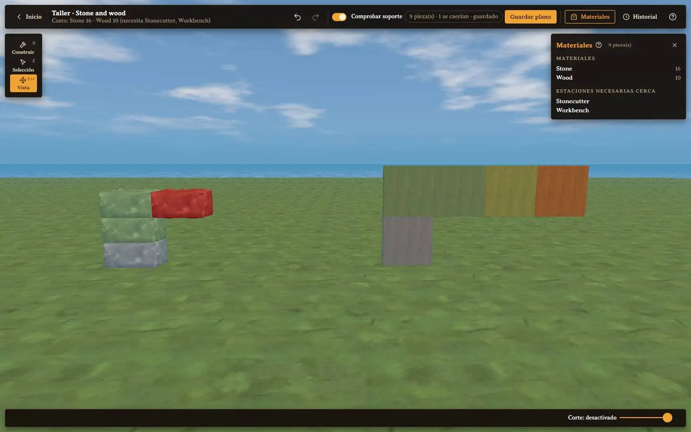
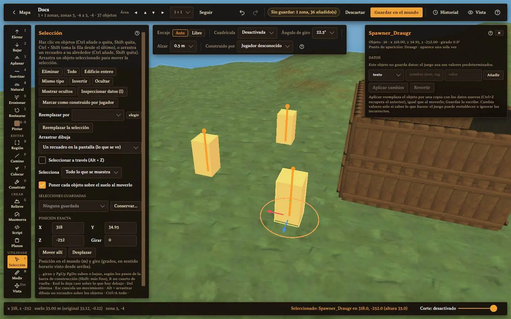
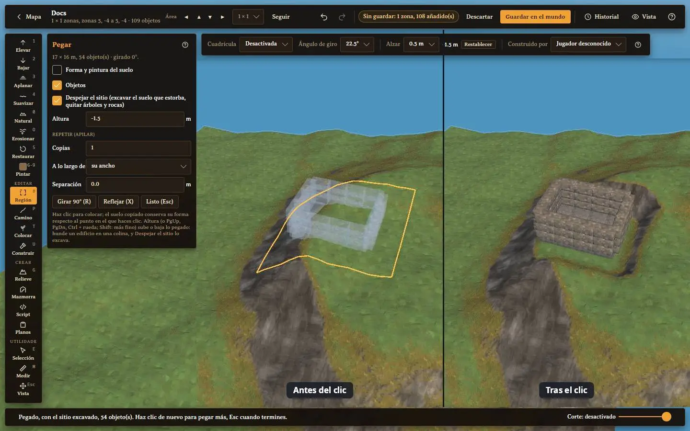

<!-- source: 551a19e3 -->
# Objetos

Todo lo que hay en un mundo de Valheim y no es suelo es un **objeto**: un árbol, una roca, una pared, un cofre, una
criatura, un punto de aparición invisible. Esta página explica qué guarda el juego de cada uno, a quién se atribuye su
construcción, cómo se encajan y se sostienen las piezas de construcción, las reglas con las que crecen las plantas y
lo que hacen los puntos de aparición.

## Qué es un objeto

En el guardado, cada objeto es un registro breve:

| Parte | Ejemplo |
|---|---|
| Su **tipo**, el nombre que le da el juego (su *prefab*) | `Beech1`, `rock4_forest`, `piece_chest_wood`, `Spawner_Boar` |
| Su **posición**, **giro**, inclinación y tamaño | x 1250, z −380, altura 32.4 m, orientado a 90° |
| Sus **datos**: valores que el juego guarda para él | El texto de un cartel, el contenido de un cofre, quién lo construyó, su salud, cuándo se plantó, la etiqueta de un portal |

El [Inspector](../select.md) lo muestra todo. Los nombres de los valores vienen del código del juego y del código de
tus mods, que el editor lee de sus archivos pero nunca ejecuta. Cambia un valor solo cuando sepas lo que hace: el juego
puede restablecer o ignorar los valores que no espera.

**Los ids cambian; el tipo y la posición, no.** Cada objeto también tiene un id, pero el juego da ids nuevos a los
objetos al guardar, y el editor escribe un objeto movido como una copia en su nueva posición. Así que, siempre que el
editor tiene que volver a encontrar un objeto más tarde, busca el mismo tipo en la misma posición: una selección
guardada (con un margen de 5 cm en horizontal y 20 cm en altura), tus cambios trasladados a un guardado más reciente,
una restauración desde una copia de seguridad, un deshacer después de aplicar en vivo. Un objeto que se movió o
desapareció desde entonces cuenta como ausente.

**Los objetos nuevos empiezan de cero.** Un objeto colocado es una copia limpia de uno de su tipo en el mundo, sin
conservar nada propio (ni contenido ni salud), o un objeto nuevo exactamente como lo crea el juego. Un objeto
reemplazado también es nuevo: un cofre reemplazado por otro tipo de cofre está vacío. En cambio, una copia pegada o un
plano conserva todo lo que contenían sus objetos: el contenido del cofre, el texto del cartel. Los tipos que el mundo
no puede crear (de un mod que no está instalado) se dejan fuera, y el editor dice cuáles.

**El contenido que fijas es tuyo.** Un cofre que el juego nunca ha abierto se llena con el botín del juego la primera
vez que se carga. Cuando cambias el contenido de un cofre, el editor lo marca como propio del cofre, y el juego lo
respeta. Un objeto puesto en un soporte se guarda entero, como nuevo y con la durabilidad completa de su calidad.

**No todo lo que ves es un objeto.** Las partes de las ubicaciones del juego (las rocas de la entrada de una cripta, el
campamento del comerciante, el altar de un jefe) se vuelven a crear a partir de la ubicación cada vez que se carga la
zona, así que no se pueden elegir ni cambiar (consulta [Las ubicaciones nivelan el
suelo](ground-limits.md#las-ubicaciones-nivelan-el-suelo)). Con una piedra rúnica pasa lo mismo: puedes eliminarla, lo que
quita su ubicación para siempre, pero no moverla, copiarla ni inspeccionarla.

**Algunos mods esconden objetos muy bajo tierra**, como estaciones de fabricación 10 km por debajo de una casa. Los
rectángulos, los contornos, **Todo** y **Edificio entero** dejan fuera lo que está a más de 10 m bajo el suelo, para no
llevárselo con lo que está en pie encima.

### Grupos enlazados: barcos y vehículos

Algunos mods construyen una sola cosa con muchos objetos: la nave de un mod de barcos es un objeto raíz con piezas
construidas sobre él. Cada pieza se guarda con el id de aquello de lo que cuelga y su desplazamiento respecto a ello, y
el mod la pone ahí cuando se carga el grupo. Un mod se lo indica al editor en un archivo `worldeditor.json` que
incluye; el editor no conoce ningún mod por sí solo. Entonces el editor dibuja el grupo tal como lo construye el mod, y
lo mueve, lo copia y lo elimina entero, nunca una parte suelta. Cada pegado da ids nuevos al grupo, porque dos grupos
que compartieran ids compartirían sus partes en el juego.

### Las criaturas se ponen de pie sobre las piezas

Una criatura cuya posición queda dentro de una pieza de construcción (el jefe de una mazmorra, un jabalí domado en un
corral) se pone de pie encima de la pieza más alta que tiene debajo siempre que el editor coloca objetos: al abrir o
añadir un plano, al mover, al pegar, con un script, con las herramientas de Claude. El suelo no es una pieza: una
criatura sobre él se queda donde se coloca.

## Piezas construidas por jugadores

Todo lo que un jugador puede colocar con el martillo, la azada, el cultivador o la bandeja está **construido por
jugador** en el juego: guarda **quién lo construyó**, como un id de jugador. Eso importa más de lo que parece. Sin
constructor, el juego toma una pieza por parte de una ruina:

| | Construida por jugador | Sin constructor (una ruina) |
|---|---|---|
| Desmontarla | Devuelve todos sus materiales | Devuelve un tercio |
| Un fuego a su lado | Forma una base: allí no aparecen monstruos | No es una base |
| Las incursiones | La atacan | La ignoran |
| Una guarda o un cofre privado | Obedece a su constructor | No obedece a nadie |

Por eso el editor escribe un constructor en cada pieza que coloca, pega o construye: el jugador elegido en
**Construido por** en [la barra de construcción](../build.md#la-barra-de-construcción). Esa lista ofrece los jugadores que construyeron en este mundo (con su número de piezas), los jugadores nombrados en
camas, guardas y lápidas, y los personajes de este equipo. Empieza con el jugador con más piezas; si no hay, tu propio
personaje. **Nadie (no construido por jugador)** coloca las piezas como partes de una ruina a propósito. Si no se
conoce ningún jugador, las piezas reciben **Jugador desconocido**: cuentan como construidas, pero las guardas y los
cofres privados no obedecen a nadie, así que elige tu propio id cuando puedas.

Algunas cosas conservan o quitan el constructor a propósito:

- Mover o editar un objeto conserva el constructor que tiene.
- Un plano no guarda constructor: quien lo construye en el juego pasa a ser su constructor. Uno guardado a partir de
  una ruina recuerda que es una ruina.
- Una mazmorra generada no tiene constructor, como las del propio juego: las incursiones la ignoran y devuelve un
  tercio de sus materiales.
- **Marcar como construido por jugador** (la herramienta [Selección](../select.md)) da un constructor a las piezas que
  no lo tienen: una ruina que quieres reparar y conservar, o piezas colocadas por versiones antiguas del editor.

Una ruina sobre la que construiste (una torre de piedra remendada con madera) cuenta como tu construcción: sus piezas
que tocan las tuyas, y las que tocan a esas, aparecen con tus construcciones en Vista y en el mapa.

## Encaje

Las piezas de construcción se unen como las une el martillo del juego. Cada pieza tiene **puntos de encaje**, en sus
esquinas y extremos, que el editor lee de tu Valheim junto con la forma real de cada pieza (sus colisionadores) y sus
reglas de colocación. Cuando dos puntos de encaje se acercan, la pieza se mueve para que coincidan exactamente: las
paredes quedan una tras otra, los suelos se unen borde con borde, una pared se apoya sobre un suelo.

**Cómo coloca una pieza el martillo**, lo que [Construir](../build.md) sigue paso a paso en un mundo, en el Taller y en
una mazmorra (su encaje **Auto**):

1. La línea del cursor toca lo más cercano: el suelo, o la forma real de una pieza (no su caja).
2. La pieza, girada como la hayas puesto, se mueve para que el punto de su forma más cercano al impacto lo toque. Las
   alfombras y otras piezas de suelo, y las piezas que el juego deja hundirse en las cosas, se guían en cambio por su
   centro.
3. De todos los puntos de encaje de la pieza y de las piezas a menos de 10 m, se unen los del par más cercano a menos
   de medio metro. Apunta a lo alto de una pared para poner la siguiente encima, cerca de su extremo para poner una al
   lado.
4. Se omite un encaje que pondría la pieza exactamente donde ya está la misma pieza.

El alzado (`PgUp`, `PgDn` o `Ctrl` + rueda) se suma antes del encaje, así que una pieza alzada se encaja con puntos cercanos a su nueva altura. La
cuadrícula solo redondea los puntos del suelo: una pieza apuntada a otra pieza se encaja como siempre.

La barra de construcción tiene dos modos más. **Manual** limita el paso 3 a un punto de encaje de la pieza, el que
eligen `Q` y `E` (marcado en la pieza), y le da un alcance de 1.5 m: en una esquina abarrotada, donde el par más
cercano es el borde equivocado, elige el punto que debe unirse. **Libre**, o mantener `Alt` en cualquier modo, omite
el paso 3: la pieza se queda donde toca, y con `Alt` su posición en horizontal se redondea a un cuarto de metro desde
el centro del área.

Las demás herramientas encajan por los mismos puntos de encaje, cada una a su manera:

| Dónde | Cómo encaja |
|---|---|
| [Colocar](../place.md), **Encajar con las piezas que ya hay** (partes de ruinas: las piezas que construyen los jugadores se colocan con Construir) | Una pieza cada vez bajo el cursor. **Al lado**: una tras otra con la pieza que está junto al cursor, a su altura, donde un par de puntos de encaje se une a menos de 1 m. **Encima**: su base sobre lo alto de la pieza que hay bajo el cursor. Una pieza encajada se orienta como la pieza a la que se une. |
| [Construir](../build.md), **Extender** en Línea, Círculo o Rectángulo (y Línea con **Uno tras otro** de [Colocar](../place.md), para partes de ruinas) | Cada pieza empieza donde termina la anterior. Los dos extremos de una pieza son los centros de sus dos lados cortos, calculados a partir de sus puntos de encaje (los tipos sin puntos de encaje usan la caja de su modelo). Una línea que empieza a menos de 1 m de una pieza la continúa. |
| [Selección](../select.md), con el **Encaje** de la barra de construcción en **Auto** | Mientras mueves, el par de puntos de encaje más cercano (uno de una pieza movida, otro de una pieza de alrededor) a menos de 0.75 m se une, y toda la selección se desplaza para que coincidan. |
| [Script](../scripting.md), `snap: true` | Una pieza colocada se une a los puntos de encaje de las piezas que hay a menos de 0.5 m. |

Las posiciones escritas (la **POSICIÓN EXACTA** de la herramienta Selección) nunca se encajan: son exactas.

## La comprobación de soporte

En el juego, cada pieza de construcción necesita **soporte**, que sube desde el suelo a través de las piezas que se
tocan. Una pieza con demasiado poco se rompe y se cae en cuanto se acerca un jugador. **Comprobar soporte** del Taller
lo calcula como lo hace el juego, a partir de datos que lee de tu Valheim (la forma, el material y el centro de masa de
cada pieza), y tiñe cada pieza con los colores del modo de construcción del juego:

| Color | Significado |
|---|---|
| Azul claro | Soporte completo: se apoya en el suelo. |
| Verde | Firme: la mitad del soporte máximo de su material o más. |
| Amarillo, naranja | Más débil. |
| Rojo | A punto de romperse, o rompiéndose: en el juego se cae en cuanto se acerca un jugador. |

**Cómo se calcula el soporte.**

- Una pieza cuya forma, agrandada 0.15 m por cada lado, llega al suelo tiene soporte completo.
- Cualquier otra pieza toma el mejor soporte de las piezas que toca, menos una pérdida según la distancia entre sus
  centros de masa: la tasa «hacia arriba» cuando se sostiene directamente desde abajo, la tasa «lateral» cuando se
  sostiene desde un lado, y una mezcla entre ambas. Si se sostiene desde dos lados separados al menos 100° (visto desde
  arriba), recibe la media de los dos cuando eso es mejor.
- Esto se repite hasta que nada cambia. Las piezas por debajo del mínimo de su material se rompen; luego todo se vuelve
  a calcular sin ellas, de modo que un derrumbe se propaga como en el juego.

| Material | Máximo | Mínimo | Pérdida por metro lateral | Pérdida por metro hacia arriba |
|---|---|---|---|---|
| Madera | 100 | 10 | 20 % | 12.5 % |
| Madera de núcleo | 140 | 10 | 17 % | 10 % |
| Madera labrada | 200 | 10 | 20 % | 8 % |
| Piedra | 1000 | 100 | 100 % | 12.5 % |
| Hielo | 1000 | 100 | 33 % | 12.5 % |
| Hierro | 1500 | 20 | 8 % | 8 % |
| Mármol negro | 1500 | 100 | 50 % | 12.5 % |
| Grausten | 2000 | 100 | 33 % | 10 % |
| Antiguo | 5000 | 100 | 25 % | 7 % |


*A la izquierda, tres muros de piedra apilados: azul claro sobre el suelo, verde encima, y el único muro que sobresale
2 m desde lo alto en rojo, con el «1 se caerían» en la barra superior. A la derecha, paredes de madera que sobresalen
6 m desde un poste: verde, luego amarillo, luego naranja.*

Por eso la piedra se mantiene en pie a gran altura pero no puede extenderse hacia fuera (un metro lateral le quita
todo el soporte), y por eso la madera llega más lejos hacia fuera que la piedra, pero no tan alto.

**Excepciones, como en el juego.** Algunas piezas nunca se comprueban: las losas de suelo de mármol negro, las piedras
de guarda, los barcos y los carros. Se sostienen dondequiera que estén, y una losa da el soporte completo de su
material a lo que se apoya en ella; así se sostiene a 5000 m de altura una mazmorra de piezas de construcción
(consulta [Por qué se sostiene a 5000 m de altura](dungeons.md#por-qué-se-sostiene-a-5000-m-de-altura)). Las partes que se mueven
solas (la hoja batiente de una puerta, el casco de un barco) no cuentan para nada: nada se apoya en ellas. En
una mazmorra del juego, los suelos y las paredes de las salas cuentan como suelo, así que las piezas que se apoyan en
ellos se sostienen.

**Lo que la comprobación deja fuera**: las rocas y los árboles (el juego los cuenta como soporte completo; la parcela
del Taller no tiene), la forma exacta de los colisionadores curvos (cuenta su caja) y las piezas a las que el juego no
da ningún soporte (no se tiñen). Para un plano construido sobre suelo irregular, la comprobación toma el suelo donde lo
tocaba la construcción: en los puntos de contacto con el terreno que registró Homestead o, si no, bajo la pieza más
baja de cada punto.

## Reglas de crecimiento

Los retoños, los cultivos y las plantas silvestres siguen las propias reglas del juego, y las herramientas
[Colocar](../place.md) y Regenerar del editor también las siguen, para que lo que plantas crezca en el juego.

**Espacio para crecer.** Un retoño o un cultivo solo crece cuando no hay nada a menos de su **radio de crecimiento**,
leído de tu juego: 0.5 m para la mayoría de los cultivos, de 2 a 3 m para los retoños de árbol. Con **Dejar espacio
para que crezcan retoños y cultivos** activado (el valor predeterminado):

- los retoños y los cultivos guardan al menos su radio de crecimiento respecto a todo, también entre ellos;
- los cultivos ya crecidos (`Pickable_Carrot`) y los árboles que crecen de retoños (`Beech1`, `Oak1`) guardan el
  espacio que necesita su retoño, como un campo o un huerto de verdad;
- los arbustos no crecen de nada en el juego, así que a ellos solo se les aplica **Espaciado**.

Desactivado, puedes plantar tan apretado como quieras, pero esas plantas quizá nunca crezcan.

**Los cultivos necesitan suelo cultivado.** El juego solo deja crecer los cultivos en tierra cultivada, así que píntala
primero (**Cultivar** del pincel Pintar o Pintar de la herramienta Región). El panel Colocar avisa cuando un cultivo
marcado lo necesita.

**Agua.** Un objeto colocado sobre el suelo se deja fuera donde el suelo está a más de 0.3 m bajo el agua, salvo las
algas y las algas marinas.

**Agrupamiento.** Los bosques de verdad crecen en arboledas con claros entre ellas. **Agrupar** pone sobre el
mundo un patrón de ruido, con manchas de **Manchas** de ancho: donde el patrón es bajo, los puntos se
aclaran, y cuanto más alto es el Agrupamiento, más suelo queda despejado. El patrón está fijado al mundo, no al pincel,
así que los trazos contiguos coinciden.

### Cómo decide Regenerar lo que crece

**Regenerar la naturaleza** de la herramienta Región vuelve a poner lo que haría crecer el propio juego, calculando
cada zona como lo hace el juego cuando la crea por primera vez:

- **Las propias reglas del juego.** Lee las reglas de vegetación del juego de tu Valheim y usa los mismos números
  aleatorios, con la semilla del mundo, la zona y el tipo. Sobre suelo aún tal como se generó, recuperas los mismos
  árboles en los mismos lugares que tuvo el mundo al principio.
- **Las condiciones del juego**: el bioma (y si un tipo crece en su borde o en su centro), la altura sobre el agua, la
  pendiente, el factor de bosque (arboledas y claros), lo irregular que es el suelo alrededor del punto, la distancia
  al centro del mundo, cuántos grupos por zona y cuántos objetos por grupo.
- **El suelo tal como está ahora.** Una colina que subiste recibe lo que crece a su nueva altura y pendiente; una
  explanada que nivelaste recibe lo que crece en suelo llano.
- **No encima de las cosas.** Se omite un punto cuando hay algo a menos de 1 m, un objeto del mismo tipo a menos de
  3 m (un árbol que sigue en pie no se duplica) o una pieza de construcción a menos de 4 m.
- **Los biomas alternativos** (Dark Meadows, Rock Black Forest…) están donde los pone el juego, a partir de la semilla,
  con lo que añaden y sin lo que excluyen.
- **Las ubicaciones** mantienen despejado su suelo, como cuando el juego crea una zona por primera vez.

Lo que no puede saber: las comprobaciones de física del juego contra los objetos que ya están en pie. Trabaja con
hasta 16 zonas a la vez. **Hacer crecer encima los árboles y rocas del bioma** de la herramienta Relieve, para sus
montañas, usa las mismas reglas en las laderas que levantó.

## Puntos de aparición

El juego pone criaturas en sus campamentos, aldeas y mazmorras con **puntos de aparición**: objetos invisibles
(`Spawner_Boar`, `Spawner_Draugr`…), cada uno de los cuales hace aparecer su criatura donde está. Qué criatura, cuántas
estrellas y si vuelve lo fija el tipo del punto de aparición, así que para obtener otra criatura colocas otro tipo.

| Cómo hace aparecer | Cuáles |
|---|---|
| **Aparece una sola vez**: la primera vez que se acerca un jugador, nunca más una vez que muere | La mayoría de los puntos de aparición del juego. |
| **Vuelve N min después de morir** | Los `*_respawn_*`, `Spawner_Location_*`, `Spawner_imp_respawn`, `Spawner_Fish4`; a menudo 60 min. |
| **Solo de noche** o **solo de día** | Unos pocos que esperan. |
| **Cuando un evento lo despierta** | Los `TriggerSpawner_`. |

Los **Nidos de criaturas** son el tipo visible: nidos de greydwarf, montones de huesos y similares. Siguen haciendo
aparecer criaturas a su alrededor hasta que se destruyen («Greydwarf, Greydwarf_Elite · hasta 3 alrededor, a menos de
5 m»).


*Puntos de aparición junto a una cabaña: una caja simple para cada uno, con un marcador naranja encima. El punto de
aparición de draugr seleccionado está abierto en el Inspector, cuya línea dice qué hace aparecer.*

La herramienta Colocar y el Inspector muestran esta línea para cada tipo, leída de tu juego (`Punto de aparición: Boar
· 0–2 ★ · aparece una sola vez`). En 3D, cada punto de aparición y cada nido se muestra como una caja simple con un
marcador encima, visible a través de lo que tenga delante: naranja
para un punto de aparición (rojo cuando su criatura vuelve), morado para un nido. Ambos están ocultos al principio,
porque revelan dónde están las cosas; actívalos en el panel Vista.

## Cómo despeja su sitio un pegado

Una copia (de la herramienta Región o de un plano) contiene:

- **Los objetos**, con todo lo que contienen: un cofre pegado está lleno como el original.
- **Solo el suelo bajo los edificios**: bajo cada pieza de construcción (según su forma real) y 1 m a su alrededor,
  fundiéndose con el suelo donde cae a lo largo de 3 metros más. El resto del suelo de la selección se queda atrás,
  así que una aldea pegada se asienta en el terreno donde cae, en lugar de llevarse consigo un cuadrado de suelo
  ajeno. Los planos no contienen suelo.
- **Alturas**: las piezas de construcción conservan la forma del edificio, medida desde la altura media del suelo de
  la copia, que pasa a ser la altura del suelo donde haces clic. Los árboles, las rocas y similares conservan su
  altura sobre el suelo, así que cada uno cae sobre el suelo donde va.

La copia de la herramienta Selección se coloca igual.


*Antes del clic (izquierda), el contorno de lo pegado se mete en el montículo; después (derecha), el suelo que estorba
a la cabaña se excava hasta su suelo, en el mismo paso de deshacer.*

Con **Despejar el sitio** activado, cada pegado también se hace sitio, en el mismo paso de deshacer:

- Donde se levanta una pieza de construcción pegada (según su forma real, y 1 m a su alrededor), el suelo que estorba
  se **excava** hasta la base de la pieza más baja, más allá de ±8 m si hace falta. Un edificio pegado en una colina no
  queda enterrado en ella. El suelo más bajo nunca se sube.
- Donde el suelo copiado entró por completo, no se excava nada: el edificio se apoya en él como se apoyaba en el
  original.
- Las piezas a más de 100 m bajo el suelo se ignoran (algunos mods guardan allí estaciones de fabricación), y no se
  excava nada bajo un grupo enlazado como un barco.
- **Los árboles, rocas, minerales, arbustos y recolectables** de esa huella se quitan. Los edificios, las criaturas y
  los animales domados se quedan.

Los objetos pegados son objetos nuevos creados a partir de la copia, así que un pegado también funciona en otro mundo.
En vivo, un **Cortar** pegado después mueve los objetos en el juego con sus propios ids cuando puede (consulta
[Mover un objeto lo mantiene como el mismo objeto](live-editing.md#mover-un-objeto-lo-mantiene-como-el-mismo-objeto)).

## Archivos de planos

Un plano es una construcción guardada como archivo, en el formato de
[Homestead](https://thunderstore.io/c/valheim/p/sighsorry/Homestead/), el mod de construcción del juego: el mismo
archivo aparece en la pestaña de Homestead del martillo, listo para construirlo en el juego, y se pega en cualquier
mundo desde el editor. Compartir una construcción es compartir su archivo `.blueprint` y la imagen `.png` que lo
acompaña.

**Lo que conserva.** Solo las piezas de construcción: no se conservan los árboles, las rocas ni los objetos que estén
por el suelo, ni tampoco el suelo. Cada pieza es una línea con su tipo, su posición en metros desde el **ancla** (el
centro de la construcción a ras de suelo), su giro y su tamaño, de las piezas más bajas a las más altas:

```text
#Name:Small hut
#Creator:Valheim World Editor
#Description:A hut with a fire pit
#Tags:house, wood
#Pieces
woodwall;Building;-3;1;-2;0;0;0;1;"";1;1;1
```

El editor añade líneas propias que Homestead y PlanBuild omiten, así que el mismo archivo sigue construyéndose en el
juego: las etiquetas, lo que contienen los objetos (el contenido de un cofre, el texto de un cartel, las estrellas de
un jefe), si la construcción es una ruina y qué piezas solo puede colocar el editor (estatuas, barcos, criaturas: el
martillo de Homestead las omite, y el costo mostrado las deja fuera). Nunca se escribe un constructor: quien lo
construye en el juego pasa a ser su constructor.

**Lo que vuelve.** Pegados desde el editor, los objetos de un plano vuelven con lo que contenían. Construido en el
juego con Homestead, solo quedan las piezas: el juego crea los cofres vacíos y no coloca criaturas.

**Su altura.** Abierto en el Taller, un plano se mueve como un todo para que la base de su pieza de construcción más
baja quede sobre la parcela (las rocas y otras cosas que coloca la azada no cuentan). El editor recuerda ese alzado y
lo vuelve a quitar al guardar, así que el ancla conserva su altura y la construcción queda igual que antes cuando la
construye Homestead.

**Otros archivos.** El editor también lee archivos `.blueprint` de PlanBuild y archivos `.vbuild` (BuildShare y
herramientas más antiguas, una pieza por línea), y puede escribir `.vbuild`. Estos miden desde una esquina, así que se
centran en la parcela. Sus marcas de terreno no se conservan, las piezas de mods que no tienes se dejan fuera, y el
mensaje dice cuántas.
