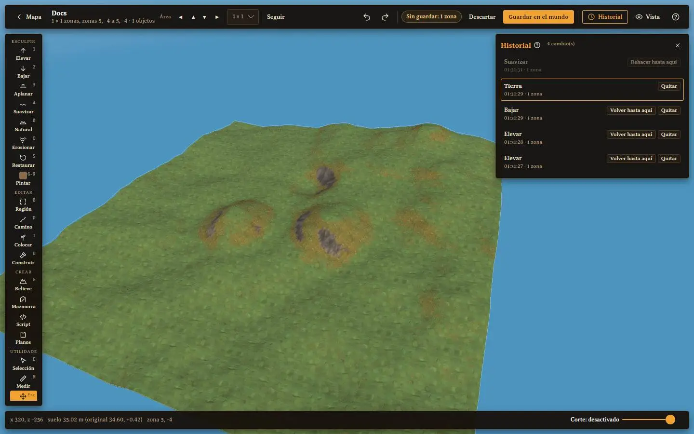

<!-- source: 752963cc -->
# Guardado e historial

Nada de lo que haces en el editor toca el mundo hasta que tú lo decides. Tus cambios esperan como cambios
**pendientes** y luego van a los archivos del mundo cuando usas **Guardar en el mundo**, o al juego en marcha cuando
usas **Aplicar en vivo**. El **Historial** conserva cada paso, incluso después de cerrar el editor, para que puedas
retirar un cambio más adelante.

```text
  tu edición ──► pendiente ──► Guardar en el mundo ──► un guardado nuevo en la carpeta del mundo   (sin conexión)
                    │
                    └────────► Aplicar en vivo ──────► el juego en marcha, que lo guarda           (en vivo)
```

## Cambios pendientes

Cada trazo, clic, pegado o ejecución de un script es un **paso**, y queda pendiente hasta que se guarda o se aplica. La
barra superior cuenta lo que está pendiente, en ámbar («Sin guardar: 3 zonas, 1 eliminado, 12 añadidos, 1
restablecida», o «Sin aplicar: …» en vivo), y muestra «Todo guardado» o «Todo aplicado» en gris cuando no hay nada
esperando:

| Recuento | Qué es |
|---|---|
| **zonas** | Zonas cuyo suelo (altura o pintura) difiere de verdad del guardado. Elevar y luego volver a bajar a la misma altura no cuenta nada. |
| **eliminados** | Objetos del mundo que se van a quitar. |
| **añadidos** | Objetos nuevos: colocados, pegados, copiados o creados por una herramienta. |
| **restablecidas** | Zonas marcadas para que el juego las vuelva a crear (consulta [Restablecer zonas](areas-and-zones.md#restablecer-zonas)). |

Una vez que has guardado, los recuentos son lo que difiere de ese guardado, así que deshacer un paso guardado lo vuelve
a dejar pendiente. En la vista 3D, cada objeto nuevo aún sin guardar lleva un punto verde (**Vista → Marcas sin
guardar** los oculta).

**Los cambios pendientes pertenecen al mundo.** Se quedan cuando mueves el área, vuelves al mapa o abres otro lugar, y
se guardan todos juntos (consulta [El área](areas-and-zones.md#el-área)). Solo se pierden cuando sales sin guardar (el
editor pregunta antes), los desechas o usas **Recargar** en un mundo en vivo (también pregunta antes).

**Descartar** desecha lo que no está guardado ni aplicado: deshace los pasos sin guardar del final del historial, del
más reciente al más antiguo, rehace los pasos guardados o aplicados que hayas deshecho desde entonces y descarta el
resto de la lista de rehacer. Los pasos guardados y aplicados se quedan.

Algunos cambios pendientes no tienen ningún paso en el historial del área abierta (hechos en otra área, o antes de que
el mundo se volviera a leer). Solo se pueden quitar volviendo a leer el mundo entero desde sus archivos o desde el
juego, lo que descarta todos los cambios pendientes, así que Descartar pregunta una segunda vez antes de hacerlo.

Tras volver a leerlo, el historial queda como lo tiene el mundo: desde los archivos, el historial guardado en el último
guardado; en vivo (**Descartar** o **Recargar**), todos los pasos que tiene el juego, aplicados y aún deshacibles,
mientras que los pasos sin aplicar se van con sus cambios.

## Guardar un mundo

El juego guarda un mundo como una carpeta de **guardados numerados**: cada guardado es un conjunto de archivos
(`_main.<n>.chunks`, `.db2`, `.fwl2` y un pequeño marcador `.ok`) más archivos de fragmentos que contienen los objetos
y el suelo. **Guardar en el mundo** funciona igual que el juego, así que un mundo guardado con él se abre en el juego
como cualquier otro:

1. **Escribe un guardado nuevo** con el número siguiente. Solo se vuelven a escribir los archivos de fragmentos que han
   cambiado; los objetos sin tocar se copian byte a byte. El marcador `.ok` va al final, porque el juego solo se fía de
   un guardado que lo tiene, así que un guardado interrumpido nunca se toma por uno bueno. Cada archivo conserva el
   formato de guardado con el que se leyó, así que se guardan tanto los mundos de Valheim 1.0.20 y posteriores como los
   de versiones más antiguas, y se abren en el juego que los creó.
2. **Vuelve a leer el guardado nuevo** y lo compara con lo que pretendía escribir: el suelo de las zonas cambiadas, el
   suelo de todas las demás zonas, el número de objetos, las zonas restablecidas. Si algo difiere o falla, los archivos
   nuevos se quitan y el mensaje termina con «No ha cambiado nada». En ese momento el guardado anterior no se ha tocado.
3. **Ordena.** El guardado desde el que abriste el mundo se conserva mientras el mundo está abierto, porque cada
   guardado se hace a partir de él. Un guardado que hiciste antes en la misma sesión se quita cuando vuelves a guardar.
   Cuando sales del mundo, solo se queda el guardado más reciente.
4. **Escribe el historial** con el mundo (consulta [Historial](#historial)).

**Cierra antes el juego.** Un juego o un servidor en marcha mantiene el mundo en memoria y sobrescribe tu guardado la
próxima vez que guarda. Para cambiar un mundo mientras se ejecuta, usa el [modo en vivo](live-editing.md).

**Lo que no se puede guardar** se lista con el motivo: ediciones en una zona a la que ningún jugador se ha acercado (el
mundo aún no tiene datos de ella: consulta [Zonas](areas-and-zones.md#zonas)), y suelo nuevo en un mundo donde nadie ha
excavado ni nivelado nunca en el juego (el editor hace las ediciones de suelo copiando una que hizo el juego, así que
excava antes una vez en cualquier sitio en el juego).

### El juego ha guardado desde que lo abriste

Si el juego guardó el mundo después de que el editor lo leyera (jugaste entre dos guardados), guardar desecharía lo que
pasó en el juego, así que el editor no guarda nada. En su lugar, ofrece **trasladar tus cambios** al guardado del
juego: vuelve a hacer cada uno de tus cambios pendientes sobre ese guardado, buscando los objetos por su tipo y su
lugar, ya que sus ids cambian con cada guardado (consulta [Qué es un objeto](objects.md#qué-es-un-objeto)).

Donde el juego cambió lo mismo, pregunta una vez por tipo: **Conservar lo mío** o **Conservar lo del juego**:

| Qué choca | Conservar lo mío |
|---|---|
| Zonas cuyo suelo habéis cambiado los dos | Tus puntos y tu pintura cambiados se imponen a los del juego; el suelo del juego se queda en el resto de esas zonas. |
| Objetos que cambió el juego (un cofre usado, un cartel, una planta que crece) y que tú eliminaste, moviste o editaste | Se eliminan, se mueven o se editan como hiciste tú. |
| Objetos que quitó el juego (recogidos, destruidos, o una criatura o un barco que se alejó) y que tú moviste o editaste | Vuelven a donde los pusiste. Uno que solo se había movido queda entonces dos veces. |

Todavía no se escribe nada: ahora el mundo es el guardado del juego con tus cambios pendientes encima. Revísalos y luego
guarda. Los pasos del Historial que tocaban algo que cediste a la versión del juego ya no se pueden deshacer, ni
tampoco los pasos anteriores a ellos; el mensaje dice cuántos se descartaron.

## Aplicar en vivo

En el [modo en vivo](live-editing.md), el mismo botón es **Aplicar en vivo**. Envía el suelo, los objetos y los
restablecimientos de zona pendientes al juego en marcha, que los comparte con todos los jugadores que haya y los guarda
él mismo, como cualquier cosa que construyen los jugadores. Los pasos enviados se marcan como **aplicado** en el
Historial; con **Auto** activado, cada paso se aplica en cuanto lo terminas.

Los pasos aplicados todavía se pueden deshacer: deshaz (o usa **Quitar** en el Historial) y vuelve a aplicar.

- Un objeto **eliminado** vuelve como una copia de lo que era cuando se leyó el mundo, con sus datos (un cofre con su
  contenido tal como estaba). Para el juego es un objeto nuevo.
- Un objeto **colocado** se vuelve a quitar, incluso si otro mod lo ha vuelto a crear mientras tanto con un id nuevo: el
  plugin lo encuentra por su tipo y su lugar.
- Un objeto **movido** vuelve a su sitio.
- Un **restablecimiento de zona** no se puede deshacer una vez aplicado.

## Historial

**Historial** (`L`) lista todos los pasos, del más reciente al más antiguo: su nombre («Elevar», «Pegar ×3», «Quitado:
Colocar»), su hora y lo que afectó. Las etiquetas indican que un paso está **aplicado** (guardado o enviado al juego),
que lo hizo **Claude** o que es de una **sesión anterior**. Por defecto conserva todos los pasos, mientras ocupen menos
de 2 GB de memoria (a partir de ahí, los más antiguos se van primero); **Configuración → Historial → Pasos guardados**
conserva solo ese número de pasos.


*El último paso se deshizo con **Volver hasta aquí**: aparece en gris y ofrece **Rehacer hasta aquí**.*

Hay dos formas de volver atrás:

| | Qué hace | Ejemplo |
|---|---|---|
| **Volver hasta aquí** | Deshace todos los pasos posteriores a este, como pulsar `Ctrl+Z` muchas veces. Los pasos posteriores se quedan en gris, para rehacerlos. Un cambio nuevo los descarta. | Probaste tres cosas y quieres el mundo como estaba antes de ellas. |
| **Quitar** | Quita solo este paso y conserva todo lo hecho después: su cambio de altura sale de los puntos que tocó, su pintura se va donde nada se ha vuelto a pintar desde entonces, sus objetos se van y los que eliminó vuelven, y sus restablecimientos se cancelan. Quitarlo es un paso nuevo, así que `Ctrl+Z` lo recupera. | Quitar una hilera de árboles plantada hace una hora sin perder el trabajo de suelo hecho desde entonces. |

**Retirar los cambios de Claude** hace un **Quitar** de cada paso que Claude hizo en el historial del área abierta, y
conserva los tuyos. Los pasos de Claude hechos en otras áreas se guardan aparte (ver más abajo): abre esas áreas para
retirarlos también.

### El historial pertenece al mundo

El historial te acompaña cuando mueves el área o cambias su tamaño, cuando Seguir la amplía y a través del mapa. Un
paso hecho entero en otra área se guarda aparte mientras esta está abierta («N paso(s) hechos en otras áreas se
conservan»); vuelve, listo para deshacer, cuando abres un área que lo contiene. Un paso que está solo en parte en el
área abierta no se puede deshacer desde aquí, ni tampoco los pasos anteriores a él. Guardar o aplicar desde cualquier
área marca como guardados los pasos de todas las áreas.

### Se conserva después de cerrar el editor

Después de cada **Guardar en el mundo** o **Aplicar en vivo**, el historial se escribe en la carpeta de datos del
editor (`history/`, un archivo por carpeta de mundo; en vivo, uno por conexión y mundo). Vuelve a abrir el mundo,
incluso días después, y los pasos están de vuelta, con la etiqueta **sesión anterior**. Deshacer devuelve el suelo,
devuelve un objeto eliminado con su contenido y retira uno colocado. Los cambios que no guardaste ni aplicaste no se
conservan.

Puede que el mundo haya cambiado desde entonces (los jugadores construyeron y excavaron, o el juego lo volvió a
guardar), así que el editor pregunta una vez antes de deshacer o rehacer el primer paso de una sesión anterior: hacerlo
devuelve las cosas a como estaban, por encima de lo que haya cambiado desde entonces. No se pregunta por un mundo que
desde entonces solo ha guardado el editor.

### Lo que un paso no puede retirar

El historial se conserva a través de cada guardado y cada aplicación, incluidos los restablecimientos de zona y el
suelo [Sin límite](ground-limits.md#sin-límite) convertido en discos de suelo. Unas pocas cosas quedan fuera de su
alcance:

- **Un restablecimiento de zona, una vez guardado o aplicado.** El juego vuelve a crear la zona: lo que los pasos
  hicieron allí se les quita (un paso que estaba entero allí desaparece), igual que el paso que marcó el
  restablecimiento. Los pasos de otros sitios se quedan.
- **Los árboles y las rocas retirados bajo suelo Sin límite**, una vez aplicados en vivo o una vez que se vuelve a
  abrir el mundo: deshacer no los devuelve. Usa [Regenerar la naturaleza](../area.md#regenerar-la-naturaleza).
- **El suelo que los jugadores han cambiado desde entonces.** Al volver a abrirlo, el suelo Sin límite de una zona
  guardada como discos de suelo vuelve con el historial, así que deshacer devuelve todo el suelo que cambió, también
  alrededor de los discos. Donde los jugadores han excavado en esa zona desde entonces, la zona conserva lo que tiene el
  juego: deshacer solo devuelve el suelo propio del paso.

## Copias de seguridad

El editor no crea ninguna carpeta de copias de seguridad propia: nunca toca el guardado anterior hasta que el nuevo se
ha vuelto a leer correctamente, y el guardado desde el que abriste el mundo se queda hasta que sales de él. Eso te
protege de un guardado que salga mal, no de una edición de la que te arrepientas después de salir. Para eso, guarda tu
propia copia de cualquier mundo que te importe (consulta
[Hacer una copia de seguridad de un mundo antes de editarlo](../guides/back-up-a-world.md)).

El juego guarda sus propias copias de seguridad junto a la carpeta del mundo (`<World>_backup_auto-<date>`), y las
versiones anteriores del editor guardaban las suyas como `<World>_backup_terraineditor-<date>`. **Volver a una copia de
seguridad**, de la herramienta Región, devuelve una selección a como estaba en una de esas copias, sin hacer retroceder
el mundo entero (consulta [Restaurar un área desde una copia de seguridad](../guides/restore-from-backup.md)). Empareja
los objetos así:

- Un objeto que está ahora en la selección y también en la copia de seguridad, del mismo tipo, en el mismo lugar (con
  1 cm de margen) y con la misma orientación, no se toca.
- Todos los demás objetos de los tipos elegidos que hay ahora en la selección se quitan, aunque su tipo esté oculto en
  Vista.
- Cada objeto de la copia de seguridad sin pareja vuelve, con todos sus datos: un cofre con su contenido, un cartel con
  su texto.
- Las piedras rúnicas nunca se tocan.

El suelo vuelve exactamente como estaba en la copia de seguridad, incluido el suelo Sin límite. Una copia de otro mundo
(otra semilla) se rechaza.
