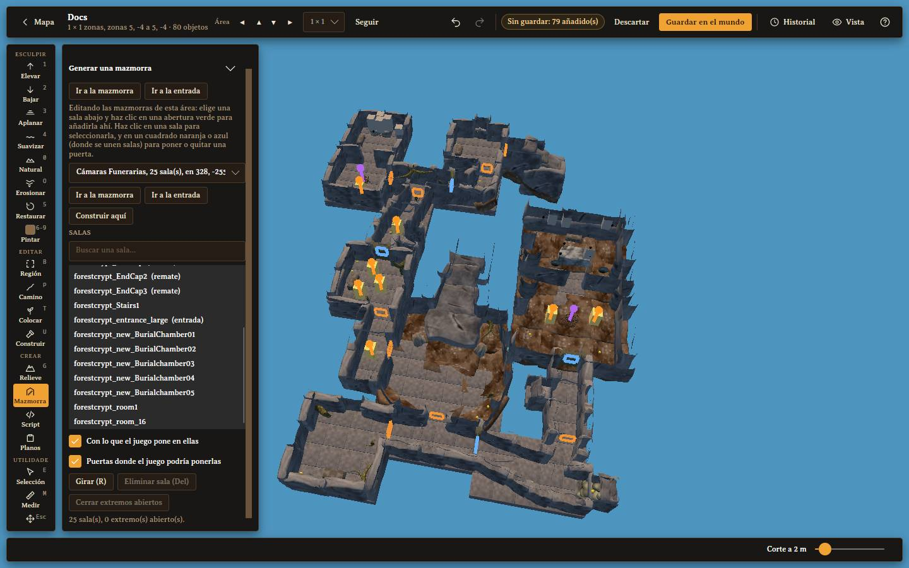
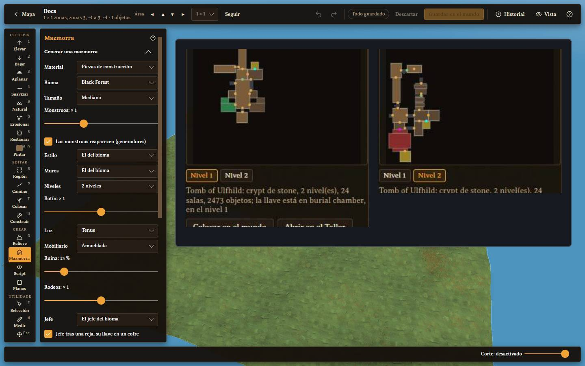
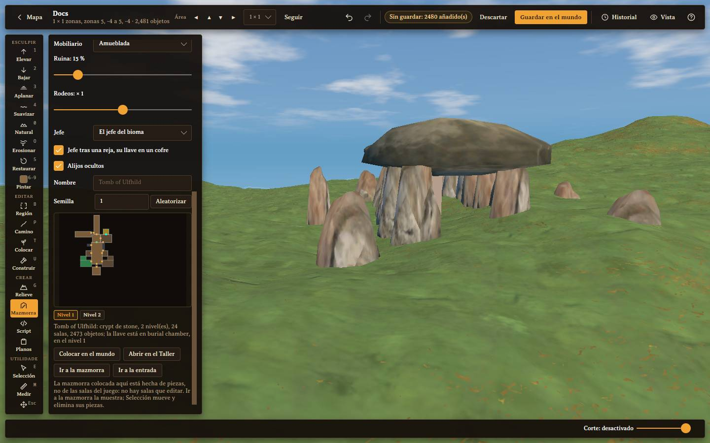
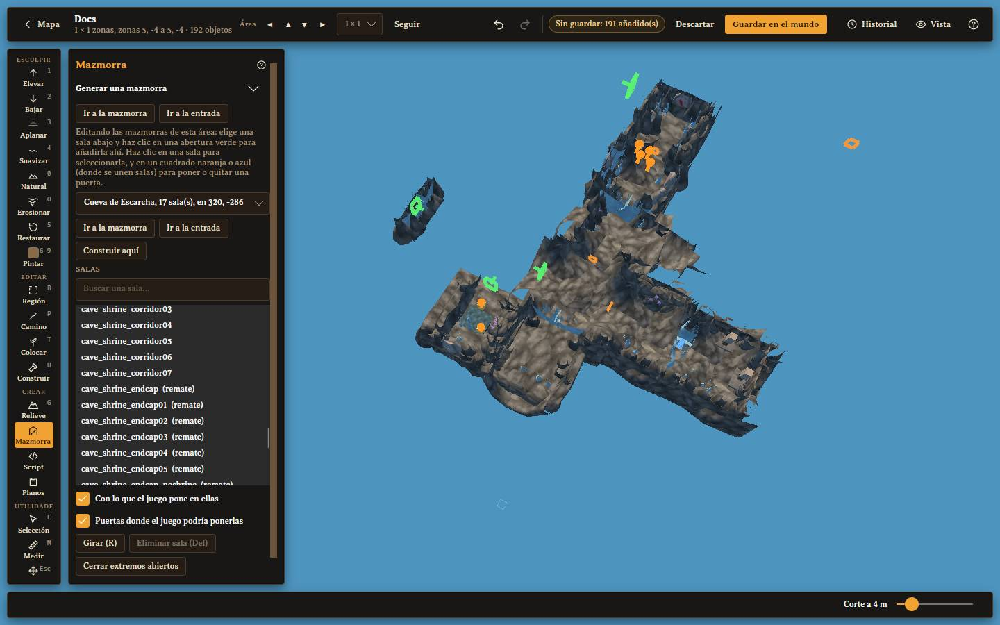
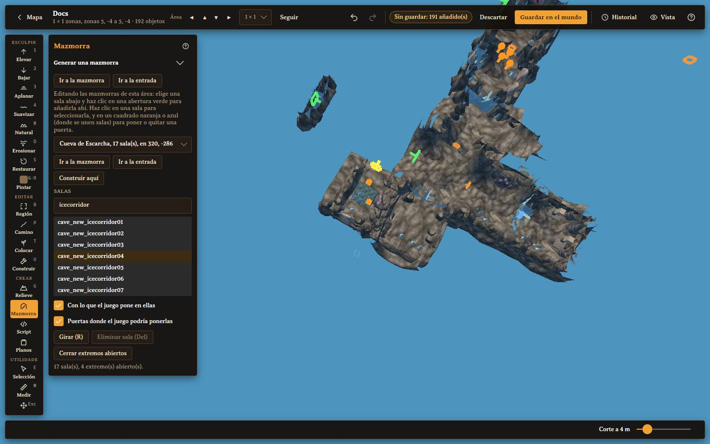
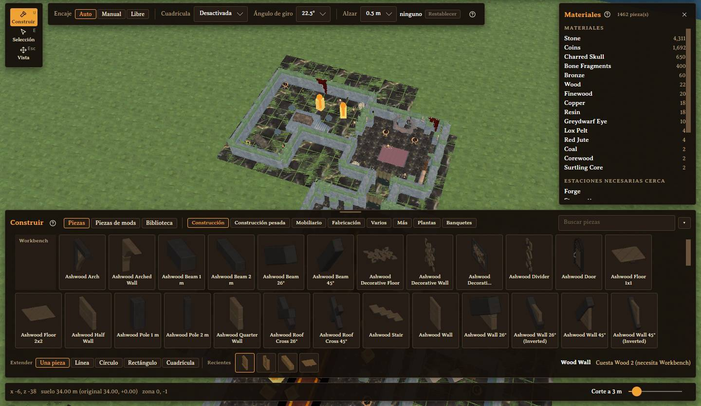

<!-- source: 16125394 -->
# Mazmorra

Genera mazmorras enteras y ponlas en tu mundo detrás de una entrada, edita las mazmorras del propio juego sala por
sala y construye dentro de ellas.

**Dónde:** barra de herramientas, sección **CREAR** · **Tecla:** ninguna · **Funciona en:** mundos guardados, en vivo;
el generador también en el Taller (**Biblioteca** → **Generar mazmorra…**)

*Una mazmorra hecha con las salas propias del juego (Cámaras Funerarias, 25 salas), 5000 m más arriba y cortada 2 m
por encima del suelo. Los cuadrados naranjas y azules marcan dónde se unen las salas. **Eliminar sala (Del)** está en
gris hasta que se selecciona una sala.*

Una mazmorra de Valheim es una ubicación en el suelo (un túmulo, la boca de una cueva) cuya puerta lleva a salas
guardadas 5000 m por encima. Consulta [Cómo guarda el juego las mazmorras](concepts/dungeons.md#cómo-guarda-el-juego-las-mazmorras).

## Úsalo

Para generar una mazmorra y ponerla en el mundo:

1. Abre un área de un mundo y luego haz clic en **Mazmorra** en la barra de herramientas.
2. En **Generar una mazmorra**, elige el **Bioma**, el **Tamaño** y los **Niveles**. El plano se vuelve a dibujar un
   momento después de cada cambio.
3. Opcional: haz clic en **Aleatorizar** hasta que te guste el plano; revisa cada nivel con los botones **Nivel 1**,
   **Nivel 2**... que hay debajo.
4. Gira la vista hacia el punto donde debe ir la entrada, centrada en él.
5. Haz clic en **Colocar en el mundo**.
6. Haz clic en **Ir a la mazmorra** para mirar dentro; **Ir a la entrada** devuelve la vista abajo.
7. Haz clic en **Guardar en el mundo** (o **Aplicar en vivo**).

Toda la colocación es un solo paso de deshacer: `Ctrl+Z` la retira entera. Las mismas elecciones y la misma semilla
siempre crean la misma mazmorra de piezas de construcción; una hecha con [las salas propias del juego](#hecha-con-las-salas-propias-del-juego)
también depende de dónde está su entrada y hacia dónde mira. Para el recorrido completo, consulta
[Generar una mazmorra y ponerla en el mundo](guides/make-a-dungeon.md).

***Generar una mazmorra** para una mazmorra de la Selva Negra, Mediana, 2 niveles, jefe tras una reja. Junto al panel,
su plano dibujado más grande, un nivel cada uno: la sala verde de la llave en el nivel 1, la arena roja con el punto
magenta de su reja y la sala del tesoro dorada en el nivel 2, y el resumen debajo.*

## Ajustes

### Generar una mazmorra

**Generar una mazmorra** está en la parte superior del panel Mazmorra: abierto cuando el área no tiene ninguna
mazmorra, plegado cuando tiene una.

| Ajuste | Qué hace |
|---|---|
| **Material** | **Piezas de construcción**: salas construidas como las construiría un jugador, amuebladas según lo que son. **Las salas propias del juego**: las salas de mazmorra del bioma unidas como las une el juego (consulta [Hecha con las salas propias del juego](#hecha-con-las-salas-propias-del-juego)). No aparece en el Taller, que solo admite piezas de construcción. |
| **Bioma** | **Praderas**, **Selva Negra** (el predeterminado), **Pantano**, **Montaña**, **Llanuras**, **Tierras de niebla**, **Tierras de ceniza**, **Extremo Norte**. Fija los monstruos, el botín, las luces, la entrada en el suelo y el estilo y los muros, salvo que los elijas tú. |
| **Tamaño** | **Pequeña**, **Mediana** (la predeterminada), **Grande**, **Enorme**: unas 5, 8, 12 o 17 salas en cada nivel. |
| **Monstruos: × 1** | De **ninguno** a 3 veces lo habitual, en pasos de 0.25. |
| **Los monstruos reaparecen (generadores)** | Activado: los generadores del juego, cuyos monstruos reaparecen un rato después de morir. Desactivado: los propios monstruos, colocados una sola vez. El jefe siempre se coloca una sola vez. |
| **Estilo** | **El del bioma**, o **Crypt** (cripta), **Catacombs** (catacumbas), **Temple** (templo), **Fortress** (fortaleza), **Prison** (prisión), **Dvergr hold** (fortaleza dvergr), **Goblin warren** (madriguera goblin), **Ruins** (ruinas): qué salas tiene y cómo se distribuyen. |
| **Muros** | **El del bioma**, o **Stone** (piedra), **Marble** (mármol), **Wood** (madera), **Stave** (madera de estilo nórdico), **Grausten**, **Dvergr**, **Goblin**. |
| **Niveles** | De **1 nivel** a **16 niveles** (2 por defecto), unidos por escaleras. El jefe espera en el último. |
| **Botín: × 1** | Cofres y tesoros: de **ninguno** al doble de lo habitual. Los niveles más profundos tienen más. Con las salas propias del juego, conserva o duplica los cofres de las salas. |
| **Luz** | **Oscura**, **Tenue** (la predeterminada) o **Luminosa**: cuántas antorchas y braseros. |
| **Mobiliario** | **Vacía**, **Amueblada** (la predeterminada) o **Lujosa**. |
| **Ruina: 15 %** | Cuánto está en ruinas, de 0 a 100 % en pasos de 5: escombros, pilares caídos, antorchas apagadas. Elegir un estilo fija su propio valor, y también elegir un bioma mientras **Estilo** es **El del bioma**. |
| **Rodeos: × 1** | Con qué frecuencia se unen salas alejadas entre sí en el recorrido, para que haya más de un camino: de **ninguno (un árbol)** al doble de lo habitual. |
| **Jefe** | **El jefe del bioma**, **Sin jefe**, o el jefe o la élite de cualquier bioma por su nombre (`Troll`, `Draugr_Elite`, `StoneGolem`...). |
| **Jefe tras una reja, su llave en un cofre** | La reja de la arena se abre con la llave de la cripta, que está en un cofre lejos de ella (los jugadores que tienen la llave del Anciano también la abren). Desactivado: grandes puertas dobles, abiertas para todos. |
| **Alijos ocultos** | Pequeñas salas del tesoro detrás de una pared agrietada que hay que romper o de un tapiz. |
| **Nombre** | Escrito en un cartel en el vestíbulo de entrada. Vacío: un nombre creado a partir de la semilla, mostrado en gris (`Barrow of Sigrun`). |
| **Semilla** y **Aleatorizar** | El número propio de la mazmorra; cualquier número entero crea otra mazmorra con las mismas elecciones. |

Cambiar **Luz** o **Ruina** no cambia nada más de la mazmorra. Con **Las salas propias del juego**, solo se usan
**Bioma**, **Tamaño**, **Monstruos**, **Botín** y la semilla; las demás filas, y el plano, se ocultan. Qué pone el
generador y dónde está en
[Cómo distribuye el generador una mazmorra](concepts/dungeons.md#cómo-dispone-el-generador-una-mazmorra) y
[Mobiliario, luz y guardias](concepts/dungeons.md#mobiliario-luz-y-guardianes).

Lo que aporta cada bioma cuando no se elige nada más:

| Bioma | Estilo | Muros | Jefe | Entrada en el suelo |
|---|---|---|---|---|
| Praderas | Crypt | Stone | `Skeleton_Hildir` | El túmulo de una cámara funeraria |
| Selva Negra | Crypt | Stone | `Troll` | El túmulo de una cámara funeraria |
| Pantano | Crypt | Stone | `Draugr_Elite` | La puerta de una cripta hundida |
| Montaña | Fortress | Stone | `StoneGolem` | La boca de una Cueva de Escarcha |
| Llanuras | Goblin warren | Goblin | `GoblinBrute` | Ninguna propia: un par de portales enlazados |
| Tierras de niebla | Dvergr hold | Dvergr | `SeekerBrute` | La entrada de una mina infestada |
| Tierras de ceniza | Fortress | Grausten | `Charred_Melee_Dyrnwyn` | Un agujero de Morgen |
| Extremo Norte | Temple | Stave | `JotunWarrior` | La boca de una Cueva de Escarcha |

**El plano** dibuja desde arriba el nivel mostrado: las salas del recorrido en marrón claro, las salas laterales en
marrón más oscuro, los pasillos en gris oscuro; la arena del jefe en rojo, la sala del tesoro y los alijos ocultos en
dorado, la sala de la llave en verde. Los pasos son puntos: la reja cerrada en magenta, los pasos ocultos en cian, los
arcos abiertos en verde, las puertas y las rejas en naranja. Señala una sala para ver su nombre. El resumen de debajo
dice qué se creó (`Barrow of Sigrun: crypt of stone, 2 level(s), 15 rooms, 2140 objects; the
key is in the ossuary on level 2`) y qué no se pudo crear (`no room for stairs down from level 3; the levels below are
left out`).

| Botón | Qué hace |
|---|---|
| **Colocar en el mundo** | Pone la entrada en el suelo en el centro de la vista, con la puerta mirando hacia ti, y la mazmorra 5000 m por encima. |
| **Abrir en el Taller** | Escribe la mazmorra (de piezas de construcción) como plano y la abre en el [Taller](workshop.md) para cambiarla: consulta [Abrirla en el Taller](#abrirla-en-el-taller). No aparece con **Las salas propias del juego**. |
| **Ir a la mazmorra** / **Ir a la entrada** | Aparecen una vez colocada la mazmorra (y hasta que `Ctrl+Z` la retira): llevan la vista arriba, al primer nivel con los techos cortados, y de vuelta abajo. |

*El túmulo de una cámara funeraria colocado con **Colocar en el mundo**, con la puerta mirando a la cámara. Bajo el
resumen ahora aparecen **Ir a la mazmorra** e **Ir a la entrada**.*

### Salas de una mazmorra

Debajo del generador, cuando hay una mazmorra en el área, el panel lista sus mazmorras y edita sus salas.

| Ajuste | Qué hace |
|---|---|
| Lista de mazmorras | Las mazmorras del área, cada una con su tipo, sus salas y su lugar (`Frost Cave, 34 room(s), at 1520, -2240`). También aparecen las aldeas fuling y las granjas de las Praderas, que se distribuyen igual sobre el suelo. |
| **Ir a la mazmorra** | Lleva la vista arriba, al centro de las salas de la mazmorra, y corta sus techos (a 4 m del suelo si el corte estaba desactivado). |
| **Ir a la entrada** | Lleva la vista de vuelta abajo, a la entrada en el suelo, sin cortar nada. |
| **Construir aquí** | Activa [Construir](build.md) sobre la mazmorra, con su panel a lo largo de la parte inferior: consulta [Construir dentro de una mazmorra](#construir-dentro-de-una-mazmorra). |
| **SALAS** + **Buscar una sala…** | Las salas que admite este tipo de mazmorra; escribe para filtrarlas por nombre. Los remates y las salas de entrada se marcan con `(end cap)` y `(entrance)`. |
| **Con lo que el juego pone en ellas** | Activado (por defecto): una sala añadida viene con lo que el juego habría creado en ella en ese lugar (cofres, generadores, antorchas, decoración). Desactivado: salas vacías. |
| **Puertas donde el juego podría ponerlas** | Activado (por defecto): una sala añadida recibe una puerta donde se une, con la misma probabilidad que usa el juego. |
| **Girar (R)** | Une la sala mostrada por su siguiente abertura del mismo tipo. |
| **Eliminar sala (Del)** | Quita la sala seleccionada. |
| **Cerrar extremos abiertos** | Pone el remate del juego en cada extremo abierto, para que nada lleve hacia fuera. El mensaje dice cuántos extremos abiertos no tienen remate de su tipo. |

Los techos se cortan con el control deslizante **Corte** de la barra de estado, el mismo que en un mundo y en el
Taller. Mientras la herramienta Mazmorra (o **Construir aquí**) está en uso con una mazmorra abierta, sus metros cuentan
desde más o menos el suelo de la entrada de la mazmorra, de 0 a 29 m: el extremo izquierdo corta a ras del suelo y el
derecho (**Corte: desactivado**) muestra los techos. Al dejar la herramienta vuelve el corte propio del mundo, y el de
la mazmorra se guarda para cuando vuelvas. Consulta [Corte](editor-basics.md#corte).

La línea de abajo cuenta las salas, los extremos abiertos y los pares superpuestos (`24 room(s), 3 open end(s). 1 overlapping
pair(s).`).

## Abrir una mazmorra

1. Abre el área sobre la entrada de una mazmorra (los marcadores de ubicación del mapa muestran las entradas).
2. Haz clic en **Mazmorra** en la barra de herramientas: la lista muestra las mazmorras del área.
3. Haz clic en **Ir a la mazmorra** debajo de la lista.
4. Opcional: mueve el control deslizante **Corte** de la barra de estado para ver más o menos de los muros.

Allí arriba la cámara ya no sigue el suelo: gira, desplázate y vuela alrededor de las salas como de costumbre.
**Salas de mazmorra** en el [panel Vista](editor-basics.md) las muestra u oculta.

Una mazmorra a la que nadie se ha acercado aún no tiene salas: el panel dice *El juego aún no ha trazado esta mazmorra
(nadie se ha acercado a ella).* Visítala en el juego y vuelve a abrir el área.

*Una Cueva de Escarcha tras **Ir a la mazmorra**, con los techos cortados 4 m por encima del suelo: el panel la lista (`Frost Cave, 17 room(s), at
-640, -350`). Los marcos verdes marcan extremos abiertos (se eliminó una sala), y los
cuadrados naranjas, dónde se unen salas sin puerta.*

## Añadir salas

Cada sala tiene **aberturas**, los pasos por donde se une a la sala siguiente. El juego solo une aberturas del mismo
tipo.

1. Busca un marco verde: marca un **extremo abierto**, una abertura a la que aún no se une ninguna sala.
2. Elige una sala en la lista de **SALAS**.
3. Señala un extremo abierto (a menos de 1.5 m): la sala aparece allí, transparente, unida como el juego une las salas.
4. Opcional: pulsa `R` (**Girar (R)**) para unirla por otra de sus aberturas.
5. Haz clic para añadirla. Se queda seleccionada, así que `Del` la vuelve a quitar.

Una sala que se superpondría a otra, o que saldría del espacio de la mazmorra (64 × 64 m alrededor del centro de su
zona en la mayoría de los tipos), se vuelve roja y la línea avisa. El juego construye la lista igualmente: es solo un
aviso.

*`cave_new_icecorridor01` elegido en **SALAS** (filtrado con «icecorridor») y apuntado a un extremo abierto: aparece
allí transparente, unido al modo del juego. La línea de abajo dice `17 room(s), 4 open end(s).`*

## Puertas

Un cuadrado marca cada lugar donde se unen dos salas y puede ir una puerta: **azul** con puerta, **naranja** sin ella.
Haz clic en él para poner ahí la puerta de la mazmorra o quitarla. Cada clic es un paso de deshacer.

## Eliminar una sala

Haz clic en una sala para seleccionarla (se muestra su caja) y luego haz clic en **Eliminar sala (Del)**. Lo que hay
en la sala (cofres, generadores...) se va con ella, y también las puertas donde se unía a otras salas. Las salas
vecinas vuelven a tener extremos abiertos: **Cerrar extremos abiertos** los remata.

## Construir dentro de una mazmorra

**Construir aquí** activa [Construir](build.md) sobre la mazmorra, con su [panel](workshop.md#el-panel-construir) y la
barra de construcción: solo las pestañas **Piezas** y **Piezas de mods** (los planos de la **Biblioteca** van a la
parcela del Taller), una pieza cada vez (las líneas de **Extender** se dibujan en el suelo, muy abajo): elige una pieza
y haz clic en el suelo o en un muro de una sala, o en una pieza que ya esté allí. Las piezas encajan como con el
martillo, y el cursor atraviesa lo que oculta el corte. Elige otra herramienta para dejar de construir.

Los suelos y los muros de una sala cuentan como terreno en el juego, así que las piezas que se apoyan en ellos se
sostienen. Las piezas que cuelgan en el vacío, lejos de las salas, se rompen en cuanto se acerca un jugador.

## Hecha con las salas propias del juego

Con **Material** en **Las salas propias del juego**, el editor une las salas de mazmorra del bioma al modo del juego:
una cámara funeraria en las Praderas y la Selva Negra, una cripta hundida en el Pantano, una Cueva de Escarcha en la
Montaña y el Extremo Norte, una mina infestada en las Tierras de niebla, y las propias de las Tierras de ceniza y las
Llanuras. Añade salas hasta que haya unas 8, 14, 20 o 26 (según **Tamaño**), sin superposiciones, cierra todos los
extremos abiertos, llena cada sala con lo que el juego pondría en ella y pone puertas donde las pondría el juego.
**Monstruos** copia cada generador más o menos ese número de veces; **Botín** conserva cada cofre con esa probabilidad
por debajo de × 1 y añade un segundo a su lado con la probabilidad que pase de ahí. Un tipo de mazmorra sin salas que
unir (un campamento, una aldea) se convierte en una Cueva de Escarcha, y el resumen lo dice.

Colocada en el mundo, es una mazmorra de salas, exactamente como el juego guarda las suyas: aparece en la lista de
mazmorras, para editarla sala por sala. Sus salas se vuelven a distribuir a partir de la entrada, como el juego
distribuye las suyas: desde donde la entrada pone la mazmorra, dentro del espacio de esa zona. Así que las salas
colocadas no son las del resumen, y colocarla en otro sitio de una zona, o mirando hacia otro lado, da otras salas; el
mismo punto y la misma orientación vuelven a dar las mismas. Con los archivos de salas y mazmorras de Expand World Data
activados, el generador, la lista de salas y las salas dibujadas los siguen: consulta
[Editar un mundo creado con Expand World, Riverheim o Tunnelheim](guides/use-mods-worlds.md).

## Abrirla en el Taller

*Una mazmorra generada (un nivel) abierta en la parcela del Taller y cortada a 3 m, con el panel Construir de nuevo
en su pestaña **Piezas**: arriba, el vestíbulo de entrada con el portal por donde llegan los jugadores; debajo, la
arena del jefe.*

**Abrir en el Taller** escribe la mazmorra como plano en la carpeta de Homestead y la abre para cambiarla: abre un
cofre, mueve los muebles, añade tus propios toques y luego **Guardar plano**. El Taller ocupa el lugar del mundo: si hay
cambios sin guardar (o sin aplicar), pregunta antes. Para poner después la mazmorra en un mundo, vuelve a abrir el
mundo y pega el plano (consulta [Mazmorras a partir de planos](#mazmorras-a-partir-de-planos)). El plano:

- conserva lo que contienen sus objetos (la llave en su cofre, los carteles, el jefe y sus estrellas) y que es una
  ruina;
- lleva las etiquetas `dungeon` y `generated`, y su descripción da la semilla y el resumen;
- tiene un **portal** en el vestíbulo de entrada, por donde llegan los jugadores.

Si ya existe un plano con ese nombre, se conserva; el nuevo se numera. Construido en el juego con Homestead, solo son
las piezas: sin llave en el cofre ni jefe.

## Mazmorras a partir de planos

Cualquier plano puede ser una mazmorra: activa **Una mazmorra** al guardarlo en el Taller (o en **Detalles** del panel
Planos). Pegado en un mundo desde el panel Planos, no va sobre el suelo:

- La entrada de la mazmorra del bioma va donde haces clic, mirando hacia ti, y la construcción 5000 m por encima.
- El giro y el reflejo de la herramienta de pegar se aplican (`R`, `X`, `,` `.`); su **Altura** y sus **Copias** no,
  aunque el panel los muestre.
- Pon un **portal** (`portal_wood`) en la construcción donde deben llegar los jugadores, mirando hacia donde deben
  mirar: la puerta de la entrada lleva ahí, y ese portal se omite. Sin él, los jugadores llegan al centro de la
  construcción, mirando al norte.
- En las Llanuras, un par de portales enlazados hace de entrada.

Las piezas solo se sostienen en el cielo sobre lo que el juego nunca comprueba como soporte: haz los suelos de mármol
negro (`blackmarble_floor_large`) y apoya todo lo demás sobre ellos.

## Atajos

| Tecla o ratón | Qué hace |
|---|---|
| Clic en un marco verde | Añade la sala mostrada ahí. |
| Clic en una sala | La selecciona. |
| Clic en un cuadrado | Pone ahí una puerta o la quita. |
| `R` | Une la sala mostrada por su siguiente abertura. |
| `Del` | Elimina la sala seleccionada. |
| `Ctrl+Z` | Deshace el último cambio (una colocación, una sala, una puerta). |

Todas las teclas del editor están en [Atajos](help/shortcuts.md).

## Consejos y límites

- **Recuperar:** cada colocación, sala o puerta es un paso de deshacer (`Ctrl+Z`). ¿Has perdido una distribución que te
  gustaba? Las mismas elecciones y la misma semilla vuelven a crear la misma mazmorra de piezas de construcción (una
  hecha con las salas propias del juego también necesita el mismo punto y la misma orientación). No se escribe nada
  hasta **Guardar en el mundo** o **Aplicar en vivo**.
- **Una mazmorra por zona** (64 × 64 m): detrás de la entrada propia del juego, cuando ya hay algo allí arriba, el
  editor lo dice y no coloca nada; pon la entrada en otra zona. En las Llanuras (entrada por portal), en cambio, va más
  arriba, como se explica más abajo.
- Una mazmorra de piezas de construcción son objetos normales, no una mazmorra de salas: [Selección](select.md) mueve y
  elimina sus piezas, y la lista de mazmorras no la muestra (el panel dice que está construida con piezas, sin salas que
  editar). Usa **Ir a la mazmorra**.
- Todo lo que coloca una mazmorra generada no tiene constructor, como lo del propio juego: las incursiones lo ignoran,
  no sirve de base para hogueras y desmontarlo devuelve un tercio de los materiales. Consulta
  [Piezas construidas por jugadores](concepts/objects.md#piezas-construidas-por-jugadores).
- La entrada es la ubicación propia del juego para el bioma: el juego crea su puerta y sus piedras cada vez que carga la
  zona. La mazmorra va donde el juego pone la de esa entrada (la de una Cueva de Escarcha, sobre el centro de la zona),
  girada para que los jugadores que cruzan la puerta lleguen al vestíbulo de entrada mirando hacia dentro. La vista se
  queda en la entrada.
- En las Llanuras, un portal en el suelo (a 3 m del punto) lleva dentro y su gemelo en el vestíbulo de entrada lleva de
  vuelta, enlazados con una etiqueta como `dg123`. Sin una entrada que lo impida, la mazmorra sube en pasos de 50 m
  cuando ya hay algo allí arriba.
- Parte de lo que el juego pone en las salas (carámbanos, cristales, peces) se asienta en el juego sobre la superficie
  más cercana, así que puede quedar un poco distinto de donde lo muestra el editor.
- El juego dibuja las mazmorras oscuras; el editor las ilumina como el exterior, para que veas lo que editas.
- **Claude** puede generar mazmorras y editar salas: consulta [Claude](claude.md).

## Relacionado

- [Generar una mazmorra y ponerla en el mundo](guides/make-a-dungeon.md)
- [Pegar un plano en un mundo](guides/paste-a-blueprint.md)
- [Cómo guarda el juego las mazmorras](concepts/dungeons.md#cómo-guarda-el-juego-las-mazmorras)
- [Taller](workshop.md) · [Selección](select.md)
