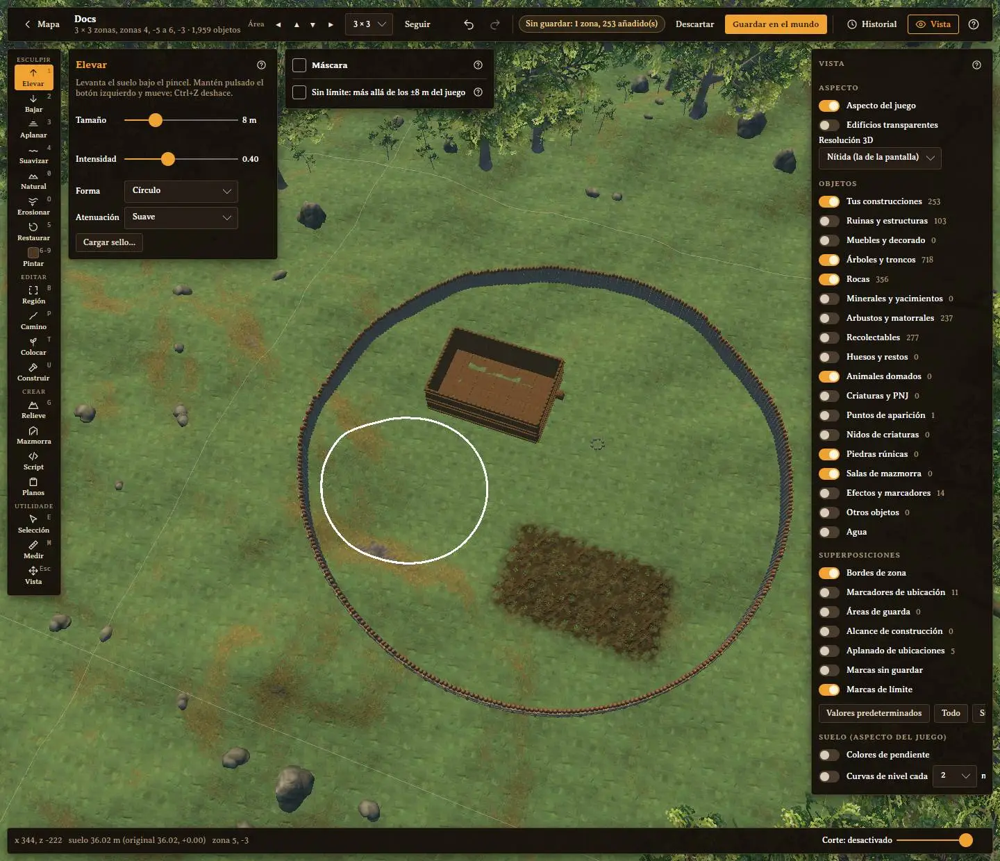
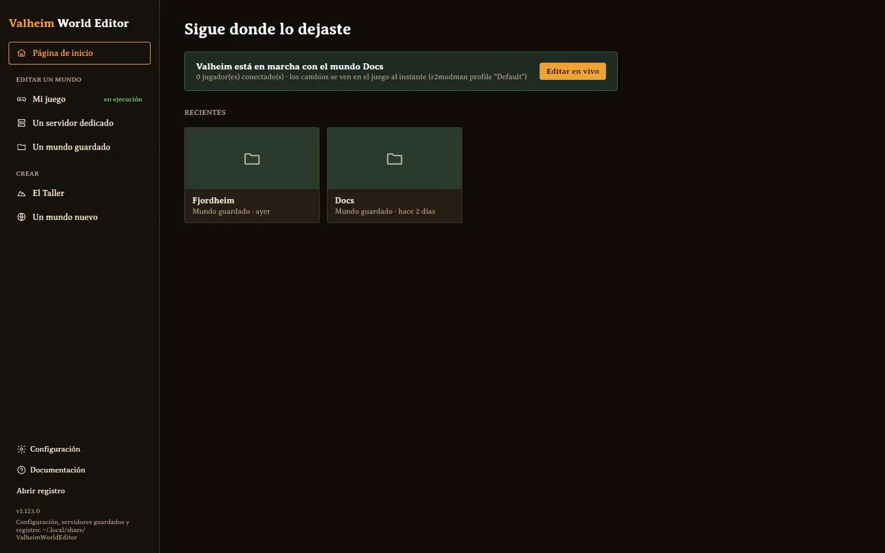
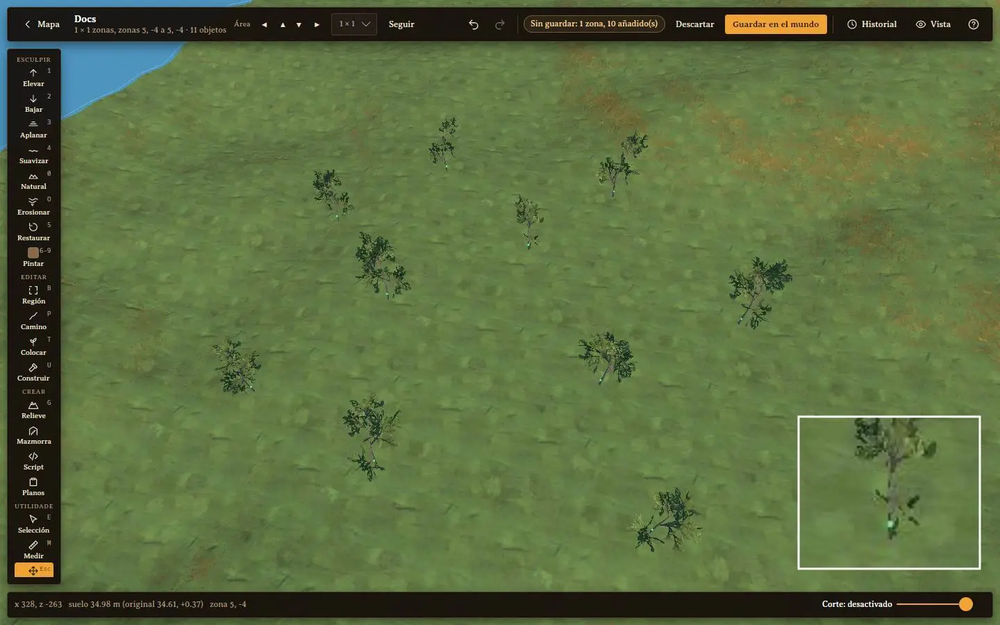
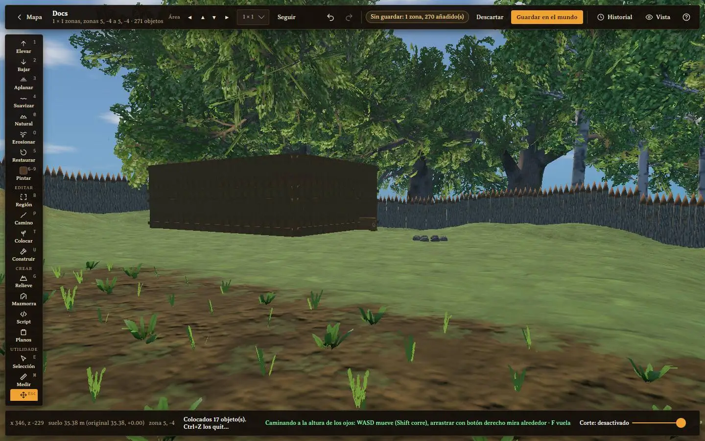
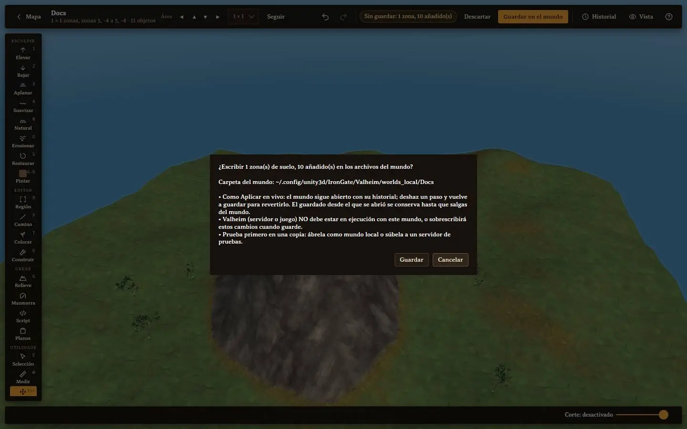
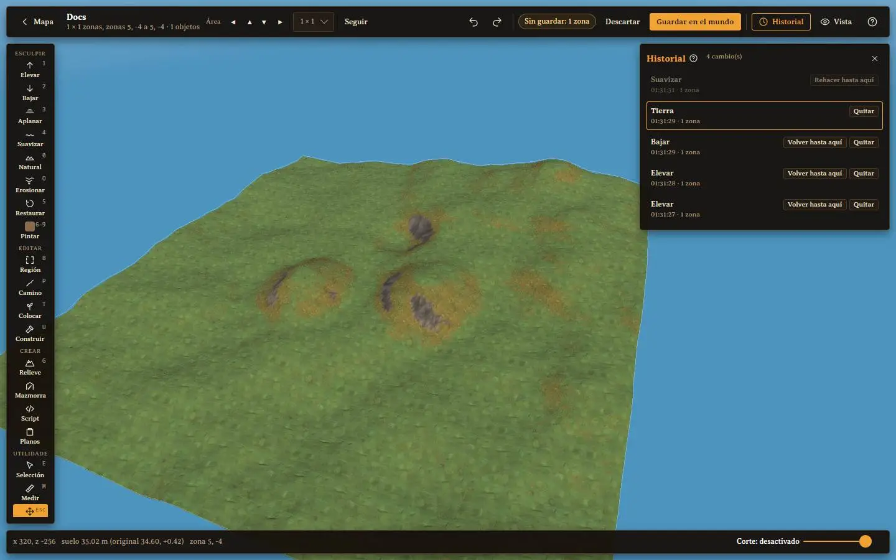
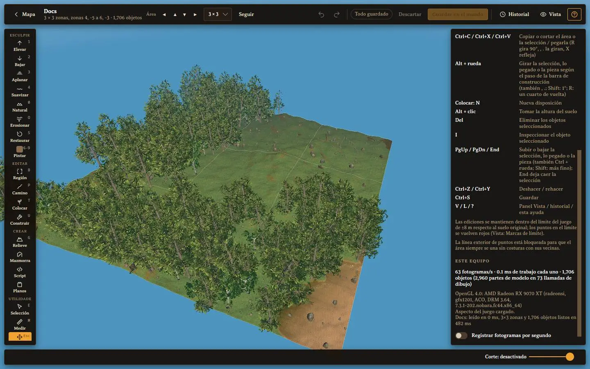
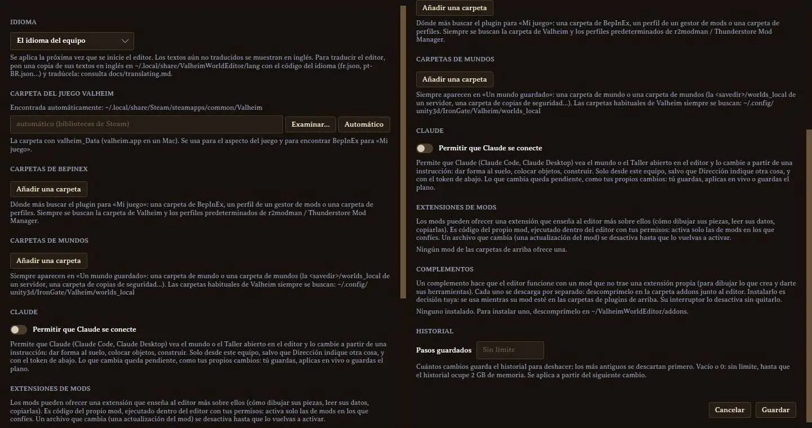

<!-- source: 1d85c1a0 -->
# La ventana del editor

Oriéntate en el editor: la página de inicio, la ventana 3D con su barra superior, su barra de herramientas y sus
paneles, la cámara, el guardado, el Historial y el panel Vista.

**Dónde:** la página de inicio se abre primero; un mundo se abre en su [mapa](map.md) y luego en **Editar en 3D** ·
**Tecla:** `?` o `F3` para la tarjeta de ayuda, `F1` para esta ayuda en la herramienta en uso · **Funciona en:** mundos
guardados, en vivo, el Taller

*Una pequeña base en un área de 3 × 3, con el pincel Elevar elegido (su anillo sobre la hierba). A la izquierda: la
barra de herramientas y el panel de la herramienta. Arriba: la barra superior. A la derecha: el panel Vista. Abajo: la
barra de estado, que lee el suelo bajo el puntero.*

## Úsalo

1. En la página de inicio, elige cómo editar: **Mi juego**, **Un servidor dedicado** o **Un mundo guardado** (o **El
   Taller** para construir sin mundo).
2. Haz clic en tu mundo. Se abre en su [mapa](map.md).
3. En el mapa, haz clic en el lugar que quieres editar, elige el tamaño del área y luego **Editar en 3D**.
4. Elige una herramienta en la barra, ajústala en su panel y úsala en la vista.
5. Revisa lo que espera en la línea de pendientes de la barra superior y luego pulsa **Guardar en el mundo** (o
   **Aplicar en vivo**).
6. Para deshacer un cambio, pulsa `Ctrl+Z` o abre **Historial** (`L`).

Cada cambio queda [pendiente](concepts/saving-and-history.md#cambios-pendientes) hasta que lo guardas o lo aplicas.

## La página de inicio

*Página de inicio: la tarjeta del juego en marcha con **Editar en vivo** y, debajo, los últimos mundos y planos
abiertos.*

El menú lateral tiene **Página de inicio** y luego dos secciones, **Editar un mundo** y **Crear**. Vuelves aquí desde
el mapa de un mundo (**Mundos**) o desde el Taller (**Inicio**).

| Entrada | Qué muestra |
|---|---|
| **Página de inicio** | Dónde lo dejaste. Cuando Valheim se ejecuta con el plugin WorldEditorBridge, una tarjeta dice «Valheim está en marcha con el mundo …» y cuántos jugadores hay conectados, con **Editar en vivo**. En **Recientes**: los mundos guardados y los planos que abriste o guardaste por última vez (los planos con su imagen), del más reciente al más antiguo, y los servidores guardados que se conectan con un clic (contraseña guardada o archivo de clave). |
| **Mi juego** | Tu propio juego, en vivo: lo que falta (BepInEx, el plugin, un primer inicio) o el mundo con el que se ejecuta y **Editar en vivo**. Junto a él aparece *en ejecución* mientras el juego está en marcha; el editor lo comprueba cada pocos segundos. Consulta [el modo en vivo](live-mode.md). |
| **Un servidor dedicado** | Los servidores guardados (**Conectar**, **editar**, **olvidar**) y el formulario para conectarte a otro. Consulta [el modo en vivo](live-mode.md). |
| **Un mundo guardado** | Los mundos de este equipo, para abrirlos con el juego cerrado. La lista sigue cada pocos segundos las carpetas de mundos añadidas o quitadas; **Actualizar** mira al instante. Pasa el puntero sobre un mundo para ver su carpeta. **Otra carpeta de mundos** abre cualquier carpeta con archivos `_main.<n>.chunks`. Consulta [Abrir un mundo que no está en la lista](guides/open-a-world.md). |
| **El Taller** | **Abrir el Taller**, si Homestead está instalado y todos los planos, del más reciente al más antiguo: haz clic en uno para abrirlo. Consulta [el Taller](workshop.md). |
| **Un mundo nuevo** | **Crear un mundo nuevo**: el mundo de una semilla antes de que exista, y una búsqueda de uno que te convenga. Consulta [un mundo nuevo](new-world.md). |

Al final del menú: **Configuración** (consulta [Configuración](#configuración)), **Documentación** (esta ayuda, en su propia
ventana), **Abrir registro**, la versión y la carpeta que guarda la configuración y el registro del editor.

## La ventana

La ventana 3D tiene cinco partes:

- **Barra superior**: el nombre del mundo y el área, los controles del área, deshacer y rehacer, lo que está pendiente,
  **Descartar**, **Guardar en el mundo** o **Aplicar en vivo**, y luego **Historial**, **Vista** y **?**. Consulta
  [La barra superior](#la-barra-superior).
- **Barra de herramientas** (borde izquierdo): todas las herramientas, con su tecla en la esquina. Consulta
  [La barra de herramientas](#la-barra-de-herramientas).
- **Panel de la herramienta** (junto a la barra): el nombre de la herramienta elegida, una línea sobre cómo usarla y
  sus ajustes. La [Máscara](masks.md) muestra su propia tarjeta al lado para las herramientas con las que funciona (los
  pinceles, Camino, Región, Relieve y Colocar). La misma tarjeta contiene **Sin límite**, el otro interruptor compartido
  de las herramientas de suelo (consulta [Sin límite](terrain.md#sin-límite)).
- **Panel derecho**: **Vista** (`V`), **Historial** (`L`), la tarjeta de ayuda **Controles** (`?` o `F3`) o el
  [Inspector](select.md) (`I`). Comparten un mismo sitio, así que solo se muestra uno a la vez; la misma tecla o el
  mismo botón otra vez lo cierra.
- **Barra de estado** (abajo): dónde está el ratón, el último mensaje, la selección, Caminar o Volar, el control
  deslizante **Corte** (consulta [Corte](#corte)) y, en una ventana de unos 1500 px de ancho o más, un recordatorio del
  ratón («Arrastrar con botón derecho gira · Rueda acerca · Arrastrar con botón central desplaza · ? ayuda»); en una
  ventana más estrecha, su sitio pasa al mensaje.

La lectura del ratón se parece a `x 1250, z -380   ground 32.40 m (original 30.10, +2.30)   zone 20, -6`: la posición
en metros, la altura actual del suelo, su altura antes de cualquier cambio y la diferencia, y la zona. En el límite del
juego añade «, en el límite de ±8 m». La selección se lee como «Seleccionados: 15 objetos (Beech ×12, Rock ×3)», con
los cuatro tipos más frecuentes.

Cada control deslizante, interruptor y botón se explica solo cuando pasas el puntero por encima. El editor recuerda tus
elecciones entre sesiones: lo que muestra Vista, las opciones de aspecto, la forma y la atenuación del pincel, la acción
de Región, el tipo de Relieve, su preajuste de Fórmula y tu propia fórmula, las opciones de Selección, qué categorías de
Colocar están abiertas, los ajustes de la barra de construcción y el tamaño del panel Construir, el panel derecho
que dejaste abierto, **Seguir**, **Auto**, el lugar del mapa y el portapapeles. **Sin límite** no: está desactivado
cada vez que se inicia el editor.

## La barra superior

| Control | Qué hace |
|---|---|
| **Mapa** | Vuelve al mapa del mundo. Lo que no está guardado ni aplicado queda pendiente. En el Taller es **Inicio**. |
| Nombre y área | El nombre del mundo; debajo, el tamaño del área, su primera y su última zona y cuántos objetos contiene. |
| **Área** ◀ ▲ ▼ ▶, lista de tamaños, **Seguir** | Mueve el área, cambia su tamaño o deja que crezca mientras miras alrededor. Consulta [El área](#el-área). |
| Deshacer, rehacer (las flechas curvas) | Deshace el último cambio (`Ctrl+Z`); lo rehace (`Ctrl+Y` o `Ctrl+Shift+Z`). Su texto al pasar el puntero nombra el paso, p. ej. «Deshacer Elevar (Ctrl+Z)». Un paso de una sesión anterior puede preguntar antes. |
| **EN VIVO** (en vivo) | Indica que estás conectado al juego en marcha mediante el plugin WorldEditorBridge. |
| Lista de jugadores, **Ir** (en vivo) | Junto a **EN VIVO**, mientras haya un jugador conectado: elige un jugador conectado y luego **Ir**. La cámara se gira hacia el jugador cuando está en el área; si no, el área se mueve hasta él. Los jugadores aparecen en la vista como postes azules con su nombre. |
| **Recargar** (en vivo) | Vuelve a cargar el mundo desde el juego, tras preguntar si hay cambios aún sin aplicar (se descartan, con sus pasos). Los pasos que tiene el juego se quedan en el Historial. Te quedas donde estás. |
| **Auto** (en vivo) | Aplica cada cambio al juego en cuanto se hace: cada trazo al soltar el botón, cada herramienta, deshacer y rehacer. Al activarlo envía al instante lo que está esperando. Se recuerda. |
| Línea de pendientes | «Sin guardar: 3 zonas, 1 eliminado, 12 añadidos, 1 restablecida» (sin conexión) o «Sin aplicar: …» (en vivo), en ámbar; «Todo guardado» o «Todo aplicado» en gris cuando no hay nada esperando. Qué cuenta: consulta [Cambios pendientes](concepts/saving-and-history.md#cambios-pendientes). |
| **Descartar** | Desecha lo que aún no está guardado ni aplicado, tras preguntar. Consulta [Descartar](#descartar). |
| **Guardar en el mundo** (sin conexión) | Escribe los cambios en los archivos del mundo (`Ctrl+S`). Consulta [Guardar en el mundo](#guardar-en-el-mundo). |
| **Aplicar en vivo** (en vivo) | Envía los cambios al juego en marcha (`Ctrl+S`): todos los que estén allí los ven al instante. Consulta [Aplicar en vivo](#aplicar-en-vivo). |
| **Historial** | Todos los cambios de la sesión (`L`). Consulta [Historial](#historial). |
| **Vista** | Qué se muestra y cómo (`V`). Consulta [Panel Vista](#panel-vista). |
| **?** | La tarjeta de ayuda **Controles** (`?` o `F3`). Consulta [La tarjeta de ayuda](#la-tarjeta-de-ayuda). Cada panel tiene arriba su propio **?** pequeño: la ventana de Ayuda en la página de esa herramienta (`F1` hace lo mismo para la herramienta en uso). |

En una ventana estrecha, la línea del nombre y el área termina en «…» (pasa el puntero por encima para leerla entera)
y, cuando ni eso basta, **Mapa**, **Recargar**, **Historial** y **Vista** muestran solo sus iconos.

En la vista, cada objeto nuevo aún sin guardar ni aplicar lleva un **punto verde**, salvo mientras está seleccionado
(entonces lo marca su contorno). **Vista → Marcas sin guardar** oculta los puntos; los objetos se quedan.

*Árboles jóvenes recién plantados: cada uno lleva un pequeño punto verde al pie hasta que se guarda (uno ampliado en la
esquina), y la línea de pendientes los cuenta: «Sin guardar: 1 zona, 10 añadidos».*

## La barra de herramientas

| Sección | Botón de la barra (tecla) | Qué abre |
|---|---|---|
| **ESCULPIR** | **Elevar** (`1`), **Bajar** (`2`), **Aplanar** (`3`), **Suavizar** (`4`), **Natural** (`0`), **Erosionar** (`O`), **Restaurar** (`5`), **Pintar** (`6` a `9`) | Los pinceles de suelo. **Pintar** es un solo pincel para las cuatro pinturas, elegidas en su panel o con una tecla: Tierra (`6`), Cultivar (`7`), Pavimento (`8`), Quitar pintura (`9`). Consulta [Esculpir y pintar](terrain.md). |
| **EDITAR** | **Región** (`B`), **Camino** (`P`), **Colocar** (`T`), **Construir** (`U`) | [Región](area.md) (acciones de recuadro o polígono, copiar y pegar), [Camino](path.md) (caminos, rampas, ríos), [Colocar](place.md) (árboles, rocas, cultivos, puntos de aparición), [Construir](build.md) (las piezas que construyen los jugadores, con el panel Construir y la barra de construcción). |
| **CREAR** | **Relieve** (`G`), **Mazmorra**, **Script**, **Planos** | [Relieve](landform.md) (un relieve entero con un clic: la forma de una fórmula, una montaña o una imagen), [Mazmorras](dungeons.md), [Script](scripting.md) y la biblioteca de planos para pegar uno (consulta [el Taller](workshop.md)). Solo Relieve tiene tecla. |
| **UTILIDADES** | **Selección** (`E`), **Medir** (`M`), **Vista** (`Esc` o `H`) | [Selección](select.md), [Medir](measure.md) y Vista: mirar alrededor; arrastrar con el botón izquierdo desplaza la vista, un clic elige un objeto y un doble clic sobre uno cambia a Selección con él seleccionado. |
| **MODS** | Un botón por cada herramienta que trae la [extensión](modding.md) de un mod: su nombre, su imagen o su primera letra; al pasar el puntero se nombra el mod | La herramienta del mod: su tarjeta de ajustes junto a la barra y su ayuda en la descripción emergente. Sus cambios van al Historial y se deshacen, rehacen y guardan como los del propio editor. Solo se muestra cuando una extensión en ejecución tiene una herramienta. |

La barra se desplaza cuando la ventana es demasiado baja para ella (y termina encima del panel Construir mientras
está abierto). En el Taller solo conserva **Construir** (`U` o `T`), **Selección** y **Vista**.

## Cámara

| Acción | Cómo |
|---|---|
| Girar la vista | Arrastrar con el botón derecho. |
| Acercar o alejar | Rueda del ratón, de 3 m a 3 km del punto al que miras. |
| Desplazar la vista | Arrastrar con el botón central, `Space` + arrastrar con el izquierdo o `Shift` + arrastrar con el derecho (en cualquier herramienta), o arrastrar con el izquierdo con la herramienta **Vista**. |
| Moverse | `W` `A` `S` `D` o las teclas de flecha. Cuanto más alejada esté la vista, más rápido. El punto al que miras se mantiene sobre el suelo (o el agua). |
| Verlo como un jugador | `F`: Caminar, luego Volar y luego de vuelta a la vista habitual. |

### Caminar y Volar

*Modo Caminar (`F`): la base como la ve un jugador de pie junto al campo, con los ojos a 1.8 m del suelo.*

`F` alterna entre tres vistas:

1. **Caminar**: tus ojos están a 1.8 m sobre el suelo (o sobre el agua donde es más profunda). Empiezas donde miraba la
   vista habitual. `W` `A` `S` `D` te mueven hacia donde miras a 6 m/s; `Shift` corre a 12 m/s. Arrastrar con el botón
   derecho mira alrededor. Sigues el suelo cuando sube y baja, incluido el suelo editado.
2. **Volar**: `F` otra vez. `Space` sube y `C` baja, a 15 m/s (`Shift`: 45 m/s). `C` también te lleva a través del
   suelo, a lo que un mod excava debajo (los túneles y sótanos de Tunnelheim); `Space` te devuelve arriba.
3. **La vista habitual**: `F` una tercera vez. La vista gira alrededor de un punto del suelo situado 20 m por delante
   de donde estabas.

La barra de estado indica qué modo está activo y sus teclas. Mientras caminas o vuelas, la rueda no acerca y arrastrar
no desplaza la vista; todas las herramientas siguen funcionando. En una mazmorra (5000 m más arriba, donde el juego
guarda las salas de las mazmorras) la cámara no sigue el suelo.

## El área

La ventana 3D muestra un **área**: un bloque de zonas (una zona mide 64 × 64 m) alrededor del punto que abriste desde
el mapa. Su línea exterior de puntos de suelo está bloqueada, así que para trabajar cerca de un borde, mueve el área o
hazla más grande. Por qué el editor funciona así: consulta [Áreas y zonas](concepts/areas-and-zones.md).

| Control | Qué hace |
|---|---|
| **◀ ▲ ▼ ▶** (después de «Área») | Mueve el área una zona (64 m) al oeste, al norte, al sur o al este. La cámara se queda donde está en el mundo, y los cambios pendientes y el Historial vienen con ella. |
| Lista de tamaños | Vuelve a abrir el área alrededor de la misma zona central con **3 × 3**, **5 × 5**, **7 × 7**, **9 × 9**, **13 × 13** o **17 × 17** zonas. La vista, los cambios y el Historial se quedan. Un área que Seguir ha ampliado (como 4 × 3) muestra su propio tamaño. Las áreas grandes (hasta 1088 m de lado) tardan en abrirse y en dibujarse. |
| **Seguir** | Cuando el punto al que miras llega a menos de 12 m del borde del área, el área crece una fila de zonas por ese lado y conserva las zonas que tiene, hasta 17 zonas en cada dirección. Haz clic para activarlo o desactivarlo; se recuerda. Consulta [Seguir](concepts/areas-and-zones.md#seguir). |

Las flechas, Seguir y la lista de tamaños esperan mientras algo se perdería, y la barra de estado dice por qué: hay
objetos seleccionados (`Alt+A` en Selección los quita), hay un trazo de pincel en curso, hay un camino dibujado
(aplícalo o bórralo) o todavía se están enviando cambios al juego. No esperan por un recuadro o polígono de Región, una
línea, cuadrícula o zona de Colocar, ni una medición: se descartan cuando el área se mueve, crece o cambia de tamaño.
Los controles del área no están en el Taller.

## Guardar, aplicar y descartar

### Guardar en el mundo

**Guardar en el mundo** (`Ctrl+S`) primero pregunta, en **Guardar en los archivos del mundo**, mostrando lo que se va a
escribir y la carpeta del mundo. Cierra Valheim (el juego o el servidor) antes de guardar: un juego en marcha
sobrescribe tus cambios la próxima vez que guarda.

*No se escribe nada hasta que haces clic en **Guardar**: la pregunta cuenta lo que entra, nombra la **carpeta del
mundo** y te avisa de que cierres Valheim antes.*

El resultado dice qué se guardó («4 zona(s), 2 objeto(s) eliminado(s), 12 objeto(s) nuevo(s) guardado en el guardado
n.º 37.») y lista lo que no se pudo guardar, con el motivo:

- una zona, o un objeto nuevo en una zona, que aún no se ha generado (**not generated yet**): ningún jugador ha estado
  allí, así que el mundo no tiene datos de ella. Visítala antes en el juego.
- suelo nuevo en un mundo que aún no tiene ningún objeto de terreno que copiar (**no terrain object to copy yet**):
  nadie ha excavado ni nivelado nunca el suelo en el juego. Edita antes el suelo una vez en cualquier sitio en el
  juego.

Después de guardar, el área y el Historial siguen como estaban. Para deshacer un cambio guardado, deshazlo (o usa
**Quitar** en el Historial) y vuelve a guardar: el guardado lo saca del mundo. Cuando ya no queda nada de lo que
guardaste, el mensaje dice que el mundo vuelve a estar como lo abriste. Cómo se escribe y se comprueba un guardado:
consulta [Guardar un mundo](concepts/saving-and-history.md#guardar-un-mundo).

**Cuando el juego ha guardado desde entonces.** Si el juego guardó el mundo después de que el editor lo leyera, no se
guarda nada: guardar desecharía lo que se hizo en el juego. La pregunta **El juego guardó este mundo** ofrece
**Trasladar mis cambios**: el editor lee el guardado del juego y vuelve a hacer sobre él cada uno de tus cambios sin
guardar. Donde el juego cambió la misma zona u objeto, pregunta una vez por tipo: **Conservar lo mío** o **Conservar lo
del juego**. No se escribe nada hasta que vuelves a guardar. **Ahora no** lo deja todo como estaba. Consulta
[Guardar un mundo](concepts/saving-and-history.md#guardar-un-mundo).

### Aplicar en vivo

En el modo en vivo, el mismo botón es **Aplicar en vivo**. Envía el suelo, los cambios de objetos y los
restablecimientos de zona al juego en marcha, y los pasos enviados se marcan como **aplicado** en el Historial. Todavía
se pueden deshacer: la siguiente aplicación envía lo deshecho. Cuando los jugadores han cambiado el suelo de una zona
que tú también cambiaste, pregunta antes (**Aplicar** o **Ahora no**). Consulta
[Aplicar en vivo](concepts/saving-and-history.md#aplicar-en-vivo) y [el modo en vivo](live-mode.md).

### Descartar

**Descartar** deshace todo lo que aún no está guardado ni aplicado, tras preguntar («Se deshacen los últimos N paso(s)
del Historial»). Deshace los pasos sin guardar del final del Historial, del más reciente al más antiguo, rehace los
pasos guardados o aplicados que hayas deshecho desde entonces y descarta el resto de la lista de rehacer. Los cambios
guardados y aplicados se quedan, igual que el resto del Historial, la cámara y la herramienta.

Puede que algunos cambios pendientes no tengan ningún paso en el Historial de esta área (hechos en otra área, o antes de
que el mundo se volviera a leer). Entonces Descartar pregunta una segunda vez: **Volver a leerlo** lee el mundo desde
sus archivos (o desde el juego, en vivo) y descarta todos los cambios pendientes del mundo entero. El Historial
conserva lo que tiene el mundo: el historial guardado en el último guardado o, en vivo, todos los pasos que tiene el
juego.

### Salir y cerrar

**Mapa**, las flechas y la lista de tamaños conservan todo lo pendiente. Salir del mundo hacia la página de inicio
(**Mundos** en el mapa) y cerrar la ventana pierden lo pendiente, así que ambos preguntan antes: **Salir de todos
modos** / **Quedarse**, y **Salir igualmente** / **Seguir editando**.

## Historial

*El último cambio se deshizo con **Volver hasta aquí**: aparece en gris y ofrece **Rehacer hasta aquí**.*

**Historial** (`L`) lista todos los cambios de la sesión, del más reciente al más antiguo. Cada fila muestra el nombre
del paso (la herramienta o la acción, p. ej. «Elevar», «Pegar ×3», «Quitado: Elevar»), la hora (con el día para los
más antiguos) y lo que afectó, p. ej. «3 zonas · 12 nuevos · 2 quitados · 1 restablecimiento(s) de zona». El paso
actual, el que `Ctrl+Z` deshará a continuación, está remarcado. El encabezado cuenta los pasos que puedes deshacer. El
panel muestra las 200 filas más recientes; **Mostrar anteriores (N)** al final añade 200 más.

| Control | Qué hace |
|---|---|
| **Volver hasta aquí** | Deshace todos los cambios hechos después de este. Los cambios posteriores se quedan en la lista, en gris. |
| **Rehacer hasta aquí** | En un cambio en gris: rehace todos los cambios hasta él, incluido. |
| **Quitar** | Quita solo este cambio y conserva todo lo hecho después. Quitarlo es un paso nuevo («Quitado: …»), así que `Ctrl+Z` recupera el cambio. El cambio quitado aparece tachado. |
| **Retirar los cambios de Claude** | Aparece cuando Claude ha hecho cambios en el historial de esta área. Quita cada uno de ellos, como hace **Quitar**, y conserva los tuyos, incluso los hechos después. Los cambios de Claude hechos en otras áreas se quedan, y la barra de estado dice cuántos son: abre esas áreas para retirarlos allí. |

Etiquetas de una fila: **aplicado** (enviado al juego, o guardado), **Claude** (hecho mediante la
[conexión con Claude](claude.md)), **sesión anterior** (conservado de una ejecución anterior del editor). Un cambio
nuevo hecho después de deshacer descarta los pasos en gris. Cuándo se escribe el Historial en el disco, hasta dónde
llega y qué pasa con los pasos hechos en otras áreas: consulta [Historial](concepts/saving-and-history.md#historial).

## Panel Vista

**Vista** (`V`) elige qué se dibuja y cómo. Cada interruptor muestra cuántos hay en el área. Solo lo que se muestra se
puede elegir o seleccionar, así que ocultar un tipo también lo protege de un clic.

| Sección | Control | Qué hace |
|---|---|---|
| ASPECTO | **Aspecto del juego** | Dibuja el mundo con las texturas, los modelos, el agua y el cielo del propio juego. Desactivado: colores planos y cajas, más rápido. |
| | **Edificios transparentes** | Dibuja las construcciones de los jugadores semitransparentes, para ver lo que hay dentro o detrás. Los árboles y las rocas siguen siendo sólidos. |
| | **Resolución 3D** | **Nítida (la de la pantalla)**, **Equilibrada** (un píxel por punto de pantalla: menos en una pantalla de alta resolución escalada) o **Rápida** (aún menos). Menos píxeles dan más fotogramas por segundo en un equipo lento; la barra de estado indica el tamaño. |
| OBJETOS | **Tus construcciones**, **Ruinas y estructuras**, **Muebles y decorado**, **Árboles y troncos**, **Rocas**, **Minerales y yacimientos**, **Arbustos y matorrales**, **Recolectables**, **Huesos y restos**, **Animales domados**, **Criaturas y PNJ**, **Puntos de aparición**, **Nidos de criaturas**, **Piedras rúnicas**, **Salas de mazmorra**, **Efectos y marcadores**, **Otros objetos** | Muestran u ocultan cada tipo. Al principio solo están activados **Tus construcciones**, **Árboles y troncos**, **Rocas**, **Animales domados**, **Piedras rúnicas** y **Salas de mazmorra**, para que el editor no te desvele lo que aún queda por descubrir. |
| | **Agua** | La superficie del mar y de los lagos. |
| SUPERPOSICIONES | **Bordes de zona** | Las líneas de zona de 64 m (activadas al principio). |
| | **Marcadores de ubicación** | Un poste en cada ubicación (aldeas, el comerciante, entradas de mazmorra…). |
| | **Áreas de guarda** | Anillos donde protege cada guarda (32 m). |
| | **Alcance de construcción** | Anillos donde cada banco de trabajo, forja u otra estación de fabricación permite construir (10–40 m, según el tipo). |
| | **Aplanado de ubicaciones** | Donde las ubicaciones aplanan el suelo: un anillo para la parte plana y otro más tenue donde se funde con el entorno. |
| | **Marcas sin guardar** | El punto verde sobre cada objeto nuevo aún sin guardar ni aplicar. |
| | **Marcas de límite** | Rojo en el suelo que ha llegado al límite de ±8 m del juego (en Aspecto del juego). Consulta [Marcas de límite](concepts/ground-limits.md#marcas-de-límite). |
| | **Valores predeterminados** / **Todo** / **Suelo** | Los interruptores habituales / todo activado / solo el suelo. Ajustan los objetos, el agua y las superposiciones, no el aspecto. |
| SUELO (aspecto del juego) | **Colores de pendiente**, **Curvas de nivel cada** 1 / 2 / 5 / 10 **m** | Superposiciones del suelo, consulta [Medir](measure.md). |

Dos cosas de la vista no están en este panel, porque se necesitan donde el panel no está: el control deslizante
**Corte** está en la barra de estado (consulta [Corte](#corte)), e ir a un jugador conectado está en la barra superior,
junto a **EN VIVO**.

Qué contiene cada tipo:

- **Ruinas y estructuras** también muestra las partes de las ubicaciones del juego que no son objetos del guardado (las
  rocas de la entrada de una cripta, el campamento del comerciante, el altar de un jefe). El juego las vuelve a crear
  cada vez que carga la zona, así que no se pueden elegir ni cambiar.
- Una ruina sobre la que has construido cuenta como construcción tuya: sus piezas que tocan las tuyas, y las que tocan
  a esas, están en **Tus construcciones**.
- **Animales domados** son las criaturas que los jugadores han domado; las salvajes están en **Criaturas y PNJ**.
- **Puntos de aparición** son los puntos de aparición invisibles del juego, mostrados con un marcador y el nombre de la
  criatura. **Nidos de criaturas** son nidos de enanos grises, montones de huesos y similares.
- **Salas de mazmorra** están muy por encima de sus entradas (5000 m más arriba). Edítalas con la herramienta
  [Mazmorra](dungeons.md).
- Lo que sostienen los soportes de objetos y los maniquíes de armadura se dibuja con el soporte, en Aspecto del juego,
  y se muestra u oculta con su tipo. Los escudos y las capas se muestran con su primer estilo, y un maniquí de armadura
  en su postura de reposo. Los objetos no se pueden elegir: elige el soporte.
- Colocar o pegar un tipo que está desactivado lo activa, para que lo que colocaste siga visible (el mensaje lo dice).

**Construido por**, el jugador que figura como constructor de las piezas que construyes, pegas o reemplazas, está en
[la barra de construcción](build.md#la-barra-de-construcción), con Construir, Selección y Pegar.

Cuando un área contiene ubicaciones (o tiene alguna a menos de 40 m), una nota al pie de la vista, junto al panel de la
herramienta, dice cuántas hay y que el suelo ya incluye el aplanado que el juego hace a su alrededor. Ciérrala con su
×. Consulta [Las ubicaciones nivelan el suelo](concepts/ground-limits.md#las-ubicaciones-nivelan-el-suelo).

## Corte

El control deslizante **Corte** de la barra de estado oculta todo lo que está por encima de una altura, y el cursor
atraviesa lo oculto: mira dentro de un edificio desde arriba, selecciona lo que hay dentro o construye allí. Es un
mismo control para todas las vistas 3D; solo cambia desde dónde cuentan sus metros.

| Dónde | Los metros cuentan desde | Rango |
|---|---|---|
| Un mundo | El suelo (o el mar) en el centro de la vista; caminando o volando, el suelo bajo la cámara. El corte sigue a la vista cuando se mueve. | 0 a 39 m |
| El [Taller](workshop.md#corte) | La parcela. | 0 a 39 m |
| Una mazmorra, con la herramienta [Mazmorra](dungeons.md) o **Construir aquí** | Más o menos el suelo de la entrada de la mazmorra. | 0 a 29 m |

El control se mueve de 1 m en 1 m. Su extremo izquierdo corta a ras del suelo, la parcela o el piso; su extremo derecho
lo desactiva. A su lado, la barra indica «Corte a N m» o «Corte: desactivado». Está desactivado cada vez que se inicia
el editor.

- **Solo objetos.** El corte oculta lo que está por encima de la altura (construcciones, árboles, rocas, salas de
  mazmorra). El suelo y el agua se dibujan enteros.
- **En un mundo, el corte se mueve con la vista.** En una pendiente, gira la vista alrededor de un edificio en lugar de
  desplazarla: la altura se cuenta desde el suelo en el centro de la vista.
- **Un mundo y una mazmorra guardan cada uno su propio corte.** Elegir la herramienta Mazmorra toma el corte de la
  mazmorra (desactivado al principio; **Ir a la mazmorra** corta a 4 m), y al dejarla vuelve el del mundo. El Taller
  empieza sin ninguno.
- **Otras formas de ver el interior**: **Vista → Edificios transparentes**, y **Ocultar** y **Seleccionar a través**
  de la herramienta [Selección](select.md).

## La tarjeta de ayuda

*La tarjeta **Controles** (`F3`), desplazada hasta el final: las últimas teclas y luego **Este equipo** con los
fotogramas por segundo, la tarjeta gráfica y **Registrar fotogramas por segundo**.*

**?**, `?` o `F3` abre la tarjeta **Controles**: las principales acciones del ratón y teclas, con un recordatorio del
límite de ±8 m y del borde bloqueado. Todas las teclas están en [Atajos](help/shortcuts.md).

Debajo, **Este equipo** dice qué dibuja la vista 3D (la tarjeta gráfica y su versión de OpenGL) y cómo se cargó el área
y, mientras la vista se mueve, los fotogramas por segundo con el trabajo propio del editor por fotograma y cuántos
objetos, partes de modelo y llamadas de dibujo hay. La vista se dibuja a toda velocidad solo mientras pasa algo; si no,
unas pocas veces por segundo.

**Registrar fotogramas por segundo** (desactivado cada vez que se abre el editor) escribe los fotogramas por segundo en
`perf-native.log`, en la carpeta de datos del editor, una línea cada 0.2 s mientras se usa la vista: si la cámara
estaba en movimiento (**moving**) o quieta (**still**) mientras pasaba otra cosa, los fotogramas por segundo, el
trabajo del editor por fotograma y el mayor intervalo entre dos fotogramas. Una línea de cabecera (`#`) da la fecha, la
versión, el tamaño de la vista, la tarjeta gráfica y lo que está cargado. Los momentos de inactividad no se escriben.

## La barra superior del Taller

En el [Taller](workshop.md), la ventana muestra una parcela vacía en lugar de un mundo, y la barra superior cambia:

| Control | Qué hace |
|---|---|
| **Inicio** | Vuelve a la página de inicio, tras preguntar si la construcción no está guardada como plano. |
| Nombre y costo | El nombre de la construcción y, debajo, «Costo: …» (pasa el puntero por encima para ver todos los materiales y las estaciones de fabricación que necesita), o «Una parcela vacía: en el plano solo se guarda la construcción». |
| **Comprobar soporte** | Activado al principio: cada pieza de construcción se tiñe del color que el juego da a su soporte en el modo de construcción, y las piezas que se caerían en el juego aparecen en rojo. Desactivado: construye libremente. Consulta [La comprobación de soporte](concepts/objects.md#la-comprobación-de-soporte). |
| Pendientes | «N pieza(s)», cuántas se caerían, y «no guardado como plano» o «guardado»; «Aún no hay piezas» en una parcela vacía. |
| **Guardar plano** | Guarda las piezas de construcción de la parcela como plano de Homestead (`Ctrl+S`). No se conserva nada más. |
| **Materiales** | Abre o cierra el panel Materiales de la derecha: lo que cuesta la construcción en el juego. Consulta [Materiales](workshop.md#materiales). |
| **Historial**, **?** | Como en un mundo. |

El control deslizante **Corte** está en la barra de estado, como en un mundo: en el Taller sus metros cuentan desde la
parcela (consulta [Corte](#corte)).

El Taller no tiene controles de área, ni **Descartar**, ni panel **Vista**: las construcciones se dibujan sólidas, y
los bordes de zona y los puntos verdes están desactivados.

## Configuración

**Configuración**, al final del menú de la página de inicio, indica dónde busca cosas el editor en este equipo. El
editor encuentra solo los sitios habituales: Valheim en todas las bibliotecas de Steam (también Steam en Flatpak y las
bibliotecas adicionales), BepInEx en la carpeta de Valheim y en los perfiles predeterminados de r2modman y Thunderstore
Mod Manager, y los mundos en las propias carpetas de mundos de Valheim (también las de Proton).

*Configuración se desplaza: su parte superior a la izquierda y su final a la derecha, hasta **Historial** y
**Guardar**. **Dibujo** solo aparece en Windows.*

| Ajuste | Qué hace |
|---|---|
| **Idioma** | El idioma del editor; al principio, el del equipo si el editor lo tiene, y si no, inglés. Se aplica cuando el editor se vuelve a iniciar. Consulta [Traducir](translating.md). |
| **Carpeta del juego Valheim** | La carpeta con `valheim_Data` (`valheim.app` en un Mac), para una copia fuera de Steam o una segunda instalación. **Automático** vuelve a buscar en las bibliotecas de Steam. |
| **Carpetas de BepInEx** | Más sitios donde buscar el plugin para **Mi juego**: una carpeta `BepInEx`, un perfil de un gestor de mods o una carpeta de perfiles. |
| **Carpetas de mundos** | Un mundo, o una carpeta de mundos (la copia `<savedir>/worlds_local` de un servidor, una carpeta de copias de seguridad…), que siempre aparece en **Un mundo guardado**. |
| **Claude** | **Permitir que Claude se conecte**, su puerto y su token, **Claude puede ejecutar scripts** y las líneas que dar a Claude Code o a Claude Desktop. Consulta [Claude](claude.md). |
| **Extensiones de mods** | Un interruptor por cada extensión que ofrece un mod de las carpetas de arriba. Activa solo las de mods en los que confíes. Consulta [Para autores de mods](modding.md). |
| **Complementos** | Los complementos descomprimidos en la carpeta `addons` junto al editor, si cada uno está en uso, y un interruptor para desactivar uno sin quitarlo. Un complemento se usa mientras su mod esté en las carpetas de plugins de arriba. |
| **Historial** | **Pasos guardados**: cuántos cambios guarda el Historial para deshacer. Vacío o 0: sin límite, hasta que el Historial ocupe 2 GB de memoria; los más antiguos se van primero. |
| **Dibujo** (Windows) | **Dibujar con el OpenGL del controlador gráfico**. Desactivado por defecto: el editor dibuja mediante Direct3D, como hacen los juegos. Se aplica cuando el editor se vuelve a iniciar. |

## Atajos

| Tecla | Acción |
|---|---|
| `Ctrl+Z` / `Ctrl+Y` o `Ctrl+Shift+Z` | Deshacer / rehacer |
| `Ctrl+S` | Guardar en el mundo, Aplicar en vivo o Guardar plano |
| `V` / `L` / `?` o `F3` | Panel Vista / Historial / tarjeta de ayuda |
| `F1` | La ventana de Ayuda en la herramienta en uso |
| `F` | Caminar, Volar, de vuelta a la vista habitual |
| `W` `A` `S` `D` | Moverse |
| `Esc` | Cancela lo que está haciendo la herramienta; si no, la herramienta Vista |

Todas las teclas y acciones del ratón, herramienta por herramienta: [Atajos](help/shortcuts.md). En un Mac, `Cmd`
funciona donde pone `Ctrl`.

## Consejos y límites

- El suelo se mueve como mucho 8 m hacia arriba o hacia abajo desde su altura original, el propio límite del juego;
  los puntos que llegan ahí se vuelven rojos. Consulta [El límite de 8 m del juego](concepts/ground-limits.md#el-límite-de-8-m-del-juego).
- La línea exterior de puntos del área está bloqueada, para que el área siempre se una a sus vecinas. Para editar ahí,
  mueve el área o hazla más grande. Consulta [El borde bloqueado](concepts/areas-and-zones.md#el-borde-bloqueado).
- Las zonas que ningún jugador ha visitado no tienen datos en los archivos del mundo: las ediciones ahí no se pueden
  guardar. Visítalas antes en el juego.
- Soltar un archivo `.blueprint` o `.vbuild` sobre la vista 3D lo añade a tu biblioteca de planos; en el Taller también
  se añade a la parcela donde lo sueltas.
- ¿Algo ha salido mal? `Ctrl+Z` deshace, **Historial** retira un cambio y **Descartar** desecha todo lo que no está
  guardado. Consulta [Deshacer un paso, retirar un cambio o descartarlo todo](guides/undo-changes.md).
- Para informar de un problema, adjunta el registro: **Abrir registro**, al final del menú de la página de inicio.
  Empieza de cero en cada ejecución, así que adjúntalo antes de volver a iniciar el editor.

## Relacionado

- [Tu primera edición](start/first-edit.md)
- [Deshacer un paso, retirar un cambio o descartarlo todo](guides/undo-changes.md)
- [Guardado e historial](concepts/saving-and-history.md)
- [Áreas y zonas](concepts/areas-and-zones.md)
- [Atajos](help/shortcuts.md)
