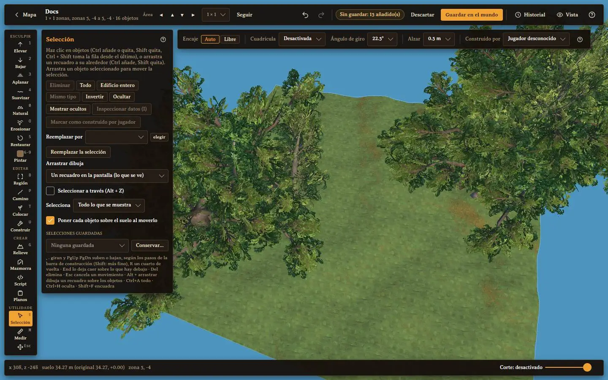

<!-- source: 133e1e92 -->
# Despejar árboles y rocas y nivelar un solar

Quita los árboles, las rocas y los arbustos de un lugar y nivélalo para tener un solar plano donde construir.

**Necesitas:** un mundo abierto en 3D, con el juego cerrado o en [modo en vivo](edit-your-game-live.md).

1. Pulsa `B` ([Región](../area.md)). Arriba de su panel, elige **Polígono**.
2. Haz clic en las esquinas alrededor del solar, unos metros más ancho que el edificio, y haz doble clic para cerrarlo.
3. Elige **Objetos**.
4. Revisa las fichas de tipo: **Árboles y troncos**, **Rocas**, **Arbustos y matorrales** y **Recolectables** están
   activadas al principio. Deja **Tus construcciones** desactivada.
5. Pulsa **Seleccionar los objetos (Enter)**. La herramienta Selección se abre con ellos seleccionados.
6. Pulsa `Del`. Han desaparecido.
7. Pulsa `B` para volver a la herramienta Región: el polígono sigue ahí. Elige **Suelo** y luego **Aplanar** en
   **Acción**.
8. Pulsa **media** para la altura media del interior, o escribe una **Altura**. Para que coincida con una puerta que ya
   construiste, apunta al suelo en su umbral y lee la altura en la barra de estado.
9. Ajusta **Borde suave** (3 m para empezar) para que el solar se funda con la pendiente. La línea bajo los ajustes dice
   cuánto suelo se excavará y se rellenará, y qué queda fuera del alcance de 8 m del juego.
10. Pulsa **Aplanar (Enter)**.
11. Opcional: en **Acción**, elige **Pintar**, luego **Tierra** o **Pavimento**, y pulsa **Pintar (Enter)**.
12. Haz clic en **Guardar en el mundo** (o **Aplicar en vivo**).

*Tras **Seleccionar los objetos (Enter)** y `Del`: los árboles de dentro del polígono han desaparecido; los de fuera
siguen en pie.*

## Comprueba que ha funcionado

- Pulsa `M` ([Medir](../measure.md)) y mide a lo ancho del solar: **Más bajo / más alto** deberían coincidir.
- O activa **Colores de pendiente** en el panel Vista: el solar se ve verde.

## Deshacerlo

- Cada acción es un paso: `Ctrl+Z` retira la última. Después de guardar, deshazla y vuelve a guardar (consulta
  [Deshacer un paso, retirar un cambio o descartarlo todo](undo-changes.md)).
- Para que los árboles vuelvan a crecer más adelante, selecciona el lugar, elige **Recuperar** y usa **Regenerar la
  naturaleza** (consulta [Región](../area.md#regenerar-la-naturaleza)).

## Relacionado

- [Región, copiar y pegar](../area.md)
- [Máscara](../masks.md): nivelar solo el pie de una pendiente
- [Hacer un camino o una rampa colina arriba](make-a-road.md)
