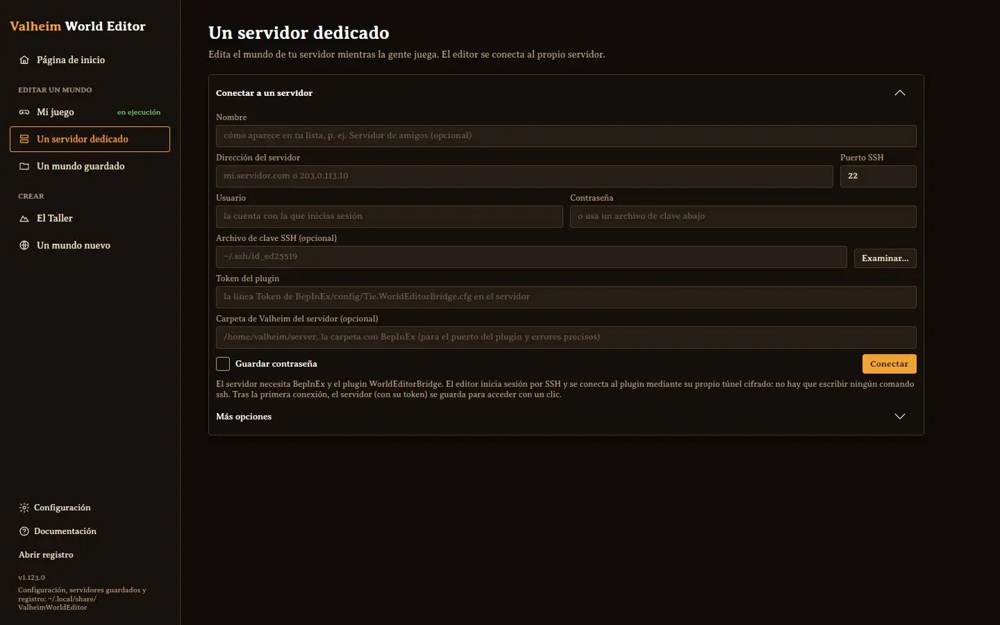

<!-- source: 52199907 -->
# Editar un servidor dedicado mientras la gente juega

Conecta el editor a tu servidor dedicado y cambia su mundo mientras los jugadores siguen en línea.

**Necesitas:** acceso SSH a la máquina que ejecuta el servidor (un inicio de sesión en la terminal, con contraseña o
con un archivo de clave: SFTP o el gestor de archivos de un panel web no bastan por sí solos), permiso para instalar
ahí BepInEx y el plugin WorldEditorBridge y para reiniciarlo. Para un servidor de juego alquilado a un proveedor (un
panel web y FTP, sin SSH), o
uno que un panel de juegos como Pterodactyl ejecuta en un contenedor: ver
[Editar un servidor alquilado o alojado con panel](edit-a-rented-server.md).

*El formulario bajo **Un servidor dedicado**. Tras la primera conexión, el servidor se guarda encima de él, para
acceder con un clic.*

1. En el servidor, instala BepInEx ([BepInExPack for Valheim](https://thunderstore.io/c/valheim/p/denikson/BepInExPack_Valheim/),
   siguiendo sus instrucciones para servidores dedicados).
2. Copia `WorldEditorBridge.dll` (de `WorldEditorBridge-<version>.zip` en la
   [página de versiones](https://github.com/Shuiei/valheim-world-editor/releases/latest)) en `BepInEx/plugins` del
   servidor, o instala WorldEditorBridge en el perfil de servidor de un gestor de mods.
3. Reinicia el servidor con BepInEx. Su `BepInEx/LogOutput.log` dice ahora `WorldEditorBridge <version> listening on
   http://127.0.0.1:5182/`.
4. En el servidor, abre `BepInEx/config/Tie.WorldEditorBridge.cfg` y copia el valor de su línea `Token`. El archivo
   solo existe una vez que el servidor ha arrancado con el plugin.
5. En la página de inicio del editor, elige **Un servidor dedicado** y luego **Conectar a un servidor**.
6. Rellena **Dirección del servidor**, **Usuario** y **Contraseña** o **Archivo de clave SSH (opcional)**. Pega el
   token en **Token del plugin**.
7. Opcional: rellena **Carpeta de Valheim del servidor (opcional)** (la carpeta que contiene `BepInEx`), para que el
   editor pueda decir exactamente qué falla si el plugin no responde. Marca **Guardar contraseña** para no volver a
   escribirla.
8. Pulsa **Conectar**. El editor inicia sesión por SSH, abre su propio túnel cifrado hasta el plugin y carga el mundo.
9. En el mapa, elige un sitio, **Editar en 3D**, haz un cambio y pulsa **Aplicar en vivo**.

## Comprueba que ha funcionado

- La barra superior muestra **EN VIVO**; después de aplicar, «Todo aplicado» y «Aplicado al juego en marcha: …» en la
  barra de estado.
- Los jugadores cerca del cambio lo ven al instante.
- El servidor aparece ahora encima del formulario, y en **Página de inicio**, para acceder con un clic la próxima vez.

Si en su lugar aparece un mensaje bajo el formulario, ver [Un servidor no se conecta](../help/troubleshooting.md#un-servidor-no-se-conecta).

## Deshacerlo

Pulsa `Ctrl+Z` (o **Quitar** el paso en el Historial) y luego **Aplicar en vivo** otra vez. Los restablecimientos de
zona no se pueden deshacer una vez aplicados.

## Los demás campos del formulario

| Campo | Qué es |
|---|---|
| **Nombre** | Cómo aparece el servidor en tu lista (opcional; si no, la dirección). |
| **Dirección del servidor** | El nombre o la dirección IP del servidor. También puedes escribir aquí `user@address`. |
| **Puerto SSH** | 22, salvo que se haya cambiado el SSH del servidor. |
| **Archivo de clave SSH (opcional)** | Tu clave privada (**Examinar…** para elegirla). Vacío: se prueban las claves habituales de `~/.ssh` (`id_ed25519`, `id_ecdsa`, `id_rsa`); una que el editor no puede usar se salta, y se siguen probando las demás y la contraseña. |
| **Token del plugin** | Siempre lo escribes tú: el editor nunca lo lee del servidor, así que un inicio de sesión SSH por sí solo no puede cambiar el mundo. |
| **Más opciones** → **Frase de contraseña de la clave** | La frase de contraseña de la clave, cuando la tiene. Nunca se guarda. |
| **Más opciones** → **Puerto del plugin** | El puerto del plugin en el servidor, cuando no es 5182 y no se indica ninguna carpeta. |
| **Más opciones** → **Tengo mi propio túnel** | **Dirección del puente** y **Token**, y luego **Conectar**: para un túnel que hiciste con `ssh -L` o PuTTY. |

## Servidores guardados

Tras la primera conexión, el servidor aparece en la lista encima del formulario, primero los más recientes, con
**Conectar**, **editar** y **olvidar**; el formulario se pliega bajo **Conectar a otro servidor**. Cada fila muestra
`user@address`, si usa un archivo de clave, una contraseña guardada o si la pide, y cuadros para lo que no está
guardado.

- **editar** rellena el formulario con el servidor; cambia lo que necesites y luego **Conectar** lo actualiza.
- **olvidar** lo quita, con su contraseña y su token.

Los servidores se guardan en `servers.cfg` en la carpeta de datos del editor (el menú lateral de la página de inicio
la muestra), una sección por servidor (`Host`, `SshPort`, `User`, `Password`, `KeyFile`, `Token`, `BridgePort`,
`GameFolder`, `HostKey`), así que también puedes editarlo a mano. Un servidor es una cuenta en una dirección y un
puerto: volver a conectarte con los mismos actualiza su sección.

`Password` solo se rellena cuando se marcó **Guardar contraseña**, en texto plano (en Linux solo tú puedes leer el
archivo): mejor usa una clave SSH.

`HostKey` es la identidad del servidor, recordada en la primera conexión. Si alguna vez cambia, el editor se niega a
conectarse, porque alguien podría estar haciéndose pasar por tu servidor. Si reinstalaste el servidor, vacía la línea
`HostKey` de cada servidor guardado con esa dirección para aceptar la nueva identidad.

## Relacionado

- [Modo en vivo](../live-mode.md): Aplicar en vivo, Auto, seguir el juego, jugadores
- [Editar un servidor alquilado o alojado con panel](edit-a-rented-server.md): el servidor de juego de un proveedor,
  Pterodactyl, Docker
- [Edición en vivo](../concepts/live-editing.md#cómo-se-conecta): el túnel SSH y el token
- [Editar el mundo en el que juegas](edit-your-game-live.md)
- [Hacer una copia de seguridad de un mundo antes de editarlo](back-up-a-world.md)
