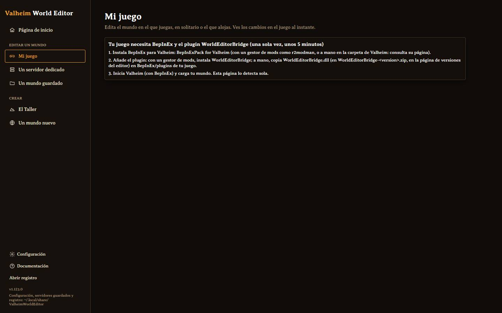
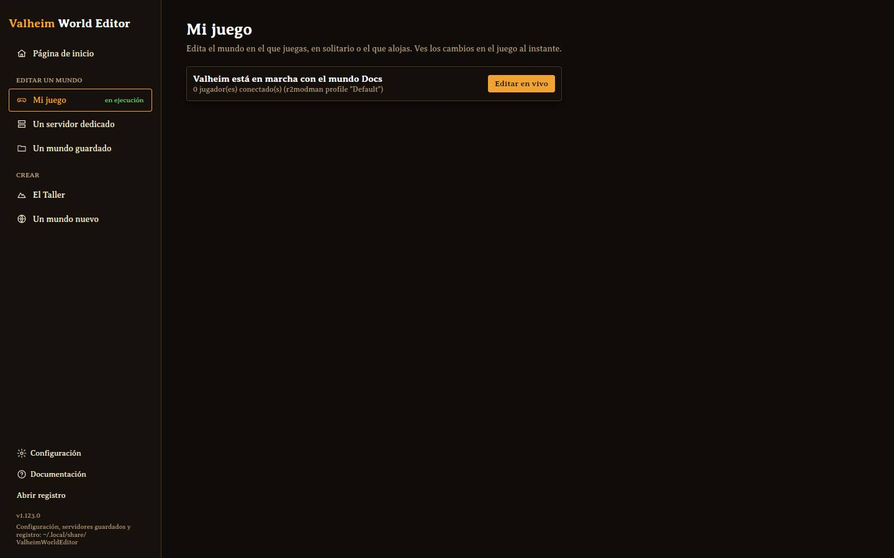

<!-- source: 0fe62110 -->
# Editar el mundo en el que juegas

Cambia el mundo de tu propia partida en marcha (un jugador, o el mundo que alojas) y ve cada cambio en el juego al
instante.

**Necesitas:** Valheim en este equipo, el editor y unos 5 minutos para instalar BepInEx y el plugin
WorldEditorBridge una sola vez.

*Lo que dice **Mi juego** antes de instalar BepInEx y el plugin: los pasos de abajo, en resumen.*

1. Instala **BepInEx** en tu Valheim, una sola vez: [BepInExPack for Valheim](https://thunderstore.io/c/valheim/p/denikson/BepInExPack_Valheim/),
   con un gestor de mods (r2modman, Thunderstore Mod Manager) o a mano en la carpeta de Valheim, como explica su página.
   En Linux con el juego nativo, BepInEx arranca mediante el script de inicio del paquete (su página muestra la opción
   de inicio de Steam); un gestor de mods lo hace por ti.
2. Añade el plugin. Con un gestor de mods, instala **WorldEditorBridge** desde
   [Thunderstore](https://thunderstore.io/c/valheim/p/Tie/WorldEditorBridge/) o
   [Hexium](https://valheim.hexium.gg/mods/Tie/WorldEditorBridge). A mano, copia `WorldEditorBridge.dll` de
   `WorldEditorBridge-<version>.zip` (en la [página de versiones](https://github.com/Shuiei/valheim-world-editor/releases/latest) del editor)
   en `BepInEx/plugins` de tu Valheim o del perfil de tu gestor de mods. Usa el plugin de la misma versión que tu editor.
3. Inicia Valheim con BepInEx y carga tu mundo (un jugador, o inicia un servidor desde el juego para alojarlo). En
   este primer inicio el plugin escribe su configuración y su token secreto, que el editor lee por sí solo.
4. En el editor, abre la página de inicio. **Página de inicio** muestra «Valheim está en marcha con el mundo …» y
   cuántos jugadores hay conectados; **Mi juego**, en el menú lateral, dice *en ejecución*.
5. Haz clic en **Editar en vivo**. El mundo se abre en su mapa.
6. Haz clic en un punto cerca de ti y elige **Editar en 3D**.
7. Haz un cambio, por ejemplo eleva una pequeña colina con el pincel **Elevar**.
8. Pulsa **Aplicar en vivo** (o `Ctrl+S`).

*La página de inicio ha detectado sola el juego en marcha: **Editar en vivo** abre su mundo.*

## Comprueba que ha funcionado

- La barra superior muestra **EN VIVO** y, tras aplicar, «Todo aplicado».
- La barra de estado dice «Aplicado al juego en marcha: …».
- En el juego, la colina aparece al instante. El juego la guarda como cualquier otro cambio.

Hasta que el juego esté listo, **Mi juego** dice qué falta: los tres pasos, «BepInEx está instalado: solo quedan los
pasos 2 y 3», «Inicia Valheim una vez con BepInEx» (el plugin nunca se ha ejecutado) o «Inicia Valheim y carga tu
mundo». Si se queda ahí, consulta [Mi juego muestra pasos que hacer](../help/troubleshooting.md#mi-juego-muestra-pasos-por-hacer).

## Deshacerlo

Pulsa `Ctrl+Z` (o **Quitar** el paso en Historial) y luego **Aplicar en vivo** de nuevo: el juego retira el cambio.
Los restablecimientos de zonas no se pueden deshacer una vez aplicados. Para que cada cambio se aplique en cuanto lo
haces, activa **Auto**.

## Relacionado

- [Modo en vivo](../live-mode.md): Aplicar en vivo, Auto, seguir el juego, jugadores
- [Editar un servidor dedicado mientras la gente juega](edit-a-server-live.md)
- [Edición en vivo](../concepts/live-editing.md#cómo-se-conecta): cómo llega el editor al juego
- [Deshacer un paso, retirar un cambio o descartarlo todo](undo-changes.md)
