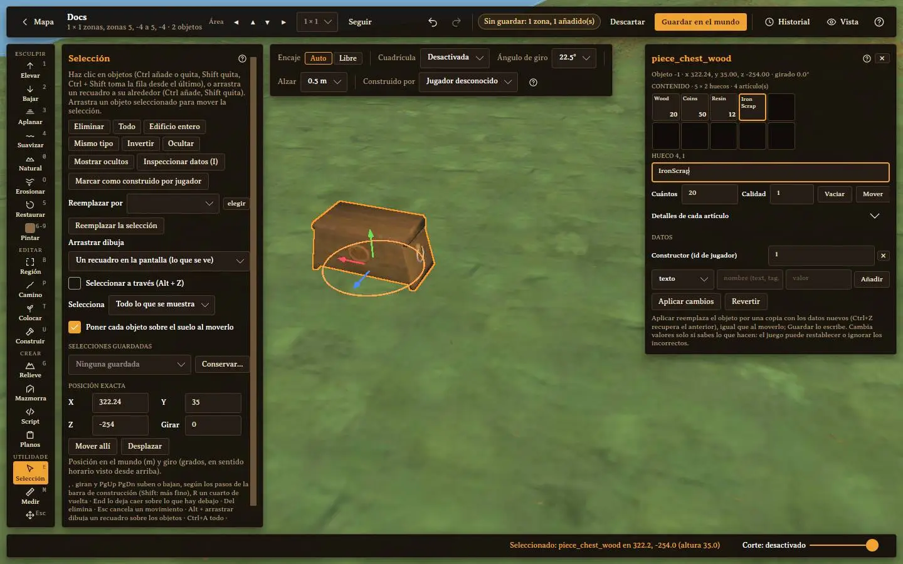

<!-- source: 0fb1e9cf -->
# Cambiar lo que contiene un cofre o lo que dice un cartel

Mete artículos en un cofre, sácalos o escribe un texto nuevo en un cartel, con el Inspector.

**Necesitas:** un mundo abierto en el editor, con el área alrededor del cofre o del cartel abierta. Para encontrarlo
antes, ver [Encontrar un objeto, un artículo de un cofre o un cartel](find-things.md).

## Un cofre

1. Pulsa `E` para abrir [Selección](../select.md).
2. Haz doble clic en el cofre: queda seleccionado solo y se abre en el Inspector, con sus huecos mostrados como en el
   juego.
3. Haz clic en un hueco vacío.
4. En **Buscar un artículo…**, escribe unas letras del artículo (`iron`, `mead`) y elígelo en la lista.
5. Ajusta **Cuántos** y, para herramientas y armaduras, **Calidad**.
6. Repite para otros huecos. Para sacar un artículo, haz clic en su hueco y luego en **Vaciar**; para moverlo,
   **Mover** y luego otro hueco.
7. Haz clic en **Aplicar cambios**.
8. Haz clic en **Guardar en el mundo** (o **Aplicar en vivo**).

Cuántos se recorta a la pila más grande que el juego permite para ese artículo. El contenido cambiado sigue siendo
del cofre: un cofre que nadie ha abierto no se llena encima con el botín del juego.

*Clic en el hueco 4, IronScrap elegido en **Buscar un artículo…** y **Cuántos** en 20; Wood, Coins y Resin llenan los
tres primeros huecos. **Aplicar cambios** los mete en el cofre.*

## Un cartel

1. Pulsa `E` y luego haz clic en el cartel.
2. Pulsa `I` (**Inspeccionar datos (I)**): hacer doble clic en un cartel seleccionaría toda la construcción.
3. En **DATOS**, busca **Texto (cartel)** y escribe el texto nuevo.
4. Haz clic en **Aplicar cambios** y luego en **Guardar en el mundo** (o **Aplicar en vivo**).

Para un cartel que aún no tiene texto, usa **Añadir**: elige **texto**, escribe `text` como nombre y luego las
palabras.

## Comprueba que ha funcionado

Vuelve a seleccionar el cofre o el cartel y pulsa `I`: el Inspector muestra el contenido o el texto nuevos. Después de
guardar, abre el cofre o lee el cartel en el juego.

## Deshacerlo

- Antes de aplicar: **Revertir** olvida los cambios de la tarjeta.
- Después de aplicar: `Ctrl+Z` devuelve el cofre o el cartel anterior.
- Después de guardar: ver [Deshacer un paso, retirar un cambio o descartarlo todo](undo-changes.md).

## Relacionado

- [Inspector](../select.md#inspector) (en la página Selección)
- [Qué es un objeto](../concepts/objects.md#qué-es-un-objeto)
- [Encontrar un objeto, un artículo de un cofre o un cartel](find-things.md)
