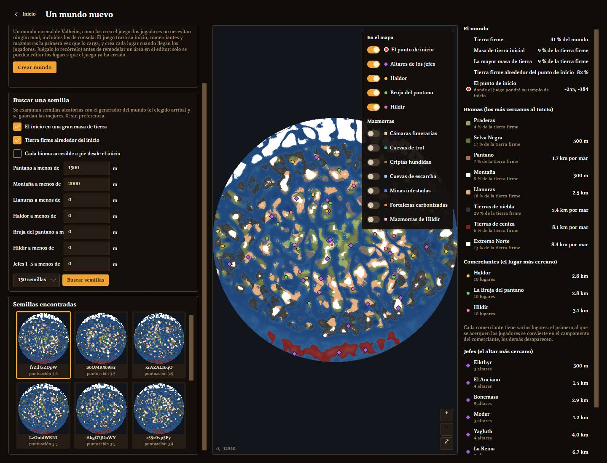

<!-- source: cccbe33c -->
# Buscar una semilla con lo que quieres cerca del inicio

Deja que el editor revise muchas semillas y elige una cuyo inicio tenga cerca los biomas, comerciantes o jefes que
quieres; luego crea el mundo.

**Necesitas:** el editor y Valheim en este equipo. No hace falta tener ningún mundo abierto.

1. En la página de inicio, elige **Un mundo nuevo** en **Crear** y luego **Crear un mundo nuevo**.
2. En **Buscar una semilla**, deja activados **El inicio en una gran masa de tierra** y **Tierra firme alrededor del
   inicio**, o desactívalos si te gustan las islas.
3. Opcional: activa **Cada bioma accesible a pie desde el inicio** para no necesitar un barco pronto.
4. Fija las distancias que quieras, en metros: **Pantano a menos de**, **Montaña a menos de**, **Llanuras a menos
   de**, un comerciante (**Haldor a menos de**, **Bruja del pantano a menos de**, **Hildir a menos de**) o **Jefes
   1–5 a menos de**. Deja un cuadro en 0 si no tienes preferencia. Las preferencias de comerciantes y jefes hacen la
   búsqueda unas cuantas veces más lenta.
5. Elige cuántas semillas revisar: **60 semillas**, **150 semillas** o **400 semillas**.
6. Pulsa **Buscar semillas**. La barra muestra por dónde va; **Detener** conserva las mejores encontradas hasta el
   momento.
7. En **Semillas encontradas**, pasa el cursor por una semilla para ver sus datos y luego haz clic en ella para verla
   en el mapa grande.
8. Compruébala en el mapa grande: la búsqueda mira cada semilla a grandes rasgos y puede pasar por alto islas pequeñas
   o estrechos. Opcional: activa los tipos de **Mazmorras** que te interesen.
9. Escribe el **Nombre** del mundo, elige **Guardado en** y pulsa **Crear mundo**.
10. Arranca Valheim y carga el mundo una vez antes de editarlo en el editor: el juego crea cada lugar cuando los
    jugadores se acercan.

*Las preferencias a la izquierda; las mejores semillas en **Semillas encontradas**, primero la mejor, cada una con su
puntuación.*

## Comprueba que ha funcionado

- El editor abre el mapa del mundo nuevo con el mensaje «Creado … (semilla …)».
- En Valheim, el mundo está en la lista de la carpeta que elegiste; un personaje nuevo aparece en el lugar del punto
  rojo.
- Los lugares de los comerciantes y los jefes están donde los mostraba la página.

## Deshacerlo

No se crea nada hasta **Crear mundo**. Para deshacerte de un mundo que creaste, elimina su carpeta de la carpeta de
mundos en la que se guardó (la opción **Guardado en**). Una semilla que te guste siempre se puede volver a escribir:
la misma semilla crea el mismo mundo.

## Relacionado

- [Un mundo nuevo](../new-world.md): cada control, el mapa, los datos y cómo se puntúan las semillas
- [Abrir un mundo que no está en la lista](open-a-world.md)
- [Editar un mundo creado con Expand World, Riverheim o Tunnelheim](use-mods-worlds.md)
