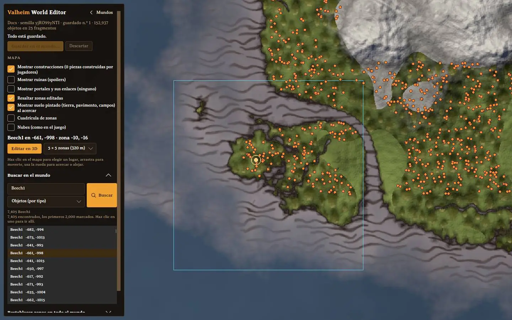

<!-- source: 1ca7ded6 -->
# Encontrar un objeto, un artículo de un cofre o un cartel

Busca en todo el mundo un objeto, un artículo en cualquier cofre o un texto en un cartel o un portal, y ábrelo en 3D.

**Necesitas:** un mundo abierto en su [mapa](../map.md).

1. En el panel lateral del mapa, abre **Buscar en el mundo**.
2. Escribe parte de lo que buscas: un tipo (`portal`, `chest`, `Beech`), un artículo (`Silver`, `Wood`) o palabras de
   un cartel. Da igual que uses mayúsculas o minúsculas.
3. Elige qué buscar: **Objetos (por tipo)**, **Artículos en contenedores** o **Textos (carteles, portales, guardas…)**.
4. Pulsa **Buscar** (o `Enter`). Cada resultado se marca en naranja en el mapa y aparece en la lista con un recuento
   por tipo.
5. Haz clic en un resultado de la lista. El mapa se centra en él y elige su zona.
6. Pulsa **Editar en 3D**. El editor se abre con ese objeto seleccionado. Para un artículo o un texto, también se
   abren sus datos.
7. Opcional: cambia el contenido del cofre o el texto del cartel (consulta
   [Cambiar lo que contiene un cofre o lo que dice un cartel](fill-a-chest.md)) y luego **Guardar en el mundo** (o
   **Aplicar en vivo**).

*Cada marca es un objeto encontrado; el que eliges en la lista es más grande, con un anillo dorado.*

## Comprueba que ha funcionado

- La línea sobre los resultados dice cuántos se encontraron. La lista muestra los 300 primeros; se marcan hasta 2000.
- **¿No se encontró nada?** Revisa la ortografía y qué elegiste buscar. La búsqueda ve el mundo tal como está en el
  editor: no encuentra los objetos que eliminaste sin guardar. Los objetos internos del propio juego (`_ZoneCtrl`…)
  solo aparecen cuando tu texto empieza por `_`.

## Deshacerlo

La búsqueda no cambia nada. Un cambio que hagas en el objeto es un paso: `Ctrl+Z` lo deshace.

## Relacionado

- [Mapa del mundo](../map.md#buscar-en-el-mundo)
- [Cambiar lo que contiene un cofre o lo que dice un cartel](fill-a-chest.md)
- [Selección](../select.md)
