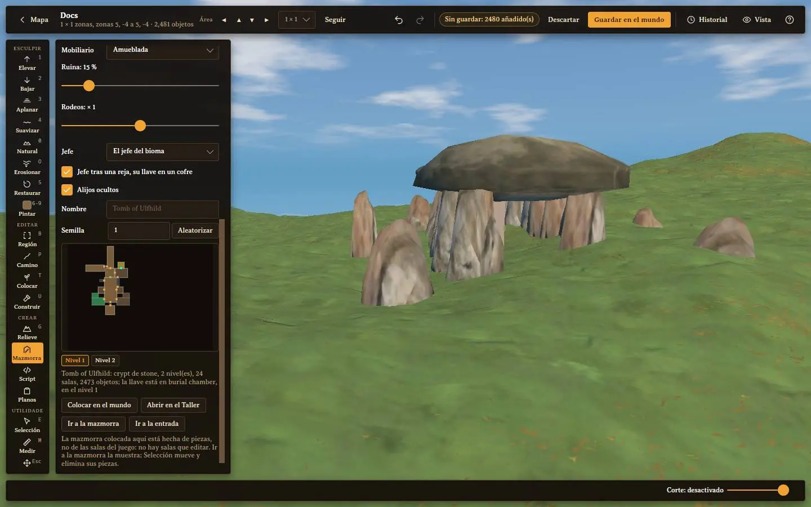

<!-- source: 89221403 -->
# Generar una mazmorra y ponerla en el mundo

Crea una mazmorra entera a partir de unas pocas elecciones y colócala detrás de una entrada, como hace el juego con
las suyas.

**Necesitas:** un mundo abierto en el editor, con abierta el área donde va la entrada, en una zona que todavía no
tenga entrada de mazmorra (antes, una copia de seguridad: consulta [Hacer una copia de seguridad de un
mundo](back-up-a-world.md)).

## Pasos

1. Haz clic en **Mazmorra** en la barra de herramientas (sección CREAR).
2. En **Generar una mazmorra**, elige el **Bioma**: fija los monstruos, el botín y la entrada en el suelo.
3. Elige el **Tamaño** y los **Niveles**, y el jefe en **Jefe**.
4. Mira el plano; haz clic en **Nivel 1**, **Nivel 2**... debajo de él para ver cada nivel.
5. Opcional: haz clic en **Aleatorizar** hasta que te guste el plano, o escribe un **Nombre** para el cartel del
   vestíbulo de entrada.
6. Gira la vista hacia el lugar donde debe ir la entrada, con ese lugar en el centro de la vista.
7. Haz clic en **Colocar en el mundo**. La entrada aparece en el suelo, con la puerta mirando hacia ti.
8. Haz clic en **Ir a la mazmorra** para mirar dentro desde arriba, sin los techos.
9. Haz clic en **Ir a la entrada** para volver abajo.
10. Haz clic en **Guardar en el mundo** (o **Aplicar en vivo**).

*La entrada tras **Colocar en el mundo**: el túmulo de una cámara funeraria, con la puerta mirando a la cámara.*

Para cambiar la mazmorra a mano antes de colocarla (mover muebles, llenar cofres), guarda (o aplica) tus cambios y
haz clic en **Abrir en el Taller** en lugar del paso 7: el Taller ocupa el lugar del mundo. Cambia la mazmorra, haz
clic en **Guardar plano**, vuelve a abrir el mundo y pégala: consulta [Pegar un plano en un
mundo](paste-a-blueprint.md).

## Comprueba que ha funcionado

La barra de estado dice *Generado …: … objetos, 5000 m por encima de aquí.* **Ir a la mazmorra** muestra sus salas.
Después de guardar, abre el mundo en el juego, camina hasta la entrada y cruza la puerta: llegas al vestíbulo de
entrada.

## Deshacerlo

- Antes de guardar: `Ctrl+Z` deshace toda la colocación en un solo paso.
- Después de guardar: consulta [Deshacer un paso, retirar un cambio o descartarlo todo](undo-changes.md), o
  [Restaurar un área desde una copia de seguridad](restore-from-backup.md).

## Consejos

- *Ya hay algo ahí arriba*: cada zona (64 × 64 m) contiene una sola mazmorra. Pon la entrada en otra zona.
- Las mismas elecciones y la misma semilla siempre crean la misma mazmorra de piezas de construcción: anota la
  **Semilla** para volver a crearla. Una mazmorra de salas propias del juego se vuelve a trazar desde su entrada al
  colocarla, así que también necesita el mismo lugar y la misma orientación.
- **Material: Las salas propias del juego** la construye en cambio con las salas del juego, para editarla sala por
  sala.

## Relacionado

- [Mazmorra](../dungeons.md)
- [Cómo guarda el juego las mazmorras](../concepts/dungeons.md#cómo-guarda-el-juego-las-mazmorras)
- [Taller](../workshop.md)
