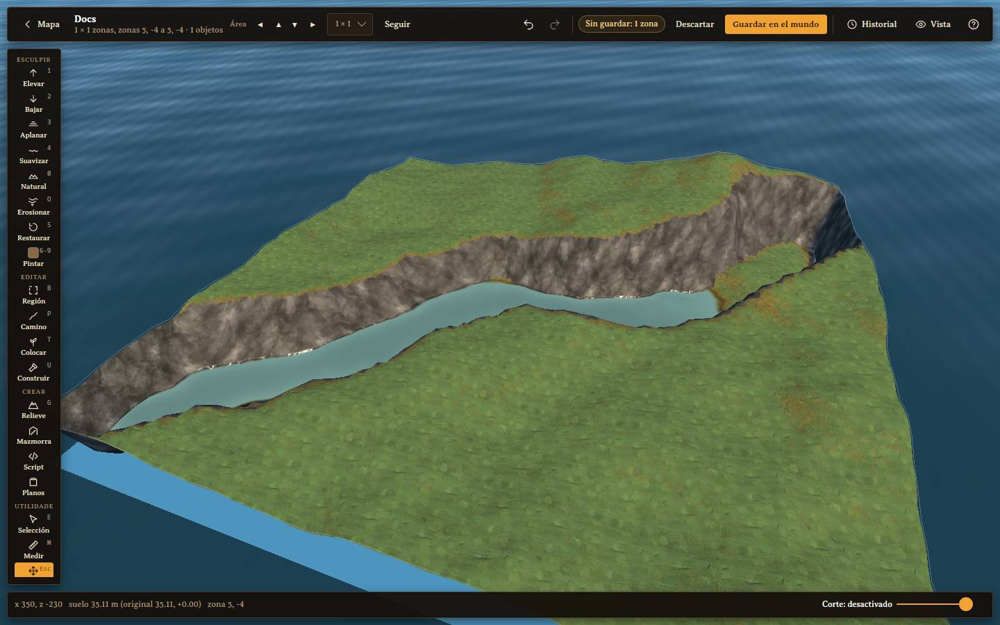

<!-- source: d55dc125 -->
# Excavar un río o un estanque

Excava un río, un canal o un estanque que se llene de agua.

**Necesitas:** un mundo abierto en 3D, con el juego cerrado o en [modo en vivo](edit-your-game-live.md). Lo más fácil
es un terreno bajo cerca del mar.

Valheim no tiene agua que fluya: el agua de los ríos es el mar, a 30 m en todas partes. Un río o un estanque solo tiene
agua donde su lecho está por debajo de 30 m.

1. Pasa el cursor por el recorrido y lee la altura del suelo en la barra de estado. Con **Sin límite** desactivado solo
   puedes excavar 8 m hacia abajo, así que el suelo por encima de unos 36 m no retendrá agua.
2. Pulsa `P` ([Camino](../path.md)) y haz clic en puntos a lo largo del río, desde el mar o un lago hacia el interior.
3. En el panel, elige **Río / canal (agua)**.
4. Ajusta **Ancho** (el ancho del agua), **Borde suave** (las orillas) y **Profundidad** (cuánto queda el lecho por
   debajo del nivel del mar en su centro; 2 m al principio).
5. Pulsa **Aplicar (Enter)**. El lecho se llena de agua.
6. Para un estanque, pulsa `B` ([Región](../area.md)), elige **Polígono**, haz clic alrededor del estanque y haz doble
   clic en la última esquina para cerrar la forma.
7. En el grupo **Suelo**, elige **Aplanar** en **Acción**, escribe una **Altura** por debajo de 30 m (28 m da un agua
   de 2 m de profundidad), pon **Borde suave** en unos 5 m para unas orillas suaves y pulsa **Aplanar (Enter)**.
8. Haz clic en **Guardar en el mundo** (o **Aplicar en vivo**).

*Un río excavado con Río / canal (agua): el mar lo llena.*

## Comprueba que ha funcionado

- El agua aparece en la vista 3D en cuanto el lecho queda por debajo de 30 m.
- Si la barra de estado dice que una parte llegó al límite del juego, el suelo es demasiado alto ahí: bájalo primero
  cerca del mar, sigue un terreno más bajo o activa **Sin límite** (consulta [Elevar o excavar más allá del límite de 8 m del juego](raise-past-the-limit.md)).

## Deshacerlo

`Ctrl+Z` deshace el último **Aplicar** o **Aplanar**. Después de guardar, deshaz y guarda de nuevo (consulta
[Deshacer un paso, retirar un cambio o descartarlo todo](undo-changes.md)).

Para rellenar un río más adelante, cuando ya no queden pasos para deshacer, dibuja de nuevo la línea (o consérvala) y
aplica **Restaurar** de la herramienta Camino: el suelo a lo largo de ella vuelve a como lo generó el mundo. El pincel
**Restaurar** (`5`) hace lo mismo en un solo lugar.

## Relacionado

- [Camino](../path.md#río-o-canal)
- [Medir y superposiciones](../measure.md): profundidad del agua
- [Límites del suelo](../concepts/ground-limits.md)
