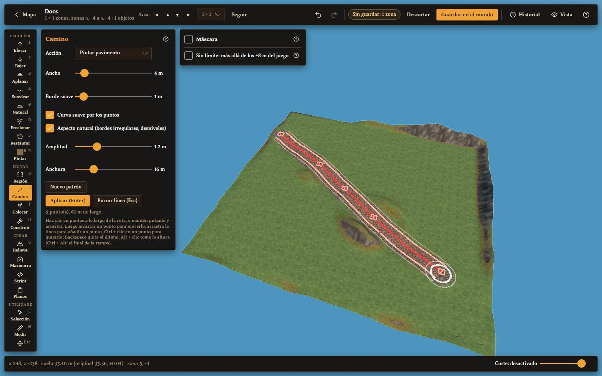

<!-- source: 20a95afa -->
# Hacer un camino o una rampa colina arriba

Dibuja un camino llano con una rampa uniforme que sube la colina, pavimentado por el centro.

**Necesitas:** un mundo abierto en 3D, con el juego cerrado o en [modo en vivo](edit-your-game-live.md).

1. Opcional: comprueba antes la pendiente. Pulsa `M` ([Medir](../measure.md)), haz clic en el pie de la colina y luego
   en su cima: **Desnivel** es la que dará una rampa entre ambos puntos.
2. Pulsa `P` ([Camino](../path.md)) y haz clic en puntos a lo largo de la parte llana del camino.
3. En el panel, elige **Aplanar**. Haz `Alt`+clic en el suelo para tomar su altura, o escríbela en **Altura**.
4. Ajusta **Ancho** (8 m es un buen camino) y **Borde suave** (4 m lo funde con la pendiente).
5. Opcional: marca **Aspecto natural (bordes irregulares, desniveles)** para un sendero gastado.
6. Pulsa **Aplicar (Enter)** y luego **Borrar línea (Esc)**.
7. Para la colina, haz clic en un punto de su pie y en otro de su cima, y elige **Rampa (inicio → fin)**. **Inicio** y
   **Fin** siguen el suelo bajo los dos extremos; escribe una altura para cambiar uno.
8. Pulsa **Aplicar (Enter)**. La línea se queda.
9. Para pavimentarlo, elige **Pintar pavimento**, reduce **Ancho** y **Borde suave** (4 m y 1 m) y vuelve a pulsar
   **Aplicar (Enter)** sobre la misma línea.
10. Haz clic en **Guardar en el mundo** (o **Aplicar en vivo**).

*Un camino hecho con Aplanar a través de dos montículos y luego Pintar pavimento (Ancho 4 m, Borde suave 1 m) sobre la
misma línea.*

## Comprueba que ha funcionado

- Mide a lo largo del camino: **Desnivel** se mantiene igual a lo largo de toda una rampa.
- Si algunos puntos se volvieron rojos, parte del camino llegó al límite de 8 m del juego: consulta
  [Elevar o excavar más allá del límite de 8 m del juego](raise-past-the-limit.md).

## Deshacerlo

Cada **Aplicar** es un paso de deshacer: `Ctrl+Z` deshace el último. **Borrar línea (Esc)** solo quita la línea, no lo
que aplicaste. Después de guardar, deshaz y vuelve a guardar (consulta
[Deshacer un paso, retirar un cambio o descartarlo todo](undo-changes.md)).

Para quitar un camino más adelante, cuando ya no queden los pasos de deshacer, dibuja una línea a lo largo de él y
aplica **Restaurar** con un **Ancho** que lo cubra: el suelo vuelve a como lo generó el mundo, sin pintura.

## Relacionado

- [Camino](../path.md)
- [Medir y superposiciones](../measure.md)
- [Despejar árboles y rocas y nivelar un solar](clear-an-area.md)
