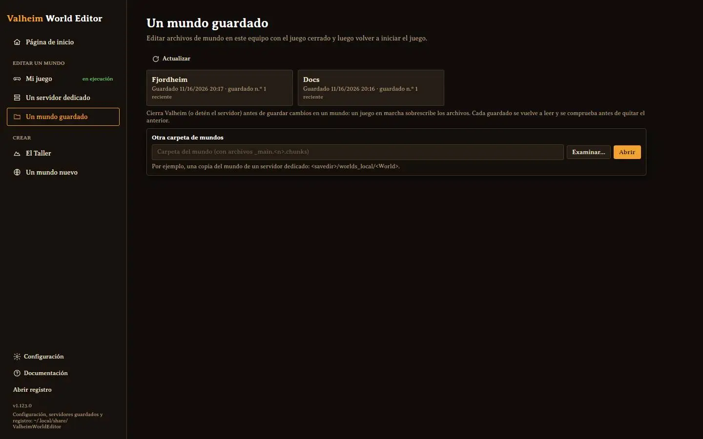

<!-- source: 289a125b -->
# Abrir un mundo que no está en la lista

Abre un mundo desde cualquier carpeta de este equipo: una copia del mundo de un servidor, una copia de seguridad, un
mundo en otra unidad.

**Necesitas:** la carpeta del mundo (la que contiene los archivos `_main.<n>.chunks`), y que ningún juego ni servidor
esté en marcha con él.

1. Cierra Valheim, o detén el servidor que usa el mundo: un juego en marcha sobrescribe los archivos que guarda el
   editor.
2. Para el mundo de un servidor dedicado, copia su carpeta, `<savedir>/worlds_local/<World>`, del servidor a este
   equipo.
3. En la página de inicio, haz clic en **Un mundo guardado**.
4. En **Otra carpeta de mundos**, haz clic en **Examinar…** y elige la carpeta del mundo, o pega su ruta en el cuadro.
5. Haz clic en **Abrir**. El mundo se abre en su [mapa](../map.md).
6. Opcional: para tener el mundo en la lista siempre, abre **Configuración**, haz clic en **Añadir una carpeta** en
   **Carpetas de mundos**, elige la carpeta del mundo (o una carpeta de mundos) con **Examinar…** y luego **Guardar**.

*Los mundos que el editor encontró por sí solo y, debajo, **Otra carpeta de mundos** con **Examinar…** y **Abrir**.*

## Comprueba que ha funcionado

- El mapa muestra el mundo, con su nombre y su semilla arriba del panel lateral.
- En **Página de inicio**, el mundo aparece en **Recientes**, así que la próxima vez se abre con un clic.
- Con la carpeta añadida en **Configuración**, **Un mundo guardado** muestra el mundo con *tuyo* bajo su nombre.

## Deshacerlo

Abrir un mundo no cambia nada en él: solo **Guardar en el mundo** escribe. Para quitar una carpeta de la lista, abre
**Configuración**, haz clic en **✕** junto a ella en **Carpetas de mundos** y luego en **Guardar**.

## Consejos

- El editor dice qué le pasa a una carpeta: «Esa carpeta contiene mundos; elige uno de ellos» (elegiste
  `worlds_local`: elige un mundo dentro de ella) o «No hay ningún mundo de Valheim en esa carpeta».
- Un mundo en el antiguo formato de un solo archivo (`<World>.db` y `.fwl`) aparece en gris: cárgalo una vez en Valheim
  y el juego lo convierte en una carpeta de mundo que el editor abre.
- Un mundo hecho con un mod de generación de mundos (Expand World, Riverheim) necesita su complemento: consulta
  [Editar un mundo creado con Expand World, Riverheim o Tunnelheim](use-mods-worlds.md).
- Después de editar aquí el mundo de un servidor, vuelve a copiar la carpeta al servidor con el servidor detenido.

## Relacionado

- [Hacer una copia de seguridad de un mundo antes de editarlo](back-up-a-world.md)
- [Editar un servidor dedicado mientras la gente juega](edit-a-server-live.md)
- [La ventana del editor](../editor-basics.md)
- [El mapa del mundo](../map.md)
