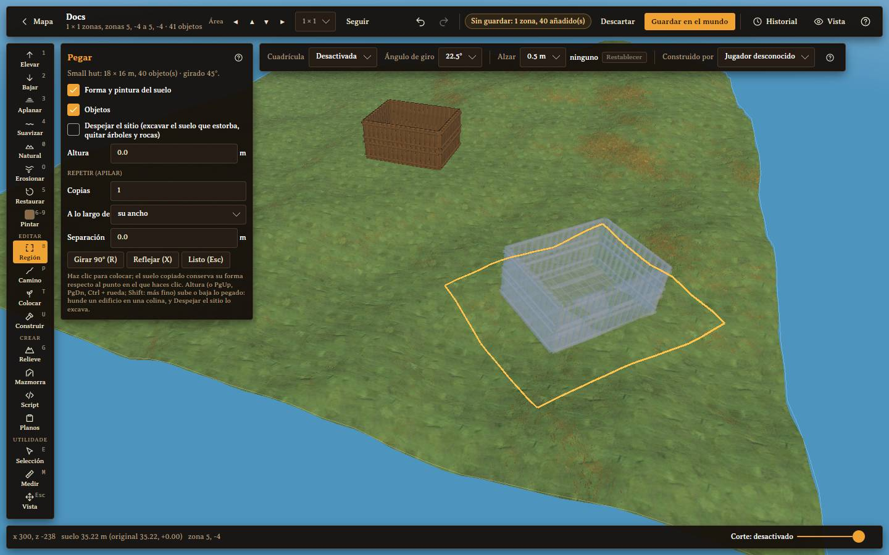

<!-- source: 45f0d395 -->
# Pegar un plano en un mundo

Pon en un mundo un edificio de tu biblioteca de planos (hecho en el Taller, guardado desde un mundo o importado).

**Necesitas:** un mundo abierto en el editor, con abierta el área donde va el edificio, y un plano en la biblioteca
(consulta [Taller](../workshop.md)). Antes, una copia de seguridad: consulta [Hacer una copia de seguridad de un mundo](back-up-a-world.md).

## Pasos

1. Haz clic en **Planos** en la barra de herramientas (sección CREAR).
2. Opcional: para traer un archivo que te han enviado, haz clic en **Importar archivo…** y elige el archivo `.blueprint`
   o `.vbuild`.
3. Escribe una palabra de su nombre o sus etiquetas en **Buscar planos**.
4. Haz clic en **Pegar** junto al plano. El panel se cierra y el plano sigue al cursor, transparente.
5. Gíralo con `R` (un cuarto de vuelta) o con `,` `.` (según **Ángulo de giro** en la barra de construcción); pulsa
   `X` para reflejarlo.
6. Opcional: para hundirlo en una pendiente, bájalo con `PgDn` (o `Ctrl` + rueda). **Despejar el sitio**, en el panel
   Pegar (activado al principio), excava el suelo que estorba y quita árboles y rocas.
7. Haz clic donde debe quedar. Vuelve a hacer clic en otro sitio para más copias.
8. Pulsa `Esc` para dejar de pegar.
9. Haz clic en **Guardar en el mundo** (o **Aplicar en vivo**).

Las piezas pegadas contienen lo que contiene el plano: contenido de cofres, textos de carteles, criaturas. Su
constructor es el jugador elegido en **Construido por** en [la barra de construcción](../build.md#la-barra-de-construcción),
que se muestra mientras pegas; las piezas de una ruina se quedan sin constructor. Las piezas de mods que este mundo no
tiene se omiten, y el mensaje las enumera.

*Tras **Pegar**: la cabaña sigue al cursor, transparente, con su huella delineada, girada 45° (`turned 45°` en el
panel **Pegar**), y **Despejar el sitio** desactivado. Detrás, la cabaña de la que se guardó.*

Un plano marcado como **Una mazmorra** no se pone sobre el suelo: su entrada va donde haces clic y el edificio, 5000 m
por encima. Consulta [Mazmorra](../dungeons.md).

## Comprueba que ha funcionado

El edificio queda firme donde hiciste clic, con puntos verdes sin guardar, y la barra de estado dice cuántos objetos
se pegaron. Mira bajo sus bordes: nada debería flotar. Después de guardar, acércate a él en el juego.

## Deshacerlo

- Antes de guardar: `Ctrl+Z` retira cada pegado.
- Después de guardar: consulta [Deshacer un paso, retirar un cambio o descartarlo todo](undo-changes.md).

## Consejos

- Lo pegado debe caber dentro del área abierta; si dice *No se ha pegado*, abre un área más grande alrededor del lugar.
- Las piezas que el editor coloca por sí mismo (estatuas, decorados, criaturas) también se pegan, aunque el martillo de
  Homestead las omita.
- Para cambiar antes el plano, haz clic en **Abrir** para abrirlo en el Taller.
- Para conservar algo de un mundo como plano: cópialo (la herramienta Región, o `Ctrl+C` en Selección) y luego haz
  clic en **Guardar como plano…** en la fila **Copia** del panel.

## Relacionado

- [Taller](../workshop.md) · [Región](../area.md)
- [Mover o copiar un edificio](move-a-building.md)
- [Piezas construidas por jugadores](../concepts/objects.md#piezas-construidas-por-jugadores)
