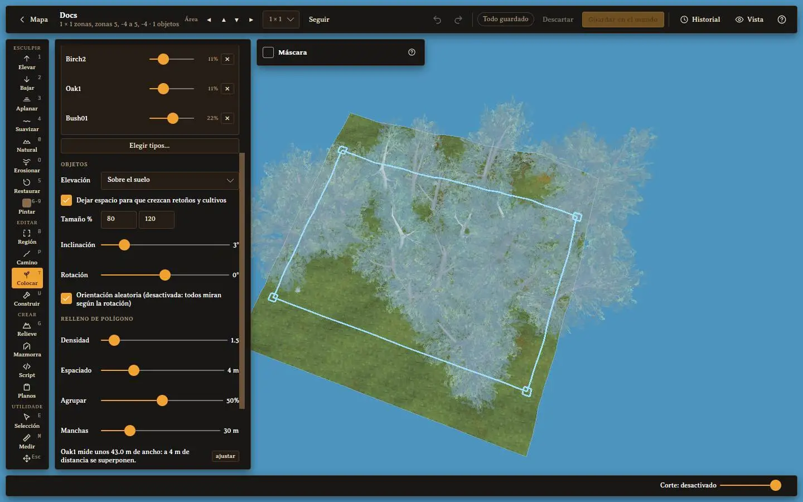

<!-- source: 78139bdb -->
# Plantar un bosque, un campo o un seto

Llena un trozo de terreno con árboles en arboledas naturales, un campo de cultivos en hileras o un seto a lo largo de
una línea.

**Necesitas:** un mundo abierto en el editor (antes, una copia de seguridad: consulta
[Hacer una copia de seguridad de un mundo](back-up-a-world.md)).

## Un bosque

1. Pulsa `T` para abrir [Colocar](../place.md).
2. En **Elegir un preajuste**, elige **Bosque de las Praderas** (o **Bosque de la Selva Negra**, **Pantano**).
3. En la parte superior del panel, elige **Polígono**.
4. Haz clic en puntos del suelo alrededor del contorno del bosque, o mantén pulsado y arrastra para dibujarlo a mano
   alzada.
5. Opcional: en **RELLENO DE POLÍGONO**, sube **Agrupar** a un 50 % para tener arboledas con claros entre ellas, y
   ajusta **Manchas** al tamaño que deben tener las arboledas.
6. Pulsa `N` (**Nueva disposición (N)**) hasta que la vista previa te parezca bien.
7. Pulsa `Enter` para plantarlo.
8. Haz clic en **Guardar en el mundo** (o **Aplicar en vivo**).

*Un polígono de unos 58 × 40 m con **Agrupar** 50 % y **Manchas** 30 m (y **Densidad** 1.5): los
árboles transparentes se reúnen en arboledas con claros entre ellas. Las filas de **RELLENO DE POLÍGONO** están en la
parte inferior del panel.*

## Un campo

1. Pinta el campo con **Cultivar** (barra de herramientas, **Pintar**, o la tecla `7`): los cultivos solo crecen en
   tierra cultivada.
2. En Colocar, haz clic en **Elegir tipos…**, busca `carrot`, marca los cultivos que quieras y luego haz clic en
   **Listo**.
3. Elige **Cuadrícula** y ajusta **Espaciado** en **CUADRÍCULA** (1 m va bien para las zanahorias).
4. Arrastra un recuadro sobre la tierra cultivada y luego pulsa `Enter`.

Deja activado **Dejar espacio para que crezcan retoños y cultivos**, para que cada cultivo tenga el espacio que el juego
necesita para crecer.

## Un seto

1. En Colocar, haz clic en **Elegir tipos…**, busca `bush` y marca uno o dos arbustos.
2. Elige **Línea** y luego **Puntos**.
3. Haz clic en puntos a lo largo del seto; ajusta **Cada** a unos 1.5 m y **Ondulación** a 0.25 m.
4. Pulsa `Enter`.

## Comprueba que ha funcionado

La vista previa transparente se vuelve sólida donde plantaste, con un punto verde de sin guardar en cada objeto. La
barra de estado dice cuántos objetos se colocaron. En el juego, ve hasta allí después de guardar.

## Deshacerlo

- Antes de guardar: `Ctrl+Z` deshace el último polígono, cuadrícula, línea o trazo de pincel.
- Para quitar unos pocos: modo Pincel con los mismos tipos marcados, `Shift` + arrastrar sobre ellos.
- Después de guardar: consulta [Deshacer un paso, retirar un cambio o descartarlo todo](undo-changes.md).

## Relacionado

- [Colocar](../place.md)
- [Reglas de crecimiento](../concepts/objects.md#reglas-de-crecimiento)
- [Despejar árboles y rocas y nivelar un solar](clear-an-area.md)
