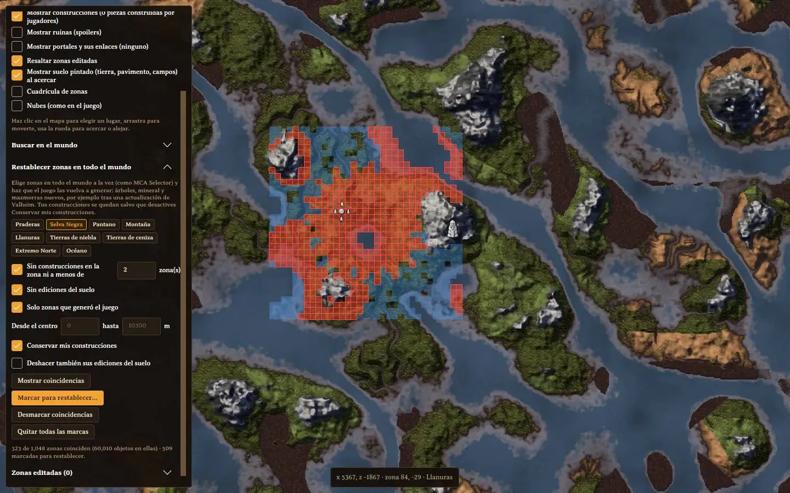

<!-- source: e87fa23c -->
# Volver a generar zonas

Haz que el juego vuelva a crear a partir de la semilla las zonas que elijas, con árboles, rocas, mineral y mazmorras
nuevos, por ejemplo para tener el contenido nuevo de una actualización de Valheim en lugares donde nadie ha construido.

**Necesitas:** el mundo cerrado en el juego (o el servidor detenido), o el [modo en vivo](edit-a-server-live.md), y una
[copia de seguridad del mundo](back-up-a-world.md): un restablecimiento guardado no se puede deshacer.

1. En el juego, aleja a los animales domados de los lugares que vas a restablecer: todo lo que hay en una zona
   restablecida desaparece, salvo las lápidas y, con **Conservar mis construcciones** activado, las piezas construidas
   por jugadores. Después cierra el juego (o detén el servidor), salvo que edites en vivo.
2. Haz una copia de seguridad del mundo.
3. Abre el mundo. Se abre su [mapa](../map.md).
4. En el panel lateral, abre **Restablecer zonas en todo el mundo**.
5. Ajusta el filtro: los biomas que restablecer, y deja activados **Sin construcciones en la zona ni a menos de N
   zona(s)** y **Conservar mis construcciones** para que las bases y el terreno a su alrededor no se toquen. Usa
   **Desde el centro … hasta … m** para restablecer solo una parte del mundo.
6. Pulsa **Mostrar coincidencias**. La primera vez, el editor lee todas las zonas. Las zonas que coinciden se vuelven
   azules, y una línea dice cuántas coinciden y cuántos objetos contienen.
7. Cambia el filtro hasta que las zonas azules sean las que quieres.
8. Pulsa **Marcar para restablecer…**. La pregunta dice cuántas zonas son, qué desaparece y si se conservan tus
   construcciones: léela y acepta. Las zonas se vuelven rojas.
9. Haz clic en **Guardar en el mundo** (o **Aplicar en vivo**).

*Las zonas azules coinciden con el filtro; las rojas están marcadas para restablecer.*

Para restablecer solo las zonas que hay bajo un lugar, usa en su lugar la herramienta [Región](../area.md#restablecer-zonas):
dibuja un recuadro sobre ellas, elige **Recuperar**, luego **Restablecer zonas** en **Acción**, y pulsa **Restablecer
zonas… (Enter)**. Tiene los mismos interruptores **Conservar mis construcciones** y **Deshacer también sus ediciones del
suelo** que el mapa.

## Comprueba que ha funcionado

- Antes de guardar, la línea bajo los botones cuenta las zonas marcadas para restablecer.
- En el juego, ve a una zona restablecida: se vuelve a crear al acercarte, con árboles, rocas y su ubicación nuevos.

## Deshacerlo

- **Antes de guardar:** **Quitar todas las marcas** (en el mapa o en la herramienta Región) cancela todos los
  restablecimientos marcados, y **Desmarcar coincidencias** solo los de las zonas que coinciden con el filtro (uno
  marcado con **Restablecer zonas** de la herramienta Región: también `Ctrl+Z`).
- **Después de guardar:** no se puede deshacer en el editor. Repón la copia de seguridad del mundo del paso 2 (consulta
  [Hacer una copia de seguridad de un mundo antes de editarlo](back-up-a-world.md#deshacerlo)).

## Relacionado

- [Mapa del mundo](../map.md#restablecer-zonas-en-todo-el-mundo)
- [Zonas](../concepts/areas-and-zones.md#zonas)
- [Hacer una copia de seguridad de un mundo antes de editarlo](back-up-a-world.md)
