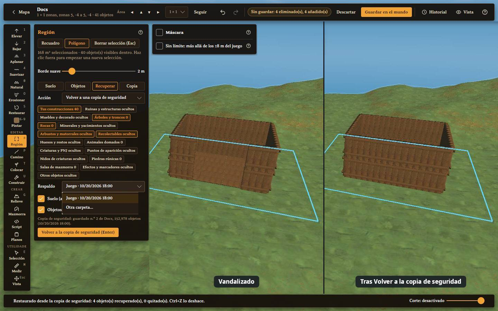

<!-- source: 0a333811 -->
# Restaurar un área desde una copia de seguridad

Devuelve un lugar a como estaba en una copia de seguridad, después de un acto de vandalismo, una mala incursión o una
edición de la que te arrepientes, sin hacer retroceder el resto del mundo.

**Necesitas:** una copia de seguridad del mundo de antes del daño: las propias copias de seguridad del juego junto a la
carpeta del mundo (`<World>_backup_auto-<date>`), o una copia de seguridad de un servidor copiada a este equipo. El
juego cerrado, o el [modo en vivo](edit-a-server-live.md).

1. Abre el mundo y busca el lugar en el [mapa](../map.md). Pulsa **Editar en 3D**.
2. Pulsa `B` ([Región](../area.md)), elige **Polígono** y haz clic alrededor del lugar dañado, un poco más amplio que
   él.
3. Elige **Recuperar** y luego **Volver a una copia de seguridad** en **Acción**.
4. En **Respaldo**, elige una fecha anterior al daño («Juego · fecha»). Para una copia de seguridad de un
   servidor u otra copia, elige **Otra carpeta…** y selecciónala (en vivo, es la única forma). La línea de debajo dice
   qué guardado es.
5. Elige las fichas de tipo que quieres recuperar. Para un edificio, activa **Tus construcciones**.
6. Deja marcados **Suelo (altura y pintura)** y **Objetos de los tipos elegidos arriba**, o desmarca el que no quieras
   recuperar.
7. Pulsa **Volver a la copia de seguridad (Enter)**.
8. Mira el resultado. Si está bien, usa **Guardar en el mundo** (o **Aplicar en vivo**).

*Izquierda: un polígono alrededor de una cabaña a la que le falta parte del muro más cercano, con **Volver a una copia
de seguridad** elegido, la lista **Respaldo** abierta en la copia del juego y **Tus construcciones**
activado. Derecha: después de **Volver a la copia de seguridad (Enter)**, el muro vuelve a estar entero; la línea
encima del botón nombra el guardado de la copia de seguridad y la barra de estado cuenta lo que ha vuelto.*

## Comprueba que ha funcionado

- La barra de estado dice «Restaurado desde la copia de seguridad: el suelo, N objeto(s) recuperado(s), M
  quitado(s).»
- «Nada que restaurar: la selección está como en la copia de seguridad» significa que la copia de seguridad tiene ahí
  los mismos objetos y el mismo suelo: elige una copia más antigua.
- Un cofre restaurado vuelve a tener su contenido: haz clic en él con [Selección](../select.md) (`E`) y pulsa `I` para
  mirar dentro.

## Deshacerlo

`Ctrl+Z` deshace la restauración: es un solo paso en el Historial. Después de guardar, deshazla y vuelve a guardar. Los
objetos de los tipos elegidos que no están en la copia de seguridad se quitan, así que vuelve a restaurar desde una
copia más reciente si has perdido algo que construiste después.

## Relacionado

- [Región: Volver a una copia de seguridad](../area.md#volver-a-una-copia-de-seguridad)
- [Hacer una copia de seguridad de un mundo antes de editarlo](back-up-a-world.md)
- [Copias de seguridad](../concepts/saving-and-history.md#copias-de-seguridad)
