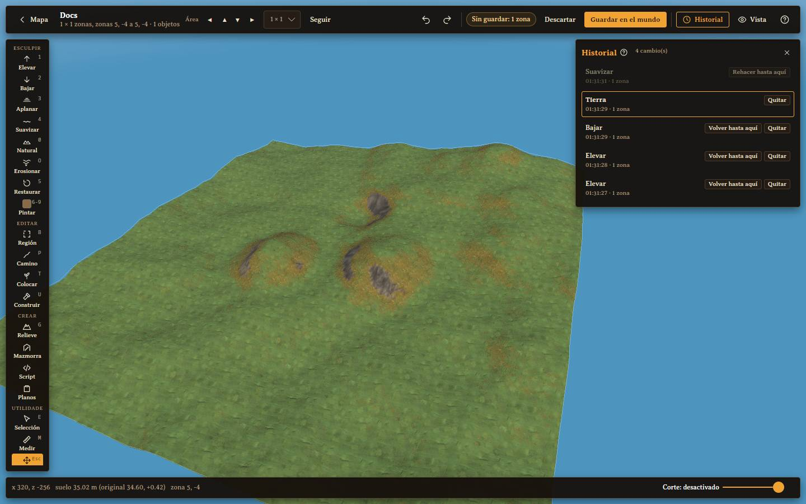

<!-- source: a0f30736 -->
# Deshacer un paso, retirar un cambio o descartarlo todo

Retira lo que hiciste en el editor: los últimos pasos, un cambio del medio conservando el resto, o todo lo que aún no
está guardado.

**Necesitas:** un mundo abierto en 3D (guardado o en vivo) o el Taller, con cambios en el **Historial**.

1. Para deshacer el último cambio, pulsa `Ctrl+Z` (o la flecha curva de la barra superior). Púlsalo otra vez para el
   paso anterior. El texto de la flecha al pasar el puntero nombra el paso que deshace.
2. Para rehacer lo que acabas de deshacer, pulsa `Ctrl+Y` o `Ctrl+Shift+Z`.
3. Para volver varios pasos atrás de una vez, abre **Historial** (`L`) y haz clic en **Volver hasta aquí** en el último
   cambio que quieras conservar. Los posteriores se vuelven grises; **Rehacer hasta aquí** en uno de ellos los
   recupera.
4. Para retirar un cambio y conservar todo lo hecho después, haz clic en **Quitar** en ese cambio del **Historial**.
   Aparece tachado, y quitarlo es un paso propio: `Ctrl+Z` recupera el cambio.
5. Para retirar todo lo que hizo Claude y conservar tus propios cambios, haz clic en **Retirar los cambios de Claude**
   en el **Historial** (solo aparece cuando Claude ha hecho cambios en el área abierta). Hazlo en cada área que cambió
   Claude: la barra de estado dice cuántos cambios de Claude en otras áreas se conservan.
6. Para descartar todo lo que aún no está guardado ni aplicado, haz clic en **Descartar** en la barra superior y
   confirma. Los cambios guardados y aplicados se quedan: un paso guardado que habías deshecho vuelve, así que guarda
   después de deshacerlo si quieres que desaparezca.
7. Para retirar un cambio que ya guardaste, deshazlo (o usa **Quitar**) y vuelve a usar **Guardar en el mundo**. En
   vivo, deshazlo y vuelve a usar **Aplicar en vivo** (o deja que **Auto** lo envíe).

*Historial: el último cambio deshecho con **Volver hasta aquí**, en gris y con **Rehacer hasta aquí**.*

> [!WARNING]
> Un cambio nuevo hecho después de deshacer descarta los pasos en gris: ya no se pueden rehacer. Cerrar el editor
> descarta todos los cambios que no guardaste ni aplicaste.

## Comprueba que ha funcionado

- La vista muestra el suelo y los objetos como estaban, y la línea de pendientes de la barra superior cuenta menos (o
  dice «Todo guardado»).
- En el **Historial**, la fila remarcada es el paso al que volviste; los pasos deshechos están en gris y los quitados,
  tachados.

## Deshacerlo

Todo esto es reversible hasta que haces un cambio nuevo: `Ctrl+Y` rehace lo deshecho, **Rehacer hasta aquí** recupera
los pasos en gris y `Ctrl+Z` recupera un cambio quitado. **Descartar** no se deshace: por eso pregunta antes.

## Consejos

- El Historial se conserva después de cada guardado o aplicación: vuelve a abrir el mundo, incluso después de cerrar el
  editor, y los pasos están de vuelta, con la etiqueta **sesión anterior**. Si el mundo ha cambiado desde entonces, el
  editor pregunta antes de deshacer uno. Consulta [Historial](../concepts/saving-and-history.md#historial).
- Un paso hecho en otra área espera hasta que abres un área que lo contiene: el panel dice cuántos hay.
- Para volver más atrás de lo que llega el Historial del editor, usa una copia del mundo: consulta
  [Hacer una copia de seguridad de un mundo antes de editarlo](back-up-a-world.md) o
  [Restaurar un área desde una copia de seguridad](restore-from-backup.md).

## Relacionado

- [Restaurar un área desde una copia de seguridad](restore-from-backup.md)
- [Hacer una copia de seguridad de un mundo antes de editarlo](back-up-a-world.md)
- [Guardado e historial](../concepts/saving-and-history.md)
- [La ventana del editor](../editor-basics.md#historial)
