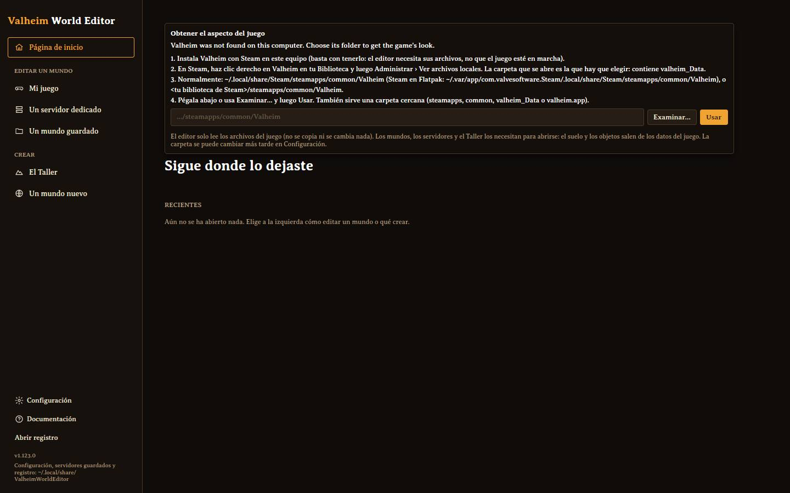
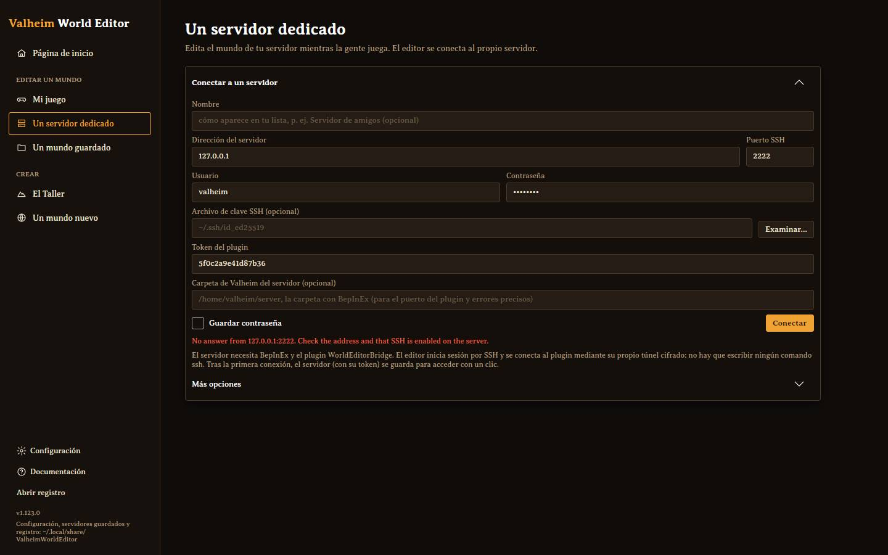
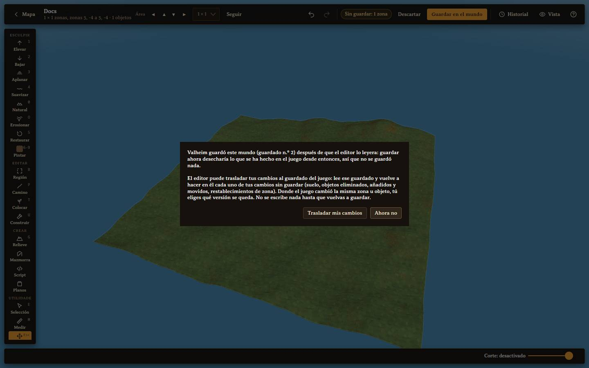

<!-- source: 5b752532 -->
# Solución de problemas

Busca en la tabla lo que ves y sigue su sección: cada una dice por qué ocurre y qué hacer.

| Lo que ves | Ve a |
|---|---|
| «No se encontró Valheim en este equipo», o cajas en lugar de modelos | [No se encuentra Valheim](#no-se-encuentra-valheim) |
| **Mi juego** enumera pasos, o el juego en marcha no aparece en **Página de inicio** | [Mi juego muestra pasos por hacer](#mi-juego-muestra-pasos-por-hacer) |
| Un mensaje bajo el formulario del servidor después de **Conectar** | [Un servidor no se conecta](#un-servidor-no-se-conecta) |
| Una tarjeta de mundo aparece en gris, o un mundo no se abre | [Un mundo no se abre o aparece en gris](#un-mundo-no-se-abre-o-aparece-en-gris) |
| El guardado termina con «No ha cambiado nada» o «Sin guardar» | [El guardado dice que no ha cambiado nada](#el-guardado-dice-que-no-ha-cambiado-nada) |
| «El juego guardó este mundo» al guardar | [El juego guardó mientras editabas](#el-juego-guardó-mientras-editabas) |
| En vivo: los jugadores no ven un cambio, o el editor no ve los suyos | [Un cambio en vivo no aparece](#un-cambio-en-vivo-no-aparece) |
| Parpadeos, líneas o una vista 3D negra en Windows | [Parpadeos o líneas en Windows](#parpadeos-o-líneas-en-windows) |
| «Windows protegió su PC», o macOS no abre la aplicación | [Windows o macOS bloquean la aplicación](#windows-o-macos-bloquean-la-aplicación) |
| Claude dice que no puede llegar al editor | [Claude no se puede conectar](#claude-no-se-puede-conectar) |
| Un script dice «errores», «error» o «no cambió nada» | [Un script falla](#un-script-falla) |
| Cualquier otra cosa | [El registro y los informes de errores](#el-registro-y-los-informes-de-errores) |

## No se encuentra Valheim

El editor lee las texturas, los modelos y el terreno del juego de tu instalación de Valheim; sin ella no se abre ningún
mundo ni el Taller. La página de inicio muestra entonces **Obtener el aspecto del juego** con «No se encontró Valheim
en este equipo.»

1. Instala Valheim con Steam en este equipo. Basta con tenerlo: no hace falta que el juego esté en marcha.
2. En Steam, haz clic derecho en Valheim en tu Biblioteca y luego en **Administrar › Ver archivos locales**. La carpeta
   que se abre (la que contiene `valheim_Data`, o `valheim.app` en un Mac) es la que hay que elegir.
3. Pega su ruta en la tarjeta, o usa **Examinar…**, y luego **Usar**. También sirve una carpeta cercana (`steamapps`,
   `common`, `valheim_Data`, `valheim.app`).

Lugares habituales:

- Windows: `C:\Program Files (x86)\Steam\steamapps\common\Valheim`
- Linux: `~/.local/share/Steam/steamapps/common/Valheim` (Steam en Flatpak:
  `~/.var/app/com.valvesoftware.Steam/.local/share/Steam/steamapps/common/Valheim`)
- macOS: `~/Library/Application Support/Steam/steamapps/common/Valheim`
- Otra biblioteca de Steam: `<library>/steamapps/common/Valheim`

La carpeta se puede cambiar más adelante en **Configuración** → **Carpeta del juego Valheim** (**Automático** vuelve a
buscar en las bibliotecas de Steam). Si la tarjeta dice **No se pudo leer el aspecto del juego**, pulsa **Reintentar**
o revisa la carpeta en Configuración; si vuelve a fallar, infórmalo con el registro ([abajo](#el-registro-y-los-informes-de-errores)).

*«No se encontró Valheim en este equipo.»: elige la carpeta que contiene `valheim_Data` y luego **Usar**.*

## Mi juego muestra pasos por hacer

**Mi juego** dice lo que aún necesita tu Valheim antes de que aparezca **Editar en vivo**:

| Dice | Haz esto |
|---|---|
| «Tu juego necesita BepInEx y el plugin WorldEditorBridge» | Instala ambos: consulta [Editar el mundo en el que juegas](../guides/edit-your-game-live.md). |
| «BepInEx está instalado: solo quedan los pasos 2 y 3.» | Añade el plugin a `BepInEx/plugins` e inicia Valheim. |
| «Inicia Valheim una vez con BepInEx» | El plugin nunca se ha ejecutado. Inicia el juego a través de BepInEx (**Start modded** del gestor de mods, o el script de inicio del paquete en Linux), no con el botón normal de Steam. |
| «Inicia Valheim y carga tu mundo» | Carga un mundo en el juego (un jugador, o alojando uno). Un juego que se unió al servidor de otra persona no se puede editar. |

El editor comprueba cada pocos segundos. Busca el archivo de configuración del plugin en cada carpeta de BepInEx que
conoce: tu carpeta de Valheim, el perfil del gestor de mods en el que se instaló el propio editor, cada perfil de
r2modman y de Thunderstore Mod Manager para Valheim (en Linux también r2modman de Flatpak), y las carpetas de
**Configuración** → **Carpetas de BepInEx**. Si tu juego o tu perfil está en otro sitio, añade allí su carpeta
`BepInEx`, su perfil o una carpeta de perfiles.

**¿Sigue sin aparecer nada con el juego en marcha?** El plugin escucha en el puerto 5182. Si otro programa usa ese
puerto (un túnel `ssh -L 5182:…` que abriste a mano, por ejemplo), el plugin no puede iniciarse, y el
`BepInEx/LogOutput.log` del juego tiene una línea `WorldEditorBridge: caught at … while listening on 127.0.0.1:5182 (the bridge does
not answer)`. Cierra ese programa o cambia `Port` en la [configuración del plugin](../live-mode.md#configuración-del-plugin).

«No se pudo comprobar tu juego: …» significa que el editor no pudo leer una carpeta de BepInEx: el resto del mensaje
dice por qué.

## Un servidor no se conecta

El mensaje bajo el formulario dice qué salió mal. Los que empiezan igual
aparecen una sola vez.

| Mensaje | Qué hacer |
|---|---|
| «Escribe la dirección del servidor.» / «Escribe el token del plugin: …» | Rellena **Dirección del servidor** o **Token del plugin**. |
| «The server refused the login: check the user name and the password or key.» (el servidor rechazó el inicio de sesión) | Revisa **Usuario**, y la **Contraseña** o el **Archivo de clave SSH**. Una clave con frase de contraseña necesita **Más opciones** → **Frase de contraseña de la clave**. |
| «No answer from <address>:<port>. Check the address and that SSH is enabled on the server.» (no hay respuesta de esa dirección) | Revisa **Dirección del servidor** y **Puerto SSH** (22 salvo que se haya cambiado), y que el servidor acepte SSH. |
| «The server's identity changed (it was …, now …).» (la identidad del servidor ha cambiado) | Si reinstalaste el servidor, vacía la línea `HostKey` que indica el mensaje en `servers.cfg` y vuelve a conectar. Si no, no te conectes: alguien podría estar haciéndose pasar por tu servidor. |
| «The server answered but refused the token.» (el servidor respondió, pero rechazó el token) | Vuelve a copiar entera la línea `Token` de `BepInEx/config/Tie.WorldEditorBridge.cfg` del servidor. |
| «That token cannot be sent (…)» (ese token no se puede enviar) | El token contiene un salto de línea u otro carácter suelto: vuelve a copiarlo. |
| «El túnel está abierto, pero el plugin no responde en el servidor: …» | El servidor no está en marcha, o no con BepInEx y el plugin. Rellena **Carpeta de Valheim del servidor (opcional)** en el formulario y vuelve a conectar para obtener una respuesta precisa (abajo). Un servidor en un contenedor (un panel de juegos como Pterodactyl) nunca responde así: consulta [Un servidor en un contenedor](../guides/edit-a-rented-server.md#un-servidor-en-un-contenedor). |
| «The plugin answered, but the game it runs in does not host the world» (el plugin respondió, pero su juego no aloja el mundo) | El plugin está en un juego que se unió a otro servidor. Instálalo en el servidor que aloja el mundo. |
| «The server answered with an error (…). Is it the WorldEditorBridge plugin?» (el servidor respondió con un error) | Otra cosa responde en el puerto del plugin: revisa **Más opciones** → **Puerto del plugin** y `Port` en la configuración del plugin. Con 400, a través de un túnel hacia una `BindAddress` distinta de `127.0.0.1`: pon `BindAddress = +` (consulta [Un servidor en un contenedor](../guides/edit-a-rented-server.md#un-servidor-en-un-contenedor)). |
| «Could not connect: …» (no se pudo conectar) | Cualquier otro fallo; el resto del mensaje dice cuál. |

Con **Carpeta de Valheim del servidor** rellenada, el editor mira allí por SSH y dice exactamente qué falta: «The folder
… does not exist on the server» (la carpeta no existe en el servidor), «BepInEx is not installed in …» (BepInEx no está
instalado), «The plugin is not in …/BepInEx/plugins» (el plugin no está en esa carpeta), «The plugin is installed but
has never run: restart the server with BepInEx» (el plugin nunca se ha ejecutado: reinicia el servidor con BepInEx) o
«The plugin is installed but does not answer: is the server running, and started with BepInEx (not the plain start
script)?» (el plugin no responde: ¿está el servidor en marcha y se inició con BepInEx?). Este último, en un servidor que
sí se ejecuta con BepInEx, suele significar que se ejecuta en un contenedor (Pterodactyl, Pelican, Docker): consulta [Un
servidor en un contenedor](../guides/edit-a-rented-server.md#un-servidor-en-un-contenedor).

A un servidor de juego alquilado a un proveedor, con un panel web y FTP pero sin inicio de sesión SSH, no se puede
llegar en vivo: edita en cambio los archivos de su mundo, como en [Un servidor de juego
alquilado](../guides/edit-a-rented-server.md#un-servidor-de-juego-alquilado).

Con **Tengo mi propio túnel**, «Nothing answers on 127.0.0.1:…» (nada responde) o
«No answer from 127.0.0.1:… within … s» (sin respuesta a tiempo) significa que tu túnel no está abierto, o que el
servidor no se está ejecutando con el plugin.

*Se pulsó Conectar sin que nada respondiera en la dirección: «No answer from 127.0.0.1:2222. Check the address and that SSH
is enabled on the server.» Revisa **Dirección del servidor** y **Puerto SSH**.*

## Un mundo no se abre o aparece en gris

Una tarjeta en gris en **Un mundo guardado** dice por qué en naranja. Los motivos habituales:

- «Old save format: load this world in Valheim once, then it can be edited here.» (formato de guardado antiguo:
  carga este mundo una vez en Valheim y luego podrás editarlo aquí). El juego convierte los mundos antiguos de un solo
  archivo al cargarlos.
- «Creado con un mod de generación de mundos (…) que ningún complemento en uso dibuja», «… el complemento está
  desactivado» o «… dibuja cuando … está en una de las carpetas de plugins de BepInEx»: instala el complemento,
  actívalo en **Configuración → Complementos** o añade la carpeta de BepInEx del mod en Configuración. Consulta
  [Editar un mundo creado con Expand World, Riverheim o Tunnelheim](../guides/use-mods-worlds.md).
- Un mundo de Riverheim también necesita un Riverheim que conozca su preajuste (actualiza uno más antiguo), y
  Riverheim 1.3 o posterior necesita Worldhalla en la misma carpeta de BepInEx; los mundos creados con la beta obsoleta
  de Riverheim no se pueden abrir.

Para una carpeta que escribiste en **Otra carpeta de mundos**: «That folder holds worlds; pick one of them (…)» (esa
carpeta contiene mundos; elige uno) significa que elegiste una carpeta `worlds_local` en lugar de un mundo; «No Valheim
world in that folder» (no hay ningún mundo de Valheim en esa carpeta) significa que no contiene archivos
`_main.<n>.chunks`. Consulta [Abrir un mundo que no está en la lista](../guides/open-a-world.md).

«No se pudo abrir el mundo: …» da el motivo después de los dos puntos; el registro tiene los detalles.

## El guardado dice que no ha cambiado nada

El editor comprueba cada guardado volviéndolo a leer: si algo está mal, quita los archivos nuevos y termina con «No ha
cambiado nada». Tu mundo está como estaba, y tus cambios siguen en el editor.

| Mensaje | Qué hacer |
|---|---|
| «No hay cambios sin guardar.» | No hay nada pendiente de guardar. |
| «Valheim guardó este mundo (guardado n.º …) después de que el editor lo leyera» | Consulta [El juego guardó mientras editabas](#el-juego-guardó-mientras-editabas). |
| «Falló el guardado (…). No ha cambiado nada.» / «El mundo guardado no se volvió a leer correctamente (…). No ha cambiado nada.» | Revisa el motivo entre paréntesis (un disco lleno, una carpeta en la que no puedes escribir). Cierra Valheim si usa el mundo y vuelve a guardar. |
| «Este mundo usa el formato de guardado …; el editor solo guarda los formatos … a ….» | Un formato más nuevo: actualiza el editor. Uno más antiguo: carga y guarda el mundo en un Valheim actualizado y vuelve a abrirlo. |
| «Sin guardar: … zone …: not generated yet (…; visit it in game first)» (zona aún no generada) | Ningún jugador ha estado allí, así que el mundo no tiene datos que cambiar. Ve hasta allí en el juego y vuelve a editar. |
| «Sin guardar: … the world has no terrain object to copy yet (edit the ground once in game first)» (el mundo aún no tiene ningún objeto de terreno que copiar) | Excava o nivela el suelo una vez en cualquier sitio del juego, guarda la partida y vuelve a guardar. |
| «No se pudo guardar nada.» | Todo estaba en la lista «Sin guardar» de arriba. |

Un trazo de pincel que no hace nada con «No ha cambiado nada: la Máscara excluye todo el suelo bajo el pincel» es la
[Máscara](../masks.md) en acción: revisa sus ajustes de altura, pendiente, bioma y pintura.

## El juego guardó mientras editabas

Un juego en marcha guarda el mundo en memoria y sobrescribe los archivos. Si guardó después de que el editor leyera el
mundo, **Guardar en el mundo** no guarda nada y pregunta **El juego guardó este mundo**:

1. Pulsa **Trasladar mis cambios**. El editor lee el guardado del juego y vuelve a hacer cada uno de tus cambios sobre
   él.
2. Si el juego cambió las mismas zonas u objetos, pregunta una vez por cada tipo (suelo, objetos cambiados, objetos
   quitados): **Conservar lo mío** o **Conservar lo del juego**.
3. Revisa el resultado: tus cambios están ahora pendientes sobre el guardado del juego. Aún no se ha escrito nada.
4. Cierra Valheim (o detén el servidor) y vuelve a pulsar **Guardar en el mundo**.

*Guardado rechazado porque el juego guardó el mundo después de que el editor lo leyera: **Trasladar mis cambios**
vuelve a hacer tus cambios sobre el guardado del juego.*

**Ahora no** lo deja todo como estaba. Trasladar tus cambios puede descartar algunos pasos del Historial (el mensaje
dice cuántos).

Para evitarlo, cierra el juego antes de guardar, o edita en vivo. Más en
[Guardar un mundo](../concepts/saving-and-history.md#guardar-un-mundo).

## Un cambio en vivo no aparece

- **Los jugadores no ven un cambio aplicado.** Mira el `BepInEx/LogOutput.log` del servidor: las líneas después de
  cada aplicación dicen qué se destruyó, se creó y se movió, y si algo volvió a crear un objeto destruido. Consulta
  [Lo que registra el plugin](../live-mode.md#lo-que-registra-el-plugin).
- **«No se pudo aplicar en vivo: …» o «No se pudo contactar con el juego: …»**. El juego no respondió en 30 segundos
  (está cargando, u ocupado). No se hizo nada: vuelve a pulsar **Aplicar en vivo**.
- **«Sin aplicar: el juego cambió el suelo donde tienes cambios»**. Respondiste **Ahora no** a **Aplicar sobre los
  cambios del juego**: vuelve a aplicar y elige **Aplicar**, o deshaz ahí tus cambios.
- **El editor no ve lo que cambian los jugadores** y dice «El plugin WorldEditorBridge del servidor es más antiguo que
  este editor». Actualiza el plugin; mientras tanto, **Recargar** vuelve a leer el mundo.

## Parpadeos o líneas en Windows

En Windows, el editor dibuja con Direct3D, como los juegos. Si la vista 3D o el mapa parpadean, muestran líneas,
dibujan mal o despacio, prueba el propio OpenGL del controlador gráfico:

1. En la página de inicio, abre **Configuración**.
2. En **Dibujo**, activa **Dibujar con el OpenGL del controlador gráfico** y pulsa **Guardar**.
3. Cierra el editor y vuelve a iniciarlo.

Desactívalo de la misma manera si va peor. Actualizar el controlador gráfico también ayuda. La tarjeta **Controles**
(`F3` en la vista 3D) muestra en **Este equipo** qué tarjeta gráfica y qué versión de OpenGL dibujan la vista.

## Windows o macOS bloquean la aplicación

**Windows: «Windows protegió su PC».** SmartScreen lo muestra la primera vez, hasta que conoce la firma del editor.
Haz clic en **Más información** (muestra el editor del programa) y luego en **Ejecutar de todas formas**.

**macOS: «no se puede abrir».** La versión para Mac está firmada, pero no con un certificado de Apple Developer, así
que macOS no puede comprobar quién la hizo.

1. Haz doble clic una vez en **ValheimWorldEditor.app** y cierra el mensaje.
2. En **Ajustes del Sistema › Privacidad y seguridad**, haz clic en **Abrir de todos modos** junto a
   ValheimWorldEditor.
3. O, en Terminal: `xattr -dr com.apple.quarantine /Applications/ValheimWorldEditor.app`.

<!-- picture: os-blocked.jpg: two halves side by side: left, Windows SmartScreen "Windows protected your PC" after More info, showing the publisher and Run anyway; right, macOS System Settings › Privacy & Security scrolled to the "ValheimWorldEditor was blocked" line with Open Anyway -->

Después se abre con un doble clic. La versión para Mac es experimental (Apple silicon, macOS 12 o posterior).

## Claude no se puede conectar

| Comprueba | Qué hacer |
|---|---|
| El editor está en marcha | Claude solo llega al editor mientras se está ejecutando. Inícialo. |
| **Permitir que Claude se conecte** está activado | En **Configuración → Claude**, actívalo y pulsa **Guardar**. La sección debería decir «Listening on http://127.0.0.1:5731/mcp» (a la escucha en esa dirección). |
| «Could not listen on port …» (no se pudo escuchar en el puerto) | Otro programa usa el puerto. Elige otro **Puerto**, pulsa **Guardar** y vuelve a añadir el editor a Claude con el nuevo comando. |
| Pulsaste **Nuevo token** | El token antiguo dejó de funcionar: vuelve a ejecutar el nuevo comando de Claude Code. |
| Claude Desktop | Reinícialo después de editar su configuración. Si moviste la carpeta del editor, vuelve a copiar las líneas desde Configuración: contienen la ruta del programa. |
| Claude Code | `/mcp` debería mostrar **valheim-editor** como conectado. Si no, vuelve a ejecutar el comando desde Configuración. |

¿Claude se conecta pero no cambia nada? Mientras un mundo en vivo tiene **Auto** activado, Claude solo puede cambiar
el panel Vista: desactiva Auto. Los scripts necesitan **Claude puede ejecutar scripts**. Consulta
[Claude](../claude.md).

## Un script falla

La casilla de salida bajo el script dice qué pasó, y en todos los casos no cambió nada:

- «El script tiene errores»: un error de escritura o de C#, indicado con su línea (`line 4: The name 'Groud' does not exist
  in the current context`). Corrige esa línea. «El script no tiene ninguna instrucción que ejecutar» debajo significa
  que la casilla está vacía o solo contiene comentarios: escribe al menos una línea de código, o carga un ejemplo.
- «El script se detuvo con un error»: falló durante la ejecución, en la línea indicada (un nombre de objeto que el
  editor no puede crear, un preajuste de pintura o de montaña que no conoce, un tamaño de 0 o menos, una división por
  cero).
- «El script se ejecutó y no cambió nada.»: usa `Print` para comprobar que tu bucle encuentra lo que esperas.
- «El área cambió mientras se ejecutaba el script»: mientras tanto editaste, deshiciste o guardaste. Vuelve a
  ejecutarlo y espera.
- «El script se detuvo (o se ejecutó 2 minutos)»: hazlo más ligero, por ejemplo `Area.Points(step: 4)`.

Más en [Script](../scripting.md#cuando-algo-sale-mal).

## El registro y los informes de errores

Todo lo que dice el editor va a `ValheimWorldEditor.log`, que se empieza de nuevo en cada ejecución, en la carpeta de
datos del editor:

- Windows: `%LOCALAPPDATA%\ValheimWorldEditor`
- Linux: `~/.local/share/ValheimWorldEditor`
- macOS: `~/Library/Application Support/ValheimWorldEditor`

**Abrir registro**, al final del menú lateral de la página de inicio, lo abre; la carpeta también se muestra allí. Cada
error que gestiona el editor es una línea que empieza por `Caught at`, con dónde ocurrió y qué estaba haciendo el
editor. Los datos personales se omiten: tu carpeta personal se escribe `~`, y las rutas, direcciones, nombres de
cuenta, contraseñas y tokens se sustituyen por marcadores como `<path>`.

Para informar de un problema, [abre una incidencia](https://github.com/Shuiei/valheim-world-editor/issues) con:

1. Lo que hiciste y lo que viste (una captura de pantalla ayuda).
2. El registro del editor, desde **Abrir registro**, justo después del problema (antes de volver a iniciar el editor).
3. En vivo: el `BepInEx/LogOutput.log` del juego o del servidor.
4. Para una vista lenta: activa **Registrar fotogramas por segundo** en la tarjeta **Controles** (`F3`), usa la vista
   y adjunta `perf-native.log` de la misma carpeta de datos.

¿Encontraste un problema de seguridad? Infórmalo en privado: consulta [SECURITY.md](../../../SECURITY.md).
