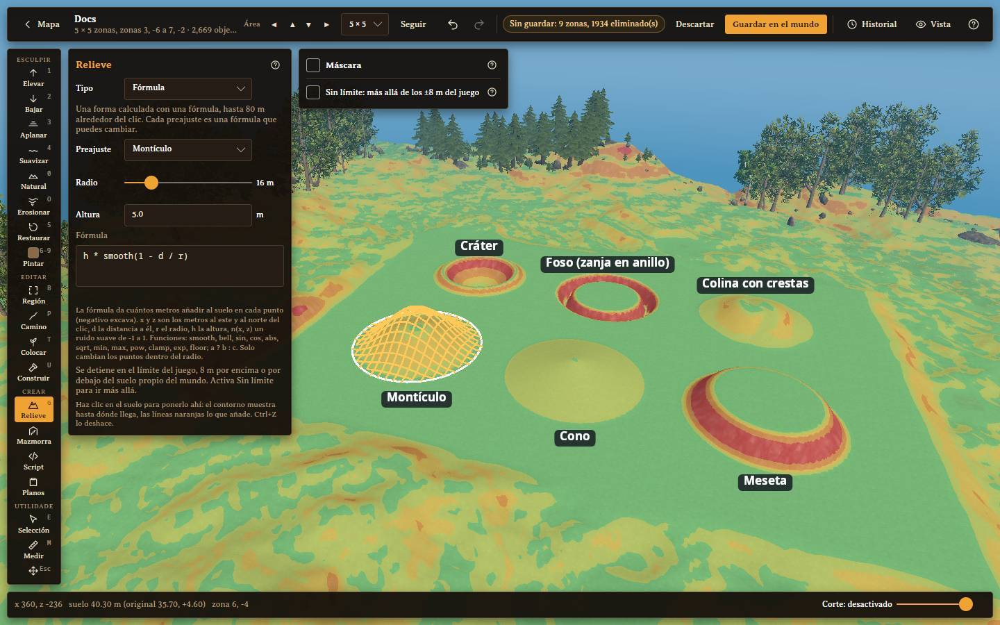
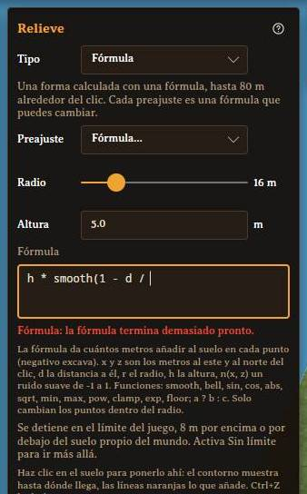
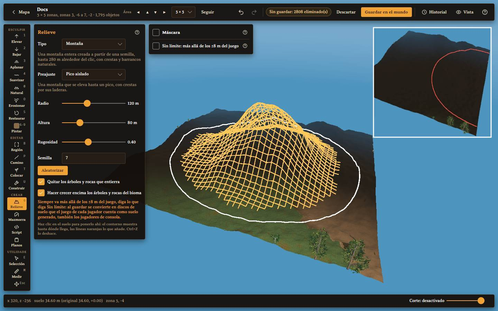
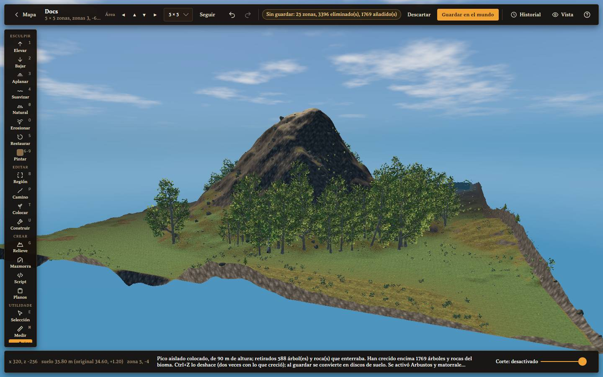
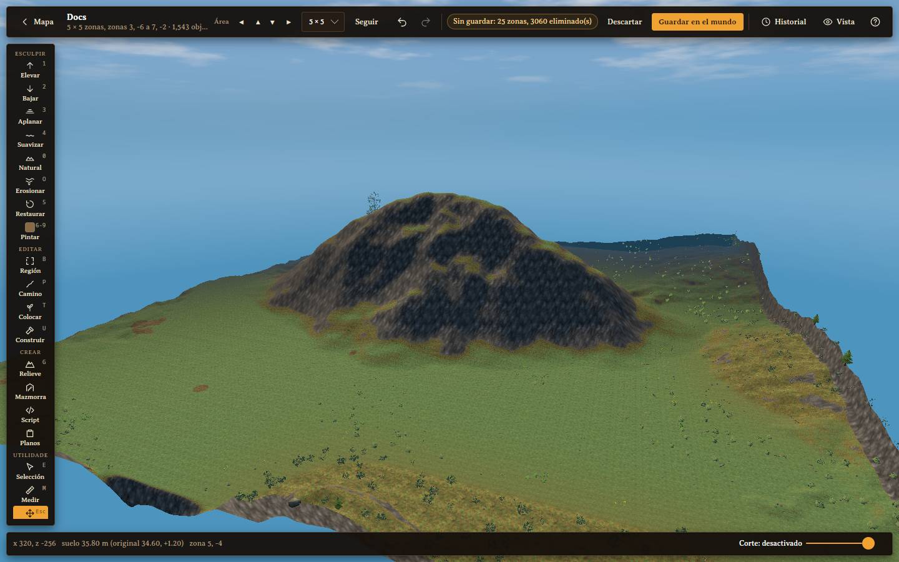
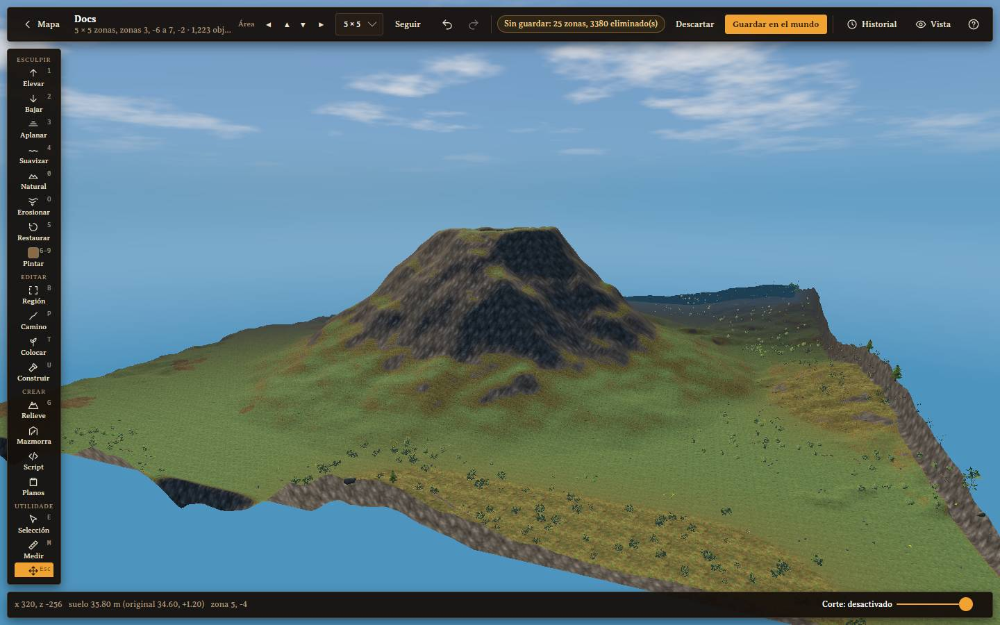
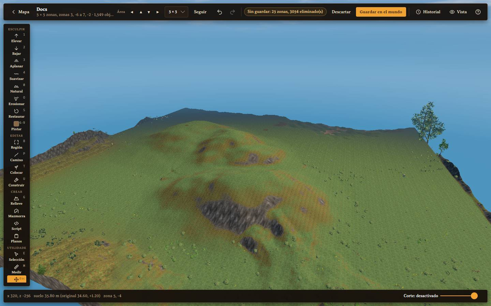
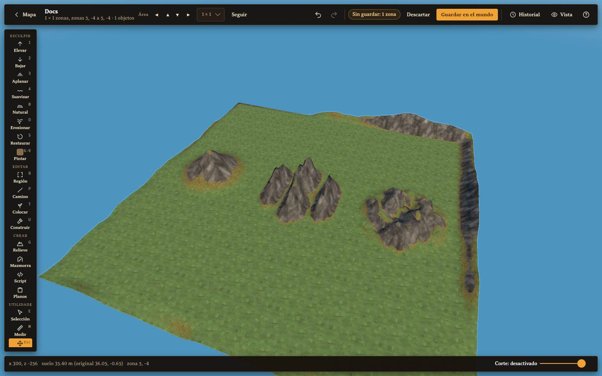
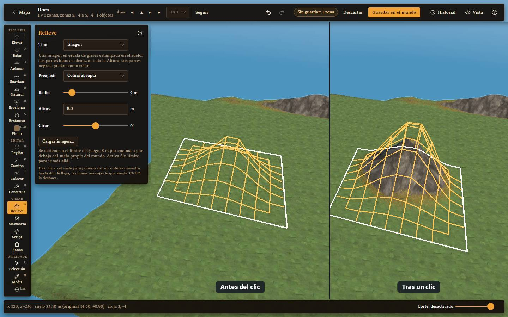

<!-- source: e6ef7a67 -->
# Relieve

Pon un relieve entero en el suelo con un clic: un montículo o un cráter calculado con una fórmula, una montaña que
supera con creces los 8 m del juego, o una imagen tuya estampada.

**Dónde:** barra de herramientas, sección **CREAR** · **Tecla:** `G` · **Funciona en:** mundos guardados, en vivo

*El tipo **Fórmula**. Fila delantera, de izquierda a derecha: Montículo, Cono, Meseta. Fila trasera, de izquierda a
derecha: Cráter, Foso (zanja en anillo), Colina con crestas, cada uno con el radio predeterminado de 16 m y la altura de
5 m, con **Colores de pendiente** activado en Vista para que se lean sus pendientes. El panel muestra el Montículo y su
fórmula; sobre el montículo, el contorno blanco es el radio y las líneas naranjas lo que añadiría otro clic.*

## Úsalo

1. En la barra de herramientas, haz clic en **Relieve** (`G`).
2. En el panel, elige un **Tipo**: **Fórmula**, **Montaña** o **Imagen** (consulta [Los tres tipos](#los-tres-tipos)).
3. Elige un **Preajuste** y luego ajusta **Radio** y **Altura**.
4. Mueve el puntero sobre el suelo. El contorno blanco muestra hasta dónde llega el relieve, y las líneas naranjas lo
   que añade, tan alto o tan hondo como vaya a quedar.
5. Haz clic. El relieve se estampa al instante.
6. ¿No queda bien? `Ctrl+Z` lo deshace. Cada clic es un paso de deshacer («Relieve: Montículo»).

## Los tres tipos

Cada tipo tiene sus propios preajustes. Ningún preajuste se llama igual en dos tipos, así que el nombre indica cuál
usaste.

| Tipo | Crea | Radio | El límite de ±8 m del juego |
|---|---|---|---|
| **Fórmula** | Una forma suave y exacta calculada con una fórmula que puedes leer y cambiar. | 2 a 80 m | Lo respeta, salvo que **Sin límite** esté activado. |
| **Montaña** | Una montaña natural entera a partir de una semilla, con crestas y barrancos, y árboles que crecen sobre ella. | 20 a 280 m | Siempre lo supera. |
| **Imagen** | Una imagen en escala de grises estampada: una integrada o cualquier archivo de imagen. | 2 a 80 m | Lo respeta, salvo que **Sin límite** esté activado. |

Una línea cerca de la parte inferior del panel indica cómo queda ahora mismo el tipo elegido respecto al límite. Se
vuelve ámbar cuando el relieve lo va a superar. Consulta [Sin límite](terrain.md#sin-límite) para el interruptor y para lo
que hace el guardado con el suelo que supera el límite.

## Ajustes de todos los tipos

Están en el mismo sitio y con el mismo nombre en los tres tipos. Cada tipo recuerda sus propios valores.

| Ajuste | Qué hace |
|---|---|
| **Tipo** | De qué se hace el relieve. Se recuerda para la próxima vez. |
| **Preajuste** | El relieve: la lista propia del tipo. |
| **Radio** | Hasta dónde llega desde el clic. |
| **Altura** | Cuánto se eleva (m). En **Fórmula** e **Imagen**, una altura negativa lo invierte: un montículo se convierte en un hoyo, y un foso en un muro en anillo. |
| **Girar** | Su dirección, cuando la tiene: la cresta o la cordillera de **Montaña**, y cualquier **Imagen**. |

## Fórmula

Una forma calculada punto por punto. Cada preajuste es una fórmula que se muestra en la casilla; si la cambias, la lista
pasa a **Fórmula…**, la tuya, que se recuerda para la próxima vez.

| Preajuste | Forma |
|---|---|
| **Montículo** | Una colina redonda y suave. |
| **Cono** | Laderas rectas hasta un vértice. |
| **Meseta** | Una cima plana con una ladera suave alrededor. |
| **Cráter** | Una hondonada con un borde elevado. |
| **Foso (zanja en anillo)** | Una zanja a tres cuartos del radio. Con una altura negativa, un muro en anillo. |
| **Cuenco** | Una hondonada redonda. |
| **Colina con crestas** | Un montículo con crestas que lo cruzan. |
| **Fórmula…** | La tuya. |

| Ajuste | Qué hace |
|---|---|
| **Radio** | 2 a 80 m (16 m por defecto). Solo cambia el suelo dentro de él. |
| **Altura** | 5 m por defecto. Es `h` en la fórmula. |
| **Fórmula** | Cuántos metros añadir al suelo en cada punto dentro del radio; un número negativo excava. Un error se muestra debajo de la casilla, y no se puede colocar nada hasta corregirlo. |

*Una fórmula sin terminar: la lista pasó a **Fórmula…**, y la línea bajo la casilla dice qué falla («la fórmula termina
demasiado pronto»).*

### Escribir una fórmula

La fórmula se calcula para cada punto del suelo dentro del radio, y el resultado se suma al suelo en ese punto.

| Nombre | Significado |
|---|---|
| `x`, `z` | Metros al este y al norte del clic. |
| `d`, `r`, `h` | Distancia al clic, el radio, la altura. |
| `n(x, z)` | Ruido suave de más o menos -1 a 1, a partir del patrón de los pinceles (**Nuevo patrón** en [Natural](terrain.md#natural) lo cambia). Usa `n(x / 10, z / 10)` para irregularidades amplias. |
| `pi` | 3.14159… |

Funciones: `abs`, `atan2(y, x)`, `bell(t)` (1 en 0, y se desvanece hacia ±1), `ceil`, `clamp(v, a, b)`, `cos`, `exp`,
`floor`, `log`, `max(…)` y `min(…)` (cualquier número de valores), `pow(a, b)`, `round`, `sign`, `sin`, `smooth(t)` (0
por debajo de 0, 1 por encima de 1, una S suave entre ambos), `sqrt`, `tan`.

Operadores: `+ - * / %`, `^` (potencia), comparaciones `< > <= >= == !=` (1 o 0), `&&`, `||`, `!` y `a ? b : c`.

Los preajustes muestran cómo funciona:

| Preajuste | Fórmula |
|---|---|
| **Montículo** | `h * smooth(1 - d / r)` |
| **Cono** | `h * max(0, 1 - d / r)` |
| **Meseta** | `h * smooth((r - d) / (0.35 * r))` |
| **Cuenco** | `-h * smooth(1 - (d / r) ^ 2)` |
| **Foso (zanja en anillo)** | `-h * bell((d - 0.75 * r) / (0.12 * r))`: una zanja a tres cuartos del radio. |

Dos más para empezar: `h * smooth(1 - d / r) * (1 + 0.3 * n(x / 8, z / 8))` es una colina irregular, y
`abs(x) < 3 ? -h : 0` excava una zanja de 6 m de ancho a través del círculo.

## Montaña

Una montaña entera creada a partir de una semilla y sumada al suelo que hay, así que conserva la forma propia del
terreno y se funde con él en su borde. Su contorno nunca es un círculo perfecto, y **Rugosidad** añade abultamientos,
crestas y barrancos en proporción a su tamaño.

*Pico aislado, de 80 m de altura y 120 m de radio, antes del clic: las líneas naranjas lo muestran tan alto como va a
quedar y el anillo blanco hasta dónde llega. En el recuadro, arriba a la derecha: con el puntero cerca del borde del
área, el anillo se vuelve rojo y no aparece vista previa, porque no cabría.*

| Preajuste | Altura / radio que sortea | Forma |
|---|---|---|
| **Pico aislado** | 50–110 m / 120–240 m | Una montaña que se eleva hasta un pico, con crestas por sus laderas. |
| **Cresta** | 35–80 m / 140–260 m | Una cresta larga, la mitad de ancha que de larga. |
| **Cordillera** | 40–90 m / 180–280 m | De tres a cinco picos a lo largo de una línea, unidos por collados. |
| **Mesa** | 20–50 m / 70–150 m | Una cima plana con laderas empinadas y rocosas: espacio para construir arriba. La rugosidad solo afecta a las laderas. |
| **Volcán** | 45–100 m / 130–240 m | Un cono con un cráter en la cima. |
| **Colinas onduladas** | 12–30 m / 100–220 m | De tres a seis colinas suaves juntas. |

| Pico aislado | Cresta |
|---|---|
|  |  |
| **Volcán** | **Colinas onduladas** |
|  |  |

*Cuatro preajustes en el centro de un área de 5 × 5 despejada y nivelada antes, para que cada uno destaque. El pico
aislado tiene encima los árboles del bioma; los demás se dejan desnudos para que se vea su forma.*

| Ajuste | Qué hace |
|---|---|
| **Preajuste** | El tipo de montaña. Elegir uno sortea una montaña nueva de ese tipo, como **Aleatorizar**. |
| **Radio** | 20 a 280 m. Su contorno es irregular y llega hasta un 15 % más lejos: el anillo lo muestra. |
| **Altura** | Cuánto se eleva sobre el suelo de ese lugar, de 5 a 300 m. |
| **Girar** | Solo **Cresta** y **Cordillera**: la dirección en que se extiende, de 0° a 179°. |
| **Rugosidad** | 0: laderas suaves. 1: barrancos y crestas profundos. |
| **Semilla** | El número del que sale su detalle: el mismo preajuste, los mismos valores y la misma semilla vuelven a crear la misma montaña. |
| **Aleatorizar** | Una montaña nueva del preajuste: nuevo tamaño, rugosidad, dirección y semilla. Si no cabe en el área abierta, se hace más pequeña en conjunto, altura incluida, para que las laderas sigan igual de suaves. |
| **Quitar los árboles y rocas que entierra** | Activado al principio. Se quitan los árboles, las rocas, el mineral, los arbustos y los recolectables donde eleva el suelo más de 2 m (el guardado lo haría de todos modos). Las piezas de construcción se quedan, y también lo que hay en una mazmorra muy por encima. |
| **Hacer crecer encima los árboles y rocas del bioma** | Activado al principio. Hace crecer los árboles y las rocas propios del bioma, según las reglas del juego, en las laderas que elevó más de un metro, lejos de lo que ya hay allí. Un segundo paso de deshacer. |

Una montaña debe caber entera en el área abierta, borde irregular incluido: donde el anillo está rojo, un clic no pone
nada.

## Imagen

Una imagen en escala de grises estampada en el suelo: sus partes blancas alcanzan toda la **Altura**, las grises una
parte, y las negras quedan como están. La imagen cubre un cuadrado el doble de ancho que el **Radio**; el contorno lo
muestra.

*Las imágenes integradas, de 6 m de altura con un radio de 8 m. De izquierda a derecha: Colina abrupta, Dunas, Suelo
rocoso.*

*La **Colina abrupta**, con **Radio** de 9 m y **Altura** de 8 m. Izquierda: su contorno cuadrado y su vista previa
naranja sobre suelo plano antes del clic. Derecha: la colina entera, estampada con un clic.*

| Preajuste | Forma |
|---|---|
| **Colina abrupta** | Un pequeño pico con laderas abruptas. |
| **Dunas** | Crestas paralelas dentro de una mancha redonda. |
| **Suelo rocoso** | Suelo abultado y quebrado. |
| Las tuyas | Cada imagen que hayas cargado, con su nombre de archivo. |

| Ajuste | Qué hace |
|---|---|
| **Radio** | La mitad del lado de la imagen, de 2 a 80 m (16 m por defecto). |
| **Altura** | Cuánto se elevan las partes blancas (m, 4 por defecto). Negativa: se hunden en lugar de elevarse. |
| **Girar** | Gira la imagen, de -180° a 180°. |
| **Cargar imagen…** | Usa cualquier imagen (PNG, JPEG…): un mapa de alturas de otra herramienta, un logotipo, una forma dibujada a mano. Su brillo es la altura; las partes transparentes cuentan como negro. Se escala a un cuadrado de 128 × 128 puntos, así que una imagen ancha se comprime y se pierde el detalle fino. Se guarda para la próxima vez con su nombre de archivo. |
| **Olvidar imagen** | Quita la imagen cargada elegida. Solo aparece con imágenes cargadas: las integradas se quedan. |

Las imágenes son los [sellos](terrain.md#sellos) de los pinceles: una que cargues aquí también es una forma de pincel,
y una cargada allí se ofrece aquí. Dos sellos integrados, **Mesa (cima plana)** y **Borde de cráter**, solo son formas
de pincel: como relieves, los crea el tipo **Fórmula** (**Meseta**, y **Foso** con una altura negativa).

## Atajos

| Tecla o ratón | Qué hace |
|---|---|
| `G` | Elige Relieve. |
| Clic en el suelo | Estampa ahí el relieve. |
| `Ctrl+Z` | Deshace el último (pulsa dos veces si crecieron árboles en una montaña). |
| `Esc` | Sale de la herramienta (vuelve a Vista). |

## Consejos y límites

- **Fórmula e Imagen se detienen a 8 m del suelo generado**, y la barra de estado lo dice. Para relieves más altos,
  marca **Sin límite: más allá de los ±8 m del juego** en la tarjeta **Máscara** junto al panel (consulta
  [Sin límite](terrain.md#sin-límite)): sigue activado para todas las herramientas de suelo hasta que lo desactives.
- **Una montaña siempre supera los 8 m del juego**, diga lo que diga **Sin límite**. El guardado la convierte en discos
  de suelo y vacía el Historial del área, como con [Sin límite](terrain.md#sin-límite). Revísala antes de guardar.
- **Para montañas grandes, abre antes un área más grande** (la lista de tamaños del área en la barra superior): en un
  área de 5 × 5 el radio puede llegar a unos 137 m.
- **La [Máscara](masks.md) se aplica**: donde deja fuera el suelo, el relieve se corta en un escalón, y una montaña en un
  acantilado.
- **Una fórmula que da 0 en todas partes** no cambia nada, y la barra de estado lo dice. Los puntos donde no da ningún
  número (una división entre cero) se quedan como estaban.
- **La línea de puntos más exterior del área nunca cambia** (consulta
  [El borde bloqueado](concepts/areas-and-zones.md#el-borde-bloqueado)).
- **Para suavizar un borde** después, pásale el pincel **Suavizar** o **Natural**.
- **Las pendientes suaves conservan la hierba y los árboles; las empinadas muestran roca desnuda**, como las dibuja el
  juego.
- **Para usar una imagen como pincel** mientras arrastras, elígela como **Forma** del pincel (consulta
  [Sellos](terrain.md#sellos)). Para fijar las alturas de un área entera a partir de una imagen, consulta
  [Mapa de alturas](area.md#mapa-de-alturas).
- **Un [script](scripting.md)** también puede colocar formas de fórmula y montañas, según reglas.

## Relacionado

- [Elevar o excavar más allá del límite de 8 m del juego](guides/raise-past-the-limit.md)
- [Sin límite](concepts/ground-limits.md#sin-límite): cómo se guarda el suelo más allá de 8 m
- [Cómo se crea una montaña](concepts/ground-limits.md#cómo-se-crea-una-montaña)
- [Reglas de crecimiento](concepts/objects.md#reglas-de-crecimiento): qué crece en una montaña
- [Esculpir y pintar](terrain.md): pinceles y sellos
