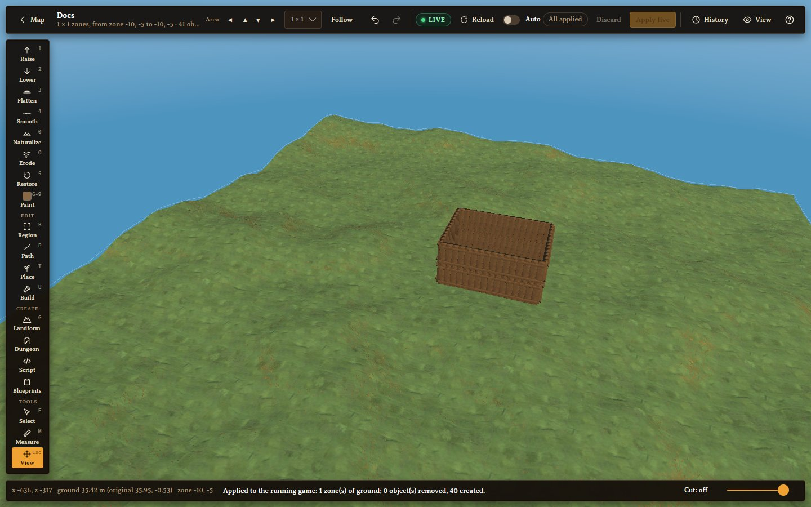

<!-- source: e9428d01 -->
# Modo en vivo

Edita el mundo de un juego en marcha o de un servidor dedicado mientras la gente juega: ven cada cambio en cuanto lo
aplicas.

**Dónde:** página de inicio, **Editar en vivo** en **Página de inicio** o **Mi juego**, o **Un servidor dedicado** ·
**Tecla:** `Ctrl+S` aplica · **Funciona en:** tu propia partida (un jugador o el mundo que alojas), un servidor dedicado


*Conectado a un servidor en marcha: **EN VIVO**, **Recargar** y **Auto** en la barra superior, y una cabaña que el
juego aún no tiene («Sin aplicar: 1 zona, 40 añadidos», puntos verdes en las piezas nuevas).*

El modo en vivo necesita **BepInEx** y el plugin **WorldEditorBridge** en el juego que aloja el mundo. Los jugadores que
se unen no necesitan ninguno de los dos. Un servidor dedicado también debe darte **acceso SSH** a la máquina en la que
funciona (un inicio de sesión en una consola, no solo SFTP o el gestor de archivos de un panel web): la mayoría de los
servidores de juego alquilados a un proveedor no lo dan, consulta
[Editar un servidor alquilado o alojado con panel](guides/edit-a-rented-server.md). Para prepararlo y conectarte,
sigue [Editar el mundo en el que juegas](guides/edit-your-game-live.md) o
[Editar un servidor dedicado mientras la gente juega](guides/edit-a-server-live.md). Cómo habla el editor con el juego
se explica en [Edición en vivo](concepts/live-editing.md#cómo-se-conecta).

## Úsalo

1. Conéctate: en la página de inicio, haz clic en **Editar en vivo** (tu partida) o en **Conectar** junto a un servidor
   guardado.
2. En el mapa del mundo, haz clic en un punto y elige **Editar en 3D**.
3. Edita con cualquier herramienta, como lo harías sin conexión. Los objetos nuevos llevan un punto verde; la barra
   superior cuenta lo que no está aplicado.
4. Pulsa **Aplicar en vivo** (o `Ctrl+S`). Los jugadores ven el cambio al instante, y el juego lo guarda como siempre.
5. Para retirar un cambio, deshazlo (`Ctrl+Z`) y vuelve a pulsar **Aplicar en vivo**.

## Ajustes

El modo en vivo funciona como sin conexión, con estos controles en la barra superior:

| Control | Qué hace |
|---|---|
| Distintivo **EN VIVO** | Muestra que el editor está conectado al juego en marcha. |
| **Recargar** | Vuelve a leer todo el mundo desde el juego. Los cambios aún no aplicados se descartan, tras preguntar. Te quedas donde estás. |
| **Auto** | Activado: cada trazo, colocación y deshacer se aplica al instante, sin pulsar **Aplicar en vivo**. Al activarlo se envía lo que ya está esperando. Se recuerda entre sesiones. |
| Contador de pendientes | «Sin aplicar: …» en ámbar, o «Todo aplicado». La línea del mapa dice «Aún sin aplicar: …». |
| **Aplicar en vivo** | Ocupa el lugar de **Guardar en el mundo**. Envía al juego todos los cambios pendientes. |
| Lista de jugadores, **Ir** | Junto a **EN VIVO**, mientras haya un jugador conectado: los jugadores conectados, por nombre. Elige uno y luego **Ir** (consulta [Jugadores](#jugadores)). |

## Aplicar en vivo, Auto y Recargar

**Aplicar en vivo** envía el suelo de cada zona que cambiaste, luego los objetos que eliminaste, colocaste, moviste o
cambiaste, y luego los restablecimientos de zonas. Solo se envía lo que cambió desde la última aplicación. El orden y lo
que hace cada parte se explican en [Qué se envía y cuándo](concepts/live-editing.md#qué-se-envía-y-cuándo).

La barra de estado dice entonces lo que se hizo, por ejemplo «Aplicado al juego en marcha: 2 zona(s) de suelo; …». Si
el juego no responde, nada se marca como aplicado y la siguiente aplicación lo vuelve a enviar. Solo se ejecuta una
aplicación a la vez: una segunda pulsación espera y envía solo lo que sigue pendiente.


*Tras **Aplicar en vivo**: «Todo aplicado», los puntos verdes han desaparecido y la barra de estado dice «Aplicado al
juego en marcha: …».*

**Auto** convierte cada cambio en una aplicación. Espera al final de un trazo, así que un trazo de pincel largo se
envía como una sola aplicación. Mientras Auto está activado, [Claude](claude.md) no cambia nada; desactiva Auto para
dejarle trabajar.

**Recargar** rara vez hace falta: el área abierta sigue el juego por sí sola. Úsalo para actualizar el resto del mundo
(el mapa), o cuando el plugin es demasiado antiguo para seguirlo.

Después de cada aplicación, el historial se guarda en disco, como después de guardar: conéctate más tarde al mismo
juego y los pasos siguen ahí para deshacerlos (consulta [Historial](concepts/saving-and-history.md#historial)).

## Seguir el juego

Mientras hay un área abierta, el editor pregunta al juego cada 2 segundos qué ha cambiado en las zonas de esa área. Lo
que los jugadores construyen, quitan, excavan o pavimentan ahí aparece en el editor sin un paso en el Historial. La
barra de estado dice lo que ha llegado, por ejemplo «Desde el juego: 2 objeto(s) nuevo(s), 1 quitado(s), el suelo de 1
zona(s).». Un simple cambio de datos (un fuego que se consume, un cofre usado) llega sin aviso.

- **Los objetos** que cambian los jugadores conservan su lugar en tu Historial y en tu selección.
- **Tus propios objetos, una vez aplicados,** se muestran donde y como los tiene realmente el juego (una pieza asentada
  por la física, la salud de una criatura).
- **El suelo** que cambiaron los jugadores solo llega donde no tienes cambios esperando en esa zona. Donde sí los
  tienes, se conservan los tuyos, y **Aplicar en vivo** pregunta primero **Aplicar sobre los cambios del juego**:
  **Aplicar** escribe tu suelo sobre esa zona (lo que hicieron ahí los jugadores desde entonces puede borrarse); **Ahora
  no** mantiene pendientes tus cambios.
- El seguimiento solo ocurre en la vista 3D, nunca durante un trazo ni mientras se aplica. El mapa muestra el mundo tal
  como se leyó la última vez.

Los detalles están en [Seguir el juego](concepts/live-editing.md#seguir-el-juego).

<!-- picture: live-apply-over.jpg: live world, a 3 × 3 area where you raised ground in one zone and a player then dug in the same zone; Apply live pressed: the "Apply over the game's changes" question with its text naming the zone, and the Apply and Not now buttons, over the 3D view -->

## Jugadores

Los jugadores conectados se dibujan en su posición con su nombre: postes azules en la vista 3D, puntos azules en el
mapa. Se mueven como lo hacen los jugadores (cada 2 segundos en 3D, cada 5 en el mapa). En la barra superior, junto a
**EN VIVO**, elige un jugador en la lista y pulsa **Ir**: la cámara va hasta él, y el área se desplaza hasta él cuando
está fuera de ella.

<!-- picture: live-players.jpg: live world with two players connected, 3D view at about 60 m showing two blue posts with their names over a base, the top bar's player list beside LIVE with a name chosen and the Go button visible -->

## Mover cosas

Un objeto movido (mover o girar con la herramienta Selección, o **Cortar** y luego pegar) se mueve en el juego como el
mismo objeto, cuando solo cambiaron su posición y su giro. Los mods que siguen objetos (el cartel de etiqueta de un
cofre, los cofres de un almacén, una guarda) lo siguen reconociendo, y un cofre conserva su contenido tal como lo tiene
el juego. Deshacer lo devuelve a su sitio de la misma forma.

Esto solo funciona cuando ningún jugador tiene cargados a la vez el lugar antiguo y el nuevo (las zonas alrededor de
cada jugador, unos 160 m, más para objetos grandes). Si no, el objeto se vuelve a crear en su nuevo lugar y se quita del
antiguo, y el mensaje de la aplicación dice cuántos: para otros mods son objetos nuevos. **Mueve una construcción
mientras no haya nadie cerca** para conservar todo lo suyo.

Un objeto cuyos datos cambias (en el Inspector de la herramienta [Selección](select.md), o con la herramienta de un mod)
también conserva su identidad en el juego. Las partes del grupo enlazado de un mod (como un barco) y las criaturas
siempre se vuelven a crear.

## Deshacer después de aplicar

Los cambios aplicados aún se pueden deshacer: deshaz (o **Quitar** en el Historial) y luego vuelve a usar **Aplicar en
vivo**.

- Un objeto **eliminado** vuelve como una copia de lo que era cuando se leyó el mundo (un cofre con el contenido que
  tenía entonces). Para el juego es un objeto nuevo.
- Un objeto **colocado** se vuelve a quitar del juego. Si otro mod lo volvió a crear mientras tanto con un id nuevo, el
  plugin lo encuentra por su tipo y su posición (a menos de 10 cm) y quita ese.
- Un objeto **movido** vuelve a su sitio, como el mismo objeto cuando es posible.
- **Los restablecimientos de zonas** no se pueden deshacer una vez aplicados.

Los pasos de una sesión anterior se marcan así en el Historial. Puede que los jugadores hayan cambiado el mundo desde
entonces, así que se te pregunta una vez antes de deshacerlos o rehacerlos.

## Juegos con mods

Los mods crean la mayoría de sus objetos mientras el juego está en marcha, así que el editor los aprende del juego
cuando se abre un mundo en vivo. Los objetos de un juego con mods tienen entonces sus nombres, la lista de
[Colocar](place.md) los ofrece, el panel [Construir](build.md), tanto en un mundo como en el [Taller](workshop.md),
muestra las piezas de los mods en su pestaña **Piezas de mods** con su costo (un mod cada vez, elegido en la lista de su
lateral; se muestran como máximo 300 piezas, busca las demás; los mods instalados en este equipo aparecen ahí incluso sin
un juego en vivo, con su costo desconocido), y el Inspector dice de qué mod viene un objeto («Del mod …» cuando Jötunn
está instalado, si no «De un mod»).

Lo que aprende el editor se conserva (`mod-catalogue.json` en la carpeta de datos del editor), así que el mundo del
mismo servidor abierto más tarde desde sus archivos también muestra los objetos de los mods. Cada conexión lo amplía.

Los modelos de los mods se dibujan como en el juego, a partir de los propios archivos de los mods en tu carpeta de
Valheim y en los perfiles de tu gestor de mods (deben estar instalados ahí los mismos mods). La primera vez, sus bundles
se copian en la carpeta de datos del editor (`mod-bundles`, unos segundos). Las mallas que un mod crea por código
mientras el juego está en marcha (velas hechas al vuelo, por ejemplo) no se pueden encontrar: esas piezas se muestran
sin textura. Un mod también puede incluir un `worldeditor.json` para lo que el editor no puede adivinar: consulta
[Para autores de mods](modding.md).

### Los plugins propios de los mods

A un mod cuyo plugin se registró en el puente se le informa enseguida de lo que aplicaste (objetos creados, quitados y
movidos, zonas cuyo suelo cambió o se restableció), así que lo que construye a partir de sus objetos (un barco a partir
de sus piezas) se vuelve a montar al instante. El registro del editor nombra los mods registrados cuando se abre un
juego; un mod que falla en una aplicación aparece en el `BepInEx/LogOutput.log` del juego, y la aplicación se completa
igualmente.

### Los mods de Expand World

Con el [complemento Expand World](../../addons/ExpandWorld/README.md) instalado y activado (**Configuración →
Complementos**), un mundo en vivo sigue los mods que ejecuta el propio juego: su configuración y sus archivos de datos se
leen de la carpeta `BepInEx` del propio juego a través del plugin, así que el mundo de un servidor se dibuja como lo crea
ese servidor. Solo la biblioteca YamlDotNet que necesitan los archivos de datos viene de una carpeta BepInEx local. Los
archivos se copian en `live-bepinex`, en la carpeta de datos del editor; el registro dice lo que se leyó. Con un plugin
más antiguo, se usan en su lugar tus carpetas locales.

### Riverheim

Un mundo de Riverheim en vivo se dibuja con tu propia copia de Riverheim: el
[complemento Riverheim](../../addons/Riverheim/README.md) debe estar instalado y activado, y Riverheim instalado en este
equipo (con Worldhalla, para Riverheim 1.3 y posteriores). Tu Riverheim debe ser la versión que necesita un jugador que
se une al juego: desde Riverheim 1.3, la misma versión que la del juego; antes, la misma versión principal (los dos
primeros números de la versión). Si no, el editor indica ambas versiones y no abre el mundo.

## Configuración del plugin

La configuración del plugin está en `BepInEx/config/Tie.WorldEditorBridge.cfg` del juego o del servidor, escrita en su
primer inicio. (Los plugins anteriores a la 0.41.0 lo llamaban `local.worldeditorbridge.cfg`; el plugin lo renombra, y
el editor lee cualquiera de los dos).

| Opción | Predeterminado | Qué hace |
|---|---|---|
| `BindAddress` | `127.0.0.1` | La dirección en la que escucha el plugin. Mantén `127.0.0.1`: el editor llega a un servidor a través de su propio túnel SSH. Otra dirección expone el plugin a las redes locales y VPN de la máquina (nunca a internet: se rechazan las llamadas de otros lugares), con el token sin cifrar, y el registro lo advierte; consulta [Sin SSH](#sin-ssh). `+` escucha en todas las direcciones de la máquina: para un servidor en un contenedor (un panel de juego como Pterodactyl), consulta [Editar un servidor alquilado o alojado con panel](guides/edit-a-rented-server.md#un-servidor-en-un-contenedor). `0.0.0.0` no funciona: el plugin rechaza entonces todas las peticiones. |
| `Port` | `5182` | El puerto del plugin. Cámbialo cuando otro programa use el 5182. |
| `Token` | creado en el primer inicio | El secreto que debe enviar el editor, en una cabecera (nunca en la dirección): 24 letras y cifras aleatorias. Cualquiera que lo tenga y tenga acceso al puerto puede cambiar el mundo, así que mantenlo en privado. Vacía la línea y reinicia para obtener uno nuevo. |

## Sin SSH

El editor no necesita SSH cuando el juego funciona en el mismo equipo: encuentra el plugin ahí por sí solo. Para otro
equipo, el plugin tiene que escuchar en una dirección a la que ese equipo pueda llegar, en lugar de `127.0.0.1`.

**Otro equipo de la misma casa** (la misma red doméstica):

1. En el equipo que ejecuta el juego o el servidor, busca su dirección local: `ipconfig` en Windows («Dirección IPv4»),
   `ip addr` en Linux. Tiene un aspecto como `192.168.1.20`.
2. En su `BepInEx/config/Tie.WorldEditorBridge.cfg`, pon `BindAddress = 192.168.1.20` (exactamente esa dirección, no
   `0.0.0.0`) y vuelve a iniciar el juego o el servidor. Su registro dice `listening on http://192.168.1.20:5182/` y
   luego advierte de que el token viaja sin cifrar.
3. Deja pasar el puerto por el cortafuegos de ese equipo, solo en redes privadas. En Windows, en PowerShell como
   administrador (Windows solo lo aplica cuando esa red está configurada como **Privada**):

   ```powershell
   New-NetFirewallRule -DisplayName "WorldEditorBridge" -Direction Inbound -Protocol TCP -LocalPort 5182 -Action Allow -Profile Private
   ```

4. Copia la línea `Token` del mismo archivo.
5. En el editor, en la página de inicio: **Un servidor dedicado** → **Más opciones** → **Tengo mi propio túnel**.
   Escribe `192.168.1.20:5182` como **Dirección del puente**, pega el token y pulsa **Conectar**.

El token y los cambios del mundo cruzan la red sin cifrar: cualquiera en la misma wifi podría leer el token y cambiar el
mundo. Está bien en casa; no en una red compartida (una residencia, una cafetería). Además, el router puede dar algún día
otra dirección a ese equipo: entonces el plugin deja de escuchar hasta que se cambie `BindAddress`, salvo que el router
le reserve la dirección (una «reserva DHCP»).

**Un equipo fuera de casa** (el de un amigo, una máquina alquilada): el plugin rechaza las llamadas desde internet, ya
que el token la cruzaría en claro. O bien pon en ese equipo un servidor SSH, que luego usa el propio túnel cifrado del
editor (Windows 10 y 11 tienen uno: **Configuración** → **Características opcionales** → **Servidor OpenSSH**), o bien
pon ambos equipos en una VPN (Tailscale, ZeroTier, WireGuard), que cifra el trayecto, y sigue los pasos de arriba con la
dirección del equipo en la VPN (la `100.x.y.z` de Tailscale).

**Un servidor de juego alquilado a un proveedor, o gestionado con un panel de juego** (Pterodactyl, Pelican, un
contenedor Docker): consulta [Editar un servidor alquilado o alojado con panel](guides/edit-a-rented-server.md).

## Lo que registra el plugin

El `BepInEx/LogOutput.log` del juego o del servidor dice lo que hizo cada aplicación, para cuando un cambio no se ve
para todos los jugadores. Al iniciarse dice `WorldEditorBridge <version> listening on http://127.0.0.1:5182/ (token in
BepInEx/config/Tie.WorldEditorBridge.cfg)`. Luego, en cada aplicación:

- `WorldEditorBridge: destroyed N object(s) (M found again at their place under a new id, K already gone), created C,
  moved I in place and F by making it again (…); A -> B object(s) known, P peer(s)`: los objetos. *Found again* son
  objetos que otro mod había vuelto a crear, encontrados por su tipo y su posición. A y B son los objetos que el juego
  conocía antes y después (los destruidos desaparecen en la siguiente actualización del juego, así que B todavía los
  cuenta); P son los jugadores conectados.
- `WorldEditorBridge: 1 s after the apply: S of N destroyed object(s) still exist, R other object(s) of their prefab
  within 10 cm of their place (…)`: un segundo después. S por encima de 0 significa que algo en el servidor (un mod, lo
  más probable) volvió a crear un objeto destruido o lo conservó. R cuenta los objetos del mismo tipo que están donde
  estaba uno destruido: vueltos a crear por un mod, o que estaban ahí desde el principio. Ambos a 0 significa que el
  servidor hizo su parte, y lo que un jugador todavía ve es cosa del propio juego de ese jugador.
- `WorldEditorBridge: applied terrain to N zone(s) (C new)`: el suelo. *New* cuenta las zonas que no tenían cambios de
  suelo antes.
- `WorldEditorBridge: reset N zone(s): D object(s) removed, L location(s) to place again`: restablecimientos de zonas.
- `WorldEditorBridge: caught at <file>:<line> (<member>) while <doing>: <error type>: <message>`: un error que el plugin
  gestionó, con su traza de pila salvo que sea uno esperado. La carpeta personal del servidor se escribe `~`.

## Atajos

| Tecla | Acción |
|---|---|
| `Ctrl+S` | **Aplicar en vivo** |
| `Ctrl+Z`, `Ctrl+Y` | Deshacer, rehacer (luego **Aplicar en vivo** lo envía, o **Auto** lo hace al instante) |

Todas las demás teclas funcionan como sin conexión: consulta [Atajos](help/shortcuts.md).

## Consejos y límites

- El plugin solo funciona en un juego que **aloja** el mundo (un servidor, un jugador o el anfitrión). En un juego que
  se ha unido al servidor de otro se niega a cambiar nada.
- **Los restablecimientos de zonas** ocurren al instante donde hay un jugador cerca y, si no, la próxima vez que llega
  alguien. No se pueden deshacer una vez aplicados.
- Los objetos colocados en vivo los crea el servidor; los jugadores los ven como objetos que alguien acaba de construir o
  plantar.
- Miles de objetos a la vez se aplican de una sola vez y pueden hacer que el servidor dé un tirón un momento. Leer un
  mundo grande al conectarse puede tardar unos minutos.
- Si el juego no responde en 30 segundos (está cargando o muy ocupado), no se hace nada de esa petición: vuelve a
  aplicar.
- Usa el plugin de la misma versión que tu editor. Con un plugin más antiguo, el editor dice lo que falta. Las funciones
  que necesitan un plugin reciente:

| Versión del plugin | Necesaria para |
|---|---|
| 0.10.0 | Restablecimientos de zonas |
| 1.17.0 | Seguir el juego |
| 1.26.0 | Los objetos de los mods y sus nombres |
| 1.27.0 | Los modelos de los mods |
| 1.35.0 | Informar a los plugins propios de los mods de lo que se aplicó |
| 1.40.0 | Movimientos que conservan el mismo objeto |
| 1.45.3 | Que una aplicación cuya respuesta se perdió (un túnel caído) no cree objetos dos veces al reenviarse |
| 1.54.0 | Los archivos de los mods de Expand World y un mundo de Riverheim leídos desde el juego |
| 1.57.3 | Criaturas, barcos y otras cosas en movimiento seguidas mientras se mueven |
| 1.97.0 | Objetos cambiados que conservan su identidad |

## Relacionado

- [Editar el mundo en el que juegas](guides/edit-your-game-live.md)
- [Editar un servidor dedicado mientras la gente juega](guides/edit-a-server-live.md)
- [Edición en vivo](concepts/live-editing.md): cómo se conecta, qué se envía, varios editores y jugadores
- [Solución de problemas](help/troubleshooting.md#un-servidor-no-se-conecta): cuando no se conecta
