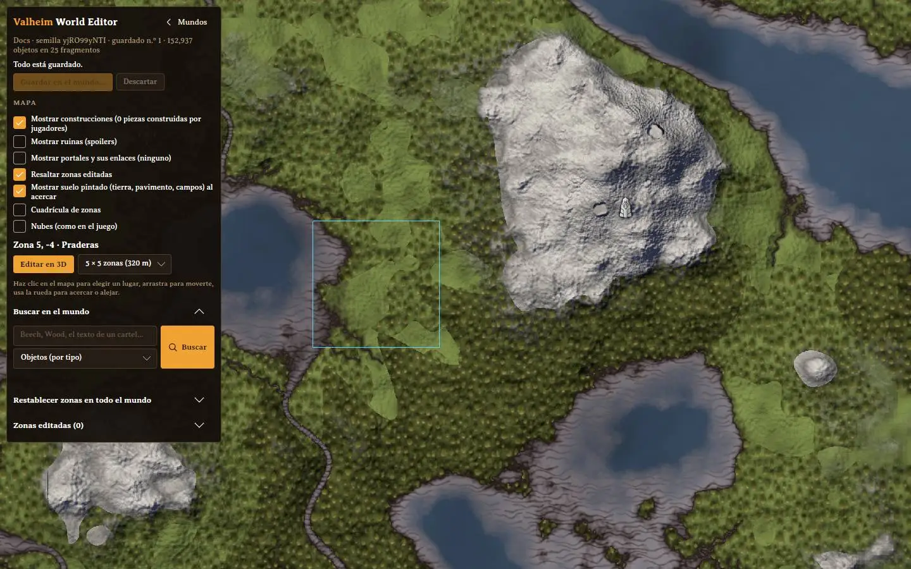
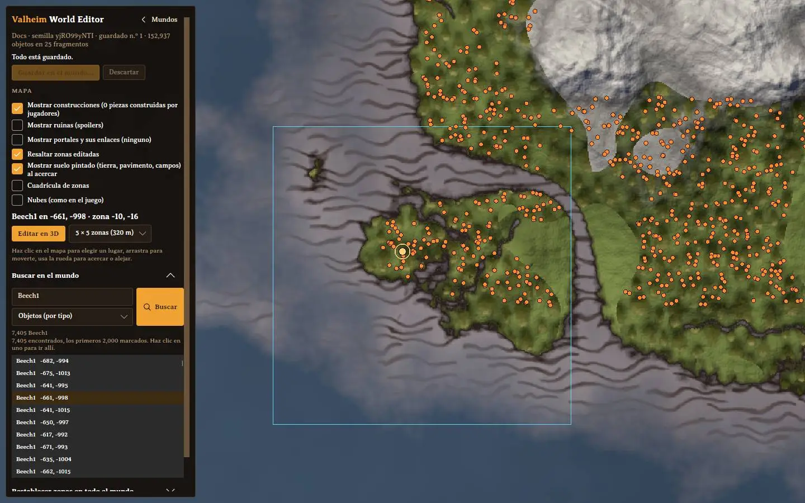
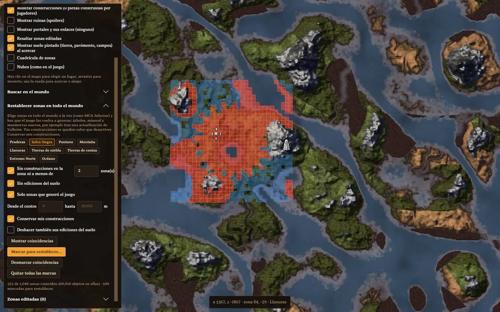
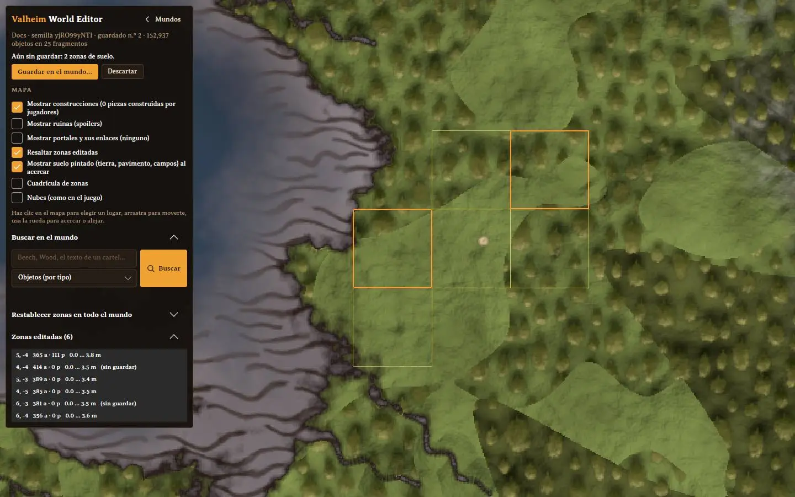

<!-- source: 2b176694 -->
# Mapa del mundo

Ve el mundo entero, elige el sitio que quieres editar en 3D, busca cualquier objeto, cofre o cartel, restablece zonas
en cualquier parte de una vez y guarda lo que está pendiente.

**Dónde:** se abre con cada mundo; **Mapa** en la barra superior del editor vuelve a él · **Tecla:** ninguna (`F1`
abre esta página) · **Funciona en:**
mundos guardados, en vivo

> [!WARNING]
> **Cierra el juego o detén el servidor antes de guardar un mundo sin conexión.** Un juego en marcha sobrescribe los
> archivos del mundo cuando guarda, y tus cambios, incluidos los restablecimientos de zona, se pierden. Para cambiar
> un mundo mientras está en marcha, usa el [modo en vivo](live-mode.md).

*Hay una zona elegida: el cuadrado azul claro es el área que abrirá **Editar en 3D**, con el tamaño elegido junto al
botón.*

El mapa se dibuja como el juego dibuja el suyo, a partir de los datos del mundo, así que se parece al mapa del juego
con todo descubierto. El inicio y los comerciantes (una vez creada su zona) muestran sus iconos como en el juego.

## Úsalo

1. Arrastra para mover el mapa; gira la rueda del ratón para acercar hacia el puntero.
2. Haz clic en un sitio. El panel lateral muestra su zona y su bioma («Zona 12, -4 · Selva Negra»), y el área que se
   abrirá aparece resaltada en azul claro.
3. En el panel lateral, elige el tamaño en la lista junto a **Editar en 3D**.
4. Pulsa **Editar en 3D**. El [editor 3D](editor-basics.md) se abre alrededor de la zona en la que hiciste clic.

El mapa recuerda dónde miraste por última vez, también la próxima vez que arranques el editor. El recuadro de abajo
muestra el punto bajo el puntero: sus coordenadas, zona y bioma («x 812, z -260 · zona 13, -4 · Praderas»), y el
bioma alternativo de su área cuando lo tiene («bioma alt. Praderas oscuras», que aparece unos segundos después de
abrirse el mapa).

## Ajustes

La parte de arriba del panel lateral da el nombre del mundo, la semilla, el número de guardado y cuántos objetos
contiene (en vivo: la conexión en lugar del número de guardado); después de guardar muestra el nuevo número de
guardado. **Mundos** vuelve a la página de inicio: con cambios pendientes pregunta antes, y **Salir de todos modos**
los pierde.

| Ajuste | Qué hace |
|---|---|
| **Recargar desde el juego** | Solo en vivo: vuelve a leer todo el mundo desde el juego en marcha. La línea de arriba lista los jugadores en línea («Mundo en vivo · 2 jugador(es) en línea: Ragnar, Freya»). |
| **Guardar en el mundo…** / **Aplicar en vivo** | Escribe cada cambio pendiente en los archivos del mundo (en vivo: lo envía al juego en marcha). La línea de arriba dice lo que está pendiente, por ejemplo «Aún sin guardar: 3 zonas de suelo, 12 eliminado(s), 40 añadido(s), 25 restablecimiento(s) de zona.» |
| **Descartar** | Tira todos los cambios aún no guardados ni aplicados, tras preguntar. |
| **Mostrar construcciones (N piezas construidas por jugadores)** | Dibuja todas las piezas construidas por jugadores: su planta de cerca, puntos más lejos, nada con el zoom muy alejado. Las ruinas sobre las que han construido los jugadores se dibujan con la construcción. Activado al principio. |
| **Mostrar ruinas (spoilers)** | Dibuja también las ruinas del mundo (torres de piedra, casas en ruinas, ruinas de las Tierras de niebla y las Tierras de ceniza), más tenues. Desactivado al principio, porque muestra dónde están. |
| **Mostrar portales y sus enlaces (N: P par(es) enlazado(s), A solo(s))** | Dibuja cada portal como un punto violeta, con una línea entre los dos que comparten etiqueta (la pareja que une el juego); un portal sin pareja aparece hueco. Con el zoom cerca (8 m por píxel o menos) cada etiqueta se escribe junto a su portal («sin etiqueta» para uno vacío). N cuenta los portales, P las parejas enlazadas, A los portales sin pareja. Los portales añadidos o eliminados en el editor cuentan en cuanto el mapa se vuelve a mostrar. Desactivado al principio, porque muestra dónde está cada portal. |
| **Resaltar zonas editadas** | Resalta las zonas cuyo suelo se cambió: una línea amarilla fina para los cambios que ya están en el mundo, una línea naranja más gruesa para los cambios aún no guardados ni aplicados. Activado al principio. |
| **Mostrar suelo pintado (tierra, pavimento, campos) al acercar** | De cerca, el mapa se dibuja con un detalle de 1 m con tus cambios de suelo pendientes; esto también muestra el suelo de tierra, pavimentado y cultivado. Activado al principio. |
| **Cuadrícula de zonas** | Dibuja las líneas entre las [zonas](concepts/areas-and-zones.md#zonas) de 64 m, cuando el zoom está lo bastante cerca. |
| **Nubes (como en el juego)** | Dibuja las sombras de las nubes a la deriva del mapa del juego. |
| **Editar en 3D** | Abre el editor 3D en el área alrededor de la zona elegida. |
| Lista de tamaño (junto a **Editar en 3D**) | Cuánto suelo carga el editor: **3 × 3 zonas (192 m)**, **5 × 5 zonas (320 m)** (por defecto), **7 × 7**, **9 × 9**, **13 × 13** o **17 × 17 zonas (1088 m)**. Usa 5 × 5 para la mayoría de trabajos, 9 × 9 o más para pegar un pueblo o levantar una gran montaña. Las áreas más grandes son más lentas. Puedes cambiarlo después en la barra superior. |

En modo en vivo, los jugadores en línea aparecen como puntos azules con sus nombres, actualizados cada 5 segundos. Los
cambios siguen [pendientes](concepts/saving-and-history.md#cambios-pendientes) de un área a otra: edita un área, vuelve
al mapa, abre otra y guárdalo todo de una vez.

## Buscar en el mundo

*Cada marca naranja es un objeto encontrado. El resultado elegido en la lista es más grande, con un anillo dorado, y
el mapa está centrado en él.*

1. Abre **Buscar en el mundo**.
2. Escribe parte de un nombre o de un texto, por ejemplo `Beech`, `Wood` o las palabras de un cartel. Las mayúsculas
   no importan.
3. Elige qué buscar (abajo).
4. Pulsa **Buscar** (o `Enter`). Cada resultado se marca en el mapa y se lista.
5. Haz clic en un resultado: el mapa se centra en él y elige su zona. **Editar en 3D** se abre entonces con ese objeto
   seleccionado.

| Buscar | Encuentra |
|---|---|
| **Objetos (por tipo)** | Cada objeto cuyo tipo contiene el texto: `portal`, `Beech`, `chest`, `guard_stone`… |
| **Artículos en contenedores** | Cada cofre, carro, barco u otro contenedor que guarda un artículo cuyo nombre contiene el texto: `Wood`, `Draugr`, `Silver`… Cada resultado dice cuántos («Wood ×50»). |
| **Textos (carteles, portales, guardas…)** | Cada objeto con un texto que lo contiene: textos de carteles, etiquetas de portales, nombres de guardas y de lápidas. Cada resultado muestra el texto que coincidió. |

Una línea sobre los resultados cuenta lo encontrado por tipo (por artículo en los contenedores) y en total. La lista
muestra los 300 primeros resultados; se marcan hasta 2000. Para artículos y textos, también se abren los
[datos](select.md) del objeto, para que puedas cambiar al momento el contenido del cofre o el texto del cartel.
Cambiar qué buscar vuelve a buscar al momento.

La búsqueda lee el mundo tal como está en el editor: los objetos que colocaste pero no guardaste se encuentran, los
que eliminaste pero no guardaste no. Los objetos de control interno del propio juego (nombres que empiezan por `_`,
como `_ZoneCtrl`) solo se encuentran cuando tu texto también empieza por `_`.

## Restablecer zonas en todo el mundo

*Las zonas de Praderas se marcaron para restablecer (rojo), luego se eligió **Selva Negra** y se pulsó **Mostrar
coincidencias** (azul). La línea bajo los botones cuenta ambas.*

Elige zonas en cualquier parte del mundo según lo que son, y haz que el juego las vuelva a generar: árboles, rocas,
minerales y mazmorras nuevos, por ejemplo tras una actualización de Valheim, en sitios donde nadie ha construido. Para
restablecer las zonas bajo una sola selección, usa en su lugar la herramienta [Región](area.md#restablecer-zonas), que tiene
los mismos dos interruptores y marca de la misma forma; paso a paso: [Volver a generar zonas](guides/reset-zones.md).

1. Abre **Restablecer zonas en todo el mundo**.
2. Ajusta el filtro (abajo).
3. Pulsa **Mostrar coincidencias**. La primera vez, el editor lee todas las zonas (un momento). Las zonas coincidentes
   se vuelven azules y una línea dice «N de M zonas coinciden (K objetos en ellas)». A partir de ahí, el mapa sigue el
   filtro a medida que lo cambias.
4. Pulsa **Marcar para restablecer…** y acepta. Las zonas coincidentes se vuelven rojas.
5. **Guardar en el mundo** (sin conexión) o **Aplicar en vivo** hace el restablecimiento. Hasta entonces, **Quitar
   todas las marcas** lo cancela, y **Desmarcar coincidencias** lo cancela para las zonas que el filtro encuentra ahora.

> [!CAUTION]
> **Un restablecimiento no se puede deshacer una vez guardado o aplicado.** Se quitan todos los objetos de la zona
> salvo las lápidas de los jugadores y, con **Conservar mis construcciones** activado, las piezas construidas por
> jugadores: árboles, rocas, minerales, ruinas, entradas de mazmorra, objetos en el suelo y criaturas, también los
> animales domados. Saca antes los animales domados y
> [haz una copia de seguridad del mundo](guides/back-up-a-world.md).

| Ajuste | Qué hace |
|---|---|
| Botones de bioma (**Praderas** … **Océano**) | Solo las zonas cuyo centro está en uno de los biomas activados. Ninguno activado: todos los biomas. |
| **Sin construcciones en la zona ni a menos de N zona(s)** | Deja fuera las zonas a menos de N zonas de piezas construidas por jugadores, incluidas las diagonales (de 0 a 50; 2 al principio). Activado al principio. Con esto desactivado, una zona que contiene piezas sigue quedando fuera mientras **Conservar mis construcciones** esté activado. |
| **Sin ediciones del suelo** | Deja fuera las zonas cuyo suelo se cambió (en el juego o en el editor). Activado al principio. |
| **Solo zonas que generó el juego** | Solo las zonas cerca de las que ya ha estado un jugador. Desactivado: también las zonas que solo contienen objetos o ediciones del suelo del editor. Activado al principio. |
| **Desde el centro … hasta … m** | Solo las zonas a esta distancia del centro del mundo. Vacío: sin límite (el borde del mundo está a 10 500 m). Por ejemplo, restablece solo los anillos exteriores. |
| **Conservar mis construcciones** | Activado al principio: las construcciones nunca se restablecen desde el mapa, y una zona que contiene piezas construidas por jugadores nunca coincide. Desactivado, y con **Sin construcciones…** también desactivado, las zonas con construcciones coinciden como cualquier otra y sus construcciones se van con el resto; la pregunta antes de marcar lo dice. |
| **Deshacer también sus ediciones del suelo** | El restablecimiento quita también los cambios del suelo de las zonas, de vuelta al suelo de la semilla. Solo importa cuando **Sin ediciones del suelo** está desactivado. Aquí está desactivado al principio (el de la herramienta Región está activado al principio). |
| **Mostrar coincidencias** | Sombrea de azul las zonas coincidentes y las cuenta, junto con los objetos que contienen. |
| **Marcar para restablecer…** | Marca para restablecer cada zona coincidente (rojo), tras preguntar. |
| **Desmarcar coincidencias** | Cancela el restablecimiento de las zonas coincidentes que están marcadas; las demás marcas se quedan. |
| **Quitar todas las marcas** | Cancela todos los restablecimientos de zona marcados, también los marcados con la herramienta Región. |

La próxima vez que un jugador se acerque a una zona restablecida, el juego la vuelve a generar a partir de la semilla,
incluida su ubicación (ruina, mazmorra, altar). En vivo, eso pasa al instante donde están los jugadores; después de un
restablecimiento en vivo el editor vuelve a leer el mundo, y el historial se conserva sin lo que hizo en las zonas
restablecidas.

## Zonas editadas

**Zonas editadas (N)** lista cada zona cuyo suelo se cambió, primero las más cambiadas. Cada fila da la zona, cuántos
puntos de altura (`a`) y de pintura (`p`) se cambiaron, el rango de los cambios de altura (`-2.4 … 6.0 m`) y «(sin
guardar)» cuando hay cambios pendientes («(sin aplicar)» en un mundo en vivo). Haz clic en una fila para acercarte a
esa zona y elegirla, lista para **Editar en 3D**.

*Cuatro zonas guardadas (amarillo fino) y dos editadas desde entonces (naranja más grueso): la lista marca las
pendientes como «(sin guardar)».*

## Atajos

| Tecla o ratón | Qué hace |
|---|---|
| Arrastrar | Mover el mapa. |
| Rueda del ratón | Acercar hacia el puntero. |
| Clic | Elegir la zona de ahí. |
| `Enter` en el cuadro de búsqueda | Buscar. |

## Consejos y límites

- **El mapa muestra el mundo tal como se leyó.** En vivo, el editor 3D sigue lo que cambian los jugadores en el área
  abierta, pero el resto del mapa solo cambia con **Recargar desde el juego**.
- **Con el zoom más cerca de unos 6 m por píxel**, la parte visible se vuelve a dibujar con un detalle de 1 m, con tus
  cambios de suelo pendientes incluidos.
- **Solo las zonas dentro del mundo** se listan para restablecer. Un servidor dedicado sin nadie en línea también
  genera zonas muy fuera del mundo: esas se dejan fuera.
- **Para deshacer un cambio**, **Quitar todas las marcas** cancela los restablecimientos marcados, y **Descartar**
  quita todo lo pendiente. Para deshacer un solo cambio, abre su área en 3D y pulsa `Ctrl+Z` o usa el Historial: ver
  [Deshacer un paso, retirar un cambio o descartarlo todo](guides/undo-changes.md).
- **¿La búsqueda no encuentra nada?** Comprueba la ortografía y la opción elegida en qué buscar; los objetos de control
  interno necesitan un `_` delante.
- **Mundos hechos con Expand World**: con su complemento instalado y activado, un mundo más ancho se muestra entero,
  los iconos de ubicación salen de sus datos, y la lectura añade el territorio y los efectos de estado que recibe ahí
  un jugador («territorio frost · efectos Freezing (noche)»). Consulta
  [Editar un mundo creado con Expand World, Riverheim o Tunnelheim](guides/use-mods-worlds.md).

## Relacionado

- [Encontrar un objeto, un artículo de un cofre o un cartel](guides/find-things.md)
- [Volver a generar zonas](guides/reset-zones.md)
- [Hacer una copia de seguridad de un mundo antes de editarlo](guides/back-up-a-world.md)
- [Áreas y zonas](concepts/areas-and-zones.md)
- [Conceptos básicos del editor](editor-basics.md), [Modo en vivo](live-mode.md)
