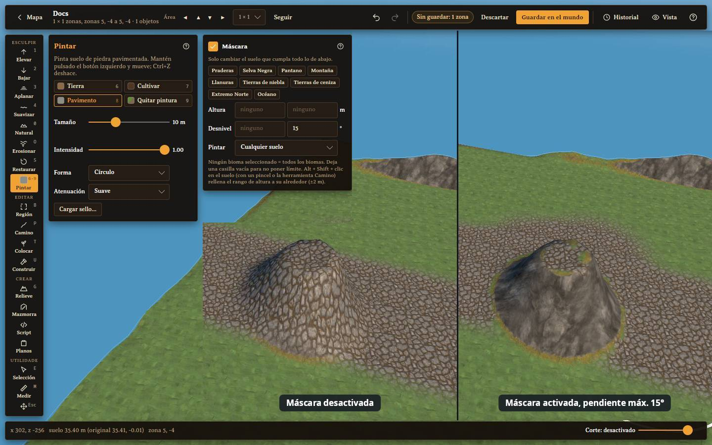
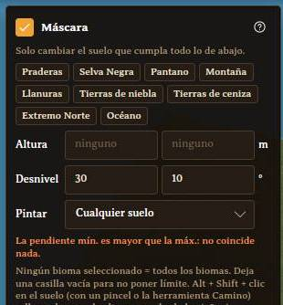

<!-- source: 1cb7e459 -->
# Máscara

Haz que una herramienta cambie solo el suelo que eliges, por bioma, altura, pendiente o pintura: pavimenta solo las
partes llanas de una colina, nivela el fondo de un valle sin tocar sus laderas, planta solo en suelo sin pintar.

**Dónde:** la tarjeta **Máscara** junto al panel de la herramienta · **Tecla:** ninguna (`Alt`+`Shift`+clic fija un
rango de altura) · **Funciona en:** mundos guardados, en vivo

*El mismo trazo ancho de pintura Pavimento sobre un montículo. Izquierda, Máscara desactivada: todo queda pavimentado.
Derecha, Máscara activada con pendientes de menos de 15°: el suelo llano queda pavimentado y las laderas empinadas del
montículo no. La tarjeta Máscara está junto al panel de la herramienta.*

La Máscara funciona con los pinceles de esculpir y el pincel Pintar, [Relieve](landform.md), [Camino](path.md), las
acciones de la herramienta [Región](area.md), el pegado y [Colocar](place.md). No frena [Construir](build.md): una pieza
va donde señalas.

## Úsalo

1. Elige una herramienta que use la Máscara. La tarjeta **Máscara** aparece junto a su panel.
2. En la tarjeta, marca **Máscara**. Sus ajustes se abren debajo.
3. Ajusta los biomas, la altura, la pendiente y la pintura que quieras. Deja un ajuste vacío para no limitar por él.
4. Usa la herramienta como de costumbre: solo cambia el suelo que cumple todos los ajustes.
5. Cuando termines, desmarca **Máscara**. Sigue activada, con sus ajustes, cuando cambias de herramienta.

## Ajustes

| Ajuste | Qué hace |
|---|---|
| **Máscara** | Activada: la herramienta solo cambia el suelo que cumple todo lo de abajo. Desactivada: sin límite. |
| Fichas de bioma | **Praderas**, **Selva Negra**, **Pantano**, **Montaña**, **Llanuras**, **Tierras de niebla**, **Tierras de ceniza**, **Extremo Norte**, **Océano**: solo estos biomas. Ninguno elegido: todos los biomas. |
| **Altura** mín. / máx. | Solo el suelo entre estas alturas (m; el mar está a 30 m). Deja una casilla vacía («ninguno») para no poner límite por ese lado. |
| **Desnivel** mín. / máx. | Solo el suelo entre estas inclinaciones, de 0° a 90°. Un máximo de 0 solo deja pasar el suelo perfectamente plano. |
| **Pintar** | **Cualquier suelo**, **Solo sin pintar**, **Solo pintado**, **Solo tierra**, **Solo cultivado** o **Solo pavimento**. |

Un aviso naranja aparece debajo de los ajustes cuando no dejan pasar nada: una pendiente máxima de 0°, o un mínimo por
encima del máximo.

*La pendiente mín. de 30° es mayor que la máx. de 10°, así que la tarjeta avisa en naranja: «La pendiente mín. es mayor
que la máx.: no coincide nada.»*

### Sin límite, en la misma tarjeta

Debajo de la Máscara, la tarjeta contiene el otro ajuste que comparten todas las herramientas de suelo:

| Ajuste | Qué hace |
|---|---|
| **Sin límite: más allá de los ±8 m del juego** | Activado: las herramientas de suelo llegan hasta 400 m desde el suelo generado, no solo los 8 m del juego. Un solo interruptor para los pinceles de esculpir, [Relieve](landform.md) (sus fórmulas e imágenes), [Camino](path.md) y [Región](area.md); sigue activado hasta que lo desactivas, y está desactivado cada vez que se inicia el editor. Consulta [Sin límite](terrain.md#sin-límite). |

No forma parte de la Máscara (funciona con la Máscara activada o desactivada), y la tarjeta solo lo muestra con las
herramientas a las que afecta: no con el pincel Pintar ni con [Colocar](place.md), que no mueven suelo. Una montaña de
Relieve siempre supera el límite, diga lo que diga el interruptor.

## Atajos

| Tecla o ratón | Qué hace |
|---|---|
| `Alt`+`Shift`+clic en el suelo | Con un pincel de esculpir o de pintar, o con la herramienta Camino: activa la Máscara y rellena **Altura** desde 2 m por debajo hasta 2 m por encima de ese punto. Útil para trabajar solo en una terraza o en una línea de costa. |

## Consejos y límites

- **La Máscara no tiene borde suave.** Cada punto del suelo (uno por metro) cumple o no, así que esculpir con ella
  puede dejar un escalón donde el suelo que cumple se junta con el resto, sobre todo con Elevar, Bajar y un
  [Relieve](landform.md). Pasa después el pincel **Suavizar** por el escalón, con la Máscara desactivada.
- **Durante un trazo de pincel, la Máscara mira el suelo tal como estaba al pulsar el botón.** Un trazo de Elevar con
  un límite de altura sigue subiendo por encima de él hasta que sueltas. Las ediciones de un clic (Relieve, Camino,
  Región, pegar) miran el suelo justo antes de hacerse.
- **El bioma es el que generó el mundo** en ese lugar. Remodelar el suelo no lo cambia.
- **Pintar:** el suelo limpiado con **Quitar pintura** cuenta como sin pintar. **Solo tierra**, **Solo cultivado** y
  **Solo pavimento** necesitan que esa pintura sea al menos la mitad del color.
- **¿No ha cambiado nada?** La barra de estado dice «No ha cambiado nada: la Máscara excluye todo el suelo bajo el
  pincel (revisa sus ajustes de altura, pendiente, bioma y pintura).»
- **Un pegado también obedece a la Máscara, aunque la tarjeta no se muestre mientras pegas.** Una Máscara que se ha
  quedado activada limita el suelo al que el pegado da forma (sus objetos entran todos). Desmarca **Máscara** antes de
  copiar y pegar si quieres todo el suelo.
- **La Máscara es un ajuste, no un cambio**: no se deshace con `Ctrl+Z` ni se guarda en el mundo. Está desactivada, con
  sus casillas vacías, cada vez que se inicia el editor.

Ideas:

- Para pavimentar un camino solo en las partes llanas de una ladera, ajusta **Desnivel** máx. y usa **Pintar
  pavimento** de la herramienta Camino.
- Para plantar solo en suelo sin pintar o solo en suelo cultivado, ajusta **Pintar** y usa [Colocar](place.md).
- Para nivelar el fondo de un valle sin tocar sus laderas, ajusta **Altura** máx. un poco por encima del fondo del valle
  y usa **Aplanar** o la herramienta [Región](area.md).

## Relacionado

- [Despejar árboles y rocas y nivelar un solar](guides/clear-an-area.md)
- [Plantar un bosque, un campo o un seto](guides/plant-a-forest.md)
- [Esculpir y pintar](terrain.md), [Camino](path.md), [Región](area.md)
- [Cómo juzga el suelo la máscara](concepts/ground-limits.md#cómo-juzga-la-máscara-el-suelo)
