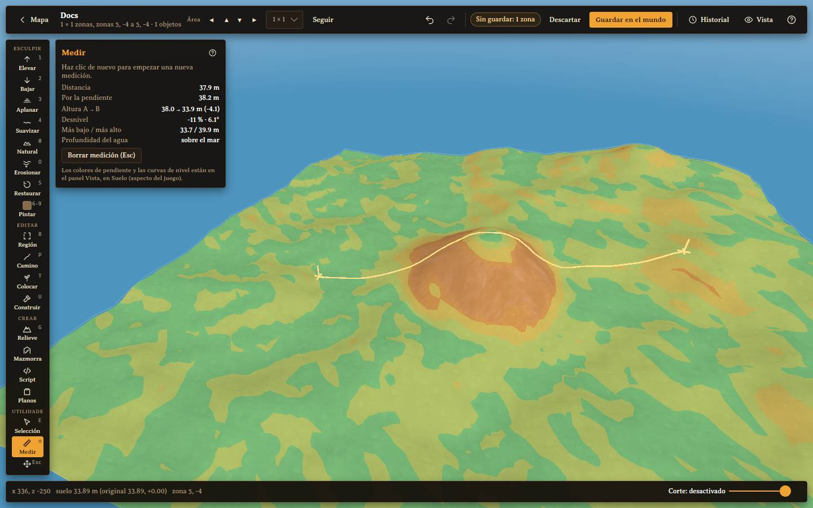
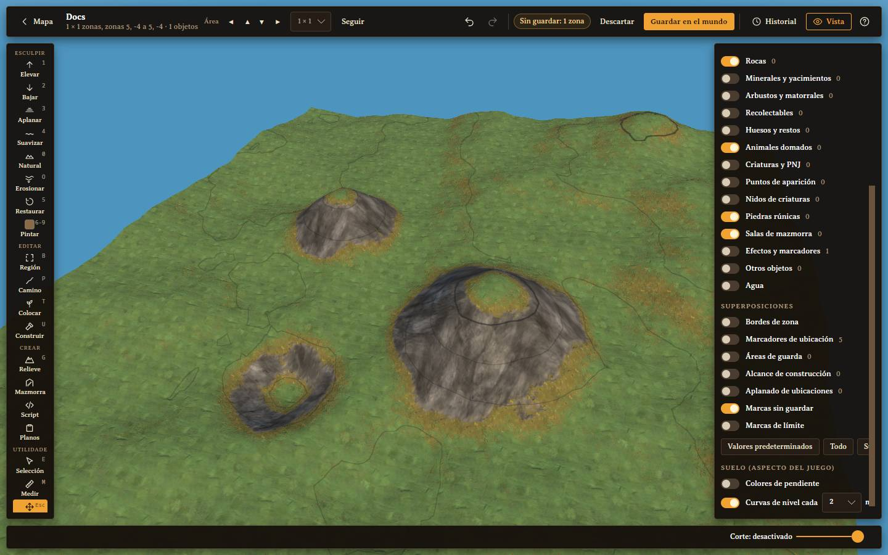
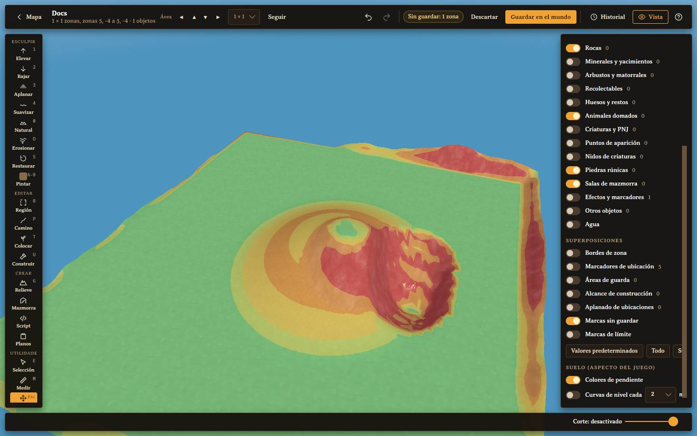

<!-- source: 164ad5c4 -->
# Medir y superposiciones

Haz clic en dos puntos y lee la distancia, la diferencia de altura y la pendiente entre ellos. Dos superposiciones del
suelo, los colores de pendiente y las curvas de nivel, muestran la inclinación y la altura en todas partes a la vez
mientras usas cualquier herramienta.

**Dónde:** barra de herramientas, sección **UTILIDADES**; las superposiciones en el panel Vista · **Tecla:** `M` ·
**Funciona en:** mundos guardados, en vivo

*Una medición desde el pie de un montículo hasta pasada su cima, con los colores de pendiente activados. La línea
sigue el suelo; el panel muestra la distancia, las alturas y la pendiente.*

## Úsala

1. En la barra de herramientas, haz clic en **Medir** (`M`).
2. Haz clic en un primer punto del suelo. La línea sigue al cursor.
3. Haz clic en un segundo punto para fijar la medición. El panel muestra las lecturas.
4. Haz clic una vez más para empezar una nueva medición, o pulsa **Borrar medición (Esc)** para quitarla.

La línea se dibuja a lo largo del suelo, así que muestra el perfil entre los dos puntos. La indicación de arriba del
panel dice lo que hace el siguiente clic.

## Lecturas

| Lectura | Qué significa |
|---|---|
| **Distancia** | La distancia en línea recta vista desde arriba, como en un mapa (m). |
| **Por la pendiente** | La longitud de una línea recta de A a B, incluida la diferencia de altura (m). |
| **Altura A → B** | La altura del suelo en ambos puntos y la diferencia, por ejemplo `35.0 → 42.5 m (+7.5)`. |
| **Desnivel** | La pendiente media de A a B, en % y en grados. Una pendiente del 100 % son 45°. |
| **Más bajo / más alto** | El suelo más bajo y el más alto a lo largo de la línea, leídos cada metro: un bulto o una hondonada se ven aquí aunque A y B estén al mismo nivel. |
| **Profundidad del agua** | Cuánto está el punto más bajo por debajo del mar (el mar está a 30 m), o «sobre el mar». |

Las alturas son las del juego, como en la barra de estado. Puedes seleccionar los valores del panel y copiarlos.

## Superposiciones del suelo

En el panel Vista (`V`), bajo **SUELO (aspecto del juego)**:

| Ajuste | Qué hace |
|---|---|
| **Colores de pendiente** | Colorea el suelo según su inclinación, para que veas dónde una rampa o un solar es demasiado empinado: verde por debajo de 10°, verde amarillento de 10 a 20°, amarillo de 20 a 30°, naranja de 30 a 45°, rojo por encima de 45°. Las colinas conservan sus luces y sombras. |
| **Curvas de nivel cada** *N* **m** | Dibuja curvas de nivel cada **1**, **2** (por defecto), **5** o **10** m. Una de cada cinco curvas es más oscura y más gruesa. Las curvas muy juntas indican suelo empinado. |

Ambas necesitan **Aspecto del juego** (el aspecto del suelo del panel Vista), siguen activadas mientras usas otras
herramientas y se recuerdan. Las curvas de nivel caen en múltiplos del intervalo, así que el nivel del mar (30 m)
siempre tiene una y la línea de costa es fácil de seguir.

*Curvas de nivel cada 2 m sobre dos montículos y una hondonada, con los bordes de zona desactivados. El panel Vista
muestra **Curvas de nivel cada** 2 m bajo **SUELO (aspecto del juego)**; una de cada cinco curvas es más oscura.*

*Colores de pendiente en un montículo: verde en el suelo llano, luego verde amarillento, amarillo y naranja subiendo
por su ladera suave, y rojo en el acantilado cortado en él. El panel Vista muestra **Colores de pendiente** marcado
bajo **SUELO (aspecto del juego)**.*

## Atajos

| Tecla o ratón | Qué hace |
|---|---|
| `M` | Elegir Medir. |
| Clic | Fijar el punto A, luego el punto B, y luego empezar de nuevo. |
| `Esc` | Borrar la medición; un segundo `Esc` sale de la herramienta. |
| `V` | Mostrar u ocultar el panel Vista (las superposiciones). |

## Consejos y límites

- **La medición no cambia nada** en el mundo y no se guarda.
- **Las lecturas siguen al suelo.** Cambia el suelo con otra herramienta y vuelve a Medir, o deshaz: las alturas, la
  pendiente y los puntos más bajo y más alto se vuelven a leer en los mismos A y B.
- **Planifica una rampa:** mide desde su pie hasta su cima. **Desnivel** es la pendiente que da la **Rampa** de la
  herramienta [Camino](path.md) en línea recta entre los mismos puntos.
- **Marcas de límite**, en el mismo panel Vista, tiñe de rojo el suelo que ha llegado a los ±8 m del juego. Consulta
  [Marcas de límite](concepts/ground-limits.md#marcas-de-límite).

## Relacionado

- [Hacer un camino o una rampa colina arriba](guides/make-a-road.md)
- [Despejar árboles y rocas y nivelar un solar](guides/clear-an-area.md)
- [Conceptos básicos del editor](editor-basics.md): el panel Vista
- [Camino](path.md), [Esculpir y pintar](terrain.md)
