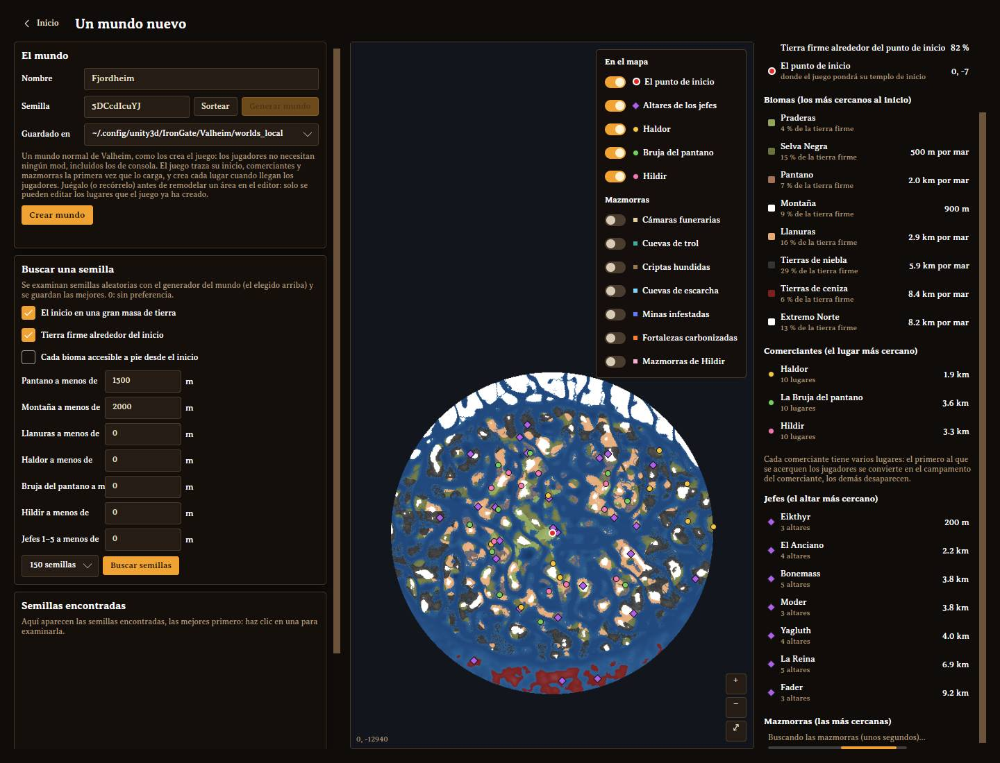
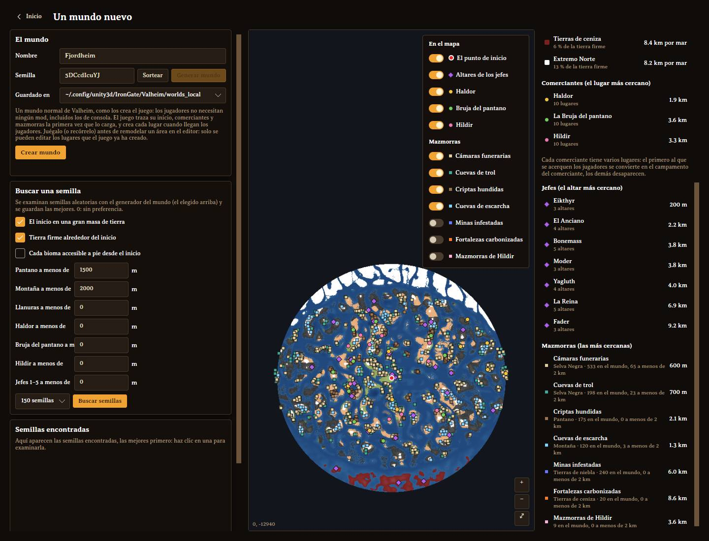
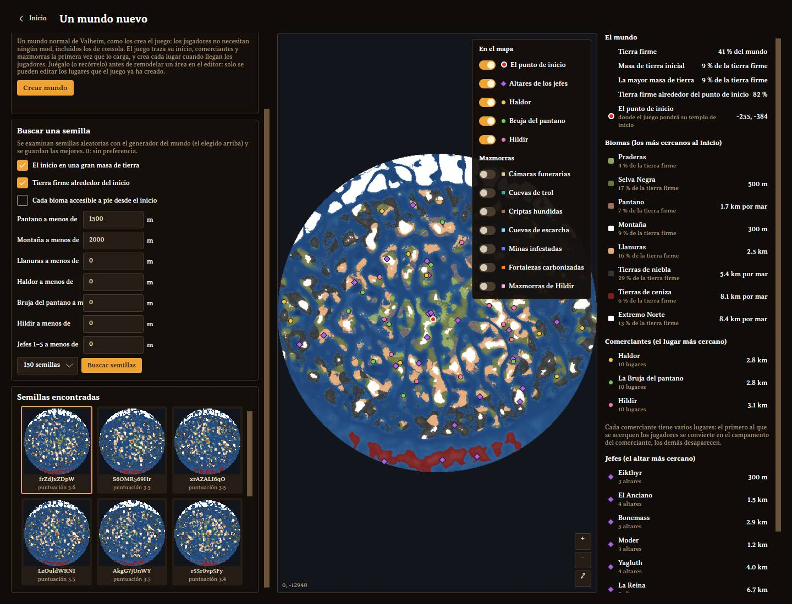

<!-- source: eca6c42a -->
# Un mundo nuevo

Mira el mundo de una semilla antes de que exista, busca entre muchas semillas una que te convenga y crea el mundo.

**Dónde:** página de inicio, **Crear** → **Un mundo nuevo** → **Crear un mundo nuevo** · **Tecla:** ninguna ·
**Funciona en:** la página de inicio (no hace falta tener ningún mundo abierto)

*El punto rojo es el inicio, los rombos morados son los altares de los jefes, y los puntos amarillos, verdes y rosas
son los lugares de los comerciantes. La columna de la derecha enumera los datos de la semilla, aquí desplazada hasta
los altares más cercanos de los jefes.*

El mundo que creas es un mundo normal de Valheim, hecho con las propias reglas del juego a partir de su semilla: los
jugadores se unen sin ningún mod, incluidos los jugadores de consola en juego cruzado (salvo que elijas el generador
de un mod de generación de mundos; consulta [Consejos y límites](#consejos-y-límites)).

## Úsalo

1. En la página de inicio, elige **Un mundo nuevo** en **Crear** y luego **Crear un mundo nuevo**. Se muestra el
   mundo de una semilla aleatoria.
2. Escribe una semilla y pulsa **Generar mundo** (o `Enter`), o pulsa **Sortear** para otra aleatoria. Para que el
   editor busque por ti, consulta [Buscar una semilla](#buscar-una-semilla).
3. Mira el mapa y los datos que lo acompañan. Opcional: activa los tipos de mazmorra que te interesen.
4. Escribe el **Nombre** del mundo, elige dónde queda **Guardado en** y pulsa **Crear mundo**. El editor escribe el
   mundo y abre su mapa.
5. Inicia Valheim, carga el mundo nuevo y recorre las partes que quieras editar. El juego crea cada lugar solo cuando
   los jugadores se acercan a él.
6. Vuelve a abrir el mundo en el editor para remodelar lo que el juego ha creado.

**Inicio** (arriba a la izquierda) vuelve a la página de inicio; no se crea nada.

## Ajustes

| Ajuste | Qué hace |
|---|---|
| **Semilla** | Hasta 10 letras y cifras, como en el juego. La misma semilla siempre crea el mismo mundo. Las mayúsculas cuentan: `Valheim` y `valheim` son dos mundos. |
| **Sortear** | Pone otra semilla aleatoria en la casilla y muestra su mundo. |
| **Generar mundo** | Muestra el mundo de la semilla (o `Enter` en la casilla de la semilla). En gris mientras la semilla de la casilla sea la que se muestra. |
| **En el mapa** | Muestra u oculta **El punto de inicio**, **Altares de los jefes**, **Haldor**, **Bruja del pantano** e **Hildir**. |
| **Mazmorras** | Muestra dónde estará cada tipo de mazmorra (desactivado al principio). Consulta [Mazmorras](#mazmorras). |
| **Nombre** | El nombre del mundo, tal como lo muestra el juego. También es el nombre de su carpeta, así que no puede contener `/ \ : * ? " < > \|`. |
| **Guardado en** | En cuál de las carpetas de mundos del juego va: tus mundos locales (`worlds_local`) o los mundos en la nube de Steam (`worlds`), las que existen en este equipo. Primero va la carpeta en la que guarda el juego instalado (en Linux, la versión de Windows que se ejecuta con Proton guarda sus mundos dentro de su prefijo de Steam), para que el juego muestre el mundo. |
| **Generador** | Solo aparece cuando hay en uso un complemento para un mod de generación de mundos y se encuentra el mod: el generador del mod o **El del juego**. Consulta [Consejos y límites](#consejos-y-límites). |
| **Crear mundo** | Crea el mundo y abre su mapa. Un mundo con el mismo nombre que ya esté en esa carpeta nunca se sobrescribe: se te pide otro nombre. |

## El mapa

El mapa muestra el mundo de la semilla tal como lo creará el juego: la tierra coloreada por bioma (el terreno más alto,
más claro), el agua sobre tierra teñida de azul, el mar sombreado según su profundidad y el norte arriba. Tarda unos
segundos; mientras tanto se muestra «Examinando el mundo de …». Con zoom, la vista se vuelve a dibujar con un punto
por píxel de pantalla, para que costas y ríos se vean nítidos. La esquina inferior izquierda muestra las coordenadas
bajo el puntero.

Sobre el mapa están los lugares que el juego distribuye la primera vez que carga el mundo:

- el **inicio** (punto rojo con un anillo blanco): el templo de inicio, donde llegan los jugadores nuevos;
- los **altares de los jefes** (rombos morados): Eikthyr, el Anciano, Bonemass, Moder, Yagluth, la Reina y Fader;
- los **lugares de los comerciantes**: Haldor (amarillo), la Bruja del pantano (verde) e Hildir (rosa). Cada
  comerciante tiene varios lugares: el primero al que se acerquen los jugadores se convierte en el campamento, y los
  demás desaparecen.

Pasa el puntero sobre una marca para ver sus coordenadas y su distancia al inicio. Los lugares están exactamente donde
los pondrá el juego: el editor reproduce las reglas de colocación del juego, leídas de los archivos de tu Valheim
(unos segundos, la primera vez).

## Mazmorras

*Cuatro tipos activados: cada pequeño cuadrado es una mazmorra, y su color, su tipo, como en los interruptores y en
**Mazmorras (las más cercanas)** (distancia, bioma, cuántas hay en el mundo y a menos de 2 km).*

Los interruptores de **Mazmorras** muestran **Cámaras funerarias**, **Cuevas de trol**, **Criptas hundidas**,
**Cuevas de escarcha**, **Minas infestadas**, **Fortalezas carbonizadas** y **Mazmorras de Hildir**. El editor empieza
a buscarlas en cuanto se muestra una semilla (unos segundos); un tipo que activas aparece en cuanto se encuentra. Se
conservan las mazmorras de las últimas 20 semillas que miraste, así que al volver a una se muestran al instante.

**Mazmorras (las más cercanas)** indica, para cada tipo, a qué distancia del inicio está la más cercana, su bioma,
cuántas hay en el mundo y cuántas quedan a menos de 2 km. Haz clic en una fila para activar ese tipo y ver la más
cercana en el mapa.

Incluyen los tipos que un **bioma alternativo** (una variante como Dark Meadows) añade o excluye. No se muestran las
aldeas, las ruinas ni los demás lugares pequeños.

## Los datos de la semilla

Junto al mapa, el mundo de la semilla en forma de listas. Haz clic en una fila con una marca para verla en el mapa, o
para ver la más cercana de su tipo.

- **El mundo**: **Tierra firme** (cuánto del mundo es tierra), **Masa de tierra inicial** y **La mayor masa de
  tierra** (cada una como parte de toda la tierra), **Tierra firme alrededor del punto de inicio** (tierra a menos de
  400 m del inicio) y las coordenadas del inicio.
- **Biomas (los más cercanos al inicio)**: la parte de la tierra de cada bioma y a qué distancia está su tierra más
  cercana, con «por mar» cuando está en otra masa de tierra (necesitas un barco).
- **Comerciantes (el lugar más cercano)**: a qué distancia está el lugar más cercano de cada comerciante, y cuántos
  lugares tiene.
- **Jefes (el altar más cercano)**: a qué distancia está el altar más cercano de cada jefe, y cuántos hay.
- **Mazmorras (las más cercanas)**: consulta [Mazmorras](#mazmorras).

Aquí, tierra es el suelo sobre el que puedes estar de pie o vadear: como mucho 1 m bajo el agua, o 3 m en un Pantano.
Una masa de tierra es tierra unida a tierra sin cruzar agua más profunda.

## Buscar una semilla

*Los deseos (aquí una gran masa de tierra con tierra alrededor, un Pantano a menos de 1500 m y una Montaña a menos de
2000 m, 150 semillas); las mejores semillas encontradas en **Semillas encontradas**, las mejores primero. Se hizo clic
en la primera: su borde se ilumina y su mundo llena el mapa grande.*

**Buscar una semilla** examina muchas semillas aleatorias en segundo plano y conserva las mejores para tus deseos. Un 0
en una casilla de distancia significa «sin preferencia». Para una búsqueda paso a paso, consulta [Buscar una semilla
con lo que quieres cerca del inicio](guides/find-a-seed.md).

| Ajuste | Qué hace |
|---|---|
| **El inicio en una gran masa de tierra** | Prefiere semillas cuyo inicio esté en una gran masa de tierra (activado al principio). |
| **Tierra firme alrededor del inicio** | Prefiere semillas con poca agua a menos de 400 m del inicio (activado al principio). |
| **Cada bioma accesible a pie desde el inicio** | Prefiere semillas en las que el más cercano de cada bioma esté en la propia masa de tierra del inicio. |
| **Pantano a menos de**, **Montaña a menos de**, **Llanuras a menos de** | Prefiere semillas en las que la tierra más cercana de ese bioma esté a menos de tantos metros (de 0 a 8000 m, en pasos de 250; al principio 1500 para el Pantano y 2000 para la Montaña). |
| **Haldor a menos de**, **Bruja del pantano a menos de**, **Hildir a menos de** | Prefiere semillas en las que uno de los lugares de ese comerciante esté a menos de tantos metros. |
| **Jefes 1–5 a menos de** | Prefiere semillas en las que un altar de cada uno de Eikthyr, el Anciano, Bonemass, Moder y Yagluth esté a menos de tantos metros. |
| Lista de semillas | Cuántas semillas aleatorias examinar: **60 semillas**, **150 semillas** (el valor predeterminado) o **400 semillas**. |
| **Buscar semillas** | Inicia la búsqueda; la barra de debajo muestra cuánto lleva. |
| **Detener** | Detiene la búsqueda y muestra las mejores encontradas hasta el momento. |

Las 12 mejores semillas aparecen en **Semillas encontradas**, cada una como un pequeño mapa con su semilla y su
puntuación. Pasa el puntero sobre una para ver sus datos; haz clic en ella para verla en el mapa grande (recibe un
borde de color).

### Cómo se puntúan las semillas

- **El inicio en una gran masa de tierra** suma hasta 3 (la parte de la tierra que ocupa la masa de tierra del inicio,
  por 3); **Tierra firme alrededor del inicio** suma hasta 2 (la parte de tierra a menos de 400 m, por 2).
- Un deseo de distancia que se cumple suma de 1 a 2, más cuanto más cerca esté. Uno que no se cumple resta, más cuanto
  más lejos esté; un bioma o un comerciante que la semilla no tiene en absoluto resta 2. **Jefes 1–5 a menos de**
  cuenta la media de los cinco jefes.
- **Cada bioma accesible a pie** suma 0.25 por cada bioma cuya tierra más cercana esté en la masa de tierra del inicio.

Una puntuación nunca es menor que 0. La búsqueda examina cada semilla de forma más gruesa que el mapa grande (puntos a
unos 210 m de distancia en lugar de unos 40 m), así que puede pasar por alto islas pequeñas y estrechos angostos:
comprueba en el mapa grande una semilla encontrada antes de elegirla. Los deseos sobre comerciantes o jefes hacen la
búsqueda varias veces más lenta.

## Atajos

| Entrada | Acción |
|---|---|
| `Enter` (en la casilla de la semilla) | Mostrar el mundo de la semilla |
| Rueda del ratón | Acercar o alejar donde está el puntero |
| Arrastrar | Mover el mapa (desde cualquier sitio, también sobre una marca) |
| Doble clic | Volver a mostrar todo el mundo |
| **+**, **−**, **⤢** (abajo a la derecha) | Más cerca, más lejos, todo el mundo |

## Consejos y límites

- **Juega el mundo antes de editarlo.** Un mundo nuevo aún no contiene árboles, rocas ni edificios, solo su nombre,
  su semilla y una lista de zonas vacía. El juego distribuye el inicio, los comerciantes, los altares y las mazmorras
  la primera vez que carga el mundo (donde los mostraba esta página), y crea cada zona a medida que los jugadores se
  acercan. El editor solo puede remodelar las zonas que el juego ha creado; hasta entonces, el mapa muestra la tierra
  de la semilla sin nada encima.
- El mundo se escribe en el formato de guardado de Valheim 1.0.20 y posteriores, como escribe el juego un mundo nuevo:
  un juego o un servidor más antiguo lo rechaza, así que actualízalo antes. Un mundo con el mismo nombre nunca se
  sobrescribe.
- Si los jefes y los comerciantes no se pueden leer de los archivos de tu juego, la página lo dice: el mapa sigue
  mostrando los biomas, pero faltan las marcas y la búsqueda no puede buscarlos. El registro (**Abrir registro** en la
  página de inicio) dice por qué.
- Con el [complemento Expand World](../../addons/ExpandWorld/README.md) en uso, las semillas examinadas y el mundo
  creado siguen la configuración y los archivos de datos de los mods (la página lo indica encima de **Crear mundo**):
  un mundo más ancho, otros biomas y lugares, el nivel del mar de los mods. Un bioma que añaden los mods y un
  territorio se muestran con sus propios colores de mapa.
- Con el [complemento Riverheim](../../addons/Riverheim/README.md) en uso y Riverheim instalado, **Generador** ofrece
  Riverheim (elegido al principio, ya que el juego convierte cada mundo nuevo en un mundo de Riverheim mientras el mod
  está instalado) o **El del juego**. Un mundo de Riverheim necesita Riverheim en el juego de cada jugador, así que los
  jugadores de consola en juego cruzado no pueden unirse. Cada semilla tarda unos segundos: Riverheim distribuye
  primero todo su mundo.
- No se crea nada hasta **Crear mundo**: **Inicio** y cerrar la página no dejan rastro. Para quitar un mundo que
  creaste, elimina su carpeta de la carpeta de mundos en la que se guardó.

*Con el complemento Riverheim en uso, **Generador** indica Riverheim y su versión, y la nota de debajo dice lo que un
mundo de Riverheim pide a sus jugadores. El mapa y los datos son el propio mundo de Riverheim para esta semilla.*

## Relacionado

- [Buscar una semilla con lo que quieres cerca del inicio](guides/find-a-seed.md)
- [Editar un mundo creado con Expand World, Riverheim o Tunnelheim](guides/use-mods-worlds.md)
- [Áreas y zonas](concepts/areas-and-zones.md#zonas): por qué el juego debe crear una zona antes de que puedas editarla
- [Mazmorra](dungeons.md): editar una mazmorra una vez que el juego la ha creado
