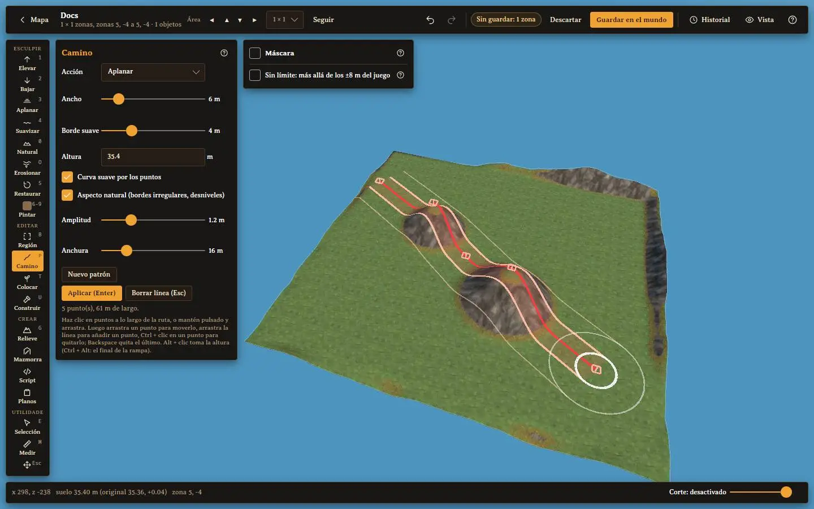
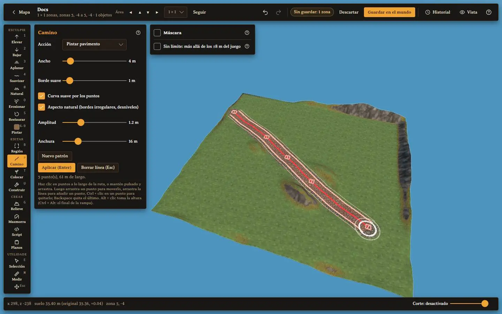
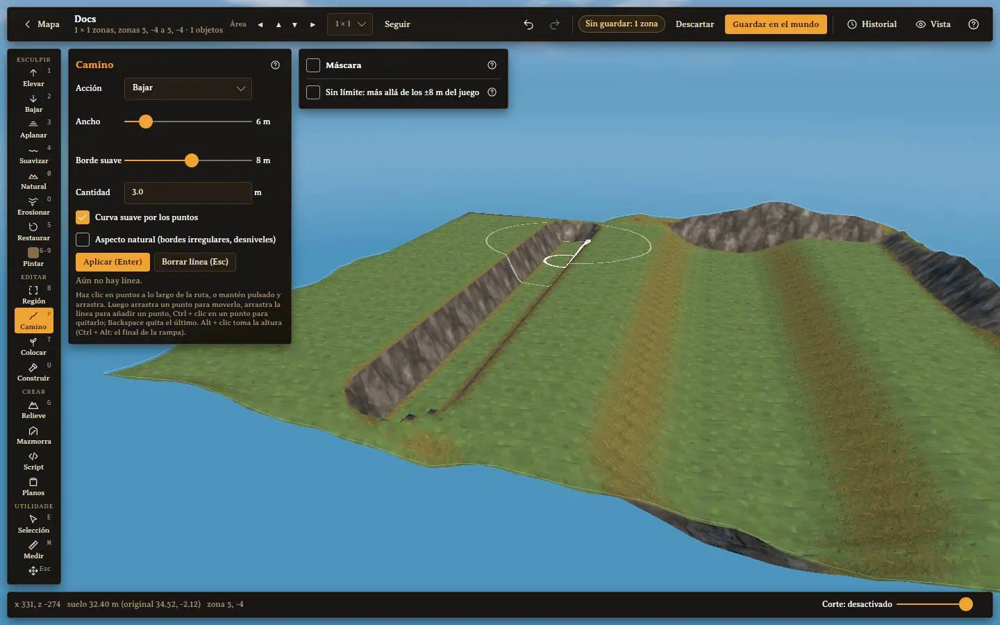
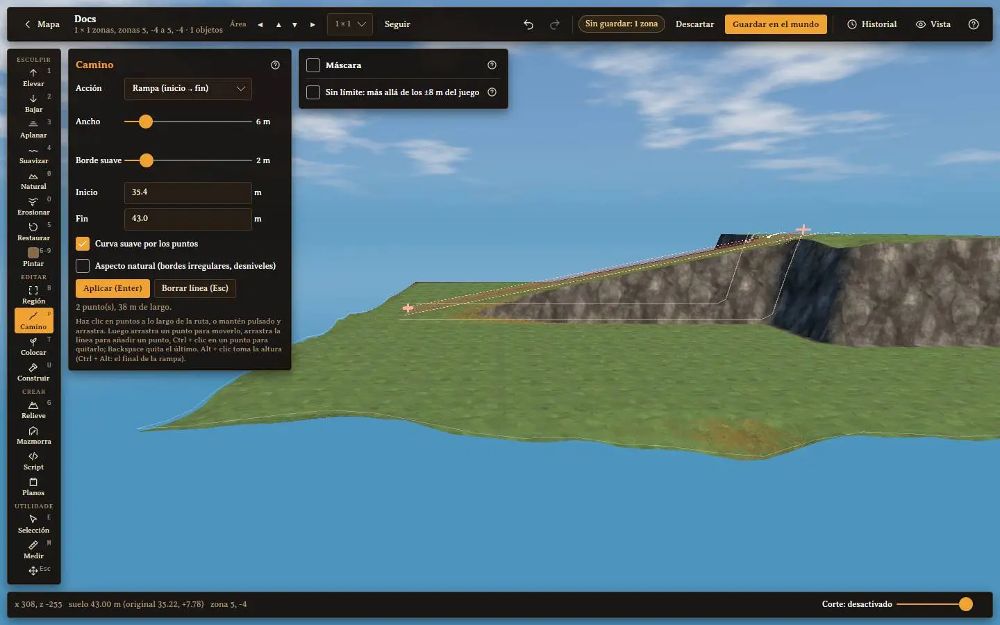
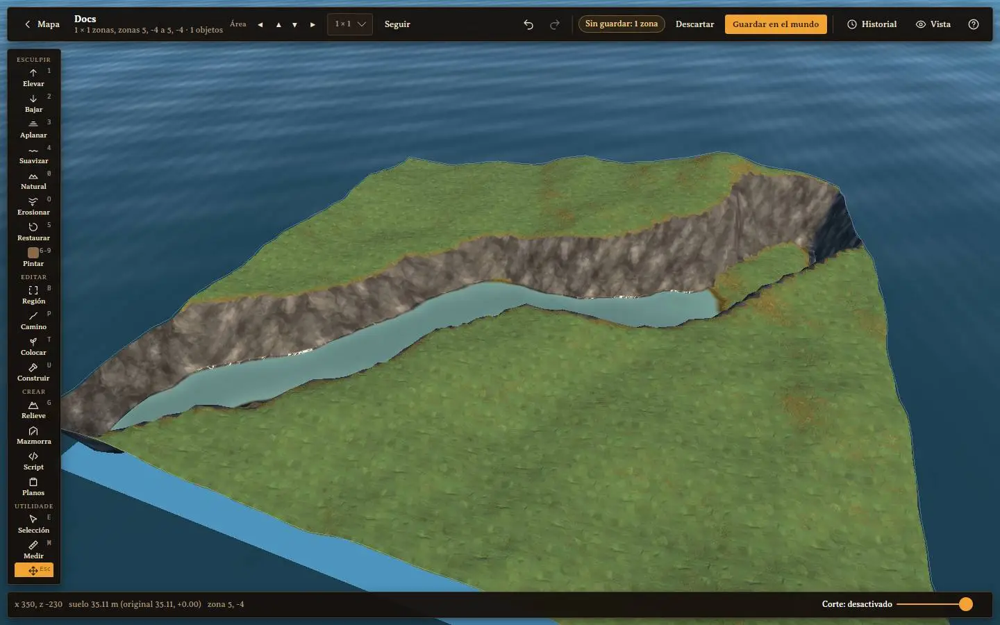

<!-- source: 2d41926b -->
# Camino

Dibuja una línea y luego aplana, haz una rampa, eleva, baja, suaviza, excava o pinta el suelo a lo largo de ella:
caminos, rampas, terraplenes, zanjas y ríos.

**Dónde:** barra de herramientas, sección **EDITAR** · **Tecla:** `P` · **Funciona en:** mundos guardados, en vivo

*Una línea de cinco puntos dibujada sobre dos montículos, con **Aplanar** elegido, su **Altura** tomada del suelo
llano con `Alt`+clic y **Aspecto natural** activado. Todavía no ha cambiado nada: la franja muestra el ancho del camino
y sus bordes suaves hasta que pulsas **Aplicar (Enter)**; los círculos del último punto son los del puntero.*

## Úsala

1. En la barra de herramientas, haz clic en **Camino** (`P`).
2. Haz clic en puntos a lo largo del recorrido, o mantén pulsado y arrastra para dibujarlo a mano alzada. Bajo el
   puntero, un círculo muestra el ancho del camino y otro más tenue su borde suave; una vez que hay puntos, la franja
   muestra ambos a lo largo de la línea.
3. Opcional: ajusta la línea. Arrastra un punto para moverlo, arrastra la línea entre dos puntos para añadir un punto
   ahí, `Ctrl`+clic en un punto para quitarlo, `Backspace` para quitar el último.
4. En el panel, elige una **Acción** y ajusta sus opciones.
5. Pulsa **Aplicar (Enter)**. El cambio es un paso de deshacer, con el nombre de la acción («Camino: Aplanar»).
6. Opcional: elige otra acción y aplícala a la misma línea (aplanar y luego pavimentar), o mueve sus puntos y vuelve a
   aplicar. La línea se queda hasta que pulsas **Borrar línea (Esc)**.

El panel muestra cuántos puntos tiene la línea y cuánto mide.

*La línea de la primera imagen, con la misma cámara: **Aplanar** abrió un camino llano a través de ambos montículos, y
luego **Pintar pavimento** con **Ancho** 4 m y **Borde suave** 1 m pavimentó su centro. La línea se queda para la
siguiente acción.*

## Ajustes

| Opción | Qué hace |
|---|---|
| **Acción** | Qué ocurre a lo largo de la línea (consulta [Acciones](#acciones)). |
| **Ancho** | Ancho del camino, de 1 a 40 m (8 m por defecto). La acción actúa por completo en todo ese ancho. |
| **Borde suave** | Hasta dónde se atenúa el cambio a cada lado, de 0 a 15 m (4 m por defecto), para que el camino se funda con el suelo. Con **0** el borde es nítido: una zanja de lados rectos y empinados. |
| **Altura** | **Aplanar**: la altura del camino (m). `Alt`+clic en el suelo la toma. |
| **Cantidad** | **Elevar** / **Bajar**: cuánto (m, 2 por defecto). |
| **Inicio**, **Fin** | **Rampa**: la altura en el primer y en el último punto (m). Consulta [Rampa](#rampa). |
| **Profundidad** | **Río / canal**: cuánto queda el lecho bajo el nivel del mar en su centro (m, 2 por defecto). |
| **Curva suave por los puntos** | Activada (por defecto): una curva suave que pasa por tus puntos. Desactivada: líneas rectas entre ellos. |
| **Aspecto natural (bordes irregulares, desniveles)** | Un ancho que varía a lo largo del recorrido (hasta un 45 % en cada sentido) y bordes irregulares, para todas las acciones; además, pequeños desniveles en la superficie para **Aplanar**, **Rampa**, **Elevar**, **Bajar** y **Río / canal**. El camino parece entonces gastado y no hecho con una herramienta. |
| **Amplitud**, **Anchura**, **Nuevo patrón** | **Natural** y **Aspecto natural**: qué altura y qué anchura tienen los desniveles, y otro patrón aleatorio para ellos. Son los del pincel [Natural](terrain.md#natural): se ajusten aquí, allí o en la herramienta [Región](area.md), son los mismos valores. |
| **Ángulo de reposo** | **Erosionar**: la pendiente más empinada que se mantiene, de 10° a 60° (33° por defecto). El del pincel [Erosionar](terrain.md#erosionar), el mismo valor. |

*Dos líneas rectas sobre suelo llano, cada una con **Bajar** de 3 m y **Ancho** 6 m, vistas a lo largo. Izquierda:
**Borde suave** 0, una zanja de paredes rectas y empinadas. Derecha: **Borde suave** 8 m, los taludes descienden
suavemente hasta el suelo.*

## Acciones

| Acción | Qué hace |
|---|---|
| **Aplanar** | Nivela el camino a la **Altura**: un camino, una terraza a lo largo de una pendiente, un terraplén sobre una hondonada. |
| **Rampa (inicio → fin)** | Una pendiente que sube o baja de forma uniforme desde **Inicio** hasta **Fin**. |
| **Elevar** | Levanta el camino la **Cantidad**, conservando sus subidas y bajadas: un talud, un dique. |
| **Bajar** | Hunde el camino la **Cantidad**: una zanja, un camino hundido. |
| **Suavizar** | Iguala el suelo a lo largo del camino: cada punto se acerca a la media del suelo en 3 m a la redonda. Vuelve a aplicarla para más. |
| **Natural** | Desniveles de aspecto natural a lo largo del camino, sobre la forma general del suelo, con **Amplitud**, **Anchura** y el patrón: lo que necesita un camino aplanado o elevado para volver a parecer suelo. |
| **Erosionar** | Desgasta el suelo a lo largo del camino de una vez: las pendientes se asientan al **Ángulo de reposo**, la lluvia abre cárcavas y deja abanicos, y las pendientes se vuelven a asentar. |
| **Restaurar** | Vuelve a como lo generó el mundo a lo largo del camino, sin pintura, incluido el suelo elevado o excavado con Sin límite: deshace un camino o una zanja mucho después de que haya desaparecido el historial de deshacer. |
| **Río / canal (agua)** | Excava un lecho bajo el nivel del mar, para que se llene de agua (consulta [Río o canal](#río-o-canal)). |
| **Pintar tierra**, **Pintar pavimento**, **Pintar cultivado** | Pinta el camino, con todo el color en todo el ancho, atenuándose en el borde suave. |
| **Quitar pintura** | Pinta el suelo normal del bioma a lo largo del camino (consulta [Pincel de pintura](terrain.md#pincel-pintar)). |

**Aplanar**, **Elevar**, **Bajar**, **Suavizar**, **Natural**, **Erosionar**, **Restaurar** y las pinturas son las
mismas acciones que las de los [pinceles](terrain.md) y la herramienta [Región](area.md), con los mismos nombres (Región
muestra Restaurar como **Volver al suelo generado**, en su grupo **Recuperar**): un pincel indica dónde con su trazo, la
herramienta Región con una selección, la herramienta Camino con una línea, y el suelo cambia de la misma forma.

### Rampa

*Una rampa de dos puntos vista de lado, desde el suelo a su pie (**Inicio** 35.2 m) hasta lo alto de una plataforma
elevada 8 m (**Fin** 43 m). Sube de forma uniforme todo el trayecto.*

Hasta que escribes una altura o tomas una, **Inicio** y **Fin** siguen el suelo bajo el primer y el último punto, así
que mover los extremos los actualiza. `Alt`+clic en el suelo toma la altura de inicio, `Ctrl`+`Alt`+clic la de fin.
**Borrar línea (Esc)** hace que vuelvan a seguir el suelo. Una rampa sinuosa tiene la misma pendiente en todo su
recorrido.

### Río o canal

*Un río excavado a través de la zona con **Río / canal (agua)**: el mar lo llena.*

Valheim no tiene agua que fluya: el agua de los ríos es el mar, al mismo nivel (30 m) en todas partes. Así que un río
solo tiene agua donde su lecho está por debajo del nivel del mar. La acción excava un lecho en forma de U a una
**Profundidad** bajo el nivel del mar en su centro, que sube hasta la línea de agua en el **Ancho**; el **Borde suave**
forma las orillas. Solo excava: el suelo que ya está más bajo se queda como está, así que un río puede desembocar en un
lago o en el mar.

Al atravesar terreno alto, un río necesita un corte profundo, y el límite de ±8 m del juego lo detiene a 8 m de
profundidad (la barra de estado lo indica). Baja antes el suelo cerca del mar, sigue el terreno bajo o activa
[Sin límite](terrain.md#sin-límite).

## Atajos

| Tecla o ratón | Qué hace |
|---|---|
| `P` | Elegir Camino. |
| Clic / mantener pulsado y arrastrar | Añadir puntos / dibujar la línea a mano alzada (un punto cada 2 m). |
| Arrastrar un punto / arrastrar la línea | Mover el punto / añadir un punto ahí y moverlo. |
| `Ctrl`+clic en un punto | Quitarlo. |
| `Backspace` | Quitar el último punto. |
| `Alt`+clic | Tomar la altura (Aplanar) o el inicio de la rampa. |
| `Ctrl`+`Alt`+clic | Tomar la altura del final de la rampa. |
| `Alt`+`Shift`+clic | Ajustar el rango de altura de la [Máscara](masks.md) a 2 m por encima y por debajo de ese punto, como con un pincel. |
| `Enter` | Aplicar la acción. |
| `Esc` | Borrar la línea; un segundo `Esc` sale de la herramienta. |
| `Ctrl+Z` | Deshacer el último Aplicar. |

## Consejos y límites

- **La [Máscara](masks.md) se aplica a todas las acciones**, y también el límite de ±8 m, salvo que
  [Sin límite](terrain.md#sin-límite) esté activado. Donde el camino llega al límite, los puntos se vuelven rojos y la
  barra de estado lo indica. El interruptor Sin límite está en la tarjeta **Máscara**, junto al panel Camino: un solo
  interruptor para todas las herramientas del suelo.
- **Una esquina marcada** necesita dos puntos muy juntos, o **Curva suave por los puntos** desactivada: una curva suave
  pasa por cada punto en el que haces clic.
- **Comprueba antes la pendiente de una rampa** con [Medir](measure.md): medida desde el pie hasta lo alto,
  **Desnivel** es la que dará la rampa.
- **Borrar línea (Esc) solo quita la línea.** Lo que aplicaste se queda; `Ctrl+Z` retira un Aplicar cada vez.
- **El camino solo funciona dentro del área abierta**, y nunca mueve su línea exterior de puntos (consulta
  [El borde bloqueado](concepts/areas-and-zones.md#el-borde-bloqueado)).

## Relacionado

- [Hacer un camino o una rampa colina arriba](guides/make-a-road.md)
- [Excavar un río o un estanque](guides/make-a-river.md)
- [Límites del suelo](concepts/ground-limits.md)
- [Esculpir y pintar](terrain.md), [Medir](measure.md)
- [Cómo se atenúa el borde de un camino](concepts/ground-limits.md#cómo-se-difumina-el-borde-de-un-camino)
