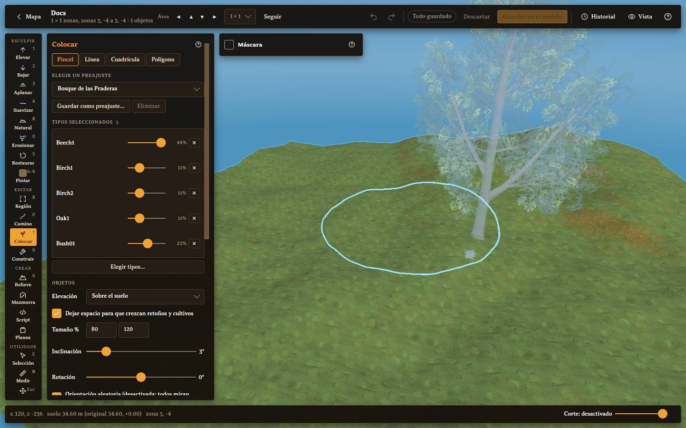
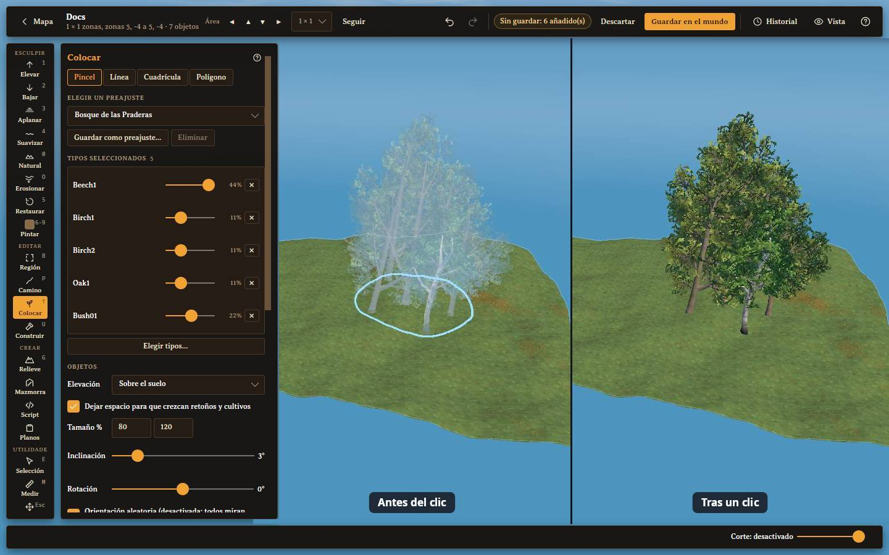
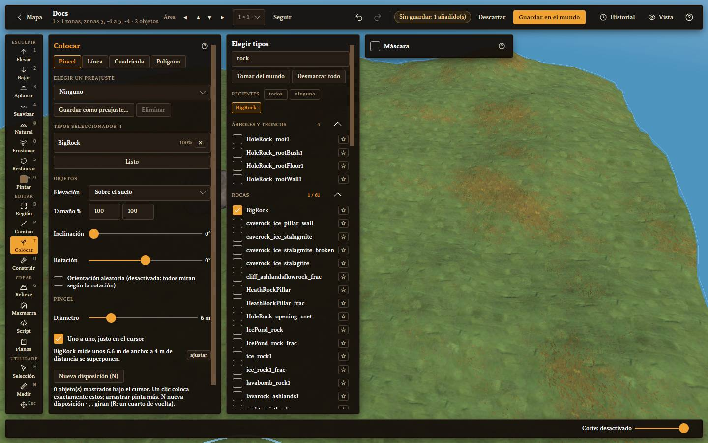
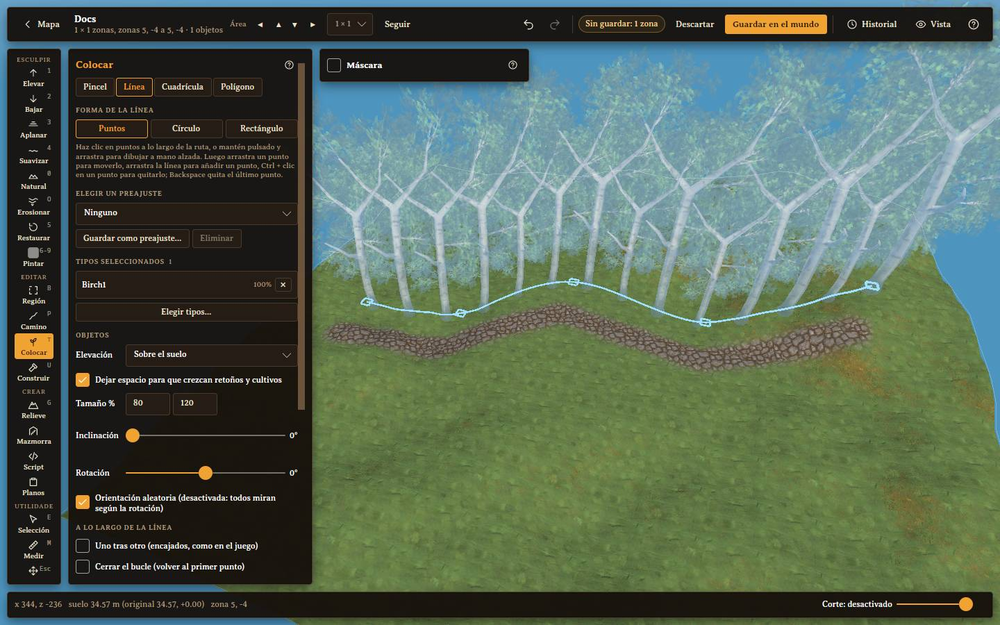
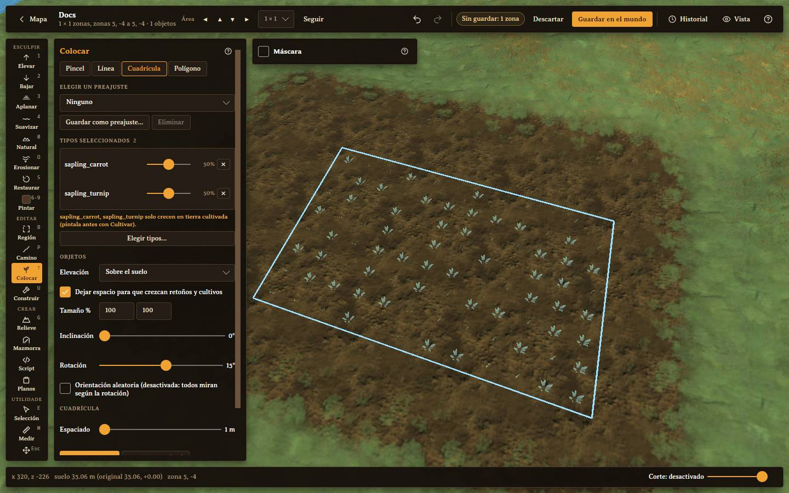
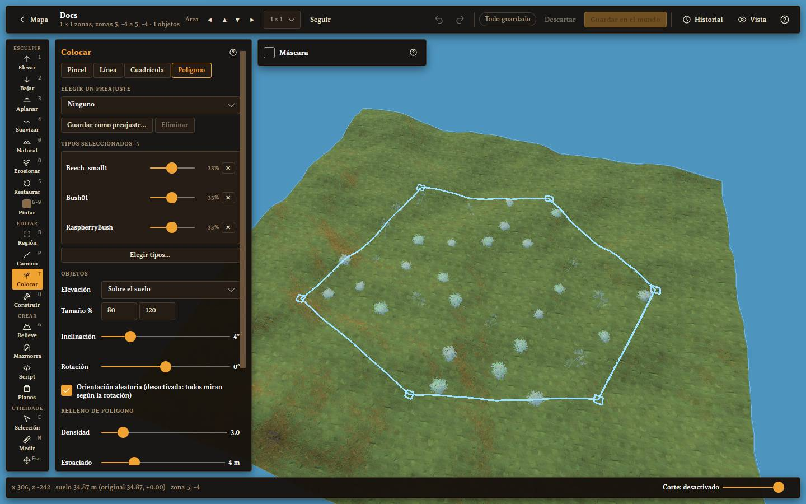
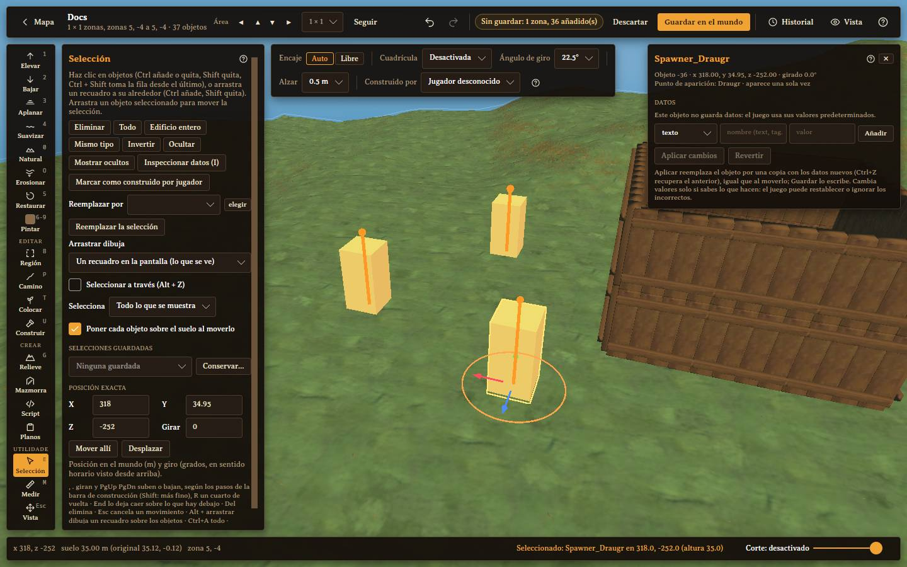

<!-- source: c6106c48 -->
# Colocar

Pon árboles, rocas, arbustos, cultivos y puntos de aparición en el mundo, de uno en uno o a cientos. Las piezas que
construyen los jugadores (muros, suelos, vallas, muebles) se colocan con [Construir](build.md), la herramienta que hay
debajo en la barra.

**Dónde:** barra de herramientas, sección **EDITAR** · **Tecla:** `T` · **Funciona en:** mundos guardados, en vivo (el
Taller solo tiene [Construir](build.md))

*Los árboles y arbustos transparentes que hay dentro del círculo del pincel son exactamente lo que coloca un clic; el
panel muestra el preajuste Bosque de las Praderas y sus tipos.*

*Izquierda: la vista previa transparente en el círculo del pincel. Derecha: el mismo lugar tras un clic, con los
árboles y arbustos donde los mostraba la vista previa.*

## Úsala

Para plantar un bosquecillo:

1. Pulsa `T`.
2. En el panel **Colocar**, en **Elegir un preajuste**, elige **Bosque de las Praderas**.
3. Arriba del panel, elige **Pincel**.
4. Apunta al suelo: la vista previa transparente muestra lo que coloca un clic.
5. Haz clic para colocarlo, o arrastra para seguir añadiendo.

En Línea, Cuadrícula y Polígono, dibuja en su lugar la forma, revisa la vista previa y pulsa `Enter` (**Colocar
(Enter)**). La forma se queda después de colocar, con su vista previa ahora vacía (lo que colocaría ya está ahí): pulsa
**Borrar forma (Esc)** para dibujar la siguiente.

Cada clic, trazo o `Enter` es un paso de deshacer (`Ctrl+Z`). No se escribe nada en el mundo hasta que usas **Guardar
en el mundo** (o **Aplicar en vivo**). Para mover o eliminar lo que colocaste, usa [Selección](select.md).

## Ajustes

El panel, de arriba abajo. Las filas que no corresponden al modo o a los tipos elegidos se ocultan. Los tipos marcados
con sus proporciones, el **Ritmo**, tus preajustes, los favoritos y los tipos recientes se conservan entre sesiones; las
demás opciones vuelven a sus valores predeterminados. La [Máscara](masks.md) está en su propia tarjeta junto al panel y
se aplica a todos los modos.

| Opción | Qué hace |
|---|---|
| **Pincel**, **Línea**, **Cuadrícula**, **Polígono** | El modo: consulta [Modos](#modos). |
| **Forma de la línea** | Solo en modo Línea: **Puntos**, **Círculo** o **Rectángulo**. Consulta [Línea](#línea). |
| **Elegir un preajuste** | Carga una mezcla: sus tipos con sus proporciones, más Densidad, Espaciado, Agrupar, Manchas, Tamaño e Inclinación, con orientación aleatoria activada. Incluidos: **Bosque de las Praderas**, **Bosque de la Selva Negra**, **Pantano**, **Matorral de bayas**, **Suelo de bosque**, **Rocas de las Praderas**; los tuyos van después como **Tuyo: *nombre***. Los tipos que el mundo no puede colocar se omiten (la barra de estado dice cuántos). **Ninguno** no carga nada; elegirlo después de un preajuste desmarca todos los tipos. |
| **Guardar como preajuste…** / **Eliminar** | Guarda con un nombre los tipos elegidos, sus proporciones y esas opciones. **Eliminar** quita uno de los tuyos, tras preguntar. |
| **Tipos seleccionados** | Los tipos que elegiste, cada uno con su control deslizante de proporción y una ✕ para quitarlo («Ninguno todavía» mientras no haya ninguno). Con dos o más tipos, arrastra un control para fijar la proporción de ese tipo: los demás se ajustan para que las proporciones sumen el 100 %, y cada uno conserva al menos el 1 %. Beech al 75 % con Birch da tres hayas por cada abedul. |
| **Elegir tipos…** | Abre la tarjeta **Elegir tipos**: consulta [Elegir qué colocar](#elegir-qué-colocar). |
| **OBJETOS: Elevación** | **Sobre el suelo**: cada objeto se apoya en el suelo (una parte de ruina, por su base). **Por encima del suelo**: **Altura** metros por encima del suelo que tiene debajo. **A una altura fija**: la base de todos los objetos a la misma **Altura**, haga lo que haga el suelo (un muro a nivel, una plataforma). |
| **Altura** | Los metros para Por encima del suelo, o la altura para A una altura fija. |
| **Encajar con las piezas que ya hay** | Se muestra cuando un tipo marcado es una parte de una ruina o de una mazmorra que tiene puntos de encaje (las piezas que construyen los jugadores son de [Construir](build.md)). Activado: la parte se engancha a las piezas que la rodean, como con el martillo. En modo Pincel, **Al lado** la pone a continuación de la pieza junto al cursor y **Encima** la asienta sobre la pieza bajo el cursor. La línea de abajo del panel dice a qué se encajó («Encajado al lado de *nombre*.»). Consulta [Encaje](concepts/objects.md#encaje). |
| **Dejar espacio para que crezcan retoños y cultivos** | Se muestra cuando está marcado un retoño, un cultivo o un árbol que crece de uno. Activado: conservan el espacio que el juego necesita para que crezcan. Desactivado: tan juntos como quieras (puede que no crezcan). Consulta [Reglas de crecimiento](concepts/objects.md#reglas-de-crecimiento). |
| **Tamaño %** mín. / máx. | Cada objeto recibe un tamaño aleatorio entre los dos, del 10 al 300 % (de 80 a 120 al principio). |
| **Inclinación** | Inclinación aleatoria, de 0 a 20°. |
| **Rotación** | Gira el patrón del pincel y la orientación de cada objeto, de -180 a 180°. |
| **Orientación aleatoria (desactivada: todos miran según la rotación)** | Activada: cada objeto mira hacia un lado al azar. Desactivada: todos miran según la Rotación. |
| **PINCEL: Diámetro** | Radio del pincel, de 1 a 30 m. Es también el tamaño de los pinceles de esculpir: un único valor para ambos. |
| **Ritmo** | Pincel: lo rápido que planta un arrastre, de 0.05 a 1. Cuanto más alto, antes llena el círculo del pincel hasta su Densidad. Es propio del pincel de Colocar: la **Intensidad** de los pinceles de esculpir no lo cambia. Oculto con Uno a uno. |
| **Uno a uno, justo en el cursor** | Pincel: un objeto justo bajo el cursor por clic; arrastrar no añade más. Solo lo impide un objeto que esté justo en ese punto. |
| **Densidad** | Pincel y Polígono: objetos por cada 100 m², de 0.2 a 20. |
| **Espaciado** | Pincel y Polígono: la distancia mínima entre objetos, de 0.5 a 15 m, también respecto a los objetos que ya hay. En Cuadrícula: el tamaño de la celda, de 1 a 30 m. |
| **Agrupar** | Pincel y Polígono: reúne los objetos en arboledas con claros entre ellas, de 0 a 100 %. 0 es un reparto uniforme. |
| **Manchas** | Con Agrupar: lo grandes que son las arboledas y los claros, de 5 a 120 m. |
| **ajustar** | Se muestra cuando un tipo marcado es más ancho que el espaciado («Beech1 mide unos 6.2 m de ancho: a 4 m de distancia se superponen.»). Haz clic para ajustar el espaciado a ese ancho. |
| **Colocar (Enter)**, **Borrar forma (Esc)**, **Quitar el último punto (Backspace)** | Línea, Cuadrícula y Polígono: colocar lo que muestra la vista previa, quitar la forma o retirar el último punto en el que hiciste clic. |
| **Nueva disposición (N)** | Nuevos puntos, tipos, tamaños y orientaciones aleatorios para la vista previa (y nuevas arboledas con Agrupar). |

La línea de abajo dice cuántos objetos muestra la vista previa y qué teclas se aplican. Una línea naranja bajo los tipos
seleccionados avisa cuando algo requiere atención: «Aún no hay nada que colocar», o cultivos que «solo crecen en tierra
cultivada (píntala antes con Cultivar)».

## Elegir qué colocar

**Elegir tipos…** abre una tarjeta junto al panel con todos los tipos que el juego guarda en un mundo, incluidos los
tipos de los que tu mundo aún no tiene ninguno y los tipos de tus mods. No están en ella las criaturas, los objetos
tirados ni los cuerpos inertes, ni las piezas del martillo y de la bandeja: esas están en el panel de
[Construir](build.md). Los retoños y cultivos del cultivador están en ambos. **Listo** la cierra.

*La tarjeta Elegir tipos buscando «rock», con BigRock marcado: la categoría Rocas cuenta 1 tipo marcado junto a su
total, y BigRock encabeza la fila Recientes.*

| Control | Qué hace |
|---|---|
| **Buscar tipos (oak, rock, bush…)** | Filtra la lista por nombre y abre todas las categorías con alguna coincidencia. Los puntos de aparición y los nidos también se encuentran por su criatura (`boar` encuentra `Spawner_Boar`). |
| Casillas | Se coloca cada tipo marcado; cada objeto elige uno de ellos al azar, según su proporción. Haz clic en el nombre de una categoría para plegarla o abrirla; tras el nombre, cuántos tipos tiene, o «marcados / todos». |
| **Tomar del mundo** | Haz clic en un objeto del mundo para colocar solo su tipo; `Shift` + clic lo añade a los tipos marcados (o lo quita). `Esc` cancela. Una pieza de construcción no se toma: la barra de estado indica que la coloques con Construir. |
| **Desmarcar todo** | Desmarca todos los tipos. |
| **Favoritos** | Haz clic en la ☆ que hay tras un tipo para marcarlo con una estrella; los tipos con estrella aparecen como botones encima de la lista. |
| **Recientes** | Los ocho últimos tipos que colocaste, del más nuevo al más antiguo, después de los tipos elegidos ahora. |
| Botones de Favoritos y Recientes | Clic: marcar o desmarcar ese tipo. `Shift` + clic: colocar solo ese tipo. **todos** / **ninguno** marcan o desmarcan toda la fila. |

Las categorías: **Árboles y troncos**, **Rocas**, **Arbustos y matorrales**, **Recolectables**, **Minerales y
yacimientos**, **Ruinas y estructuras**, **Muebles y decorado**, **Huesos y restos**, **Puntos de aparición**, **Nidos
de criaturas**, **Criaturas y PNJ** (comerciantes, pájaros), **Efectos y marcadores** (niebla, música, zonas de
eventos de jefe) y **Otros objetos**. Los tipos sin modelo aparecen como cajas en la vista previa.

## Modos

| Modo | Cómo funciona |
|---|---|
| **Pincel** | La vista previa sigue al cursor dentro del círculo del pincel. Un clic coloca exactamente lo que muestra; arrastrar sigue añadiendo (a qué ritmo depende de Densidad y **Ritmo**). `Shift` + arrastrar quita los tipos marcados bajo el pincel. Con solo partes de ruina que encajan marcadas, **Uno a uno** se activa solo y cada parte se encaja. |
| **Línea** | Haz clic en puntos a lo largo de un recorrido, o dibuja un círculo o un rectángulo. Los objetos van cada **Cada** metros, o uno tras otro. |
| **Cuadrícula** | Arrastra un recuadro. Va un objeto en el centro de cada celda; el recuadro recibe tantas celdas enteras como quepan. |
| **Polígono** | Haz clic en puntos alrededor de un trozo de suelo, o mantén pulsado y arrastra para dibujar su contorno a mano alzada. Los objetos van en puntos aleatorios del interior (Densidad, Espaciado). |

En Línea y Polígono, arrastra un punto para moverlo, arrastra el contorno para añadir un punto y haz `Ctrl` + clic en un
punto para quitarlo. Hacer doble clic en el último punto coloca la forma, como `Enter`. En Cuadrícula y Polígono, `,`
`.` y `Alt` + rueda giran todo el recuadro o el polígono, con sus celdas; `R` lo gira un cuarto de vuelta.

### Línea

*Modo Línea con **Puntos**: abedules cada 4 m a lo largo de una curva suave por cinco puntos, junto a un camino
pavimentado, antes de **Colocar (Enter)**. Los árboles pálidos son la vista previa.*

| Control | Qué hace |
|---|---|
| **Puntos** | Haz clic en puntos a lo largo del recorrido, o mantén pulsado y arrastra para dibujar a mano alzada. **Cerrar el bucle (volver al primer punto)** vuelve al primer punto, para cerrar una valla alrededor de un lugar. **Curva suave por los puntos** dibuja una curva en lugar de tramos rectos. |
| **Círculo** | Pulsa en el centro y arrastra hacia fuera hasta el tamaño; suelta para verlo. |
| **Rectángulo** | Pulsa en una esquina y arrastra hasta la opuesta. |
| **Uno tras otro (encajados, como en el juego)** | Cada parte empieza donde acaba la anterior, girada a lo largo de la línea, como las encaja el martillo: el muro de una ruina, una fila de suelos viejos. Si hay varios tipos marcados, se alternan. Se activa solo cuando todos los tipos marcados son partes que el juego encaja. Con él, un círculo ajusta su tamaño a partes enteras, y los lados de un rectángulo se llenan desde las esquinas para que las esquinas se unan. Para extender una tras otra las piezas del martillo (una valla, una empalizada), usa **Extender** de [Construir](build.md#extender-piezas-a-lo-largo-de-una-línea-o-en-cuadrícula). |
| **Capas** | Con Uno tras otro: la línea apilada de 1 a 20 partes de alto. |
| **Cada** | Sin Uno tras otro: la distancia entre objetos, de 0.5 a 30 m. |
| **Ondulación** | Desplazamiento lateral aleatorio respecto a la línea, de 0 a 5 m. |
| **Seguir la línea (más la rotación; sustituye la orientación aleatoria)** | Activado (por defecto): cada objeto mira a lo largo de la línea, más la Rotación. Desactivado: orientación aleatoria. Los círculos y rectángulos siempre siguen su contorno. |

- Cuando la línea no termina en una pieza entera, la línea de abajo dice cuánto sobra («quedan 0.8 m de línea al final:
  mueve un punto para cerrarlo»).
- Una línea que empieza a menos de 1 m de una pieza que ya hay (con **Encajar con las piezas que ya hay** activado) la
  continúa, a su nivel.
- En una pendiente, las partes puestas una tras otra se mantienen a nivel y suben o bajan en escalones con el suelo.
  Para una fila uniforme, aplana antes el suelo a lo largo de la línea ([Camino](path.md), Aplanar) o usa **A una altura
  fija**.

### Cuadrícula

*Zanahorias y nabos en una cuadrícula girada 15°, vistos desde arriba y de cerca para que se vea el cultivo de cada
celda. La línea naranja del panel avisa de que los cultivos necesitan tierra cultivada.*

### Polígono

*Un polígono dibujado punto a punto, con arbustos y árboles jóvenes en vista previa en puntos aleatorios del interior.*

Los puntos se sortean una vez y se mantienen mientras el polígono no cambie; **Nueva disposición (N)** sortea otros.

## Puntos de aparición y nidos

Los puntos de aparición son los marcadores invisibles del juego que ponen criaturas en campamentos, aldeas y mazmorras.
Encuéntralos en **Elegir tipos**, en **Puntos de aparición** (busca la criatura: `boar`), y colócalos como cualquier
tipo. Cada tipo muestra lo que hace aparecer, leído de tu juego:

- la criatura y sus estrellas (`Boar · 0–2 ★`);
- **aparece una sola vez** (la primera vez que un jugador se acerca, nunca más una vez que muere), o **vuelve *N* min
  después de morir**;
- **solo de noche**, **solo de día**, o **cuando un evento lo despierta** para los pocos que esperan.

La criatura, las estrellas y el tiempo de reaparición son fijos para cada tipo: elige el tipo que hace aparecer lo que
quieres. Los **Nidos de criaturas** (nidos de greydwarfs, montones de huesos...) siguen haciendo aparecer criaturas a su
alrededor hasta que se destruyen; su línea dice cuántas y a qué distancia («Greydwarf, Greydwarf_Elite · hasta 3
alrededor, a menos de 5 m»). Consulta [Puntos de aparición](concepts/objects.md#puntos-de-aparición).

*De cerca, dos puntos de aparición de jabalí y uno de draugr junto a una cabaña. La línea del Inspector del draugr
seleccionado dice lo que hace aparecer y si vuelve.*

En la vista 3D, cada punto de aparición y cada nido aparece como una caja sencilla con un marcador encima, visible a
través de cualquier cosa que tenga delante, a menos de 250 m: naranja para un punto de aparición (rojo cuando su criatura
vuelve), morado para un nido. Al principio están ocultos: activa **Puntos de aparición** y **Nidos de criaturas** en el
[panel Vista](editor-basics.md).

## Atajos

| Tecla o ratón | Qué hace |
|---|---|
| `T` | Abre Colocar. |
| Clic / arrastrar | Pincel: colocar / seguir añadiendo. Línea y Polígono: añadir puntos. Cuadrícula: dibujar el recuadro. |
| `Shift` + arrastrar | Pincel: quitar los tipos marcados bajo el pincel. |
| `Ctrl` + clic en un punto | Línea y Polígono: quitar ese punto. |
| `Enter` | Colocar la línea, la cuadrícula o el polígono. |
| `Esc` | Cancelar **Tomar del mundo**; si no, borrar la forma; sin nada dibujado, volver a **Vista**. |
| `Backspace` | Quitar el último punto. |
| `N` | Nueva disposición. |
| `,` `.` o `Alt` + rueda | Girar 15° (`Shift`, más fino: 1°): la orientación o, en Cuadrícula y Polígono, todo el recuadro o el polígono. |
| `R` | Girar lo mismo un cuarto de vuelta. |
| `[` `]` | Tamaño del pincel. |
| `PgUp` / `PgDn` o `Ctrl` + rueda | Subir o bajar la elevación 0.5 m (`Shift`, más fino: 0.1 m). Desde Sobre el suelo, empieza a elevarse por encima de él. |
| `Alt` + clic | Pasar a A una altura fija, a lo alto de la pieza en la que se hace clic (para apoyarse en ella), o del suelo en ese punto. |
| `Ctrl+Z` | Deshacer la última colocación. |

Todas las teclas del editor están en [Atajos](help/shortcuts.md).

## Consejos y límites

- **Deshacer:** `Ctrl+Z` retira un clic, un trazo o una forma, también después de guardar (luego vuelve a guardar).
  Consulta [Deshacer cambios](guides/undo-changes.md).
- Como máximo 2000 objetos por línea, cuadrícula o polígono, y 400 por clic de pincel.
- Los objetos solo van dentro del área abierta, no en su línea exterior de puntos, y donde lo permite la Máscara.
- Un objeto sobre el suelo se omite donde el suelo está más de 0.3 m bajo el agua (salvo el kelp y las algas). Por
  encima del suelo o A una altura fija, puede quedar sobre el agua.
- Pincel y Polígono respetan el Espaciado con lo que ya hay. Línea y Cuadrícula lo ignoran, salvo un objeto que esté
  justo en el punto, así que colocar dos veces la misma forma no la duplica.
- Los cultivos solo crecen en tierra cultivada: píntala antes con **Cultivar** (o con Pintar de la herramienta Región).
- Los retoños y cultivos que colocas cuentan como construidos por un jugador, el elegido en **Construido por** en
  [la barra de construcción](build.md#la-barra-de-construcción); los árboles, las rocas, los puntos de aparición y las partes de
  ruinas no. Consulta [Piezas construidas por jugadores](concepts/objects.md#piezas-construidas-por-jugadores).
- Los objetos nuevos están recién hechos: sin contenido, sin salud. Para llenar un cofre, consulta
  [Cambiar lo que contiene un cofre](guides/fill-a-chest.md).

## Relacionado

- [Plantar un bosque, un campo o un seto](guides/plant-a-forest.md)
- [Despejar árboles y rocas y nivelar un solar](guides/clear-an-area.md)
- [Qué es un objeto](concepts/objects.md#qué-es-un-objeto)
- [Construir](build.md) · [Selección](select.md) · [Máscaras](masks.md)
