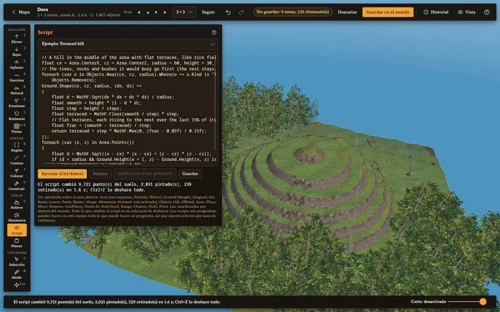
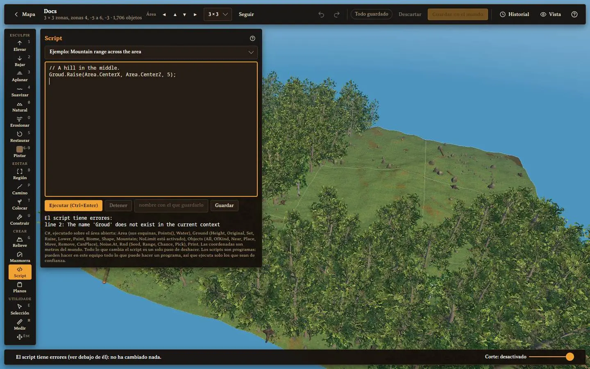

<!-- source: f2b8214d -->
# Script

Escribe unas pocas líneas de C# que den forma, pinten y llenen el área abierta según una regla: una cordillera, un
bosque solo en pendientes suaves, terrazas, una plaza pavimentada exactamente a la altura media.

**Dónde:** barra de herramientas, sección **CREAR** · **Tecla:** ninguna (`Ctrl+Enter` ejecuta el script) ·
**Funciona en:** mundos guardados, en vivo (no en el Taller)


*El ejemplo Terraced hill ejecutado en un área de 3 × 3: el código en el panel y, debajo, la línea de resultado que
dice lo que cambió el script.*

No necesitas instalar nada: el propio editor compila el script. Si nunca has escrito C#, parte de un
[ejemplo](#los-ejemplos) y cambia sus números, o sigue [Tu primer script](#tu-primer-script).

## Úsala

1. Abre un área en el editor 3D. Un script trabaja sobre el **área abierta** (las zonas que ves).
2. Elige **Script** en la sección **CREAR** de la barra de herramientas.
3. Elige un ejemplo o un script guardado en la lista, o escribe el tuyo en el cuadro de código.
4. Pulsa **Ejecutar (Ctrl+Enter)**. El cuadro de salida muestra «Compilando…», «Ejecutando…» y después lo que el
   script imprimió y lo que cambió, o lo que salió mal.
5. Mira el resultado. Deshacer (la flecha de la barra superior) deshace toda la ejecución en un solo paso; `Ctrl+Z`
   también, una vez que has hecho clic en la vista 3D (en el cuadro de código deshace lo que escribes). Cambia los
   números y vuelve a ejecutar hasta que te guste.
6. Pulsa **Guardar en el mundo** (o **Aplicar en vivo**) para conservarlo, como cualquier otro cambio.

No cambia nada mientras el script se ejecuta: cuando termina, todo lo que cambió entra en el área de una vez, como un
solo paso de deshacer. Si tiene errores, falla, se detiene o se ejecuta durante 2 minutos, no cambia nada.

## Tu primer script

Esta lección levanta un montículo en el centro del área y luego lo hace más alto.

1. Abre un área y elige **Script**.
2. Selecciona todo el texto del cuadro de código y reemplázalo por:

   ```csharp
   // Un montículo de 10 m de alto y 30 m de ancho, en el centro del área.
   Ground.Shape(Area.CenterX, Area.CenterZ, 15, (dx, dz) =>
   {
       float d = MathF.Sqrt(dx * dx + dz * dz) / 15;   // 0 en el centro, 1 en el borde
       return 10 * (1 - d);                            // metros que añadir
   });
   Print($"The top is at {Ground.Height(Area.CenterX, Area.CenterZ):0.0} m.");
   ```

3. Pulsa `Ctrl+Enter`. Un montículo se eleva en el centro del área; la salida dice dónde está su cima y cuántos puntos
   del suelo cambiaron.
4. Haz clic en la vista 3D y pulsa `Ctrl+Z`. El montículo desaparece.
5. Haz clic en el cuadro de código, cambia `10 *` por `20 *` y vuelve a pulsar `Ctrl+Enter`. El montículo es el doble
   de alto.
6. Opcional: escribe un nombre en el cuadro de nombre y pulsa **Guardar** para encontrar el script en la lista la
   próxima vez.

`Ground.Shape` añade los metros que devuelve tu función a cada punto a menos de 15 m del centro; `dx` y `dz` son los
metros desde el centro. Todas las demás llamadas están en la [referencia de la API](#referencia-de-la-api).

## Ajustes

| Ajuste | Qué hace |
|---|---|
| **Lista** | Los siete ejemplos («Ejemplo: …») y luego tus scripts guardados, primero los más recientes. Elegir uno **reemplaza** el texto del cuadro de código: guarda antes tu propio script. Un ejemplo vacía el cuadro de nombre; un script guardado pone ahí su nombre. |
| **Cuadro de código** | El script. `Tab` sangra; `Ctrl+Enter` lo ejecuta; `Ctrl+Z` deshace lo que escribes, no la ejecución. |
| **Ejecutar (Ctrl+Enter)** | Compila y ejecuta el script sobre el área abierta. Sus cambios son **un solo paso de deshacer**, llamado «Script: » más el nombre de la entrada de la lista en el Historial. |
| **Detener** | Detiene un script en ejecución, haga lo que haga: no se conserva nada de lo que hizo. |
| Cuadro de nombre, **Guardar** | Guarda el código con el nombre escrito y lo selecciona en la lista. Los caracteres que un nombre de archivo no admite se convierten en `_`. Guardar encima de otro script guardado pregunta antes. |
| **Salida** | Lo que el script imprimió (`Print`) y luego lo que cambió, o sus errores con su línea. |

Los scripts guardados son archivos `<name>.csx` en la carpeta `scripts` de la carpeta de datos del editor
(`~/.local/share/ValheimWorldEditor/scripts` en Linux, `%LOCALAPPDATA%\ValheimWorldEditor\scripts` en Windows,
`~/Library/Application Support/ValheimWorldEditor/scripts` en macOS). Edítalos en cualquier editor de texto, o
compártelos: un archivo `.csx` puesto ahí aparece en la lista cuando el editor vuelve a arrancar, o después de que
guardes un script.

## Los ejemplos

Cada ejemplo es un script completo, listo para ejecutarse en cualquier área abierta. Léelos para ver cómo se usa la
API.

| Ejemplo | Qué hace |
|---|---|
| **Mountain range across the area** | Cuatro montañas de tipo Lone peak en línea del suroeste al noreste, cada una de 35 a 60 m de alto. `Rnd.Seed = 7`, así que es la misma cordillera en cada ejecución. Al guardar se convierten en discos de suelo (más allá del límite de 8 m del juego). |
| **Terraced hill** | Una colina de 30 m de alto y 60 m de radio, cortada en seis terrazas planas como arrozales. Primero se quitan los árboles, rocas y arbustos que enterraría (todo lo demás se queda); los escalones empinados se pintan de tierra. |
| **Canyon with a river** | Un cañón sinuoso de oeste a este, de 18 m a cada lado de su línea, excavado hasta 3 m por debajo del nivel del mar para que lo llene el agua, que se atenúa en los últimos 30 m en los bordes del área. |
| **Scatter boulders** | Grandes rocas (`rock4_forest`, `rock4_coast`, `rock4_heath`) cada 6 m donde el ruido es alto, más en las pendientes, cada una girada y con un tamaño al azar. Imprime cuántas. |
| **Ring of trees** | Un anillo de 36 hayas a 40 m del centro; los árboles dentro del anillo se quitan. |
| **Flat paved base** | Un cuadrado de 40 × 40 m nivelado a su propia altura media y pavimentado, con una pendiente suave de 10 m hasta el suelo de alrededor. Se mantiene dentro del límite de 8 m (`Ground.NoLimit = false`). Imprime la altura. |
| **Noise landscape** | Terreno ondulado por toda el área: colinas y valles de hasta 25 m hacia arriba o hacia abajo con desniveles más pequeños encima, que vuelven al suelo tal como era en los últimos 40 m de los bordes. |

## Cómo ve el mundo un script

- **C# normal.** Un script es una lista de instrucciones que se ejecutan de arriba abajo. Puede declarar variables,
  bucles, funciones y clases, y usar .NET (`MathF`, `System.Linq`…). `using System`, `System.Linq` y
  `System.Collections.Generic` ya están incluidos.
- **Metros del mundo.** Cada posición está en metros: **x** al este, **z** al norte, los mismos números que la barra
  de estado y el comando `pos` del juego. Las alturas son metros sobre el cero del mundo; el mar está en `Area.Water`
  (30 m).
- **Un punto por metro.** `Ground.Set(x, z, …)` cambia el punto más cercano a (x, z); `Ground.Height` lee de forma
  continua entre puntos, tal como se dibuja el suelo.
- **Sus propios cambios.** Un script ve lo que ha cambiado hasta el momento (eleva un punto y `Ground.Height` da la
  nueva altura), pero `Objects.All` se queda como estaba el área cuando empezó.
- **Solo el área abierta.** La fila exterior de puntos se queda como está, para que el área siga uniéndose a sus
  vecinas; los cambios ahí o fuera del área se ignoran sin error. Abre un área más grande (hasta 17 × 17 zonas) para
  obras más grandes.
- **Más allá del límite de 8 m.** `Ground.NoLimit` está activado, como el interruptor
  [Sin límite](concepts/ground-limits.md#sin-límite): el suelo puede subir o bajar hasta 400 m respecto al suelo generado,
  y al guardar se convierte en discos de suelo que el juego de cada jugador cuenta como suelo generado.
  `Ground.NoLimit = false;` se mantiene dentro de los 8 m del juego: los puntos que lo superan se detienen ahí, y la
  línea de resultado dice cuántos.
- **Sin Máscara.** La [Máscara](masks.md) limita las herramientas que usas a mano, no los scripts. Comprueba en el
  script lo que necesites (`Ground.Biome`, la altura, la pendiente).
- **Un comienzo nuevo en cada ejecución.** Las variables, `Rnd` y `Objects.All` empiezan de cero. Se ejecuta un solo
  script a la vez.

## Referencia de la API

### Area

El área abierta.

| Miembro | Qué da |
|---|---|
| `Area.MinX`, `Area.MinZ`, `Area.MaxX`, `Area.MaxZ` | Sus esquinas (metros del mundo). Un área de 3 × 3 mide 192 m de lado. |
| `Area.CenterX`, `Area.CenterZ` | Su centro. |
| `Area.Points()` | Cada punto del suelo que el script puede cambiar (sin la fila exterior), como `(x, z)`, fila a fila desde el sur: `foreach (var (x, z) in Area.Points()) { … }`. `Area.Points(step: 4)` toma uno de cada 4 metros, para dispersar. Un paso de 0 o menos, o uno demasiado pequeño para avanzar por el área, detiene el script con un error. |
| `Area.Inside(x, z)` | Si un punto está dentro del área (no en su borde). |
| `Area.Water` | El nivel del mar (30 m, o donde lo pongan los ajustes de Expand World Rivers del mundo). |
| `Area.WorldSeed`, `Area.World` | La semilla del mundo (un número) y su nombre. |

### Ground

| Miembro | Qué hace |
|---|---|
| `Ground.Height(x, z)` | La altura del suelo ahí ahora (con los cambios del script hasta el momento). |
| `Ground.Original(x, z)` | El suelo antes de cualquier edición, tal como lo generó el mundo (con los discos de suelo ya guardados). La diferencia con `Height` es lo que se excavó o se levantó. |
| `Ground.Set(x, z, height)` | Pone el punto del suelo de ahí a esa altura. |
| `Ground.Raise(x, z, metres)`, `Ground.Lower(x, z, metres)` | Lo sube o lo baja esa cantidad. |
| `Ground.Shape(x, z, radius, (dx, dz) => metres)` | Añade los metros que da tu función a cada punto dentro del radio de (x, z). `dx`, `dz`: metros desde el centro; `MathF.Sqrt(dx * dx + dz * dz)` es la distancia. Un valor negativo excava. |
| `Ground.Mountain(x, z, "Lone peak", height:, radius:, rough:, turn:, seed:)` | Una montaña de la herramienta [Relieve](landform.md#montaña), con su centro en (x, z): `"Lone peak"`, `"Ridge"`, `"Mountain range"`, `"Mesa"`, `"Volcano"` o `"Rolling hills"`. `height` y `radius` en metros, `rough` de 0 a 1, `turn` en grados (la dirección de una cresta). Omite un valor para obtener uno al azar dentro del rango del preajuste; la misma `seed` da la misma montaña. Llega hasta unas 1.15 veces su radio. Los árboles, rocas, minerales, arbustos y recolectables que entierra a más de 2 m se quitan; a diferencia de la herramienta, no hace crecer árboles encima después. |
| `Ground.Paint(x, z, "dirt")` | Pinta el punto: `"dirt"`, `"cultivated"`, `"paved"` o `"clear"` (vuelta al suelo propio del bioma). Un último número de 0 a 1 pinta solo en parte (`0.5f`), mezclándose con la pintura que haya. |
| `Ground.Biome(x, z)` | El bioma de ahí: `"Meadows"`, `"BlackForest"`, `"Swamp"`, `"Mountain"`, `"Plains"`, `"Ocean"`, `"Mistlands"`, `"AshLands"` o `"DeepNorth"` (`"None"` fuera del área). |
| `Ground.NoLimit` | `true` por defecto: los cambios van más allá de los 8 m del juego. `false`: se detienen en ellos. Cuenta su valor al terminar el script. |

### Objects

Lo que hay en el área, tal como estaba cuando empezó el script. Cada objeto (`Obj`) tiene su nombre `Prefab`, su
posición `X`, `Y`, `Z`, su giro `Yaw` y sus inclinaciones `Pitch` y `Roll` (grados), su tamaño `Scale` (1: el propio
del juego), su `Kind` y `Building` (una pieza que construyó un jugador). `Objects.All` no cambia mientras se ejecuta el
script: los objetos que colocas no están en él, y los que quitas siguen en la lista.

| Miembro | Qué hace |
|---|---|
| `Objects.All` | Todos los objetos del área. |
| `Objects.OfKind("Trees")` | Los de un tipo (las mayúsculas no importan): `Buildings`, `Ruins`, `Furniture`, `Trees`, `Rocks`, `Ore`, `Bushes`, `Pickables`, `Remains`, `Animals` (domados), `Creatures` (salvajes, comerciantes, pájaros), `SpawnPoints`, `Nests`, `Runestones`, `Dungeons`, `Effects`, `Other`: los tipos del panel Vista. |
| `Objects.Near(x, z, radius)` | Los que están dentro del radio de un punto, medido en plano. |
| `Objects.Remove(o)` | Lo quita. |
| `Objects.Place("Beech1", x, z, yaw:, scale:, y:, pitch:, roll:, snap:)` | Un objeto nuevo por su nombre de prefab (`Beech1`, `Pinetree_01`, `rock4_forest`, `piece_chest_wood`…: los nombres que lista la herramienta [Colocar](place.md); para una pieza de construcción, pasa el cursor por su icono en [Construir](build.md)). Sin `y` se apoya sobre el suelo **tal como lo deja el script** (excava primero y luego coloca: queda en el hoyo). `yaw` lo gira (0: su frente mira al norte, 90: al este), `pitch` y `roll` lo inclinan, `scale` le da tamaño (`0.5f` la mitad, `2` el doble). Con `snap: true`, una pieza de construcción se mueve para encajar con los puntos de encaje de las piezas a menos de 0.5 m, como hace el martillo. Una criatura colocada dentro de una pieza de construcción se pone encima de ella (el mensaje dice cuántas). Las piezas de construcción quedan construidas por jugador, por el constructor elegido en **Construido por** en [la barra de construcción](build.md#la-barra-de-construcción) (consulta [Piezas construidas por jugadores](concepts/objects.md#piezas-construidas-por-jugadores)). Un punto fuera del área (su borde se cuenta dentro del área), un valor que no es un número o un tamaño menor que 0 detienen el script. |
| `Objects.Move(o, x:, z:, y:, yaw:, pitch:, roll:, scale:)` | Mueve, gira o cambia el tamaño de un objeto; lo que omites se queda como está (o como lo dejó un `Move` anterior). Conserva lo que contiene (contenido de cofres, constructor…). El tamaño debe ser mayor que 0, el sitio debe estar dentro del área y cada valor debe ser un número. |
| `Objects.CanPlace("Beech1")` | Si el editor puede crear ese objeto. Úsalo antes de `Place` cuando un nombre pueda estar mal: `Place` con un nombre que no puede crear detiene el script. |

### Ruido y números aleatorios

| Miembro | Qué da |
|---|---|
| `Noise.At(x, z, scale, seed)` | Ruido natural y suave, de aproximadamente -1 a 1, del tipo con el que están hechos el terreno de Valheim y las montañas de la herramienta Relieve. `scale` es el tamaño de sus desniveles en metros (32 por defecto); otra `seed` (0 por defecto) da otro patrón. Se repite cada 256 × `scale` metros. |
| `Rnd.Seed = 42;` | Hace que los números aleatorios de abajo sean los mismos en cada ejecución (sin esto, cada ejecución es distinta). |
| `Rnd.Next()` | Un número aleatorio de 0 a 1. |
| `Rnd.Range(min, max)` | Un número aleatorio entre `min` y `max`. |
| `Rnd.Int(min, max)` | Un número entero aleatorio desde `min` hasta `max`, sin incluir este último. |
| `Rnd.Chance(0.3f)` | `true` el 30 % de las veces. |
| `Rnd.Pick("Beech1", "Oak1", "Birch1")` | Uno de los valores, al azar. |

### Imprimir

`Print(anything)` escribe una línea en el cuadro de salida: valores, recuentos, lo que está haciendo el script (2000
líneas como máximo). Para comprobar números antes de cambiar nada, comenta las líneas que cambian cosas (`//`) e
imprime en su lugar.

## Recetas

Cada receta es un script completo: pégalo en el cuadro de código y ejecútalo en cualquier área abierta.

**Una colina redonda en el centro del área**, de 25 m de alto y 40 m de ancho:

```csharp
Ground.Shape(Area.CenterX, Area.CenterZ, 40, (dx, dz) =>
{
    float d = MathF.Sqrt(dx * dx + dz * dz) / 40;   // 0 en el centro, 1 en el borde
    return 25 * (1 - d * d) * (1 - d * d);           // una campana suave
});
```

**Un lago**: excava una hondonada redonda por debajo del nivel del mar; el mar la llena (el suelo por debajo de 30 m
queda bajo el agua):

```csharp
float cx = Area.CenterX, cz = Area.CenterZ, radius = 35;
Ground.Shape(cx, cz, radius, (dx, dz) =>
{
    float d = MathF.Sqrt(dx * dx + dz * dz) / radius;
    float bed = Area.Water - 4 * (1 - d * d);         // 4 m de profundidad en el centro
    float now = Ground.Height(cx + dx, cz + dz);
    return d < 0.8f ? bed - now : (bed - now) * (1 - d) / 0.2f;   // una orilla suave
});
```

**Pinar solo en pendientes suaves**, más denso donde el ruido es alto, nada en el agua:

```csharp
Rnd.Seed = 1;
int planted = 0;
foreach (var (x, z) in Area.Points(step: 5))
{
    float slope = MathF.Abs(Ground.Height(x + 1, z) - Ground.Height(x - 1, z)) / 2;   // subida por metro
    if (slope > 0.45f || Ground.Height(x, z) < Area.Water + 1) continue;             // unos 25°, y tierra seca
    if (Noise.At(x, z, 50, seed: 2) < 0 || !Rnd.Chance(0.6f)) continue;
    string tree = Rnd.Pick("Pinetree_01", "FirTree");
    float px = x + Rnd.Range(-2, 2), pz = z + Rnd.Range(-2, 2);   // un poco fuera de la cuadrícula
    if (!Area.Inside(px, pz)) continue;
    Objects.Place(tree, px, pz, yaw: Rnd.Range(0, 360));
    planted++;
}
Print($"{planted} trees planted.");
```

**Despejar el sotobosque**: quita todos los arbustos y recolectables del área (los árboles y las construcciones se
quedan):

```csharp
int n = 0;
foreach (var o in Objects.OfKind("Bushes").Concat(Objects.OfKind("Pickables")))
{
    Objects.Remove(o);
    n++;
}
Print($"{n} removed.");
```

**Un camino pavimentado** entre dos puntos, de 6 m de ancho, nivelado desde la altura de un extremo hasta la del otro:

```csharp
float x1 = Area.MinX + 20, z1 = Area.CenterZ, x2 = Area.MaxX - 20, z2 = Area.CenterZ + 30;
float h1 = Ground.Height(x1, z1), h2 = Ground.Height(x2, z2);
float length = MathF.Sqrt((x2 - x1) * (x2 - x1) + (z2 - z1) * (z2 - z1));
for (float s = 0; s <= length; s += 0.5f)
{
    float t = s / length, x = x1 + (x2 - x1) * t, z = z1 + (z2 - z1) * t;
    // A lo ancho del camino: 3 m a cada lado de la línea.
    float ax = -(z2 - z1) / length, az = (x2 - x1) / length;
    for (float w = -3; w <= 3; w += 0.5f)
    {
        Ground.Set(x + ax * w, z + az * w, h1 + (h2 - h1) * t);
        Ground.Paint(x + ax * w, z + az * w, "paved");
    }
}
```

**Montañas según el bioma**: una mesa en las Llanuras, un pico solitario en cualquier otro sitio, en el centro del
área:

```csharp
float cx = Area.CenterX, cz = Area.CenterZ;
string preset = Ground.Biome(cx, cz) == "Plains" ? "Mesa" : "Lone peak";
Ground.Mountain(cx, cz, preset, height: 40, radius: 70, seed: 123);
Print($"{preset} in the {Ground.Biome(cx, cz)}.");
```

**Tu propia función**: las funciones hacen más legibles los scripts grandes. Aquí, un círculo de piedras erguidas:

```csharp
void Stone(float x, float z) =>
    Objects.Place("highstone", x, z, yaw: Rnd.Range(0, 360), scale: Rnd.Range(0.7f, 1.1f));

Rnd.Seed = 5;
for (int i = 0; i < 12; i++)
{
    float a = i * MathF.Tau / 12;
    Stone(Area.CenterX + MathF.Cos(a) * 18, Area.CenterZ + MathF.Sin(a) * 18);
}
```

**Enderezar las rocas**: cada roca inclinada del área se pone derecha, conservando su giro:

```csharp
int n = 0;
foreach (var o in Objects.OfKind("Rocks"))
{
    if (o.Pitch == 0 && o.Roll == 0) continue;
    Objects.Move(o, pitch: 0, roll: 0);
    n++;
}
Print($"{n} rocks stood up.");
```

**Un suelo de madera** de piezas de suelo de 2 m, encajadas entre sí como lo haría el martillo, sobre una base
nivelada debajo:

```csharp
float cx = Area.CenterX, cz = Area.CenterZ, level = Ground.Height(cx, cz);
for (float z = cz - 6; z <= cz + 6; z++)
    for (float x = cx - 6; x <= cx + 6; x++)
        Ground.Set(x, z, level);
for (int i = -2; i <= 2; i++)
    for (int j = -2; j <= 2; j++)
        Objects.Place("wood_floor", cx + i * 2, cz + j * 2, y: level, snap: true);
```

## Cuando algo sale mal

El cuadro de salida dice lo que ha pasado; la barra de estado lo dice en corto. En todos los casos de abajo, no ha
cambiado nada.

- **Errores de compilación**: el script no se puede compilar. Se listan con su línea, 20 como máximo: `line 4: The name
  'Groud' does not exist in the current context` es un error de escritura en la línea 4.
- **Errores** durante la ejecución la detienen, con su línea: un nombre de objeto que el editor no puede crear (`the
  editor cannot make a “Beech” (a prefab name, like Beech1 or rock4_forest)`), una pintura o un preajuste de montaña
  que no conoce (el mensaje lista los correctos), un tamaño de 0 o menos en `Move`, una división entre cero…
- «**El script no tiene ninguna instrucción que ejecutar**»: el cuadro de código está vacío o solo contiene
  comentarios. Escribe al menos una línea de código, o elige un ejemplo de la lista.
- «**El script se ejecutó y no cambió nada.**» Comprueba con `Print` que tu bucle encuentra lo que esperas: un nombre
  de tipo escrito de otra forma, puntos fuera del área o en su borde.
- «**El área cambió mientras se ejecutaba el script: no ha cambiado nada. Vuelve a ejecutarlo.**» Editaste, deshiciste
  o guardaste mientras se ejecutaba (o se abrió otra área). Vuelve a ejecutarlo y espera a que termine.


*Un nombre mal escrito: la salida nombra la línea y el error; la barra de estado dice que no ha cambiado nada.*

### Detener un script

**Detener** y el límite de 2 minutos siempre funcionan. Un script termina en la siguiente vuelta de cualquiera de sus
propios bucles, en el siguiente punto de `Area.Points()` o en la siguiente fila de `Ground.Shape` o `Ground.Mountain`.
Una sola llamada que tarda mucho por sí misma (una consulta LINQ enorme, `Thread.Sleep`, una recursión que nunca
acaba) se termina un segundo después junto con el proceso en el que se ejecuta el script. En ambos casos no se
conserva nada de lo que hizo.

Un bucle sobre un área entera de 17 × 17 son unos 1.2 millones de puntos, unos segundos de trabajo. Usa
`Area.Points(step: 4)` cuando no hagan falta todos los puntos.

## Atajos

| Tecla | Acción |
|---|---|
| `Ctrl+Enter` (en el cuadro de código) | Ejecutar el script |
| `Tab` (en el cuadro de código) | Sangrar |
| `Ctrl+Z` (fuera del cuadro de código) | Deshacer toda la ejecución |

## Consejos y límites

- **Los scripts son programas.** Un script se ejecuta con tus permisos y puede leer y escribir tus archivos, como
  cualquier programa; el proceso en el que se ejecuta no es un entorno aislado. Ejecuta solo scripts que hayas escrito
  tú o en los que confíes. Consulta [Scripts y Claude](concepts/safety.md#scripts-y-claude).
- `Rnd.Seed` hace que una ejecución se pueda repetir: el mismo script y la misma semilla dan el mismo resultado en la
  misma área. Cambia la semilla para obtener otra variante.
- Los cambios de un script son ediciones normales: **Descartar** los quita, el Historial lista la ejecución como un
  solo paso y, en vivo, **Aplicar en vivo** los envía como cualquier otro.
- Los objetos que quitas desaparecen al guardar. Quitar una piedra rúnica quita su ubicación para siempre, igual que
  con la herramienta [Selección](select.md).
- Un objeto movido conserva todos sus datos; en vivo, se mueve en el juego como el mismo objeto cuando puede (ver
  [Mover cosas](live-mode.md#mover-cosas)).
- Una parte de un grupo enlazado de un mod (un barco y sus piezas) nunca se va ni se mueve sola: `Objects.Remove` u
  `Objects.Move` de una parte quita o mueve todo su grupo, con su forma, como hace la herramienta Selección.
- Los scripts son C# 12. [Claude](claude.md) ejecuta scripts con el mismo motor, y puede hacer una prueba en seco que
  solo dice lo que cambiaría un script.

## Relacionado

- [Dejar que Claude modele o construya](guides/connect-claude.md)
- [Límites del suelo](concepts/ground-limits.md#sin-límite): qué le pasa al suelo más allá de 8 m al guardar
- [Seguridad](concepts/safety.md#scripts-y-claude): a qué puede acceder un script en tu equipo
- [Relieve](landform.md), [Colocar](place.md) y [Construir](build.md): las herramientas que siguen las llamadas de un
  script
