<!-- source: 24266405 -->
# Selección

Elige objetos para moverlos, girarlos, alzarlos, copiarlos, reemplazarlos o eliminarlos, o abre uno en el Inspector
para ver y cambiar lo que contiene.

**Dónde:** barra de herramientas, sección **UTILIDADES** · **Tecla:** `E` · **Funciona en:** mundos guardados, en
vivo, el Taller

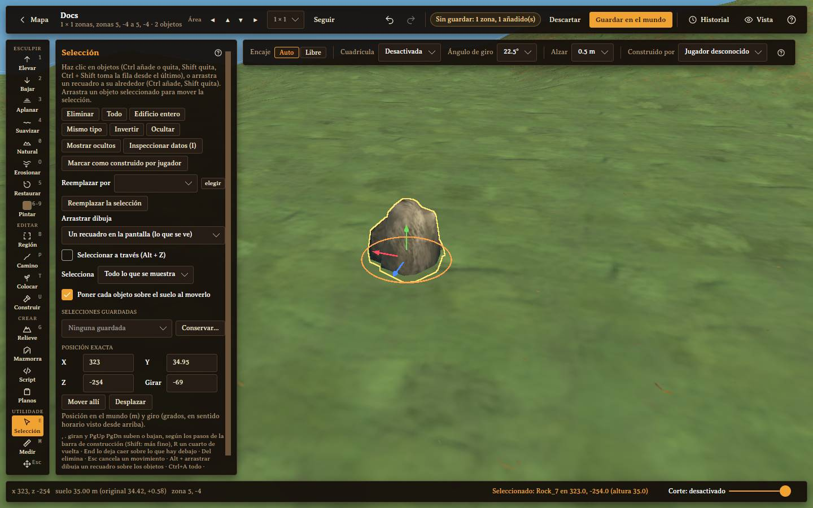
*De cerca, una roca seleccionada: su contorno naranja, las flechas X roja, Y verde y Z azul que la mueven a lo largo de
un eje, y el anillo naranja que la gira. El panel Selección está a la izquierda.*

## Úsalo

Para mover unos cuantos objetos:

1. Pulsa `E`.
2. Haz clic en un objeto. `Ctrl` + clic en más, o arrastra un recuadro en la pantalla a su alrededor.
3. Arrastra un objeto seleccionado para moverlos todos, o arrastra una flecha para moverlos a lo largo de un eje, o el
   anillo para girarlos.
4. Opcional: escribe valores exactos en **POSICIÓN EXACTA** y luego haz clic en **Mover allí**.

Desde la herramienta **Vista**, un doble clic en un objeto cambia a Selección con él seleccionado. Solo se pueden elegir
los objetos que se muestran: activa antes sus tipos en el [panel Vista](editor-basics.md). El objeto bajo el cursor
tiene una caja tenue: es el que elige un clic.

Cada movimiento, giro, eliminación o cambio es un paso de deshacer (`Ctrl+Z`). No se escribe nada en el mundo hasta que
usas **Guardar en el mundo** (o **Aplicar en vivo**).

## Ajustes

El panel Selección, de arriba abajo.

| Ajuste | Qué hace |
|---|---|
| **Eliminar** | Quita los objetos seleccionados (`Del`). `Ctrl+Z` los recupera. |
| **Todo** | Selecciona todos los objetos mostrados del área (`Ctrl+A`). |
| **Edificio entero** | Añade todas las piezas de construcción conectadas a las seleccionadas mediante piezas que se tocan: muros, suelos, tejados, vigas. Las piezas sueltas no se incluyen. |
| **Mismo tipo** | Selecciona todos los objetos mostrados de los tipos seleccionados ahora: selecciona una haya y obtendrás todas las hayas. |
| **Invertir** | Selecciona todos los objetos mostrados que no están seleccionados ahora, y solo esos (`Ctrl+I`). |
| **Ocultar** / **Mostrar ocultos** | Oculta en la vista los objetos seleccionados, para llegar a lo que tapan (`Ctrl+H`), y los vuelve a mostrar (`Alt+H`). Los objetos ocultos no se dibujan ni se pueden elegir; no cambia nada en el mundo. Abrir otra área olvida lo que estaba oculto. |
| **Inspeccionar datos (I)** | Abre el [Inspector](#inspector) sobre el único objeto seleccionado. |
| **Marcar como construido por jugador** | Da a las piezas seleccionadas que no tienen constructor el jugador elegido en **Construido por**, en [la barra de construcción](build.md#la-barra-de-construcción), para que el juego las trate como construidas por un jugador. Úsalo en una ruina que quieras reparar y conservar. Consulta [Piezas construidas por jugadores](concepts/objects.md#piezas-construidas-por-jugadores). |
| **Reemplazar por** + **elegir** + **Reemplazar la selección** | Elige un tipo (o haz clic en **elegir** y luego en un objeto del mundo) y reemplaza por él cada objeto seleccionado, en el mismo lugar y con la misma orientación. Los objetos nuevos no conservan nada de los datos de los antiguos. |
| **Arrastrar dibuja** | **Un recuadro en la pantalla (lo que se ve)** o **Un contorno en el suelo (todo encima)**: consulta [Seleccionar muchos a la vez](#seleccionar-muchos-a-la-vez). |
| **Seleccionar a través (Alt + Z)** | Un recuadro también toma lo que está oculto detrás de otros objetos dentro de él: los muebles dentro de una casa, el muro detrás de otro. |
| **Selecciona** | Lo que toman los clics, los recuadros y los contornos: **Todo lo que se muestra**, **Solo piezas construidas** (lo que construyeron los jugadores) o **Solo naturaleza** (árboles, rocas, mineral, arbustos, recolectables, restos). Lo que queda fuera se sigue dibujando, pero no estorba: con Solo piezas construidas, un recuadro toma el muro que hay detrás de un árbol. También se aplica a los clics de la herramienta Vista; **Encima** de la herramienta Colocar y los cuentagotas eligen cualquier tipo. |
| **Poner cada objeto sobre el suelo al moverlo** | Activado: cada objeto se posa sobre el suelo de madera, la mesa o la roca que haya debajo de donde termina, y si no, sobre el terreno (los árboles, los arbustos y las criaturas no sostienen nada: un árbol movido dentro de un bosque se queda sobre el terreno); un edificio se mueve como un bloque y se asienta sobre lo que hay debajo. Desactivado: toda la selección se mueve como un bloque a su altura sobre el suelo. Activado al principio. |
| **SELECCIONES GUARDADAS**: **Conservar…** | Guarda la selección con un nombre, para este mundo. Elige una en la lista para ver sus botones: **Selección** (en lugar de la selección actual), **Añadir** (a ella) y **Olvidar** (tras preguntar). Los objetos movidos o eliminados desde entonces cuentan como desaparecidos; la barra de estado dice cuántos. |
| **POSICIÓN EXACTA**: **X**, **Y**, **Z**, **Girar** | Aparece con una selección. X (este–oeste) y Z (norte–sur) son el centro de la selección, Y la altura de su objeto más bajo, y Girar la orientación del primer objeto en grados, en sentido horario visto desde arriba. |
| **Mover allí** | Mueve y gira la selección a los valores escritos, como un solo paso de deshacer. Los valores escritos son exactos: no se aplica ningún encaje sobre ellos. |
| **Desplazar** | Cambia los campos a cantidades: metros hacia el este, hacia arriba y hacia el norte, y grados de giro. **Desplazar según estos valores** lo hace. |

## Seleccionar un objeto cada vez

| Acción | Qué hace |
|---|---|
| Clic | Selecciona el objeto, y solo ese. |
| Otro clic en el mismo punto | Selecciona el objeto siguiente que hay detrás, y luego el siguiente: un cofre sobre un suelo, el suelo, la viga de debajo. |
| `Ctrl` + clic | Añade el objeto, o lo quita si ya está seleccionado. |
| `Shift` + clic | Quita el objeto. |
| `Ctrl` + `Shift` + clic | Añade la fila desde el último objeto en el que hiciste clic hasta este: clic en el muro 1, luego en el muro 3, y quedan seleccionados los muros 1 a 3. |
| Doble clic en una pieza de construcción | Selecciona el edificio entero. Un cofre (cualquier contenedor) es la excepción: se selecciona solo y se abre en el Inspector. |
| Doble clic en una parte de un barco | Selecciona el barco entero: consulta [Barcos y otros objetos enlazados](#barcos-y-otros-objetos-enlazados). |
| Clic en suelo vacío, o `Alt+A` | Quita la selección. |

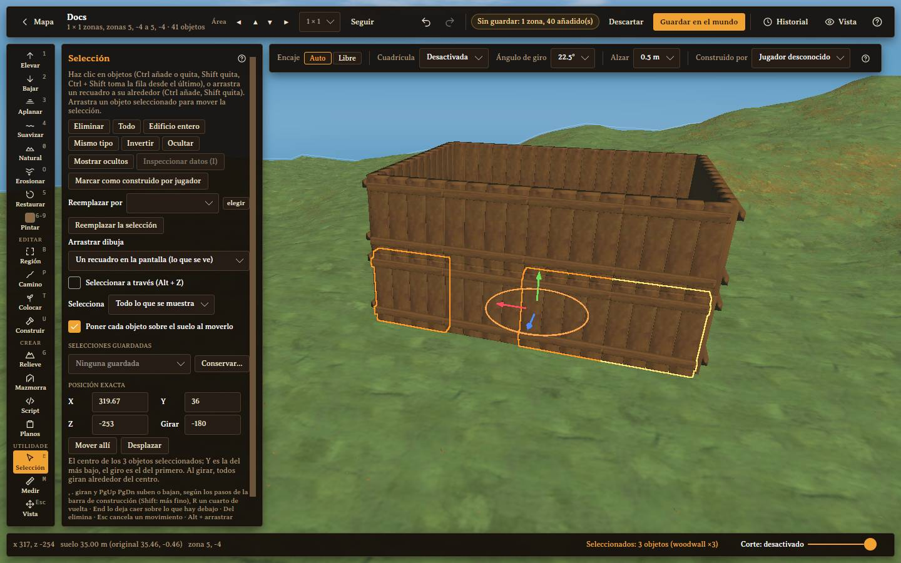
*Un clic en una pieza de muro y luego `Ctrl` + clic en dos más: la última en la que se hizo clic tiene el contorno en
amarillo más claro, las demás en naranja, y la barra de estado cuenta las tres.*

## Seleccionar muchos a la vez

Arrastrar sobre suelo vacío dibuja un recuadro en la pantalla. Al soltar, se seleccionan los objetos que **se ven**
dentro de él, no los ocultos detrás de otros. Gira la cámara para elegir: desde arriba, el suelo y la parte superior de
los muros de un edificio; desde un lado, un muro.

| Acción | Qué hace |
|---|---|
| Arrastrar sobre suelo vacío | Dibuja el recuadro; lo que se ve dentro pasa a ser la selección. |
| `Alt` + arrastrar | Dibuja el recuadro aunque empieces sobre un objeto (un edificio, un bosque). |
| `Ctrl` + arrastrar | Añade lo que toma el recuadro. |
| `Shift` + arrastrar | Lo quita. |

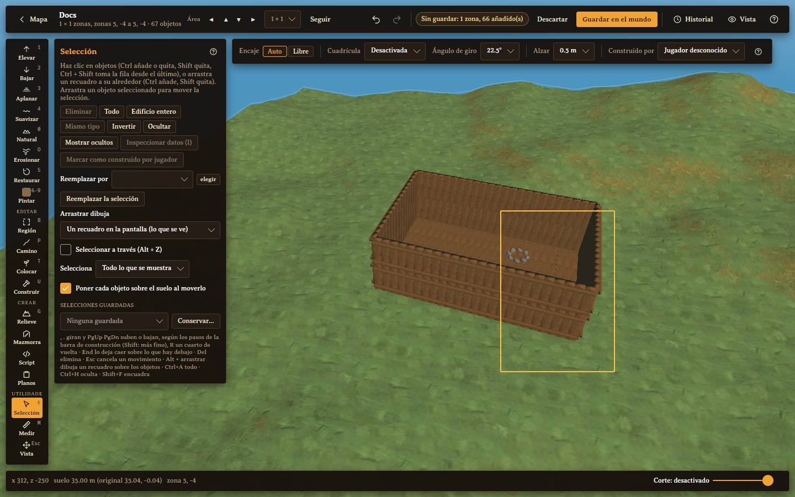
*`Alt` + arrastrar desde el centro de una cabaña sobre su mitad derecha: el recuadro se dibuja en la pantalla.*

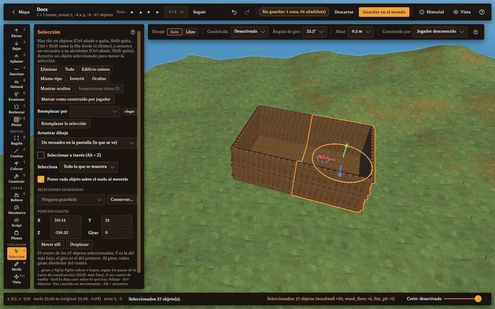
*Después de soltar: 27 piezas con contorno, los muros, el suelo que se ve entre ellos y la fogata; el suelo y el cofre
ocultos tras el muro más cercano quedan fuera. La barra de estado cuenta los objetos.*

*El mismo recuadro con **Seleccionar a través** activado: 34 piezas, también el suelo y el cofre tras el muro más
cercano.*

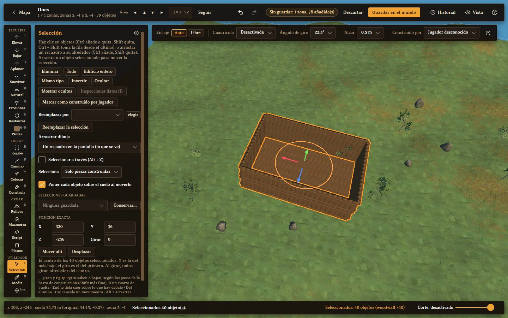
***Selecciona: Solo piezas construidas** y un recuadro sobre toda la cabaña entre rocas y arbustos: solo las 58 piezas
de la cabaña.*

Con **Arrastrar dibuja: Un contorno en el suelo (todo lo que hay encima)**, arrastrar dibuja en cambio un contorno en el
suelo, y se selecciona cada objeto mostrado que esté dentro, oculto o no. `Alt`, `Ctrl` y `Shift` funcionan como con el
recuadro.

Para seleccionar por tipo dentro de un recuadro o polígono exacto (todos los árboles, o solo las hayas, y solo donde la
[Máscara](masks.md) deja pasar el suelo), usa la herramienta [Región](area.md#acciones-de-objetos): en **Objetos**, su
**Seleccionar los objetos (Enter)** los selecciona y cambia a Selección, donde **Eliminar** y **Reemplazar la
selección** actúan sobre ellos.

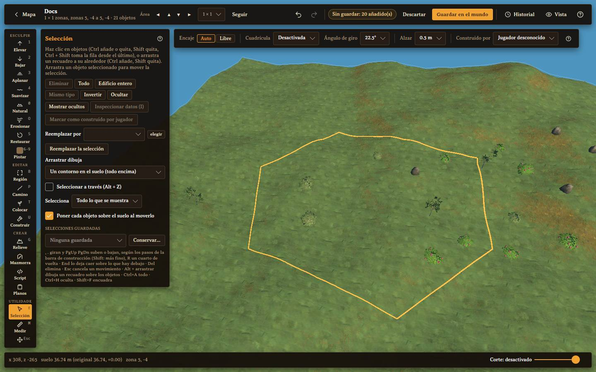
*`Alt` + arrastrar alrededor de rocas y arbustos: el contorno se dibuja aunque el arrastre empezó sobre un arbusto.*

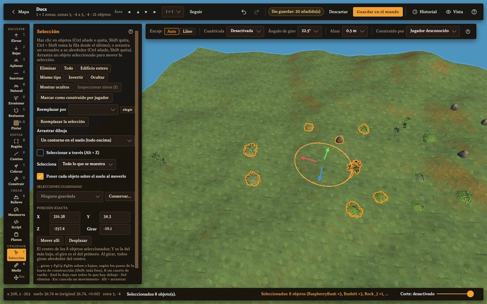
*Todo lo que se muestra dentro queda seleccionado, y **POSICIÓN EXACTA** indica dónde está la selección.*

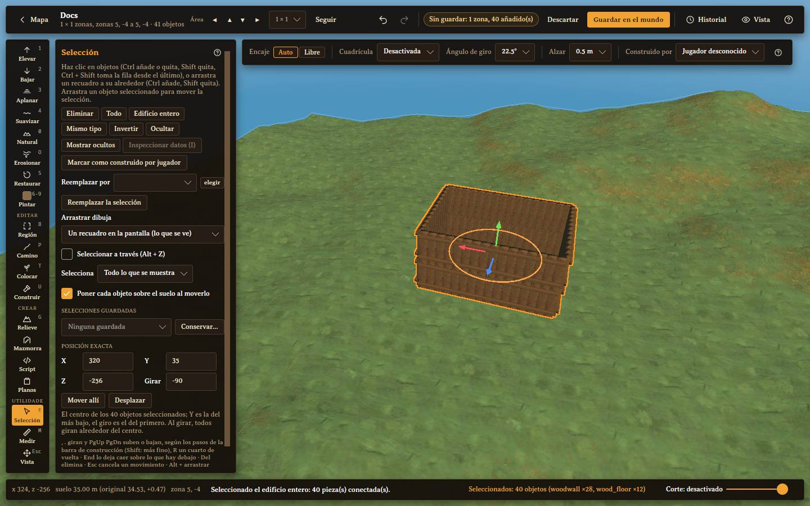
*Un clic en un muro y luego **Edificio entero**: queda seleccionada cada pieza conectada de la cabaña.*

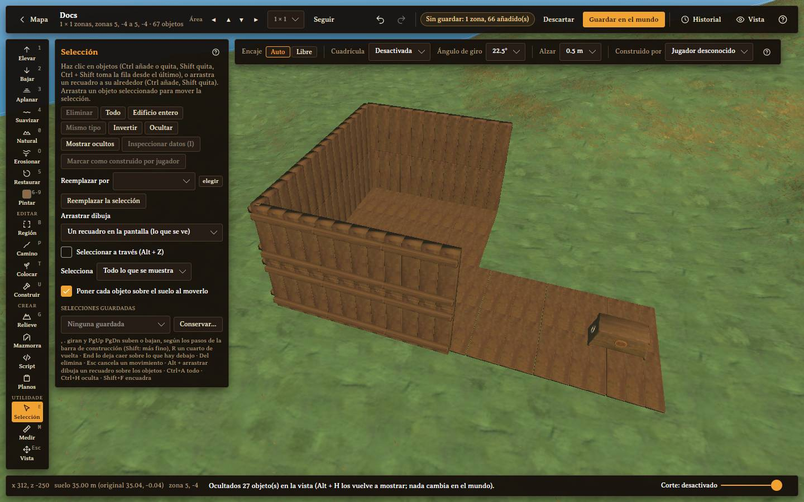
*De cerca, la cabaña después de que `Ctrl+H` ocultara su mitad derecha recuadrada: el cofre del suelo de dentro queda a
la vista. `Alt+H` devuelve los muros.*

## Mover y girar

| Acción | Qué hace |
|---|---|
| Arrastrar un objeto seleccionado | Mueve toda la selección, siguiendo el cursor sobre el suelo. Las piezas encajan con las piezas de alrededor, o siguen la cuadrícula, según esté ajustada [la barra de construcción](build.md#la-barra-de-construcción). |
| Arrastrar una flecha | Mueve a lo largo de un eje: **X roja** este–oeste, **Y verde** arriba–abajo, **Z azul** norte–sur. Mantén `Ctrl` para pasos de 0.5 m. |
| Arrastrar el anillo naranja | Gira la selección alrededor de su centro; mantén `Ctrl` para pasos de 15°. |
| `End` | Deja caer cada objeto en vertical sobre lo que hay debajo (un suelo, una mesa, una roca), y si no, sobre el terreno. |

La barra de construcción junto al panel es la misma que usan [Construir](build.md) y Pegar: **Encaje** (**Auto**: las
piezas movidas se fijan a los puntos de encaje más cercanos a menos de 0.75 m, como con el martillo; **Libre**: se
quedan donde las arrastras), **Cuadrícula** (las piezas que no encajan la siguen), **Ángulo de giro** y **Alzar** (los
pasos de las teclas de abajo) y **Construido por**.

La barra de estado sigue el movimiento: «Moviendo 12 objeto(s): 4.5 m, girado 15°, +0.25 m · encajado en woodwall». Un
objeto movido conserva sus datos: un cofre su contenido, un cartel su texto, una pieza su constructor. Consulta
[Encaje](concepts/objects.md#encaje) para ver cómo se posa un movimiento.

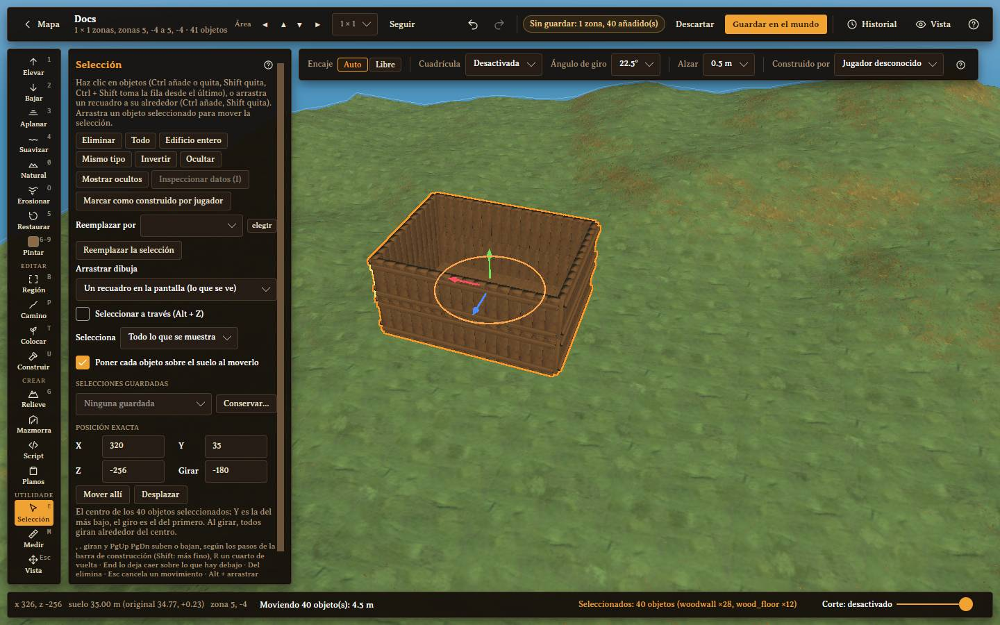
*Arrastrando la flecha X roja de una cabaña seleccionada entera: la barra de estado sigue el movimiento, «Moviendo 40
objeto(s): 4.5 m».*

## Copiar, cortar y pegar

`Ctrl+C` copia la selección; `Ctrl+V` la pega con la herramienta de pegar (`R` gira, `X` refleja), aquí o en otra área:
consulta [Región](area.md). Las copias conservan todo lo que contienen los originales. Los árboles y similares
conservan su altura sobre el suelo donde caen; las piezas de construcción conservan la forma del edificio y se llevan
consigo el suelo que tienen debajo (sin la pintura). `Ctrl+X` corta: la misma copia, y luego los objetos salen del
mundo, así que pegar los mueve.

Para guardar una copia como plano, abre **Planos** en la barra y haz clic en **Guardar como plano…** en su fila
**Copia**: consulta [el panel Planos](workshop.md#panel-planos).

## Inspector

El Inspector muestra todo lo que contiene un objeto en el guardado y te permite cambiarlo. Ábrelo con **Inspeccionar
datos (I)**, o haz doble clic en un cofre (o en cualquier objeto que no sea una pieza de construcción).

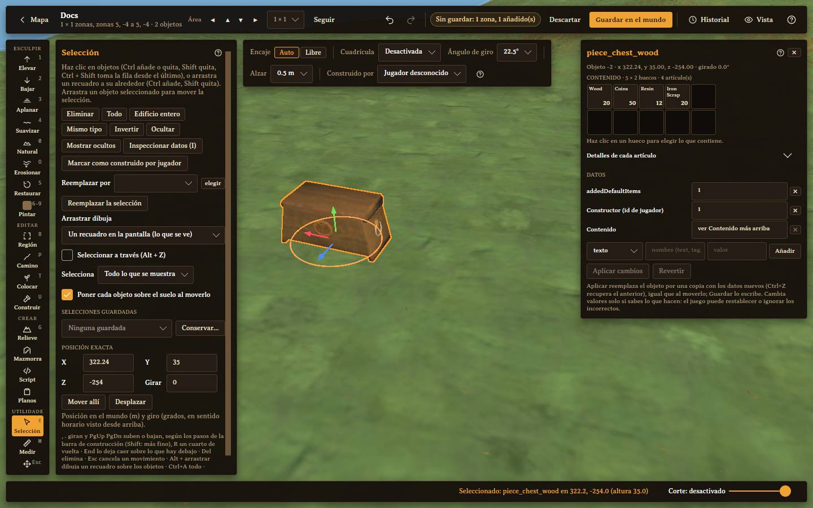
*De cerca, un cofre con cuatro artículos, abierto en el Inspector: sus huecos como en el juego, cada uno con el nombre
del artículo y cuántos hay, y luego todos los valores en DATOS.*

Arriba: el nombre del objeto, su id, su lugar y su giro. Para un punto de aparición o un nido, lo que hace aparecer
(`Spawn point: Boar · 0–2 ★ · spawns once`); para el objeto de un mod, de qué mod es.

| Parte | Qué hace |
|---|---|
| **CONTENIDO** | Cofres y otros contenedores: los huecos como en el juego («5 × 2 huecos · 4 artículo(s)»). Haz clic en un hueco y luego en **Buscar un artículo…** (escribe unas letras), **Cuántos** y **Calidad**. **Vaciar** saca el artículo; **Mover** y luego otro hueco lo mueve (dos artículos se intercambian). La cantidad se recorta a la pila más grande del juego. |
| **Detalles de cada artículo** | Cada artículo con su pila, su calidad, su durabilidad y su hueco. **Añadir artículo** pone uno nuevo en el primer hueco libre; **✕** saca uno; **Ordenar huecos** mueve todos los artículos a los primeros huecos libres, fila por fila. |
| **SOSTIENE** / **LLEVA PUESTO** | Soportes de objetos y maniquíes de armadura. La lista solo ofrece lo que el juego deja tomar a ese soporte (un soporte plano también admite comida, para poner una mesa). **Cal.** es su calidad, **Estilo** su aspecto, **Cuelga** cómo cuelga, **Postura** la postura de un maniquí de armadura; **✕** lo quita. |
| **DATOS** | Todos los valores, por el nombre del juego, con una etiqueta para los habituales: Texto (cartel), Etiqueta (portal), Constructor (id de jugador), Salud, Combustible, Nivel (estrellas)... Cambia números y textos en el sitio; **✕** quita un valor (el juego usa entonces el predeterminado). Los demás datos binarios se listan pero no se cambian. |
| **Añadir** | Añade un valor que el objeto no tiene: elige su tipo, escribe su nombre tal como lo llama el juego (`text` para un cartel, `tag` para un portal) y el valor. |
| **Aplicar cambios** | Reemplaza el objeto por una copia con los datos nuevos, en el mismo lugar: un paso de deshacer. **Guardar en el mundo** o **Aplicar en vivo** lo escribe. |
| **Revertir** | Olvida los cambios hechos en la tarjeta. |

- El tamaño de un contenedor lo da el juego. Los carros y los barcos llevan su contenedor en una parte, así que su
  tamaño se desconoce.
- Los artículos fuera de los huecos quedarían ocultos en el juego: el editor pregunta antes de aplicar eso.
- El contenido cambiado pasa a ser el propio del cofre: un cofre que nunca se ha abierto no se llena con el botín del
  juego por encima.
- Un artículo puesto en un soporte es nuevo y tiene la durabilidad completa para su calidad. En **Aspecto del juego**,
  la vista 3D lo dibuja en el soporte.
- Los nombres de los valores vienen del código del juego y de tus mods (leído, nunca ejecutado). Un nombre desconocido
  aparece como un número.

> [!WARNING]
> Cambia un valor solo cuando sepas lo que hace: el juego puede restablecer o ignorar valores que no espera. `Ctrl+Z`
> devuelve el objeto anterior hasta que guardas.

## Barcos y otros objetos enlazados

Algunos mods construyen objetos a partir de otros: la embarcación de un mod de barcos es una raíz y las piezas
construidas sobre ella; la locomotora de un mod de trenes y los vagones que arrastra. Cuando el mod los describe (su
`worldeditor.json`, consulta [Modding](modding.md), o un complemento como el de
[ValheimRAFT](../../addons/ValheimRAFT/README.md) o el de [Railroads](../../addons/Railroads/README.md)), el editor
dibuja el grupo como lo construye el mod y lo mantiene unido:

- **Se mueve entero.** Seleccionar cualquier parte y moverla, girarla o eliminarla afecta a todo el grupo (la barra de
  estado lo dice, con las palabras del mod: «a whole vehicle», un vehículo entero). Un grupo movido conserva su altura
  (un barco sigue a flote), no encaja y no cae con `End`.
- **Se copia entero.** `Ctrl+C` sobre cualquier parte copia todo el grupo, sin el suelo. Cada pegado es un grupo propio
  con ids nuevos. Una parte copiada sin su raíz se pega como una pieza normal.
- **Se quita entero.** Eliminar cualquier parte elimina todo el grupo, también cuando lo seleccionó la herramienta
  [Región](area.md#acciones-de-objetos).

Las herramientas de Claude hacen lo mismo. Consulta [Qué es un objeto](concepts/objects.md#qué-es-un-objeto).

## Atajos

| Tecla o ratón | Qué hace |
|---|---|
| `E` | Abre Selección. |
| `Ctrl+A` / `Alt+A` | Selecciona todo lo mostrado / quita la selección. |
| `Ctrl+I` | Invierte la selección. |
| `Ctrl+H` / `Alt+H` | Oculta los objetos seleccionados / los vuelve a mostrar. |
| `Alt+Z` | Activa o desactiva **Seleccionar a través**. |
| `Shift+F` o `.` del teclado numérico | Encuadra la selección (`F` sola cambia la vista). |
| `Del` | Elimina la selección. |
| `I` | Abre el Inspector sobre el único objeto seleccionado. |
| `,` `.` o `Alt` + rueda | Gira según el paso de **Ángulo de giro** de la barra de construcción, 22.5° al principio (`Shift`, más fino: 1°). |
| `R` | Gira un cuarto de vuelta. |
| `PgUp` / `PgDn` o `Ctrl` + rueda | Sube o baja según el paso de **Alzar** de la barra de construcción, 0.5 m al principio (`Shift`, más fino: una quinta parte). |
| `End` | Deja caer cada objeto sobre lo que hay debajo. |
| `Esc` | Cierra el Inspector; si no, cancela un recuadro, un contorno o un movimiento en curso; si no, vuelve a la herramienta Vista (la selección se queda). |
| `Ctrl+C` / `Ctrl+X` / `Ctrl+V` | Copiar, cortar, pegar. |
| `Ctrl+Z` | Deshacer. Las teclas pulsadas con muy poco tiempo entre ellas son un solo paso. |

Todas las teclas del editor están en [Atajos](help/shortcuts.md).

## Consejos y límites

> [!CAUTION]
> Las piedras rúnicas se pueden seleccionar y eliminar, pero no mover, girar, copiar ni inspeccionar: el juego crea cada
> una a partir de su ubicación cada vez que carga la zona, así que eliminar una quita esa ubicación para siempre (con
> el pequeño nivelado del suelo a su alrededor). Guardar en el mundo lo hace permanente; hasta entonces, `Ctrl+Z` la
> recupera.

- **Recuperar:** ¿eliminado o movido por error? `Ctrl+Z`, también después de guardar (y luego vuelve a guardar). ¿Has
  ocultado algo? `Alt+H`. Consulta [Deshacer cambios](guides/undo-changes.md).
- Los recuadros, los contornos, **Todo**, **Mismo tipo**, **Invertir** y **Edificio entero** dejan fuera todo lo que
  esté a más de 10 m bajo el suelo (objetos que un mod esconde allí, como estaciones de fabricación bajo una casa).
- Un clic elige un objeto por la forma dibujada, no por su caja: una piedra bajo las ramas de un árbol se puede elegir
  con un clic entre las ramas. Las hojas y la hierba solo cuentan donde no hay nada sólido detrás. Consulta
  [Qué es un objeto](concepts/objects.md#qué-es-un-objeto).
- Los objetos seleccionados pierden su punto verde de sin guardar mientras están seleccionados.
- En el modo en vivo, un objeto movido conserva su id en el juego en marcha cuando no cambia nada más de él. Consulta
  [Qué se envía y cuándo](concepts/live-editing.md#qué-se-envía-y-cuándo).

## Relacionado

- [Mover o copiar un edificio](guides/move-a-building.md)
- [Cambiar lo que contiene un cofre o lo que dice un cartel](guides/fill-a-chest.md)
- [Encontrar un objeto, un artículo de un cofre o un cartel](guides/find-things.md)
- [Objetos](concepts/objects.md#qué-es-un-objeto) · [Encaje](concepts/objects.md#encaje)
- [Construir](build.md) · [Colocar](place.md) · [Región](area.md)
