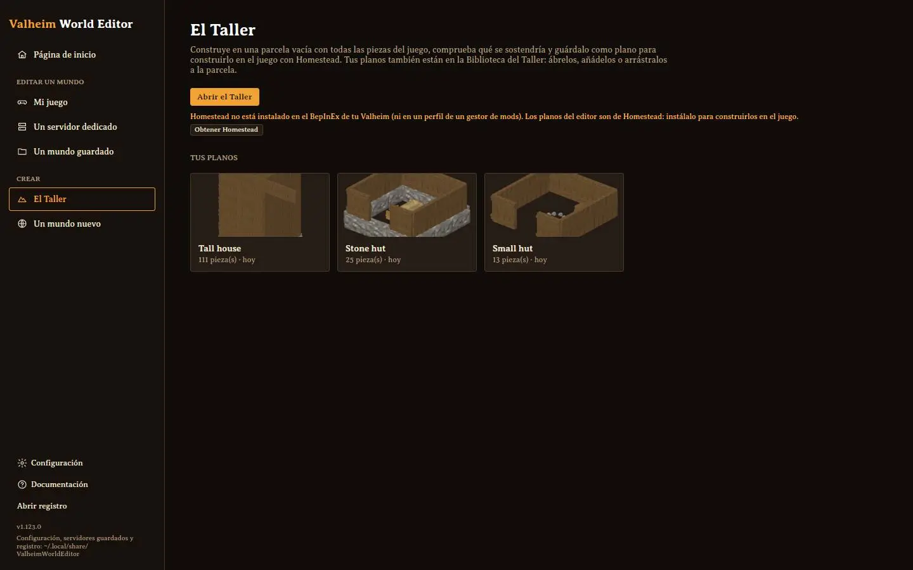
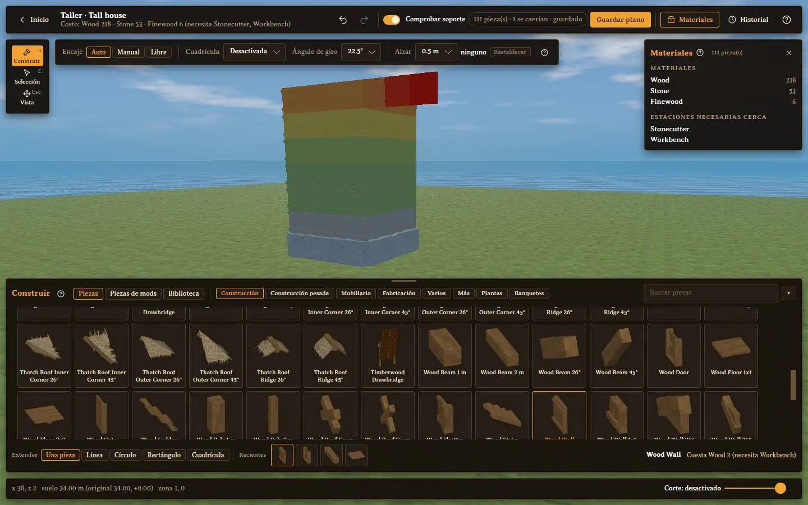
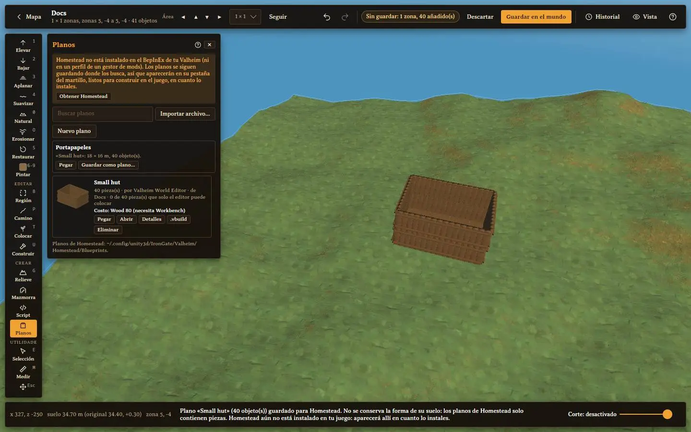

<!-- source: 491b2a7c -->
# Tu primera construcción

En unos quince minutos construyes una pequeña cabaña de madera en el Taller, ves cómo la comprobación de soporte la
colorea, la guardas como plano y la pegas en un mundo. Para la primera parte no necesitas ningún mundo: el Taller es
una parcela vacía.

**Necesitas:** el editor instalado ([Instalar el editor](install.md)). Para la última parte, un mundo con una copia de
seguridad al lado, como en [Tu primera edición](first-edit.md).

## 1. Abrir el Taller

1. En la página de inicio, haz clic en **El Taller** y luego en **Abrir el Taller**.

*En la página de inicio, **El Taller**: **Abrir el Taller**, si Homestead está instalado, y tus planos (aquí tres; la
primera vez no tienes ninguno).*

**Lo que deberías ver:** una parcela de pradera plana y vacía, el panel **Construir** a lo largo de la parte inferior
en su pestaña **Piezas**, y la barra superior diciendo «Aún no hay piezas». La barra de herramientas solo contiene
**Construir**, **Selección** y **Vista**, con la barra de construcción a su lado.

## 2. Poner un suelo

1. En el panel **Construir**, escribe `wood floor` en **Buscar piezas**.
2. Haz clic en la casilla del suelo de madera. Su nombre y su costo aparecen al pie del panel, y se añade allí a
   **Recientes**.
3. Haz clic en el centro de la parcela. El suelo queda colocado.
4. Apunta junto al borde del suelo y haz clic de nuevo. El nuevo suelo se encaja con el primero, borde con borde, como
   con el martillo del juego. Coloca cuatro suelos formando un cuadrado.

**Lo que deberías ver:** un suelo cuadrado, con cada pieza teñida de azul claro: se apoya en el terreno, así que tiene
soporte completo. La barra superior cuenta «4 pieza(s) · no guardado como plano», y bajo el título aparece el costo de
la cabaña.

## 3. Levantar las paredes

1. Busca `wood wall` y haz clic en la casilla de la pared de madera.
2. Apunta al borde exterior de un suelo y haz clic: la pared se encaja en el borde. Pulsa `,` o `.` para girarla antes
   si mira hacia el lado equivocado.
3. Pon paredes alrededor de todo el suelo. Deja un hueco para una puerta.
4. Busca `wood door`, haz clic en su casilla y pon la puerta en el hueco.
5. Pon una segunda fila de paredes encima de la primera.

*La comprobación de soporte en una casa alta: la base de piedra en azul claro, las paredes de encima en verde, luego en
amarillo y naranja a medida que se agota su soporte, y un voladizo en rojo: se caería.*

**Lo que deberías ver:** las paredes sobre el suelo están en verde (firmes); la segunda fila está en un verde más claro
o en amarillo, con menos soporte. Una pieza que se caería en el juego se vuelve roja, y la barra superior dice cuántas
se caerían. El porqué: consulta [La comprobación de soporte](../concepts/objects.md#la-comprobación-de-soporte).

¿Una pieza en el lugar equivocado? Pulsa `Ctrl+Z` para deshacerla, o pulsa `E` (**Selección**), haz clic en la pieza,
pulsa `Del` y pulsa `U` para volver a construir.

## 4. Guardar el plano

1. Haz clic en **Guardar plano** en la barra superior (o pulsa `Ctrl+S`).
2. Escribe `My first hut` como **Nombre**, unas palabras como **Descripción** y `hut, wood` como **Etiquetas**.
3. Haz clic en **Guardar**. Si algunas piezas se caerían en el juego, el editor pregunta antes: **Seguir construyendo**
   para arreglarlas (están en rojo), o **Guardar de todos modos**.

**Lo que deberías ver:** el mensaje «Plano «My first hut» (… pieza(s)) guardado para Homestead.», y la barra superior
dice «guardado». El plano está ahora en tu biblioteca, con una imagen de la cabaña. Con el mod
[Homestead](https://thunderstore.io/c/valheim/p/sighsorry/Homestead/) en tu juego, también aparece en la pestaña de
Homestead del martillo, listo para construirlo en el juego.

## 5. Pegarlo en un mundo

1. Haz clic en **Inicio** arriba a la izquierda para volver a la página de inicio.
2. Haz clic en **Un mundo guardado** y luego en tu mundo (no en su copia de seguridad). En su mapa, haz clic en un
   lugar de terreno despejado que hayas visitado y haz clic en **Editar en 3D**.
3. En la barra de herramientas, en **CREAR**, haz clic en **Planos**. En una ventana baja, desplaza la barra de
   herramientas con la rueda del ratón para llegar hasta él.
4. Busca **My first hut** en la lista y haz clic en su botón **Pegar**.
5. Mueve el ratón sobre terreno despejado: la cabaña lo sigue, transparente. Pulsa `R` para girarla un cuarto de
   vuelta.
6. Haz clic para colocarla y luego pulsa `Esc` para dejar de pegar.

*El panel **Planos** junto a la barra de herramientas: una cabaña guardada con su imagen, su costo y su botón
**Pegar**.*

**Lo que deberías ver:** la cabaña en pie sobre el suelo. Con **Despejar el sitio** activado en el panel Pegar (lo está
al principio), el suelo que estorba se excava y los árboles y rocas de su sitio desaparecen. La barra superior dice
«Sin guardar: … añadido(s)».

Un contorno rojo antes del clic significa que la cabaña no cabe en el área abierta: abre una más grande desde el mapa.

## 6. Guardar el mundo

1. Cierra Valheim si está en marcha.
2. Haz clic en **Guardar en el mundo**, comprueba la **Carpeta del mundo** en la pregunta y haz clic en **Guardar**.
3. Inicia Valheim, carga el mundo y camina hasta el lugar.

**Lo que deberías ver:** tu cabaña, en pie donde la pegaste. Sus piezas están construidas por un jugador, así que el
juego la trata como tu base (consulta [Piezas construidas por jugadores](../concepts/objects.md#piezas-construidas-por-jugadores)).

## Si no ha funcionado

- **Una pieza no se encaja**: apunta más cerca del borde o de la parte superior de la pieza que ya está; el encaje
  toma los puntos de encaje más cercanos a menos de medio metro.
- **El Taller dice que Homestead no está instalado**: no pasa nada. Los planos se guardan donde Homestead los busca, y
  pegar en un mundo funciona sin él.
- **El contorno de lo pegado está en rojo**: la cabaña está demasiado cerca del borde del área. Mueve el ratón hacia
  dentro o abre un área más grande.
- **No te gusta el resultado**: `Ctrl+Z` deshace el pegado antes de guardar. Después de guardar, deshazlo y pulsa de
  nuevo **Guardar en el mundo**: consulta [Deshacer un paso, retirar un cambio o descartarlo todo](../guides/undo-changes.md).

## Siguiente

- [El Taller](../workshop.md): cada pestaña de piezas, la biblioteca, el corte y cómo se encajan las piezas.
- [Pegar un plano en un mundo](../guides/paste-a-blueprint.md)
- [Mover o copiar un edificio](../guides/move-a-building.md)
