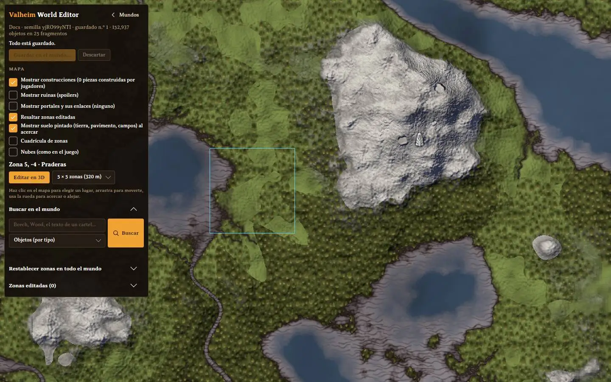
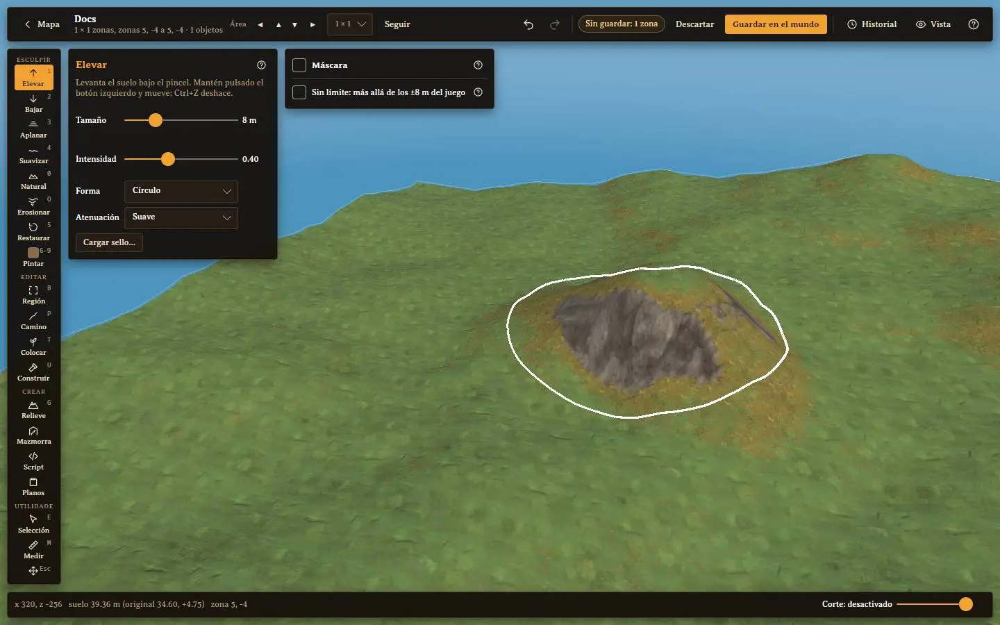
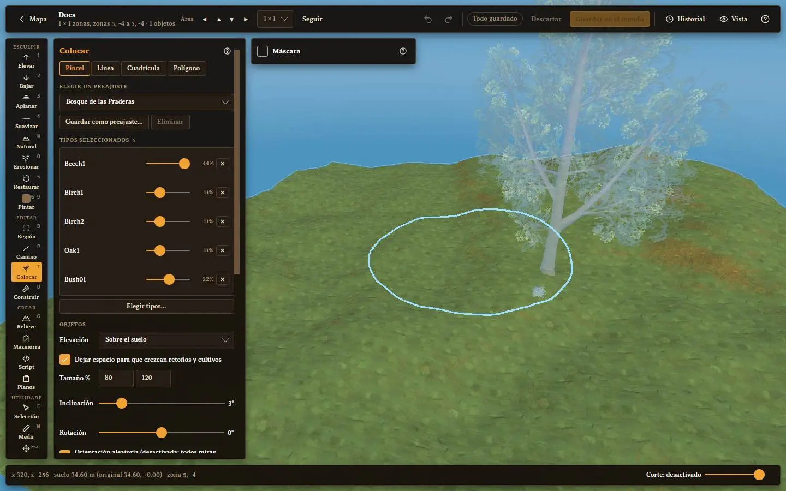
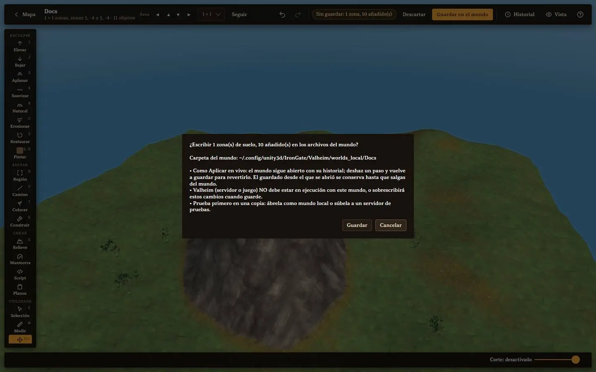

<!-- source: b94e61af -->
# Tu primera edición

En unos diez minutos copias un mundo, elevas una pequeña colina y plantas unos cuantos árboles junto a tu base,
deshaces y rehaces, guardas y vas andando hasta el resultado en Valheim. La copia conserva el mundo tal como estaba,
así que no se puede perder nada.

**Necesitas:** el editor instalado ([Instalar el editor](install.md)) y un mundo de un solo jugador en el que hayas
jugado: uno donde hayas construido una base y usado la azada o el pico al menos una vez. Valheim debe estar cerrado.

## 1. Copia el mundo

La copia es tu camino de vuelta: hagas lo que hagas después, puedes devolver el mundo exactamente a como está ahora.

1. Cierra Valheim.
2. En el editor, en la página de inicio, haz clic en **Un mundo guardado** y pasa el puntero sobre la tarjeta de tu
   mundo. La descripción emergente termina con la carpeta del mundo, por ejemplo `…/IronGate/Valheim/worlds_local/Midgard`.
3. En tu gestor de archivos, abre la carpeta `worlds_local` que la contiene.
4. Copia la carpeta del mundo y pega la copia en la misma carpeta `worlds_local`.
5. Cambia el nombre de la copia a `<World>_backup_<date>`, por ejemplo `Midgard_backup_2026-10-22`.

**Lo que deberías ver:** al cabo de unos segundos, **Un mundo guardado** lista los dos: tu mundo y
`Midgard_backup_2026-10-22`. Editas el propio mundo; la copia se queda intacta a su lado. Más sobre las copias:
[Hacer una copia de seguridad de un mundo antes de editarlo](../guides/back-up-a-world.md).

## 2. Abre el mundo

1. En **Un mundo guardado**, haz clic en tu mundo (no en la copia). Se abre en su mapa.
2. En el mapa, haz clic en un punto de terreno despejado cerca de tu base.
3. En el panel lateral, elige **3 × 3 zonas (192 m)** en la lista de tamaños junto a **Editar en 3D** y luego haz clic
   en **Editar en 3D**.

*El mapa: un clic eligió una zona (el cuadrado azul); **Editar en 3D** la abre con el tamaño elegido al lado.*

**Lo que deberías ver:** la vista 3D de tu base y el terreno de alrededor, la barra de herramientas a la izquierda y la
barra superior que dice «Todo guardado». Si la vista está lejos, gira la rueda para acercarte; arrastrar con el botón
derecho gira la vista.

## 3. Eleva una colina

1. Pulsa `1`, o haz clic en **Elevar** en la barra. Su panel se abre junto a la barra.
2. En el panel, arrastra **Tamaño** hasta unos 10 m.
3. En terreno despejado junto a tu base, mantén pulsado el botón izquierdo del ratón y mueve el ratón en pequeños
   círculos durante unos segundos.

*Elevar: el contorno del pincel en el suelo, un montículo elevado a su lado y el panel con **Tamaño** e
**Intensidad**.*

**Lo que deberías ver:** el suelo sube bajo el pincel, y la barra superior dice «Sin guardar: 1 zona» en ámbar.
Todavía no se ha escrito nada en el mundo: el cambio está [pendiente](../concepts/saving-and-history.md#cambios-pendientes).

## 4. Planta árboles

1. Pulsa `T`, o haz clic en **Colocar** en la barra.
2. En el panel **Colocar**, haz clic en **Pincel** y luego elige **Bosque de las Praderas** en **Elegir un preajuste**.
3. Arrastra el ratón a lo largo del pie de tu colina.

*Colocar con **Pincel** y el preajuste **Bosque de las Praderas**: el pincel muestra los próximos árboles
transparentes; los ya plantados están a su alrededor.*

**Lo que deberías ver:** aparecen hayas, abedules, robles y arbustos donde arrastras, cada uno con un pequeño punto
verde (aún sin guardar), y la barra superior añade «… añadidos».

## 5. Deshaz y rehaz

1. Pulsa `Ctrl+Z` (`Cmd+Z` en un Mac). Los últimos árboles que plantaste desaparecen.
2. Pulsa `Ctrl+Y`. Vuelven.
3. Pulsa `L` para abrir **Historial**.

**Lo que deberías ver:** el Historial lista tus pasos, del más reciente al más antiguo: «Colocado …» y luego Elevar.
**Volver hasta aquí** en una fila vuelve a ella; **Quitar** quita solo ese cambio. Pulsa `L` de nuevo para cerrarlo.

Más: [Deshacer un paso, retirar un cambio o descartarlo todo](../guides/undo-changes.md).

## 6. Guarda

1. Haz clic en **Guardar en el mundo** en la barra superior (o pulsa `Ctrl+S`).
2. Lee la pregunta: dice lo que escribe y la **carpeta del mundo**. Comprueba que la carpeta es la de tu mundo, no la de
   la copia, y luego haz clic en **Guardar**.

*La pregunta antes de guardar: comprueba la línea de la **carpeta del mundo** y luego haz clic en **Guardar**.*

**Lo que deberías ver:** la barra de estado dice «1 zona(s), … objeto(s) nuevo(s) guardado en el guardado n.º …», la
barra superior dice «Todo guardado» y los puntos verdes han desaparecido. El editor escribió un guardado nuevo junto al
anterior y lo volvió a leer para comprobarlo.

El mundo sigue abierto con su Historial: todavía puedes deshacer un paso y volver a guardar para retirarlo.

## 7. Míralo en el juego

1. Haz clic en **Mapa**, arriba a la izquierda, y luego en **Mundos**, para salir del mundo.
2. Inicia Valheim y carga el mundo.
3. Ve andando hasta el punto junto a tu base.

**Lo que deberías ver:** tu colina y tus árboles, como en el editor. A partir de ahora, el juego los guarda como de
costumbre.

## Si no ha funcionado

- **«Sin guardar: … not generated yet»**: has editado una zona que ningún jugador ha visitado, así que el mundo no tiene
  datos de ella. Elige un punto por el que hayas pasado, o visítalo antes en el juego.
- **«… the world has no terrain object to copy yet»**: nadie ha excavado ni nivelado nunca el suelo en este mundo. En
  el juego, usa la azada o el pico una vez en cualquier sitio, guarda, sal y vuelve a guardar en el editor.
- **«Valheim guardó este mundo … después de que el editor lo leyera»**: el juego estaba en marcha, o guardó el mundo,
  mientras editabas. Consulta [Guardar en el mundo](../editor-basics.md#guardar-en-el-mundo).
- **No te gusta el resultado**: vuelve a abrir el mundo, deshaz (o usa **Quitar** en los pasos del Historial) y luego
  **Guardar en el mundo**. O vuelve a poner la copia: consulta
  [Hacer una copia de seguridad de un mundo antes de editarlo](../guides/back-up-a-world.md#deshacerlo).

## Siguiente

- [Tu primera construcción](first-build.md): construye una cabaña en el Taller y pégala en este mundo.
- [La ventana del editor](../editor-basics.md): cada parte de la ventana.
- [Atajos](../help/shortcuts.md): todas las teclas y acciones del ratón.

En el editor, `F1` (o el pequeño **?** en la parte superior de un panel) abre esta ayuda en la herramienta que estás
usando.
