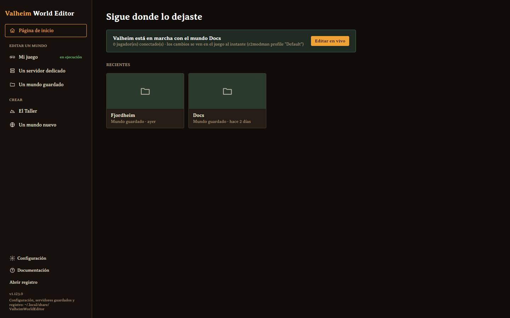
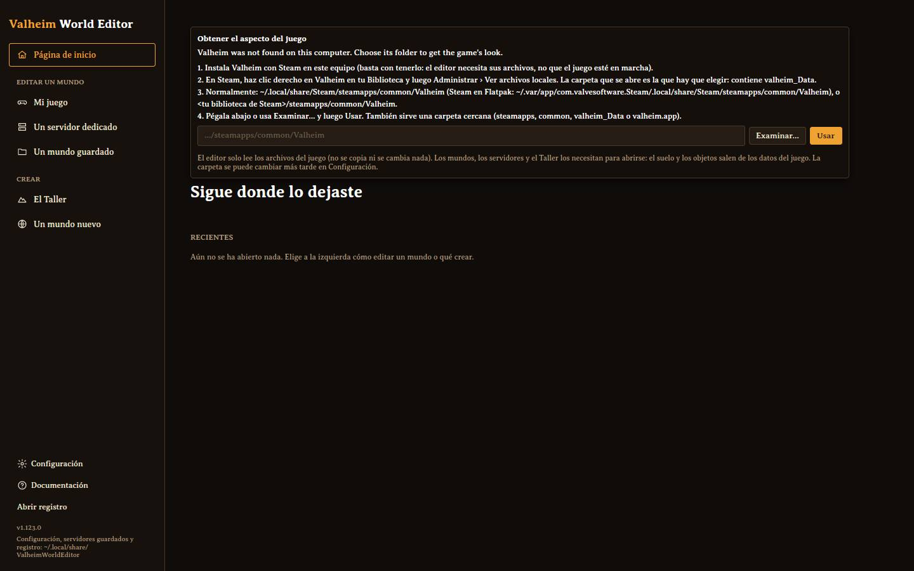
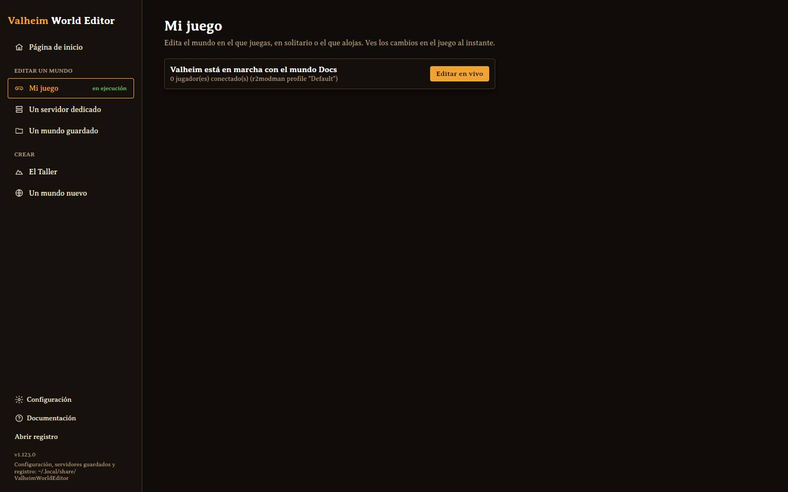
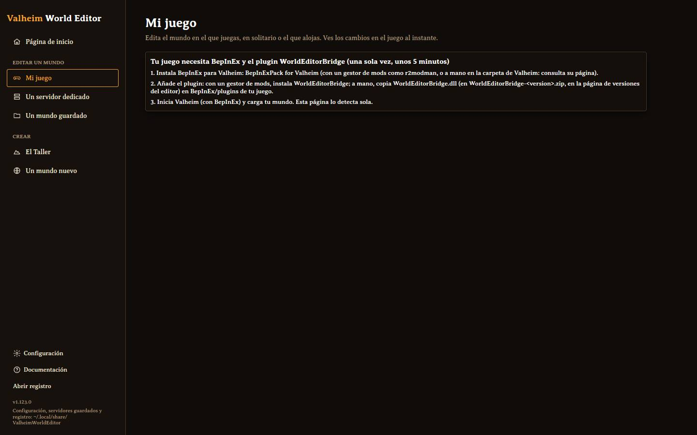

<!-- source: 68ffaeda -->
# Instalar el editor

Descarga el editor, arráncalo y deja que encuentre tu Valheim. Al final, el editor está abierto en su página de inicio
y ha leído los archivos del juego, listo para [tu primera edición](first-edit.md).

## Qué necesitas

- **Windows 10 u 11**, o **Linux**, de 64 bits; o **macOS 12 o posterior en un Mac con Apple silicon** (M1 y
  posteriores). La versión para Mac es experimental: aún no se ha probado en un Mac, y los Mac con Intel no son
  compatibles.
- **Valheim**, instalado con Steam en el mismo equipo. Basta con tenerlo: el editor lee los archivos del juego (sus
  texturas, modelos, terreno y mapa), no necesita que el juego esté en marcha. No se copia ni se cambia nada.

No necesitas instalar nada más. Todo lo que necesita el editor viene en la descarga.

## Descargar

1. Abre la [página de versiones](https://github.com/Shuiei/valheim-world-editor/releases/latest).
2. Descarga el archivo para tu equipo:
   - Windows: `ValheimWorldEditor-v<version>-win-x64.zip`
   - Linux: `ValheimWorldEditor-v<version>-linux-x64.tar.gz`
   - macOS: `ValheimWorldEditor-v<version>-macos-arm64-experimental.zip`

El editor también está en [Nexus Mods](https://www.nexusmods.com/valheim/mods/4348). El editor es un programa, no un
mod: Thunderstore y Hexium solo ofrecen su plugin (consulta [El plugin para editar en vivo](#el-plugin-para-editar-en-vivo)).

## Arrancarlo en Windows

1. Descomprime la descarga donde quieras, por ejemplo en el Escritorio. Mantén sus archivos juntos:
   `ValheimWorldEditor.exe` necesita los archivos `.dll` que hay a su lado. No lo ejecutes desde dentro del zip.
2. Haz doble clic en `ValheimWorldEditor.exe`.
3. Si Windows dice «Windows protegió su PC», haz clic en **Más información** (indica el editor del programa) y luego
   en **Ejecutar de todas formas**. Windows lo pregunta hasta que SmartScreen conoce la firma del editor.

<!-- picture: install-smartscreen.jpg: Windows 11, the blue "Windows protected your PC" dialog after More info was clicked, the publisher line and the Run anyway button visible, nothing else on screen -->

## Arrancarlo en Linux

1. Descomprime la descarga donde quieras, por ejemplo en tu carpeta personal.
2. Haz doble clic en `ValheimWorldEditor` en la carpeta. Si tu gestor de archivos lo abre como texto o pregunta qué
   hacer, elige **Ejecutar** (o clic derecho, **Ejecutar como un programa**). Desde una terminal:
   `./ValheimWorldEditor`.

El editor dibuja con OpenGL 3.3, que tiene cualquier controlador gráfico de los últimos diez años (Mesa, AMD, NVIDIA,
Intel).

## Arrancarlo en macOS (experimental)

1. Descomprime la descarga y mueve **ValheimWorldEditor.app** donde quieras, por ejemplo a Aplicaciones.
2. Haz doble clic en él una vez. macOS se niega a abrirlo, porque el editor no está firmado con un certificado de
   Apple Developer. Cierra el mensaje.
3. Abre **Ajustes del Sistema › Privacidad y seguridad**, desplázate hasta **Seguridad**, haz clic en **Abrir
   igualmente** junto a ValheimWorldEditor y confirma con tu contraseña.
4. Vuelve a hacer doble clic en la aplicación. A partir de ahora se abre con un doble clic.

En lugar de los pasos 2 y 3, puedes ejecutar en Terminal:
`xattr -dr com.apple.quarantine /Applications/ValheimWorldEditor.app` (con la ruta donde lo pusiste).

En un Mac, `Cmd` funciona donde la documentación dice `Ctrl`: `Cmd+Z` deshace, `Cmd`+clic añade a una selección. El
terreno del juego se dibuja con el propio shader del juego cuando la versión de Mac trae uno que el editor puede leer;
si no, con colores lisos. Si algo no funciona,
[abre una incidencia](https://github.com/Shuiei/valheim-world-editor/issues) con el registro del editor (**Abrir
registro** en la página de inicio).

## El primer arranque

El editor se abre en su propia ventana, en el apartado **Página de inicio** de la página de inicio. La primera vez, y
después de cada actualización de Valheim, una tarjeta dice **Preparando el aspecto del juego** mientras el editor lee
los archivos del juego durante unos segundos. Los mundos, los servidores y el Taller se abren en cuanto dice **El
aspecto del juego está listo.**

*La página de inicio: el menú lateral a la izquierda, Página de inicio a la derecha. Una vez abierto un mundo, aparece
en Recientes.*

## Cuando no se encuentra Valheim

El editor busca por sí solo en todas las bibliotecas de Steam (también en Steam de Flatpak). Si no encuentra el juego,
la tarjeta dice **Obtener el aspecto del juego** y «No se encontró Valheim en este equipo.»

*Los pasos de la tarjeta dicen dónde encontrar la carpeta; pégala en el cuadro (o **Examinar…**) y luego **Usar**.*

1. En Steam, haz clic derecho en Valheim en tu Biblioteca y luego en **Administrar › Ver archivos locales**. La
   carpeta que se abre es la que hay que elegir: contiene `valheim_Data` (`valheim.app` en un Mac).
2. Copia su ruta, pégala en el cuadro de la tarjeta (o haz clic en **Examinar…** y elígela) y luego haz clic en
   **Usar**.

Los sitios habituales son:

- Windows: `C:\Program Files (x86)\Steam\steamapps\common\Valheim`
- Linux: `~/.local/share/Steam/steamapps/common/Valheim` (Steam de Flatpak:
  `~/.var/app/com.valvesoftware.Steam/.local/share/Steam/steamapps/common/Valheim`)
- macOS: `~/Library/Application Support/Steam/steamapps/common/Valheim`
- Otra biblioteca de Steam: `<library>/steamapps/common/Valheim`

Una carpeta cercana también sirve (`steamapps`, `common`, `valheim_Data` o `valheim.app`): el editor encuentra la
carpeta del juego a partir de ella. Puedes cambiarla después en **Configuración** (**Carpeta del juego Valheim**), ver
[Configuración](../editor-basics.md#configuración).

## El plugin para editar en vivo

Para editar un mundo mientras el juego está en marcha (tu propio juego, o un servidor dedicado mientras la gente
juega), el juego que aloja el mundo necesita **BepInEx** y el plugin **WorldEditorBridge** del editor. Los jugadores
que se unen no necesitan ninguno de los dos, incluidos los de consola. Para editar mundos guardados con el juego
cerrado, o para construir en el Taller, no necesitas ninguno de los dos.

Para tu propio juego:

1. Instala BepInEx una vez: [BepInExPack for Valheim](https://thunderstore.io/c/valheim/p/denikson/BepInExPack_Valheim/),
   con un gestor de mods (r2modman, Thunderstore Mod Manager) o a mano en la carpeta de Valheim, siguiendo su página.
2. Añade el plugin. Con un gestor de mods, instala WorldEditorBridge desde
   [Thunderstore](https://thunderstore.io/c/valheim/p/Tie/WorldEditorBridge/) o
   [Hexium](https://valheim.hexium.gg/mods/Tie/WorldEditorBridge) (BepInEx viene con él). A mano, copia
   `WorldEditorBridge.dll` de `WorldEditorBridge-<version>.zip` (en la
   [página de versiones](https://github.com/Shuiei/valheim-world-editor/releases/latest) o en
   [Nexus Mods](https://www.nexusmods.com/valheim/mods/4348)) en `BepInEx/plugins` de tu Valheim. Usa la misma versión
   que la del editor.
3. Arranca Valheim con BepInEx y carga tu mundo (un jugador, o un servidor que inicies desde el juego). En este primer
   arranque el plugin escribe su configuración, `BepInEx/config/Tie.WorldEditorBridge.cfg`, con un **token**
   aleatorio.
4. En la página de inicio del editor, **Página de inicio** dice ahora «Valheim está en marcha con el mundo …» y **Mi
   juego** muestra *en ejecución*. El editor encuentra por sí solo el plugin y su token, incluidos los perfiles de los
   gestores de mods. Haz clic en **Editar en vivo**.

***Mi juego** con el juego en marcha: la tarjeta nombra el mundo, los jugadores conectados y dónde se encontró el
plugin (aquí un perfil de r2modman), con **Editar en vivo**.*

Hasta que el juego está en marcha, **Mi juego** dice lo que falta, paso a paso.

***Mi juego** antes de instalar BepInEx: los tres pasos, que se hacen una sola vez. La página detecta el juego por sí
sola en cuanto está en marcha.*

Después sigue [Editar el mundo en el que juegas](../guides/edit-your-game-live.md).

Para un **servidor dedicado**, instala BepInEx (siguiendo las instrucciones de BepInExPack para servidores dedicados)
y copia `WorldEditorBridge.dll` en `BepInEx/plugins` del servidor (o instala el plugin en el perfil de servidor de un
gestor de mods), y luego arranca el servidor una vez para que escriba su token. El editor se conecta a él por SSH, a
través de su propio túnel cifrado, así que el servidor debe darte acceso SSH a su máquina: ver
[Editar un servidor dedicado mientras la gente juega](../guides/edit-a-server-live.md). Un servidor de juego alquilado
a un proveedor a menudo no tiene acceso SSH: ver
[Editar un servidor alquilado o alojado con panel](../guides/edit-a-rented-server.md).

## Complementos para mods

Algunos mods de generación de mundos y de construcción necesitan un **complemento** para que el editor dibuje o edite
lo que crean. Cada uno se descarga por separado en la
[página de versiones](https://github.com/Shuiei/valheim-world-editor/releases/latest):
`ValheimWorldEditor-addon-<Name>-<version>.zip`.

1. Descomprime el complemento en la carpeta `addons` junto al editor (en macOS, junto a `ValheimWorldEditor.app`).
2. Abre **Configuración**: en **Complementos** lista el complemento y dice si está en uso. Un complemento se usa
   mientras su mod esté en tus carpetas de plugins de BepInEx; su interruptor lo desactiva sin quitarlo.

| Complemento | Para |
|---|---|
| [Expand World](../../../addons/ExpandWorld/README.md) | Mundos hechos con los mods Expand World (Size, Rivers, Data). |
| [Riverheim](../../../addons/Riverheim/README.md) | Mundos hechos con Riverheim. |
| [Tunnelheim](../../../addons/Tunnelheim/README.md) | Los túneles que excava Tunnelheim, y una herramienta Túnel. |
| [Railroads](../../../addons/Railroads/README.md) | Las vías, estaciones y trenes de Railroads. |
| [ValheimRAFT](../../../addons/ValheimRAFT/README.md) | Los barcos y vehículos terrestres de ValheimRAFT, cada uno movido, copiado y eliminado como una sola pieza. |

Un complemento es código que se ejecuta dentro del editor: instala solo los que sean de confianza. Consulta
[Editar un mundo creado con Expand World, Riverheim o Tunnelheim](../guides/use-mods-worlds.md).

## Dónde guarda el editor sus archivos

Su configuración, los servidores guardados (`servers.cfg`), lo que recuerda entre ejecuciones, el índice de los
archivos del juego (`game-index.json`) y su registro (`ValheimWorldEditor.log`, uno nuevo en cada ejecución) están en:

- Windows: `%LOCALAPPDATA%\ValheimWorldEditor`
- Linux: `~/.local/share/ValheimWorldEditor`
- macOS: `~/Library/Application Support/ValheimWorldEditor`

La parte de abajo del menú de la página de inicio muestra esta carpeta, y **Abrir registro** abre el registro. Tus
planos están en la carpeta de Homestead: consulta [el Taller](../workshop.md).

## Siguiente

[Tu primera edición](first-edit.md): haz una copia de seguridad de un mundo, levanta una colina, planta árboles,
guarda y míralo en el juego.
