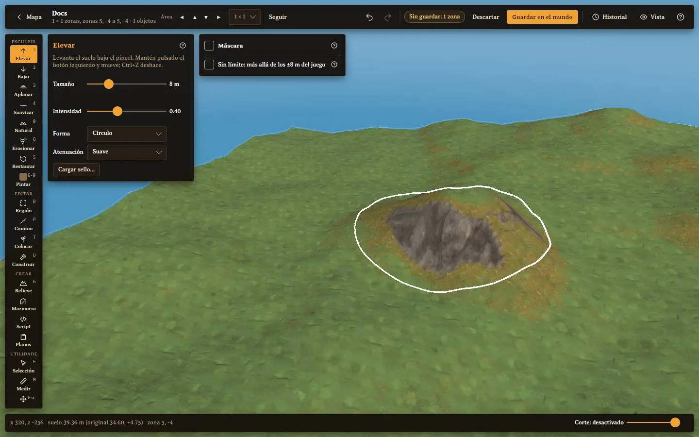
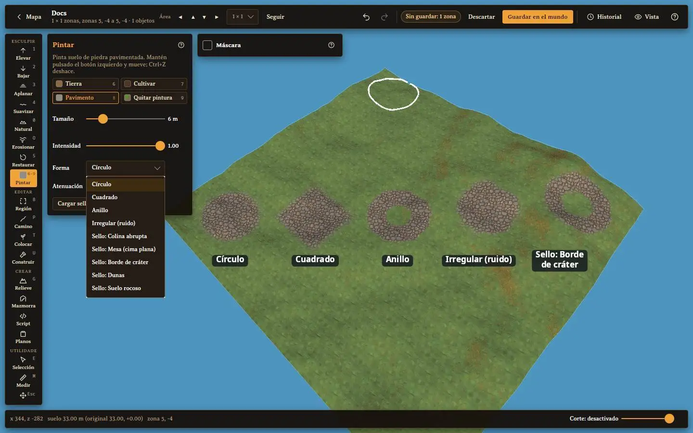
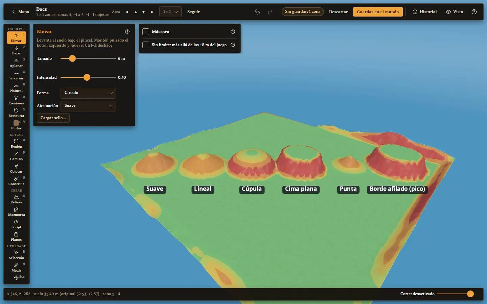
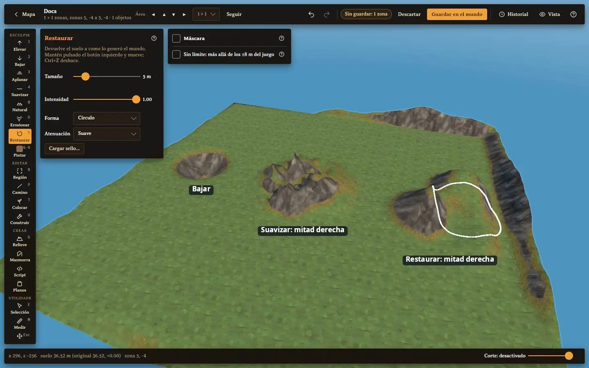
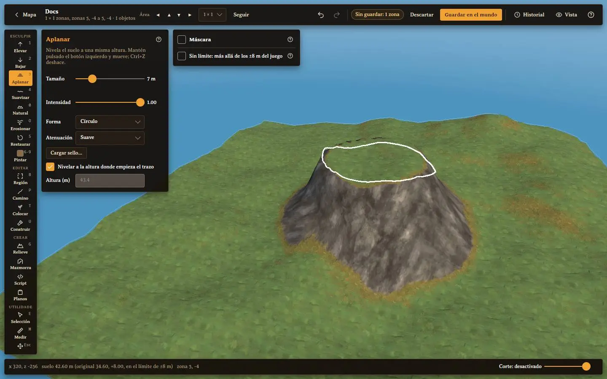
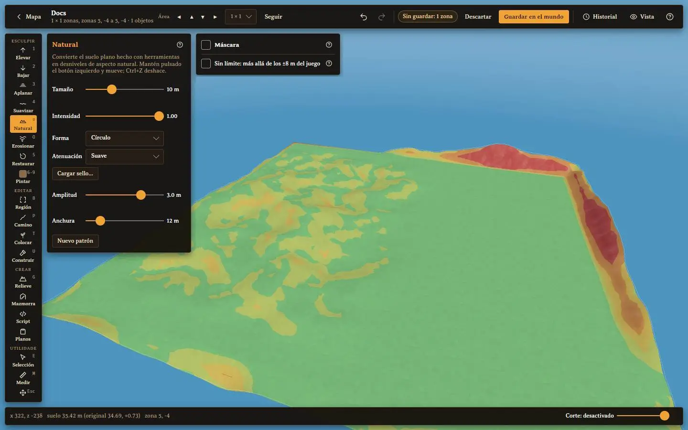
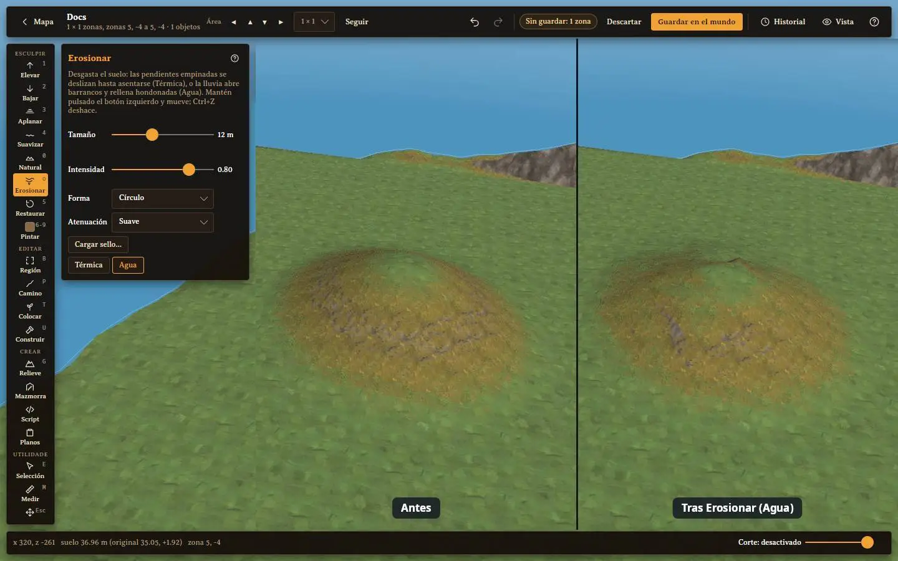
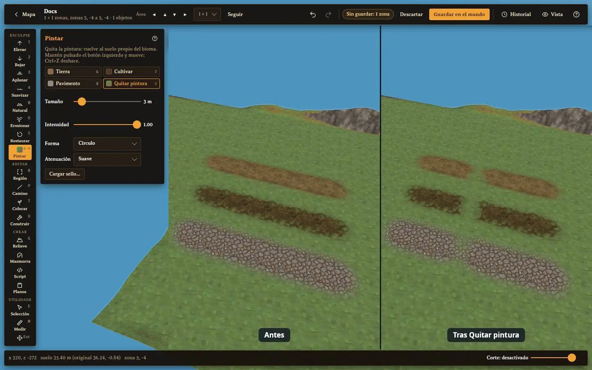
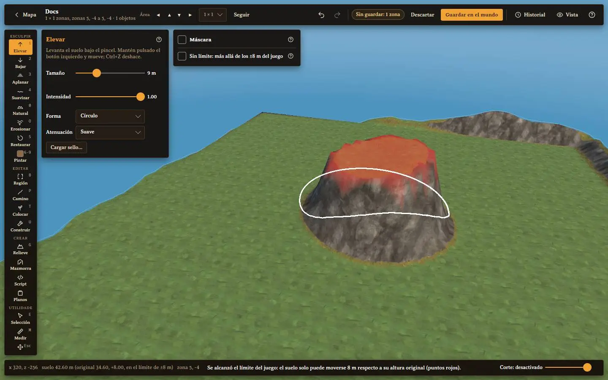
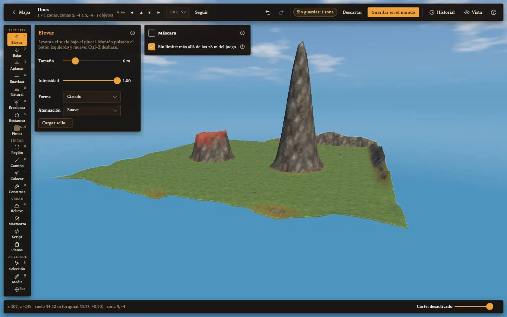

<!-- source: 9d7cf01c -->
# Esculpir y pintar

Eleva, baja, nivela, suaviza y pinta el suelo con un pincel que mantienes pulsado y arrastras, como con la azada, el
pico y el cultivador del juego, solo que más rápido y a lo grande.

**Dónde:** barra de herramientas, sección **ESCULPIR** · **Teclas:** `1` a `9`, `0`, `O` · **Funciona en:** mundos
guardados, en vivo

*Un montículo hecho con tres trazos de Elevar. El anillo blanco de su cima es el pincel; el panel de la izquierda
contiene sus ajustes.*

Cada cambio sigue las propias reglas del juego, así que el mundo carga en el juego de cada jugador, incluidos los de
consola, sin ningún mod. Cada trazo es un paso de deshacer (`Ctrl+Z`).

## Úsala

1. En la barra de herramientas, haz clic en un pincel de **ESCULPIR**, o pulsa su tecla (consulta [Atajos](#atajos)).
   Para pintar, haz clic en **Pintar** y elige la pintura en su panel (consulta [Pincel Pintar](#pincel-pintar)).
2. En el panel, ajusta **Tamaño** e **Intensidad**. `[` y `]` cambian el tamaño mientras trabajas.
3. Mantén pulsado el botón izquierdo del ratón sobre el suelo y muévelo. El pincel sigue trabajando mientras el botón
   está pulsado, así que quedarte quieto trabaja el mismo sitio cada vez más.
4. Suelta. Todo el trazo es un paso de deshacer, con el nombre del pincel («Elevar»).
5. Para conservar el cambio, **Guardar en el mundo** (o **Aplicar en vivo** en [modo en vivo](live-mode.md)). Hasta
   entonces queda [pendiente](concepts/saving-and-history.md#cambios-pendientes).

El anillo del suelo sigue las colinas que tiene debajo y muestra la forma del pincel: un cuadrado o un sello muestra
su contorno girado, la forma Anillo un segundo contorno interior.

## Ajustes

El panel muestra los ajustes que comparten todos los pinceles y luego los propios del pincel elegido. Forma y
Atenuación se recuerdan.

| Ajuste | Qué hace |
|---|---|
| **Tamaño** | El radio del pincel, de 1 a 30 m (para un cuadrado, la mitad de su lado). 6 m por defecto. |
| **Intensidad** | Lo rápido que trabaja el pincel, de 0.05 a 1 (0.40 por defecto). |
| **Forma** | **Círculo**, **Cuadrado**, **Anillo**, **Irregular (ruido)** o una imagen (**Sello: …**, ver [Sellos](#sellos)). |
| **Atenuación** | Cómo se desvanece el efecto del centro al borde (abajo). Oculto para los sellos: una imagen tiene su propio desvanecido. |
| **Girar** | Solo **Cuadrado** y sellos: gira el pincel, de -180° a 180°. |
| **Cargar sello…** / **Olvidar sello** | Añade una imagen como forma de pincel, o quita una que añadiste (consulta [Sellos](#sellos)). |
| Ajustes de Aplanar, Natural y Erosionar | Solo se muestran para ese pincel (consulta [Pinceles de esculpir](#pinceles-de-esculpir)). |

Dos ajustes valen para todas las herramientas de suelo, no solo para los pinceles, así que están en la tarjeta
**Máscara** junto al panel: la propia [Máscara](masks.md), y **Sin límite: más allá de los ±8 m del juego** debajo
(consulta [Sin límite](#sin-límite)).

### Formas

| Forma | Qué abarca |
|---|---|
| **Círculo** | Un pincel redondo. |
| **Cuadrado** | Un cuadrado tan ancho como el pincel. Gira con **Girar**. |
| **Anillo** | Solo una franja: nada dentro del 40 % del tamaño, intensidad completa al 70 %, nada en el borde. Para bordes de cráter, fosos y muros de tierra. |
| **Irregular (ruido)** | Un pincel redondo cuyo borde entra y sale hasta un tercio del tamaño. El patrón está fijado al mundo, así que dos trazos sobre el mismo sitio tienen el mismo borde. |

*Un toque de pintura Pavimento por forma, cada uno etiquetado: Círculo, Cuadrado, Anillo, Irregular (ruido) y el sello
Borde de cráter. La lista Forma está abierta en el panel.*

### Atenuaciones

| Atenuación | Cómo se desvanece | Útil para |
|---|---|---|
| **Suave** (por defecto) | Una curva en S: suave en el centro y en el borde. | La mayoría de trabajos. |
| **Lineal** | De forma uniforme del centro al borde. | Conos, pendientes regulares. |
| **Cúpula** | Se mantiene fuerte hasta lejos y luego cae rápido cerca del borde. | Colinas redondas con pies empinados. |
| **Cima plana** | Intensidad completa en el 80 % interior, solo se desvanece en la quinta parte exterior. | Plataformas, terrazas, colinas de cima plana. |
| **Punta** | Fuerte solo cerca del centro. | Agujas y pozos. |
| **Borde afilado (pico)** | Intensidad completa hasta el mismo borde, nada más allá. | Paredes empinadas y cortes rectos. |

*El mismo trazo de Elevar con cada atenuación, etiquetado: Suave, Lineal, Cúpula, Cima plana, Punta, Borde afilado
(pico). Los colores de pendiente están activados: cuanto más empinada la ladera, más roja.*

## Pinceles de esculpir

| Pincel (etiqueta en la barra) | Tecla | Qué hace |
|---|---|---|
| **Elevar** | `1` | Levanta el suelo mientras mantienes pulsado el botón. |
| **Bajar** | `2` | Excava el suelo. |
| **Aplanar** | `3` | Nivela el suelo a una misma altura: el suelo más bajo se eleva y el más alto se corta. |
| **Suavizar** | `4` | Suaviza desniveles y bordes afilados. Vuelve a pasar por un sitio para suavizar más. |
| **Natural** | `0` | Convierte el suelo plano hecho con herramientas en desniveles de aspecto natural. |
| **Erosionar** | `O` | Desgasta el suelo: las pendientes empinadas se deslizan hacia abajo, o la lluvia abre cárcavas. |
| **Restaurar** | `5` | Devuelve el suelo a como lo generó el mundo, y quita la pintura. |

*Etiquetados desde la izquierda: un pozo excavado con Bajar; un montículo irregular cuya mitad derecha igualó
Suavizar; un montículo elevado cuya mitad derecha devolvió Restaurar al suelo generado, con el anillo del pincel
encima.*

Aplanar, Suavizar, Natural y Restaurar nunca se pasan: en cada momento mueven el suelo una parte del camino hacia su
objetivo, así que mantener pulsado más tiempo solo lo acerca más.

Las herramientas [Región](area.md) y [Camino](path.md) tienen las mismas acciones con los mismos nombres, aplicadas de
una vez a una selección o a lo largo de una línea en lugar de bajo un pincel que mantienes pulsado. (Región lista
Restaurar como **Volver al suelo generado**, en su grupo **Recuperar**.) Cambian el suelo de la misma forma: un solo
**Suavizar** ahí acerca cada punto a la media del suelo en 3 m a la redonda, más o menos lo que hace mantener el
pincel Suavizar sobre un sitio durante uno o dos segundos con la intensidad por defecto.

### Aplanar

*Un trazo de Aplanar empezado en la cima del montículo la ha nivelado. **Nivelar a la altura donde empieza el trazo**
está activado, así que **Altura (m)** aparece en gris y muestra la altura que tomó: 43.4 m.*

| Ajuste | Qué hace |
|---|---|
| **Nivelar a la altura donde empieza el trazo** | Activado (por defecto): el suelo donde pulsas el botón fija la altura para todo el trazo. **Altura (m)** la muestra. |
| **Altura (m)** | Se usa cuando la opción de arriba está desactivada: cada trazo nivela a esta altura. |

Para nivelar a una altura que elijas, haz `Alt`+clic en el suelo con cualquier pincel: el editor cambia a
**Aplanar**, desactiva la opción de arriba y pone esa altura en **Altura (m)**. Úsalo para que varias plataformas
coincidan, o para nivelar un solar a la altura de una puerta que ya construiste.

### Natural

| Ajuste | Qué hace |
|---|---|
| **Amplitud** | La altura de los desniveles, de 0.2 a 4 m (1.2 m por defecto). |
| **Anchura** | Su anchura, de 4 a 60 m (16 m por defecto): los valores pequeños dan suelo abrupto, los grandes ondulaciones suaves. |
| **Nuevo patrón** | Un nuevo patrón aleatorio de desniveles para el siguiente Natural (de este pincel, de la herramienta Región o de la herramienta Camino) y para los caminos con Aspecto natural. El borde de la forma **Irregular (ruido)** y el ruido de las fórmulas de [Relieve](landform.md#escribir-una-fórmula) salen del mismo patrón, así que también cambian. |

Un segundo trazo sobre el mismo sitio no acumula más desniveles. El patrón está fijado al mundo, así que los trazos
vecinos se unen sin costuras. **Natural** y **Aspecto natural (bordes irregulares, desniveles)** de la herramienta
[Camino](path.md) y **Natural** de la herramienta [Región](area.md) usan los mismos ajustes y el mismo patrón, y los
muestran en sus propios paneles: un valor ajustado en uno se ajusta en los tres.

*Suelo nivelado con los colores de pendiente activados. La mitad izquierda se naturalizó (Amplitud 3 m, Anchura
12 m): sus desniveles se ven como manchas amarillas. La mitad derecha sigue plana y de un verde
uniforme.*

### Erosionar

| Ajuste | Qué hace |
|---|---|
| **Térmica** | El suelo más empinado que el **Ángulo de reposo** se desliza hacia sus vecinos más bajos hasta que reposa: pedreras al pie de acantilados, paredes hechas con herramientas suavizadas. El suelo solo se mueve, nunca se pierde. |
| **Agua** | Lluvia: las gotas caen bajo el pincel, corren cuesta abajo, recogen suelo donde corren rápido y lo dejan donde frenan. Muchas gotas forman cárcavas, conos de material al pie de las pendientes y fondos de valle más suaves. **Intensidad** fija cuántas gotas caen. |
| **Ángulo de reposo** | Solo **Térmica**: la pendiente más empinada que se queda quieta, de 10° a 60° (33° por defecto). Los valores más bajos aplanan más. |

El material que se desliza o que el agua arrastra fuera del pincel puede caer justo fuera de él. **Erosionar** de las
herramientas [Región](area.md) y [Camino](path.md) hace ambos tipos a la vez, sobre toda una selección o a lo largo de
una línea, con este **Ángulo de reposo** (sus paneles también lo muestran).

*El mismo montículo desde la misma cámara. Izquierda: tal como se levantó. Derecha: después de dos segundos de
Erosionar (Agua): la lluvia ha desgastado su cima y ha surcado sus laderas con pequeñas cárcavas.*

### Restaurar

**Restaurar** quita tus ediciones un poco en cada momento, hasta que el suelo queda como lo generó el mundo. También
deshace el suelo elevado o excavado con [Sin límite](#sin-límite), guardado o no: el siguiente guardado quita los discos
de suelo que ya no necesita. Solo quita la pintura en la parte interior del pincel, para que el borde de la pintura
quede limpio.

## Pincel Pintar

**Pintar**, el último botón de la sección **ESCULPIR** de la barra, es un solo pincel para las cuatro pinturas. Su
panel las muestra como cuatro muestras: haz clic en una para pintar con ella. La muestra elegida aparece resaltada, y
el botón de la barra toma su color.

| Pintura | Tecla | Qué hace |
|---|---|---|
| **Tierra** | `6` | Tierra desnuda, como un sendero pisado. |
| **Cultivar** | `7` | Tierra cultivada, como la que hace el cultivador. En el juego, los cultivos solo se pueden plantar en ella. |
| **Pavimento** | `8` | Suelo de piedra pavimentada. |
| **Quitar pintura** | `9` | Pinta el suelo normal del bioma. |

Cada tecla elige el pincel Pintar con esa pintura, desde cualquier herramienta. El botón de la barra vuelve con la
pintura que usaste la última vez (Tierra al principio).

Pintar usa los mismos Tamaño, Intensidad, Forma, Atenuación y Máscara que los pinceles de esculpir. Cambia el aspecto
del suelo y lo que crece en él, nunca su altura. Un trazo ligero o el borde suave del pincel dan una mezcla; mantén
pulsado más tiempo para obtener el color completo.

**¿Quitar pintura o Restaurar?** **Quitar pintura** pinta suelo normal del bioma encima de todo, así que también
oculta la tierra que generó el mundo ahí. **Restaurar** quita tu pintura, así que el suelo vuelve a mostrar lo que
generó el mundo.

*Izquierda: franjas de pavimento, cultivado y tierra. Derecha: las mismas franjas después de un trazo de Quitar
pintura que cruza las tres (el panel Pintar a la izquierda).*

## Sellos

Un sello es una imagen que se usa como forma del pincel: las partes blancas trabajan del todo, las grises en parte y
las negras nada. Elige uno en **Forma**, donde los sellos aparecen como **Sello: …**. Un sello abarca un cuadrado el
doble de ancho que **Tamaño** y gira con **Girar**. Funciona con todos los pinceles de esculpir y con Pintar.

| Sello | Forma |
|---|---|
| **Colina abrupta** | Un pequeño pico de laderas abruptas. |
| **Mesa (cima plana)** | Una cima plana con laderas empinadas y algo irregulares. |
| **Borde de cráter** | Un muro en anillo, para cráteres (baja el interior después) y viejos terraplenes. |
| **Dunas** | Crestas paralelas dentro de una zona redonda. |
| **Suelo rocoso** | Suelo abultado y quebrado. |

| Ajuste | Qué hace |
|---|---|
| **Cargar sello…** | Usa cualquier imagen (PNG, JPEG…) como sello: un mapa de alturas de otra herramienta, un logotipo, una forma dibujada a mano. Su brillo es la intensidad; las partes transparentes cuentan como negro. Se escala a un cuadrado de 128 × 128 puntos, así que una imagen ancha se comprime y se pierde el detalle fino. Se conserva para la próxima vez con su nombre de archivo. |
| **Olvidar sello** | Quita la imagen cargada elegida en **Forma**. Solo se muestra para imágenes cargadas: los sellos incorporados se quedan. |

**Para hundir una imagen entera en el suelo con un solo clic**, a una altura que fijes, usa el tipo **Imagen** de la
herramienta [Relieve](landform.md#imagen) en lugar de un pincel: ofrece las mismas imágenes, y las que cargues aquí.

## Sin límite

El juego mantiene cada cambio del suelo a menos de 8 m del suelo que generó. Un pincel se detiene ahí, tiñe el punto
de rojo y la barra de estado dice «Se alcanzó el límite del juego: el suelo solo puede moverse 8 m respecto a su
altura original (puntos rojos).» Consulta [El límite de 8 m del juego](concepts/ground-limits.md#el-límite-de-8-m-del-juego).

*Elevar mantenido hasta que el suelo se detuvo 8 m más arriba. Con **Marcas de límite** activado, su cima se tiñe de
rojo; la barra de estado muestra el mensaje y la lectura del cursor termina en «en el límite de ±8 m».*

**Sin límite: más allá de los ±8 m del juego**, en la tarjeta **Máscara** junto al panel de la herramienta (bajo la
Máscara), deja que las herramientas de suelo lleguen hasta 400 m del suelo generado: acantilados, cañones, agujas,
pozos profundos. Es un solo interruptor para todas las herramientas a las que afecta, y la tarjeta lo muestra con cada
una de ellas: todos los pinceles de esculpir, [Relieve](landform.md) (sus tipos **Fórmula** e **Imagen**),
[Camino](path.md) y [Región](area.md) (también sus importaciones de mapas de alturas). Sigue activado para todas las
herramientas hasta que lo desactives, y está desactivado cada vez que arranca el editor. El tipo **Montaña** de
Relieve y pegar un lugar copiado siempre van más allá del límite.

> [!IMPORTANT]
> Guardar suelo de Sin límite vuelve a leer el área desde el mundo y **borra su Historial**: no puedes deshacer más
> allá de ese guardado. Comprueba la forma antes de guardar.

*El mismo trazo de Elevar con Sin límite desactivado (izquierda: detenido en 8 m, con la cima roja) y activado
(derecha: mucho más alto). El interruptor está en la tarjeta Máscara, marcado como para el de la derecha.*

Al guardar, el suelo más allá de ±8 m se convierte en discos de suelo invisibles que el juego de cada jugador construye
de la misma forma. El mensaje de guardado dice cuántos discos se crearon y cuántos árboles y rocas se quitaron, por
ejemplo «Suelo sin límite: 312 disco(s) de suelo, 40 árbol(es)/roca(s) retirado(s); parte del suelo se desvía hasta
2.5 m (demasiado empinado)». Cómo funciona y qué cambia en el juego: [Sin límite](concepts/ground-limits.md#sin-límite).

Después de guardar:

- Los árboles, rocas, minerales, arbustos y recolectables donde el suelo se movió más de 2 m han desaparecido
  (quedarían enterrados o flotando). Las piezas de construcción se quedan.
- El suelo nuevo cuenta como generado: la azada y el pico del juego trabajan a ±8 m de él. Para quitar una forma
  guardada, usa **Restaurar** (vuelve al suelo que generó el mundo), o vuelve a rebajarla con Sin límite activado.
- Las paredes muy empinadas quedan algo más suaves que como se dibujaron.
- Las zonas que ningún jugador ha visitado todavía conservan su suelo antiguo; el mensaje dice cuántas. Visítalas antes
  en el juego.
- El mapa del juego no muestra la nueva forma.

## Atajos

| Tecla o ratón | Qué hace |
|---|---|
| `1` `2` `3` `4` `0` `O` `5` | Elevar, Bajar, Aplanar, Suavizar, Natural, Erosionar, Restaurar. |
| `6` `7` `8` `9` | El pincel Pintar con Tierra, Cultivar, Pavimento, Quitar pintura. |
| `[` / `]` | Tamaño del pincel 1 m menor / mayor. |
| Mantener pulsado el botón izquierdo y arrastrar | Trabajar el suelo. |
| `Alt`+clic | Tomar la altura de ahí: cambia a Aplanar a esa altura. |
| `Alt`+`Shift`+clic | Activar la [Máscara](masks.md) de 2 m por debajo a 2 m por encima de ese punto (también con la herramienta Camino). |
| Arrastrar con el botón central | Desplazar la vista (también con un pincel elegido). |
| `Ctrl+Z` | Deshacer el último trazo. |
| `Esc` | Dejar el pincel (vuelta a Vista). |

Todas las teclas del editor: [Atajos](help/shortcuts.md).

## Consejos y límites

- **Lee el suelo bajo el cursor** en la barra de estado: `suelo 41.20 m (original 35.00, +6.20)`. Añade «en el límite
  de ±8 m» cuando el punto está ahí. El mar está a 30 m.
- **La línea de puntos más exterior del área nunca cambia**, para que el área se una al terreno de alrededor. Para
  trabajar ahí, mueve o amplía el área: ver [El borde bloqueado](concepts/areas-and-zones.md#el-borde-bloqueado).
- **El suelo tiene una altura por metro.** Una pared siempre ocupa alrededor de un metro y el suelo no puede formar
  voladizos (un mod como Tunnelheim excava túneles de verdad: ver
  [Editar un mundo creado con Expand World, Riverheim o Tunnelheim](guides/use-mods-worlds.md)). Un borde dibujado de
  noreste a suroeste muestra un pequeño diente de sierra, también en el juego.
- **Las aldeas, el comerciante y las entradas de mazmorra nivelan el suelo a su alrededor.** Tus ediciones quedan
  encima de eso; activa **Aplanado de ubicaciones** en el panel Vista para ver dónde. Consulta
  [Las ubicaciones nivelan el suelo](concepts/ground-limits.md#las-ubicaciones-nivelan-el-suelo).
- **Velocidad:** Elevar y Bajar mueven el centro del pincel unos 2.4 m por segundo con la Intensidad por defecto, 6 m
  por segundo con Intensidad 1.
- **¿No ha cambiado nada?** Puede que la [Máscara](masks.md) deje fuera todo el suelo bajo el pincel; la barra de
  estado lo dice.
- **Para deshacer un cambio:** `Ctrl+Z` para el último trazo, **Restaurar** para un sitio, **Descartar** para todo lo
  no guardado. Consulta [Deshacer cambios](guides/undo-changes.md).

## Relacionado

- [Elevar o excavar más allá del límite de 8 m del juego](guides/raise-past-the-limit.md)
- [Despejar árboles y rocas y nivelar un solar](guides/clear-an-area.md)
- [Límites del suelo](concepts/ground-limits.md)
- [Máscara](masks.md), [Relieve](landform.md)
- [Cómo se guarda el suelo](concepts/ground-limits.md#cómo-se-guarda-el-suelo), [lo rápido que trabaja un pincel](concepts/ground-limits.md#a-qué-velocidad-trabaja-un-pincel)
