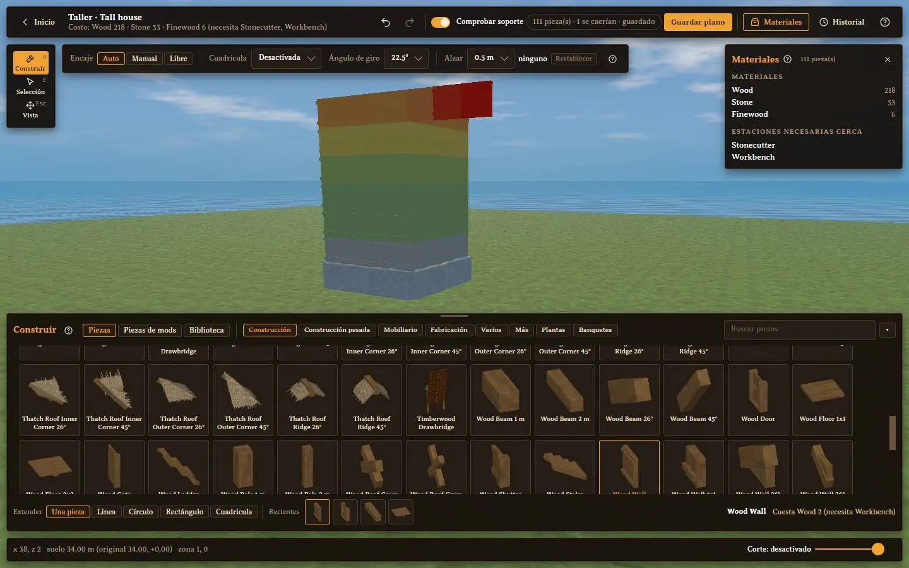
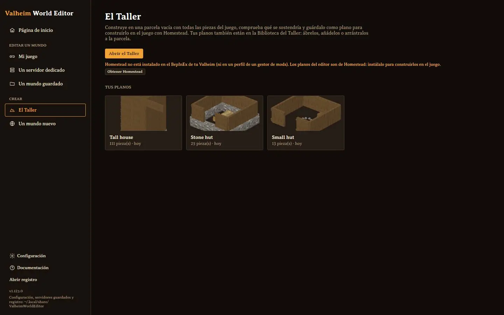
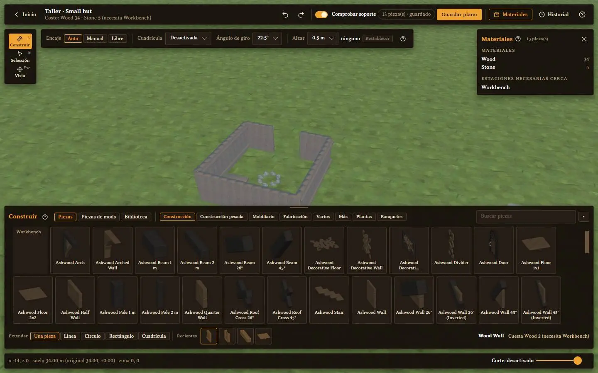
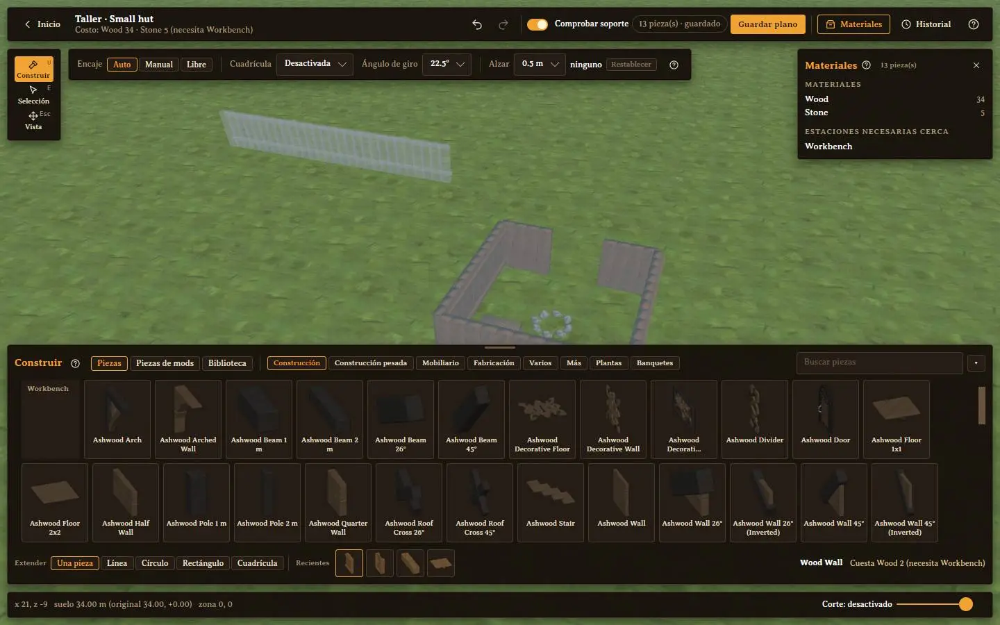
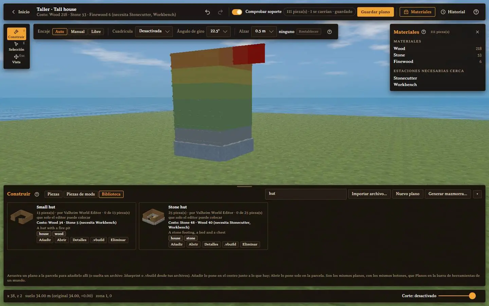
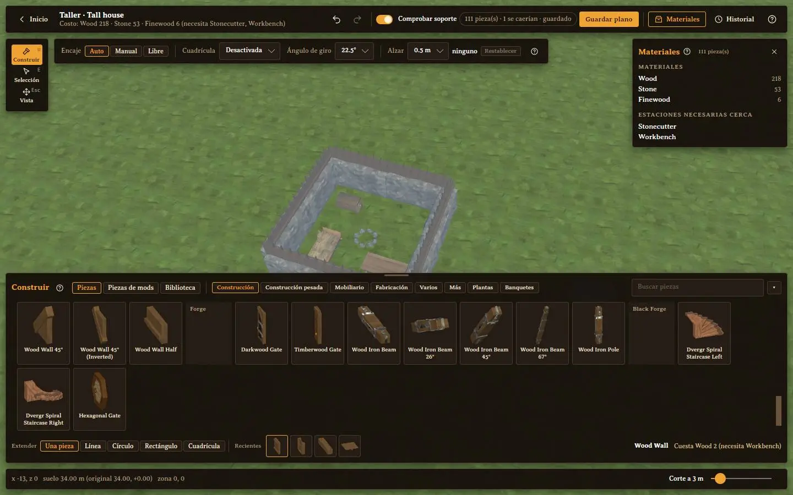
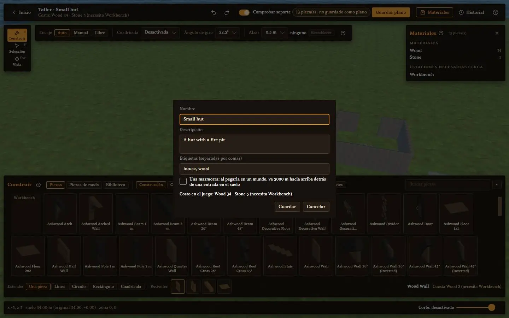
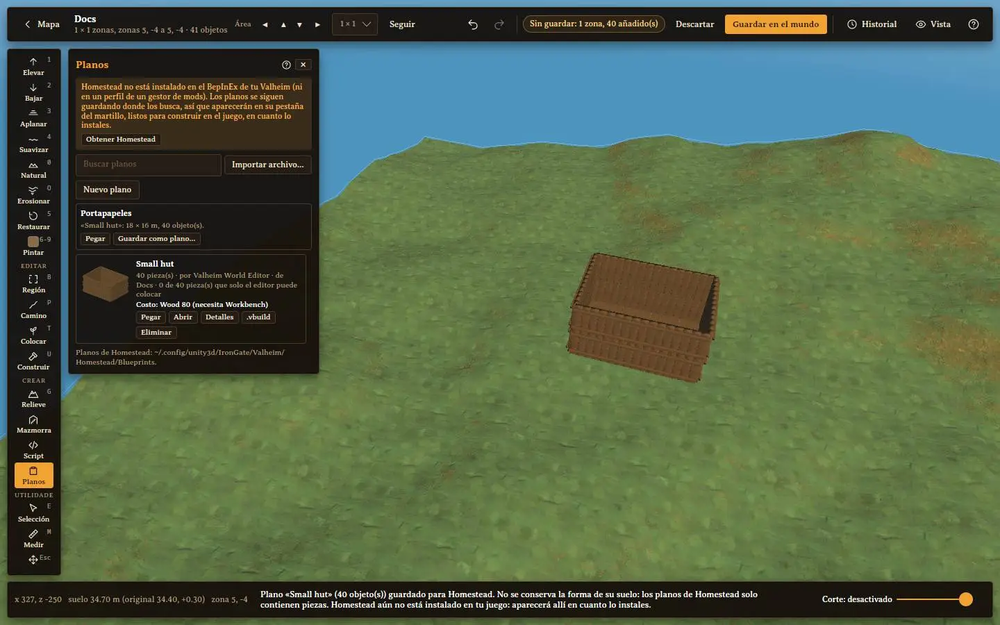

<!-- source: 820eb141 -->
# Taller

Construye en una parcela vacía con todas las piezas que tiene el juego, mira qué se sostendría y cuánto cuesta, y
consérvalo como plano para construirlo en el juego o pegarlo en cualquier mundo.

**Dónde:** página de inicio, **El Taller** → **Abrir el Taller**; en un mundo, **Planos** (barra de herramientas,
sección **CREAR**) → **Nuevo plano** · **Tecla:** ninguna · **Funciona en:** la parcela propia del Taller (el panel
**Planos** funciona en mundos guardados y en vivo)

*Una casa alta con **Comprobar soporte** activado: la base de piedra en azul claro, las paredes de madera de encima en
verde, luego en amarillo y en naranja cerca de lo alto, y el voladizo que sale de la fila superior en naranja y luego
en rojo. La barra superior indica `111 pieza(s) · 1 se caerían · guardado`.*

Un plano es un archivo de [Homestead](https://thunderstore.io/c/valheim/p/sighsorry/Homestead/), el mod de
construcción del juego: el mismo archivo aparece en la pestaña de Homestead del martillo, listo para construirlo en el
juego, y se puede pegar en un mundo desde el editor.

## Úsalo

Para construir una cabaña y conservarla:

1. En la página de inicio, haz clic en **El Taller** y luego en **Abrir el Taller**. (Desde un mundo: **Planos** en la
   barra de herramientas y luego **Nuevo plano**; un mundo con cambios sin guardar pregunta antes).
2. En el panel **Construir** de la parte inferior, elige una pieza en la pestaña **Piezas**.
3. Haz clic en la parcela para colocarla. Se encaja con las piezas que ya hay, como con el martillo.
4. Gira la pieza con `,` y `.`; súbela con `PgUp` y `PgDn` (o `Ctrl` + rueda); mantén `Alt` para colocarla libremente
   de cuarto en cuarto de metro. Para mover o eliminar piezas, pulsa `E` (Selección).
5. Fíjate en los colores de **Comprobar soporte** y en el recuento de piezas que «se caerían» en la barra superior, y
   en lo que cuesta en el panel **Materiales** de la derecha.
6. Haz clic en **Guardar plano** (`Ctrl+S`) y dale un nombre, una descripción y etiquetas.
7. Haz clic en **Inicio** para volver a la página de inicio.

Para cambiar un plano guardado, haz clic en él en **Tus planos** en la página de inicio (o en **Página de inicio**), o
haz clic en **Abrir** a su lado en la biblioteca (el panel Planos de un mundo, o la pestaña **Biblioteca** del Taller).

*En la página de inicio, **El Taller**: **Abrir el Taller**, **Obtener Homestead** (aquí no está instalado) y tres
planos en **Tus planos**, cada uno con su imagen, los más recientes primero.*

## La parcela

La parcela no forma parte de ningún mundo: 3 × 3 zonas (192 m de lado) de pradera plana a una sola altura. Su centro,
a ras de suelo, es el **ancla** del plano, el punto desde el que Homestead mide cada pieza.

- La barra de herramientas solo tiene [Construir](build.md) (`U` o `T`), **Selección** (`E`) y **Vista**. Las
  herramientas de suelo son para los mundos.
- Junto a la barra de herramientas, la **barra de construcción**: **Encaje**, **Cuadrícula**, **Ángulo de giro** y
  **Alzar** (consulta [La barra de construcción](#la-barra-de-construcción)).
- En la parte inferior, el **panel Construir**: las piezas, las piezas de tus mods y tus planos (consulta
  [El panel Construir](#el-panel-construir)).
- A la derecha, el panel **Materiales**: lo que cuesta la construcción (consulta [Materiales](#materiales)).
- No hay Máscara, ni panel Vista, ni bordes de zona, y las construcciones se dibujan opacas.
- La barra superior tiene **Inicio**, deshacer y rehacer, el interruptor **Comprobar soporte**, **Guardar plano**,
  **Materiales** e **Historial**. Cuenta las piezas, dice cuántas se caerían y si la construcción está guardada
  (`12 pieza(s) · 2 se caerían · no guardado como plano`).
- Bajo el título: lo que cuesta la construcción en el juego, en resumen; una línea larga termina en «…».
- La barra de estado tiene el control deslizante **Corte**, como en un mundo (consulta [Corte](#corte)).

No hay **Descartar**: deshaz, o vuelve a abrir el plano. Salir con una construcción no guardada como plano
(**Inicio**, abrir otro, cerrar el editor) pregunta antes.

*El Taller con una pequeña cabaña en la parcela: la barra de herramientas con solo **Construir**, **Selección** y
**Vista**, y la barra de construcción a su lado; la barra superior con **Inicio**, **Comprobar soporte**, el recuento
de piezas, **Guardar plano** y **Materiales**; el panel **Materiales** a la derecha; el panel Construir en la parte
inferior en la pestaña **Construcción**, con las cuatro últimas piezas elegidas en **Recientes** y la pared de madera
seleccionada.*

## Ajustes

### El panel Construir

El panel **Construir** (el de la herramienta [Construir](build.md), igual que en un mundo) ocupa la parte inferior de
la ventana, para que la parcela tenga el resto. Su fila superior contiene tres pestañas,
**Piezas**, **Piezas de mods** y **Biblioteca**, y luego las opciones propias de la pestaña y su búsqueda. Arrastra su
borde superior hacia arriba o hacia abajo para hacerlo más alto o más bajo, y haz clic en **▾** en su extremo derecho
para plegarlo hasta esa fila (**▴** lo vuelve a abrir). Ambas cosas se conservan para la próxima vez.

**Piezas** enumera todo lo que construyen los jugadores, cada pieza con una imagen del modelo del juego:

| Pestaña | Qué contiene |
|---|---|
| **Construcción**, **Construcción pesada**, **Mobiliario**, **Fabricación**, **Varios**, **Más** | Las propias pestañas del martillo, en el orden del juego. |
| **Plantas** | Las piezas del cultivador: cultivos, retoños y flores. |
| **Banquetes** | Las piezas de la bandeja. |

En cada pestaña, las piezas se agrupan por la estación de fabricación que necesitan, en el orden en que los jugadores
las consiguen (ninguna, banco de trabajo, cortapiedras, forja, mesa de artesano, forja negra, mesa galdr), y luego por
nombre. Cada grupo empieza con el nombre de la estación.

**Piezas de mods** enumera las piezas que añaden tus mods, un mod cada vez: elige el mod en la lista de su lado
izquierdo (con su número de piezas). Los encabezados son los grupos propios del mod (su estación de fabricación, para
una pieza que no la tiene). Las piezas vienen de dos sitios:

- **Los mods instalados en este equipo**, en las carpetas de BepInEx que conoce el editor (la de tu Valheim, las de los
  perfiles de tu gestor de mods, las añadidas en Configuración). El Taller lee sus archivos la primera vez que se
  abre, sin el juego, y de nuevo solo cuando cambian; **Volver a buscar mods** los vuelve a leer ahora. Sus nombres e
  imágenes vienen de los propios archivos de los mods. Una pieza leída así se encaja por sus propios puntos de encaje,
  pero su costo no se conoce (los mods lo fijan al arrancar el juego): indica `Costo desconocido`, y
  [Materiales](#materiales) la incluye en **Sin receta conocida**.
- **Una partida en vivo** que ejecuta los mods con WorldEditorBridge (consulta [Modo en
  vivo](live-mode.md#juegos-con-mods)): da sus nombres y costos reales, que prevalecen sobre lo que dicen los archivos.

Los mods que crean sus piezas en código (Railroads) se enumeran a través de su [complemento](modding.md), que las
nombra.

<!-- picture: workshop-mod-pieces.jpg, the Mod pieces tab with Moonforged Build Pieces and Railroads installed: the two mods down its side, Moonforged's walls with their pictures, two of them snapped together on the plot -->

| Ajuste | Qué hace |
|---|---|
| **Buscar piezas** | Busca piezas en todas las pestañas, también las de los mods, por nombre o prefab (`stone floor`, `woodwall`). Deben coincidir todas las palabras. |
| La casilla de una pieza | La elige. Su nombre y su costo aparecen al pie del panel (`Wood Wall · Cuesta Wood 2 (necesita Workbench)`), con el nombre de su mod para la pieza de un mod. Apunta a una casilla para ver su nombre de prefab. |
| **Recientes** | Las 12 últimas piezas que elegiste, las más recientes primero, al pie del panel: haz clic en una para volver a elegirla. Se conserva para la próxima vez. |

Cada clic coloca una pieza. Sin ninguna pieza elegida, Construir elige la pared de madera. **Extender**, al pie del
panel, coloca la pieza a lo largo de una línea, alrededor de un círculo o de un rectángulo, o en cuadrícula: consulta
[Extender piezas a lo largo de una línea o en cuadrícula](build.md#extender-piezas-a-lo-largo-de-una-línea-o-en-cuadrícula).

**Atajos** mientras **Construir** está activo:

| Ratón | Qué hace |
|---|---|
| Arrastrar | Extiende una fila de la pieza desde donde pulsaste: copias borde con borde, separadas por la longitud de una pieza (el ancho de una pared, el lado de un suelo), a lo largo del lado de la pieza que esté más cerca del arrastre, a la altura de la primera, hasta 64. Una pared solo forma filas a lo largo de su ancho: gírala antes para hacer la fila en el otro sentido. Suelta para colocar la fila, en un paso de deshacer. |
| `Shift` + clic derecho | Quita la pieza que hay bajo el puntero (`Ctrl+Z` la recupera). Arrastrar con el botón derecho sigue girando la vista, y `Shift` + arrastrar con el botón derecho sigue desplazándola. |
| Clic central | Construye con el tipo de la pieza que hay bajo el puntero, como un cuentagotas: se elige en el panel y queda la primera en **Recientes**. Arrastrar con el botón central sigue desplazando la vista. |

*Un arrastre desde la izquierda: una fila de paredes de madera extendidas una tras otra, transparentes hasta soltar el
botón.*

### La barra de construcción

La barra junto a la barra de herramientas contiene cómo se coloca la pieza: **Encaje** (**Auto**, **Manual**,
**Libre**), **Cuadrícula**, **Ángulo de giro** y **Alzar**. Es la misma barra que en un mundo, donde la comparten
Selección y Pegar y además tiene **Construido por**: consulta [La barra de construcción](build.md#la-barra-de-construcción).

### Pestaña Biblioteca

*La pestaña **Biblioteca** buscando «hut»: la búsqueda, **Importar archivo…**, **Nuevo plano** y **Generar mazmorra…**
en la fila superior del panel, y luego las dos cabañas una al lado de la otra (la casa alta queda fuera), cada una con
su imagen, piezas, costo, descripción, etiquetas y sus botones **Añadir**, **Abrir**, **Detalles**, **.vbuild** y
**Eliminar**.*

La Biblioteca es la misma lista que el [panel Planos](#panel-planos) de un mundo: los mismos planos, mostrados de
la misma manera, con los mismos botones. Solo cambia cómo se coloca uno: la parcela lo recibe con **Añadir** (o
arrastrándolo), un mundo con **Pegar**.

| Ajuste | Qué hace |
|---|---|
| **Buscar planos** | Conserva los planos que tienen cada palabra que escribes en su nombre, autor, descripción o etiquetas. |
| **Añadir** | Añade el plano a la parcela, en su centro. Un paso de deshacer. |
| Arrastrar un plano a la parcela | Añade el plano donde lo sueltas. |
| **Abrir** | El plano solo en la parcela, para cambiarlo (pregunta antes si la parcela no está guardada). **Guardar plano** lo vuelve a escribir. |
| **Detalles** | Cambia su nombre, descripción, etiquetas y el interruptor de mazmorra. Un nombre nuevo cambia el nombre del archivo y de la imagen cuando ese nombre está libre. Para el plano de la parcela, el Taller toma el nombre nuevo, y **Guardar plano** escribe ese archivo. |
| **.vbuild** | Escribe sus objetos como un archivo `.vbuild` en la carpeta `export` de la carpeta de planos del editor, y dice dónde. |
| **Eliminar** | Quita su archivo y su imagen, después de preguntar. Homestead también lo pierde. Eliminar el plano de la parcela deja allí la construcción, marcada como *no guardado como plano*. |
| Soltar archivos en la parcela | Los archivos `.blueprint` y `.vbuild` de tu gestor de archivos se importan y luego se añaden donde caen. Soltados en un mundo, solo se importan. |
| **Importar archivo…** | Importa a la biblioteca un archivo `.blueprint` (Homestead, PlanBuild) o `.vbuild`. |
| **Nuevo plano** | Una parcela vacía (pregunta antes si la parcela no está guardada). |
| **Generar mazmorra…** | Muestra el generador de mazmorras (solo piezas de construcción; consulta [Mazmorra](dungeons.md)). **Abrir en la parcela** pone allí la mazmorra sola, **Añadir a la parcela** la añade en el centro; en ambos casos su plano se conserva en la biblioteca, sin una imagen `.png` al lado. **← Biblioteca** vuelve atrás. |

Un plano abierto o añadido conserva su forma exacta, movido como un todo para que su pieza de construcción más baja
quede sobre la parcela. Un plano de Homestead conserva su ancla en el centro de la parcela; los demás archivos se
centran. Al volver a guardarlo se conserva la altura del ancla, para que la construcción quede igual que antes cuando
la construya Homestead. Las piezas de mods que no tienes se dejan fuera, y el mensaje las enumera. Un plano abierto
desde fuera de la carpeta de Homestead pregunta antes de sobrescribir un plano de la biblioteca con el mismo nombre.

Los planos de versiones del editor anteriores a Homestead se enumeran después de los demás, en **Planos de versiones
anteriores del editor**: **A Homestead** conserva uno como plano de Homestead, que luego se puede añadir o abrir.

### Materiales

El panel **Materiales** de la derecha enumera lo que cuesta en el juego la construcción de la parcela, y sigue cada
cambio:

| Parte | Qué enumera |
|---|---|
| **Materiales** | Cada material con su cantidad, de mayor a menor. |
| **Estaciones necesarias cerca** | Las estaciones de fabricación que deben estar cerca para construirla. |
| **Sin receta conocida** | Las piezas de las que el editor no conoce ninguna receta (las de un mod, antes de que una partida en vivo se la diera), por mod. No se cuentan. |
| **Solo el editor puede colocarlos** | Estatuas, decorados, barcos y criaturas: el martillo de Homestead los omite, así que no se cuentan. |

**Materiales** en la barra superior (o la **✕** del panel) lo cierra y lo abre; el Taller recuerda cuál.

### Comprobación de soporte

**Comprobar soporte** (activado de forma predeterminada) tiñe cada pieza de construcción con los colores que da a su
soporte el modo de construcción del juego:

| Color | Significado |
|---|---|
| **Azul claro** | Soporte completo: se apoya en el suelo. |
| **Verde** | Firme. |
| **Amarillo**, **naranja** | Más débil. |
| **Rojo** | A punto de romperse: en el juego se cae en cuanto se acerca un jugador. |

La barra superior dice cuántas piezas se caerían, y **Guardar plano** pregunta antes cuando alguna se caería (también
con el interruptor desactivado: solo oculta los colores). La piedra se mantiene en pie a gran altura pero
no puede extenderse hacia fuera; la madera llega más lejos hacia fuera pero no tan alto. Consulta [La comprobación de
soporte](concepts/objects.md#la-comprobación-de-soporte).

### Corte

*La misma casa con **Corte a 3 m**, vista desde arriba: todo lo que está por encima de 3 m queda oculto, así que ves la
planta baja, con el hogar, la cama, la mesa y el cofre.*

El control deslizante **Corte**, en la barra de estado, oculta todo lo que está por encima de una altura, de 0 a 39 m
sobre la parcela, y el cursor atraviesa lo oculto, para que puedas construir dentro. Su extremo derecho lo desactiva
(`Corte: desactivado`). Es el mismo control deslizante que en un mundo y en una mazmorra, donde sus metros se cuentan
desde el suelo o desde el suelo de la mazmorra: consulta [Corte](editor-basics.md#corte).

## Guardar un plano

**Guardar plano** (`Ctrl+S`) pide:

| Campo | Qué es |
|---|---|
| **Nombre** | Homestead lo muestra con este nombre; el archivo se llama como él. |
| **Descripción** | Unas palabras, que se muestran en la biblioteca y a las personas con las que lo compartes. Los saltos de línea se convierten en espacios. |
| **Etiquetas (separadas por comas)** | Palabras para encontrarlo: `house, viking, stone`. Hasta 12; los duplicados se descartan. |
| **Una mazmorra: al pegarla en un mundo, va 5000 m hacia arriba detrás de una entrada en el suelo** | Lo convierte en un plano de mazmorra: consulta [Mazmorra](dungeons.md). |

El diálogo muestra el **Costo en el juego**. Guardar el plano que abriste lo sobrescribe; otro nombre crea uno nuevo, y
reemplaza uno con ese nombre solo después de preguntar. Se guarda una imagen junto al archivo (un `.png`, la
construcción vista desde arriba en ángulo, sobre fondo transparente), que Homestead usa como icono. Se dibuja con los
modelos del juego cuando el editor puede leerlos; si no, con la forma de cada pieza en el color de su material. Un
plano hecho en otro sitio sin imagen recibe una dibujada en la biblioteca, solo en memoria.

*Guardando la cabaña: **Nombre** «Small hut», **Descripción** «A hut with a fire pit», **Etiquetas** «house, wood»,
**Una mazmorra** desactivado, y la línea **Costo en el juego** encima de **Guardar**.*

Lo que se conserva:

- **Todo lo que está en pie sobre la parcela**, no el suelo de la parcela. La parcela empieza vacía, así que todo es
  tuyo: las piezas que construiste y lo que trajo un plano abierto o añadido (árboles, rocas, criaturas). Debe haber
  al menos una pieza de construcción.
- **Lo que contienen los objetos**: el contenido de un cofre, el texto de un cartel, el objeto de un soporte de
  objetos, las estrellas de una criatura. Selecciona un objeto y pulsa `I` para verlo o cambiarlo: consulta
  [Inspector](select.md).
- **Si es una ruina**: piezas sin constructor, como las que tienen las ruinas y las mazmorras generadas del juego. No
  se escribe constructor para el resto: quien lo construya en el juego pasa a ser su constructor.
- **Piezas solo del editor**: estatuas, decorados, barcos y criaturas. El martillo de Homestead las omite; pegar desde
  el editor las coloca. La biblioteca las cuenta (`2 de 40 pieza(s) que solo el editor puede colocar`), y el costo las
  deja fuera.

## Panel Planos

*El panel **Planos** en un mundo: el aviso de Homestead, **Buscar planos** e **Importar archivo…**, **Nuevo plano**, el
**Copia** con **Pegar** y **Guardar como plano…**, y luego una cabaña guardada con su imagen, piezas, costo y sus
botones **Pegar**, **Abrir**, **Detalles**, **.vbuild** y **Eliminar**.*

En un mundo, **Planos** en la barra de herramientas (o **Planos…** en el panel Región) abre la biblioteca junto a la
barra de herramientas; **✕** vuelve a Vista. Un aviso dice si Homestead está instalado, con su versión, u ofrece
**Obtener Homestead**. Cada plano muestra su imagen, piezas, autor, el mundo del que viene, su costo, descripción y
etiquetas. **Buscar planos** busca en nombre, autor, descripción y etiquetas. Es la misma lista, con los mismos
botones, que la [pestaña Biblioteca](#pestaña-biblioteca) del Taller; un plano sin imagen también recibe aquí una dibujada.

| Botón | Qué hace |
|---|---|
| **Pegar** | Cierra el panel y empieza a pegarlo en el área abierta (consulta [Copiar y pegar](area.md#copiar-y-pegar)). Los tipos que este mundo no puede crear se dejan fuera y se enumeran. Un plano de mazmorra va en cambio hacia arriba, detrás de una entrada. |
| **Abrir** | Lo abre en el Taller, solo en la parcela, para cambiarlo. |
| **Detalles** | Cambia su nombre, descripción, etiquetas y el interruptor de mazmorra. Un nombre nuevo cambia el nombre del archivo y de la imagen cuando ese nombre está libre. |
| **.vbuild** | Escribe sus objetos (no el suelo) como un archivo `.vbuild` (BuildShare y herramientas más antiguas) en la carpeta `export` de la carpeta de planos del editor, y dice dónde. |
| **Eliminar** | Quita su archivo y su imagen, después de preguntar. Homestead también lo pierde. |
| **Importar archivo…** | Importa un archivo `.blueprint` o `.vbuild`. |
| **Nuevo plano** | Abre el Taller en una parcela vacía. |

La fila **Copia**, encima de los planos, muestra lo último que se copió con la herramienta Región o con
`Ctrl+C` en Selección (su tamaño y cuántos objetos), o que aún no se ha copiado nada:

| Botón | Qué hace |
|---|---|
| **Pegar** | Pega el portapapeles, como hace `Ctrl+V`. |
| **Guardar como plano…** | Guarda los objetos del portapapeles como un plano de Homestead, con nombre, descripción y etiquetas, y si es una mazmorra (consulta [Mazmorra](dungeons.md)). El suelo y los constructores no se conservan. Un plano con el mismo nombre se reemplaza, después de preguntar. Lo mismo que **Guardar plano…** en el panel Región. |

Los planos de versiones del editor anteriores a Homestead están en **Planos de versiones anteriores del editor**, con
**Pegar**, **A Homestead** (lo conserva como plano de Homestead, numerado si el nombre ya existe), **.vbuild** y **Eliminar**. Los planos de Homestead no contienen suelo: la
forma del suelo de una copia no se conserva, y el mensaje lo dice.

**Para guardar un plano desde un mundo**, copia algo con la herramienta Región o Selección (`Ctrl+C`), abre **Planos**
en la barra de herramientas y haz clic en **Guardar como plano…** en la fila **Copia**. Consulta
[Pegar un plano en un mundo](guides/paste-a-blueprint.md) para el camino inverso.

## Archivos de planos

Homestead construye en el juego los planos del editor, con un cofre para los materiales. La página de inicio y el panel
Planos buscan `Homestead.dll` en cada carpeta `BepInEx/plugins` que conoce el editor: la de tu Valheim, el perfil del
gestor de mods desde el que se ejecuta el editor, las carpetas añadidas en Configuración, y los perfiles de r2modman y
Thunderstore Mod Manager. Los planos se guardan donde Homestead los busca incluso cuando no está instalado, así que
aparecen en el juego en cuanto lo instalas.

Los planos están en la carpeta de Homestead dentro de la carpeta de guardado de Valheim (la que ya la tiene; si no, la
carpeta de guardado de tus mundos):

- Linux: `~/.config/unity3d/IronGate/Valheim/Homestead/Blueprints`
- Windows: `%USERPROFILE%\AppData\LocalLow\IronGate\Valheim\Homestead\Blueprints`

Para compartir una construcción, comparte su archivo `.blueprint` y el `.png` que lo acompaña.

**Importar** lee archivos `.blueprint` de Homestead y PlanBuild (sus marcas de terreno no se conservan) y archivos
`.vbuild`. El archivo se convierte en un plano de Homestead con su propio nombre, numerado (`House (2)`) si el nombre ya
existe. El mensaje dice cuántas piezas eran desconocidas y cuántas líneas no se pudieron leer.

Un plano de Homestead es un archivo `.blueprint` de PlanBuild con líneas de cabecera (`#Name:`, `#Creator:`,
`#Description:`, `#Category:`, `#HomesteadVersion:`...) y una línea por pieza después de `#Pieces`:
`prefab;Building;x;y;z;qx;qy;qz;qw;"";1;1;1`, su posición en metros desde el ancla, su giro y su escala. El editor
añade sus propias líneas (`#Tags:`, `#EditorData:` para lo que contienen los objetos, `#EditorRuin:1`), que Homestead y
PlanBuild omiten, así que el archivo sigue construyéndose en el juego. Las piezas se escriben de la más baja a la más
alta, al milímetro. El nombre del archivo es el nombre del plano, con los caracteres que Windows o Linux rechazan
convertidos en `_`, hasta 64 caracteres.

El costo sale de las recetas de tu propio Valheim: los materiales de cada pieza por su cantidad, de mayor a menor, con
las estaciones que deben estar cerca (`Wood 120 · Stone 64 · Core wood 20 · … (necesita Stonecutter, Workbench)`). Las
piezas sin receta conocida (de mods) se enumeran aparte; si no se conoce ninguna, indica `Costo desconocido (¿piezas de mods?)`.

## Atajos

| Tecla o ratón | Qué hace |
|---|---|
| `U` o `T` | Construir. Sus teclas (girar, subir, puntos de encaje, filas, líneas) están en la página de [Construir](build.md#atajos). |
| `E` | Selección: mover, girar, eliminar piezas (con **Encaje** en **Manual** en Construir: el siguiente punto de encaje). |
| `Esc` | Vista. |
| `Ctrl+S` | Guardar plano. |
| `Ctrl+Z` | Deshacer. |
| `Ctrl+Y` o `Ctrl+Shift+Z` | Rehacer. |

Todas las teclas del editor están en [Atajos](help/shortcuts.md).

## Consejos y límites

- **Recuperar:** `Ctrl+Z` funciona en la parcela. Un plano guardado se queda en la biblioteca: **Abrir** lo
  recupera.
- Una pestaña muestra como mucho 300 piezas: busca para encontrar las demás.
- **Lo que vuelve.** Pegados desde el editor, los objetos de un plano conservan lo que contenían (contenido de cofres,
  carteles, el jefe). Construido en el juego con Homestead, solo quedan las piezas: los cofres están vacíos y no viene
  ninguna criatura.
- Copiar y pegar son para los mundos: `Ctrl+V` no hace nada en la parcela, así que `Ctrl+X` allí solo quita las piezas
  (`Ctrl+Z` las recupera). Para añadir una construcción, usa **Añadir** o arrastra un plano.
- Un plano hecho con mods que no tienes se abre sin sus piezas; si luego lo guardas, se escribe sin ellas.
- Las criaturas que quedan dentro de una pieza de construcción se ponen de pie encima de la pieza más alta que tienen
  debajo (el mensaje dice cuántas). La barra superior cuenta las que siguen dentro de una pieza.
- La comprobación de soporte deja fuera rocas y árboles (la parcela no tiene) y cuenta las formas de malla por su caja.
- Homestead comprueba las versiones con el servidor: un servidor que lo usa desconecta a los jugadores que no lo
  tienen (los jugadores de consola no pueden tenerlo). Los jugadores solo lo necesitan en su propio juego para
  construir planos.
- Para construir en el terreno abierto de un mundo o dentro de una mazmorra con el mismo panel Construir, consulta
  [Construir](build.md) y [Mazmorra](dungeons.md).
- **Claude** puede construir en la parcela y guardar planos: consulta [Claude](claude.md).

## Relacionado

- [Pegar un plano en un mundo](guides/paste-a-blueprint.md)
- [Tu primera construcción](start/first-build.md)
- [La comprobación de soporte](concepts/objects.md#la-comprobación-de-soporte) · [Encaje](concepts/objects.md#encaje)
- [Construir](build.md) · [Mazmorra](dungeons.md) · [Selección](select.md)
