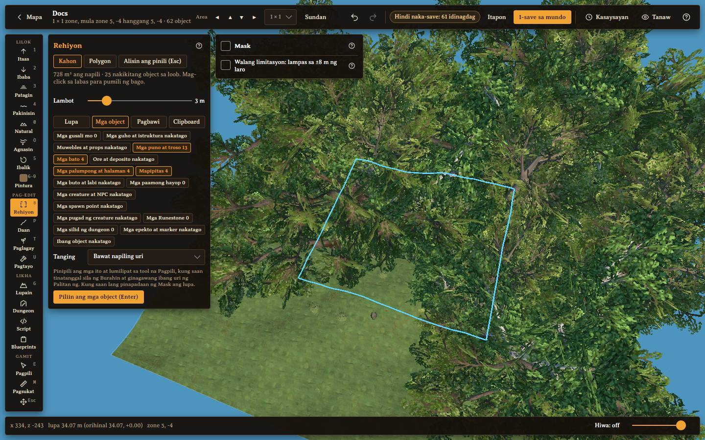
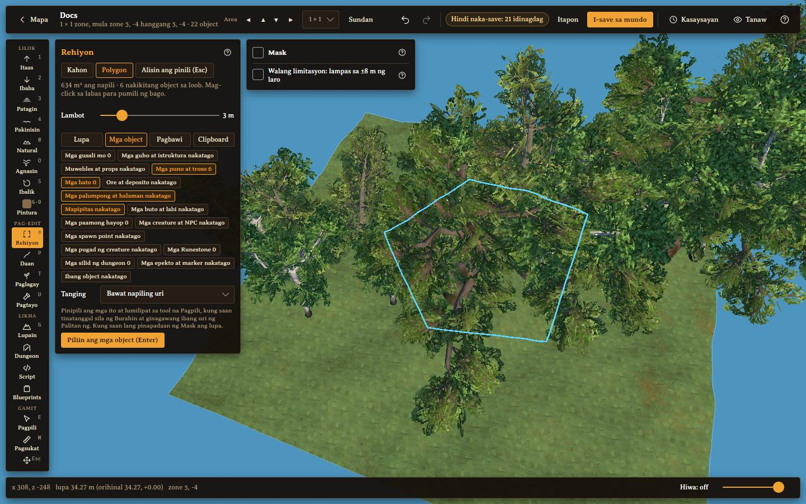
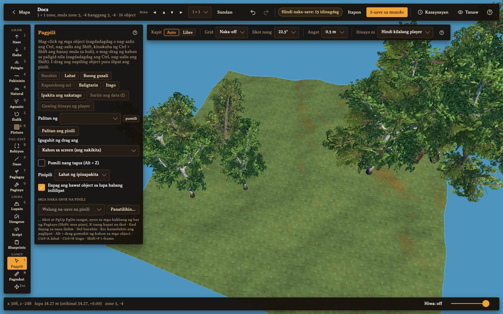
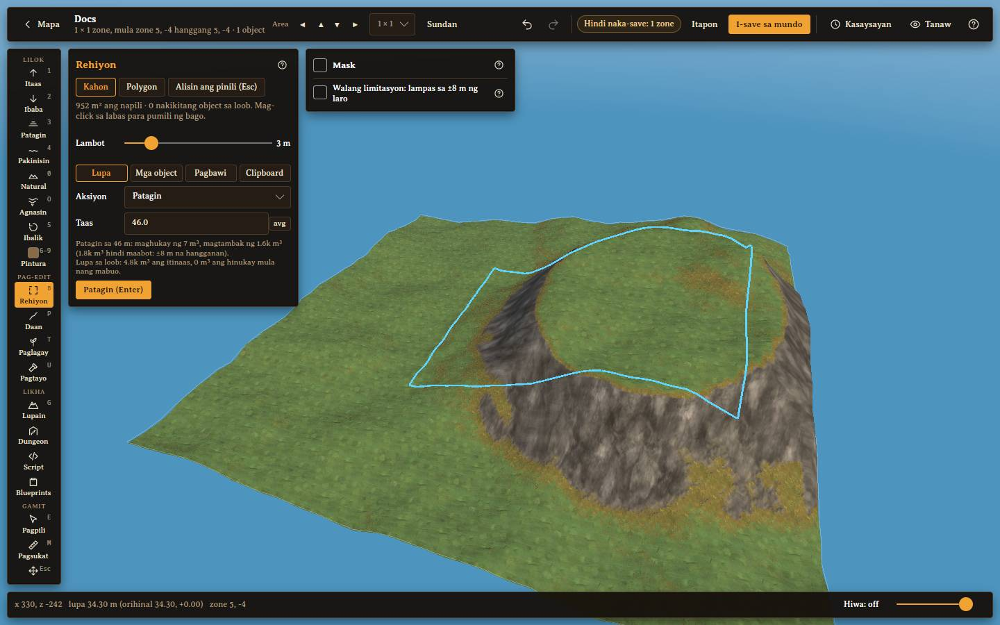
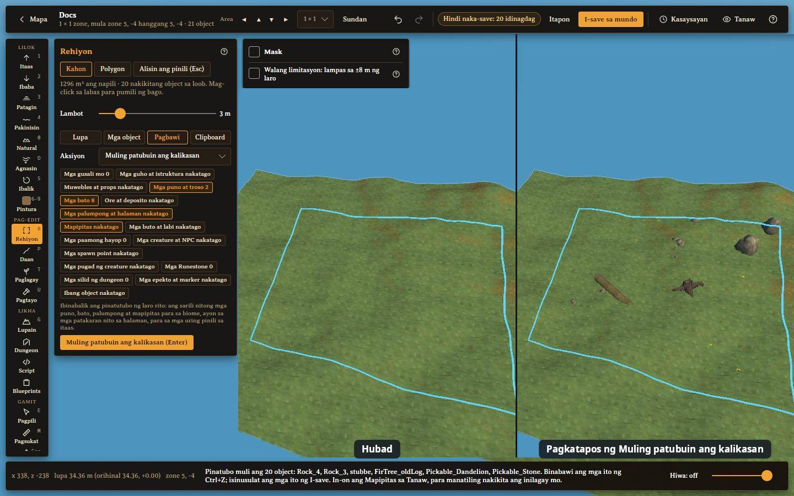
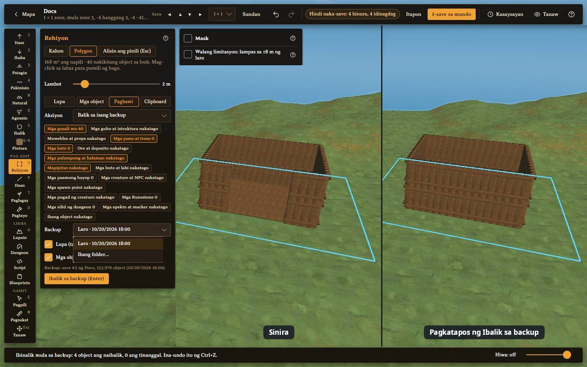
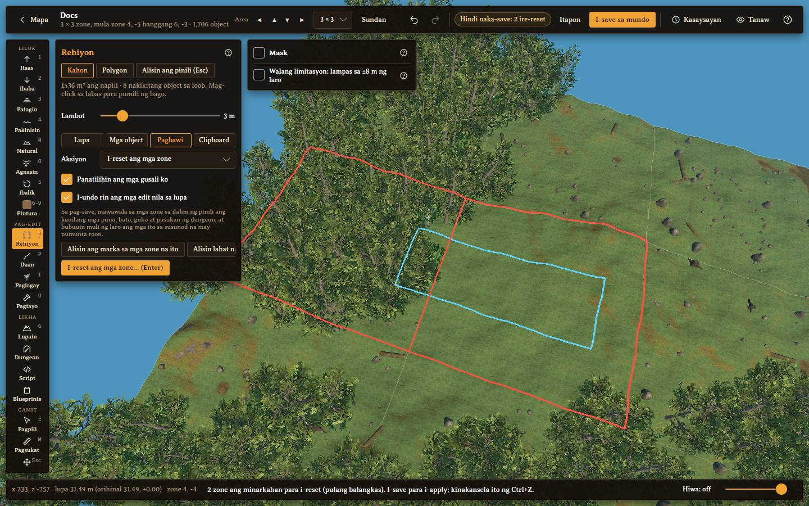
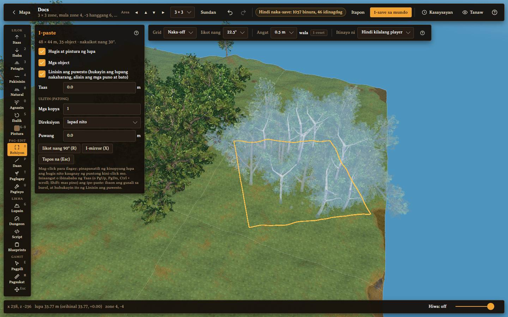
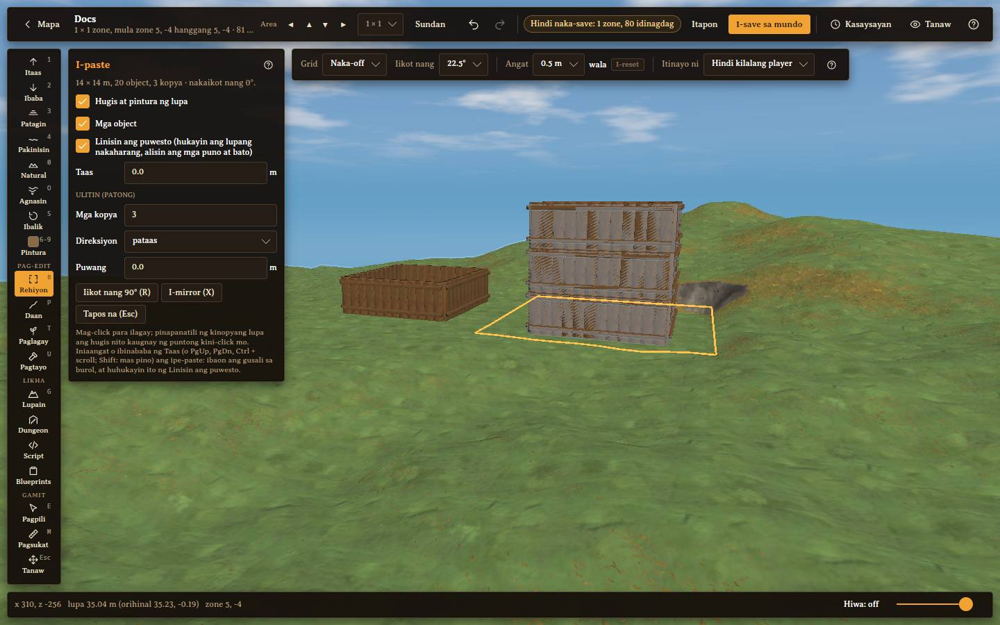
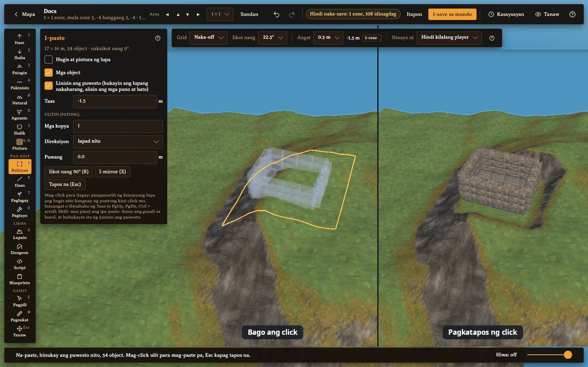

<!-- source: 89a0aafb -->
# Rehiyon, kopyahin at i-paste

Baguhin nang sabay ang lahat ng nasa loob ng kahon o polygon: patagin o pintahan ang lupa nito, piliin ang mga object
nito para burahin o palitan, kopyahin at i-paste ito, o ibalik ito sa dati: ang binuong lupa, isang backup, ang
sariling kalikasan ng laro.

**Saan:** tool rail, seksiyong **PAG-EDIT** · **Key:** `B` · **Gumagana sa:** mga naka-save na mundo, live

*Isang kahong dina-drag sa paligid ng kumpol ng puno na napili ang **Mga object**: binibilang ng mga chip ng uri ang
mga puno, bato, palumpong at mapipitas sa loob. Wala pang nagbabago: pinipili sila ng button sa ibaba.*

## Gamitin ito

1. Sa tool rail, i-click ang **Rehiyon** (`B`).
2. Sa itaas ng panel, piliin ang **Kahon** o **Polygon** at iguhit ang pinili sa lupa.
3. Pumili ng grupo: **Lupa**, **Mga object**, **Pagbawi** o **Clipboard**. Iniaalok ng Lupa at Pagbawi ang mga aksiyon
   nila sa listahang **Aksiyon**. Ipinapakita lang ng panel ang mga setting ng napiling aksiyon at isang linyang
   nagsasabi kung ano ang ginagawa nito.
4. Pindutin ang button sa ibaba, o `Enter`. Pinapangalanan ng label nito ang aksiyon: **Patagin (Enter)**, **Piliin ang
   mga object (Enter)**, **Muling patubuin ang kalikasan (Enter)**…
5. Hindi tama? Binabawi ito ng `Ctrl+Z`: isang hakbang sa Kasaysayan ang bawat aksiyon. Pinapanatili ito ng **I-save sa
   mundo** (o **I-apply nang live**).

| Grupo | Ang laman nito |
|---|---|
| **Lupa** | [Mga aksiyon sa lupa](#mga-aksiyon-sa-lupa): Patagin, Itaas, Ibaba, Pakinisin, Natural, Agnasin, Pintura, at [Heightmap](#heightmap). |
| **Mga object** | [Pumili ng mga object](#mga-aksiyon-sa-object): ang mga object sa loob, ayon sa uri, ibinibigay sa tool na Pagpili para burahin, palitan o ilipat. |
| **Pagbawi** | [Ang dating naroon](#ibalik-ang-dating-naroon), ibinabalik: [Balik sa binuong lupa](#balik-sa-binuong-lupa), [Muling patubuin ang kalikasan](#muling-patubuin-ang-kalikasan), [Balik sa isang backup](#balik-sa-isang-backup), [I-reset ang mga zone](#i-reset-ang-mga-zone). |
| **Clipboard** | [Kopyahin at i-paste](#kopyahin-at-i-paste), at [mga blueprint](#mga-blueprint). |

Natatandaan ang napiling aksiyon, at bumabalik ang bawat grupo sa aksiyong huli nitong pinili. Nililimitahan ng
[Mask](masks.md), sa sarili nitong card sa tabi ng panel, ang mga aksiyon sa lupa, ang Pumili ng mga object, ang Muling
patubuin ang kalikasan at ang Balik sa isang backup sa lupang pinapadaan nito.

## Mga setting

| Setting | Ano ang ginagawa nito |
|---|---|
| **Kahon** | Mag-drag ng parihaba sa lupa. Itinatapon ang kahong mas maliit sa isang metro. Nagsisimula ng bagong kahon ang pag-drag sa ibang lugar. |
| **Polygon** | Mag-click ng mga sulok. Isinasara ng double-click o `Enter` ang hugis (hindi bababa sa tatlong sulok); tinatanggal ng `Backspace` ang huling sulok. Nagsisimula ng bago ang pag-click pagkatapos itong isara. |
| **Alisin ang pinili (Esc)** | Inaalis ang pinili, para magsimula ng bago. |
| **Lambot** | 0 hanggang 20 m (3 m sa simula). Unti-unting lumalakas ang mga aksiyon sa lupa sa loob ng ganitong dami ng metro sa loob ng balangkas, kaya humahalo ang resulta sa lupa sa paligid. Sa **0**, matalim ang gilid at tuwid na sinusundan ang pahilig na balangkas. |
| **Lupa**, **Mga object**, **Pagbawi**, **Clipboard** | Ang grupo ng mga aksiyong ipinapakita (tingnan ang talahanayan sa itaas). |
| **Aksiyon** | Ang mga aksiyon ng grupo, para sa Lupa at Pagbawi. Tig-iisang aksiyon ang Mga object at Clipboard, kaya walang listahan. |

Ibinibigay ng linya sa ilalim ng mga button ang lawak at kung ilang nakikitang object ang nasa loob ("1250 m² ang
napili · 84 nakikitang object sa loob"). Iginuguhit lang ang pinili sa tool na Rehiyon at habang nagpe-paste;
pinapanatili ito kapag gumamit ka ng ibang tool.

*Isang saradong polygon sa paligid ng bahagi ng gubat, napili ang **Mga object**.*

*Pagkatapos ng **Piliin ang mga object (Enter)**, saka `Del` sa tool na Pagpili: wala na ang mga puno sa loob ng
polygon, nakatayo ang mga nasa labas.*

## Mga aksiyon sa lupa

Pinahihina ang bawat punto ng **Lambot** at ng Mask. Ito ang mga aksiyon ng mga [brush](terrain.md) at ng
tool na [Daan](path.md), sa parehong mga pangalan: dito, ina-apply sila sa buong pinili nang minsanan.

| Aksiyon | Ano ang ginagawa nito |
|---|---|
| **Patagin** | Pinapantay ang lupa sa loob sa **Taas** (m). Itinatakda ng **avg** ang Taas sa karaniwang taas ng lupa sa loob. |
| **Itaas** / **Ibaba** | Itinataas / hinuhukay ang lupa sa loob nang **Dami** (m). |
| **Pakinisin** | Pinapantay ang mga umbok: lumilipat ang bawat punto patungo sa karaniwang taas ng lupa sa loob ng 3 m. |
| **Natural** | Pinakikinis ang lupa, saka dinadagdagan ng mga natural na umbok. Lumalabas sa ilalim nito ang **Mga umbok**, **Lawak** at **Bagong pattern**: ang sa brush na [Natural](terrain.md#natural), parehong mga value saanman mo itakda. |
| **Agnasin** | Pinapadaan sa panahon ang lupa nang minsanan: tumatahan ang mga dahilig, umuukit ng mga bangin ang ulan at nag-iiwan ng mga pamaypay, tumatahan ulit ang mga dahilig. Lumalabas sa ilalim nito ang **Anggulo ng tambak**: ang sa brush na [Agnasin](terrain.md#agnasin), parehong value saanman mo itakda. |
| **Pintura** | Pinipintahan ang lupa sa loob ng **Hubad na lupa**, **Binungkal**, **Sementado** o **Alisin pintura** (ang listahan sa ilalim nito). |
| **Heightmap** | Ang lupa bilang grayscale na larawan, palabas at pabalik: tingnan ang [Heightmap](#heightmap). |

Para ibalik ang lupa sa kung paano ito ginawa ng mundo, piliin ang **Pagbawi**, saka ang
[Balik sa binuong lupa](#balik-sa-binuong-lupa).

Nananatili ang mga aksiyon sa lupa sa loob ng ±8 m ng laro maliban kung naka-check ang **Walang limitasyon: lampas sa
±8 m ng laro** sa card na **Mask** sa tabi ng panel: ang iisang switch para sa bawat tool sa lupa, na nananatiling
naka-on hanggang i-off mo ito. Tingnan ang [Walang limitasyon](terrain.md#walang-limitasyon).

Sa ilalim ng **Patagin**, **Itaas** at **Ibaba**:

| Setting | Ano ang ginagawa nito |
|---|---|
| Linya ng hukay at tambak | Gaano karaming lupa ang ililipat ng aksiyon ("Patagin sa 35 m: maghukay ng 120 m³, magtambak ng 340 m³"), at para sa Patagin, ang hindi maabot ("(40 m³ hindi maabot: ±8 m na hangganan)"; kapag naka-on ang Walang limitasyon, ang lampas lang sa ±400 m nito). Ikinukumpara ng pangalawang linya, "Lupa sa loob: … ang itinaas, … ang hinukay mula nang mabuo", sa mundo gaya ng pagkabuo nito. Sinusundan ng dalawa ang bawat pagbabago, ang malambot na gilid at ang Mask. |

*Isang kahon sa ibabaw ng burol na may **Patagin** sa 46 m at naka-off ang **Walang limitasyon**: "Patagin sa 46 m:
maghukay ng 0 m³, magtambak ng 1.5k m³ (2.2k m³ hindi maabot: ±8 m na hangganan)", at sa ilalim nito ang lupang
naitaas na sa loob mula nang mabuo ang mundo.*

### Heightmap

I-export ang lupa bilang grayscale na larawan, baguhin ito sa image editor (GIMP, Krita…) o terrain tool (Gaea, World
Machine…), at ibalik ito.

| Setting | Ano ang ginagawa nito |
|---|---|
| **I-export** | Isinusulat ang lupa ng kahon ng pinili, o ng buong bukas na area kapag walang napili, bilang 16-bit na grayscale na PNG: itim ang pinakamababang punto nito, puti ang pinakamataas, nasa itaas ang hilaga, isang pixel bawat metro (193 × 193 pixel ang buong 3 × 3 na area). Napupunta ito sa folder na `heightmaps` ng data folder ng editor; sinasabi ng status bar kung saan. Ini-export ang polygon bilang kahon sa paligid nito. |
| **I-import…** | Binabasa ang PNG (grayscale o may kulay, 8 o 16 bit) at ipinagkakasya ito sa kahon ng pinili, o sa buong area kapag walang napili. |
| **Pinakamababa** / **Pinakamataas** | Ang mga taas para sa itim at puti. May sariling mga taas ang larawang ini-export ng editor, kaya eksaktong ibinabalik ng hindi binagong larawan ang lupa. |
| **Ibaon sa lupa** | Itinatakda ang lupa sa mga taas ng larawan, isang hakbang ng undo. Sa loob ng pinili, inihahalo ito ng **Lambot**. Umiiral ang Mask at ang ±8 m na hangganan (maliban kung naka-on ang Walang limitasyon): nagiging pula ang mga puntong hindi maabot ang taas nila, at binibilang sila ng status bar. |
| **Kanselahin** | Kinakalimutan ang larawan nang hindi binabago ang lupa. |

Gumamit ng 16 bit kung kaya mo: 256 na baitang lang ang 8-bit na larawan sa pagitan ng Pinakamababa at Pinakamataas
(20 cm na baitang sa 50 m).

*Walang napili, pagkatapos ng **I-export**, saka **I-import…** ng parehong larawan: "Larawang 65 × 65 na ipinagkasya sa
65 × 65 m (ang buong area), kasama ang mga taas noong ini-export ito", binasa mula rito ang **Pinakamababa** at
**Pinakamataas**. Walang nagbabago hanggang sa **Ibaon sa lupa**.*

## Mga aksiyon sa object

Pinipili ng tool na Rehiyon **kung aling** mga object: ang mga nasa loob ng pinili, ng mga uring ino-on mo, kung saan
pinapadaan ng Mask ang lupa. Saka may ginagawa **sa kanila** ang tool na [Pagpili](select.md): burahin, palitan,
ilipat, iikot, kopyahin, itago.

Pinipili ng isang hanay ng **mga chip ng uri** ang mga uri. Ipinapakita ng bawat chip kung ilang object ng uri nito
ang nasa loob ("Mga puno at troso 42"). Sa simula, naka-on ang **Mga puno at troso**, **Mga bato**, **Mga palumpong at
halaman** at **Mapipitas**; piliin ang **Mga gusali mo** para sa mga piece na itinayo ng player, ang **Ore at deposito**
para sa copper, tin, silver at mga katulad. Pinipili rin ng parehong mga chip ang mga uri para sa
[Muling patubuin ang kalikasan](#muling-patubuin-ang-kalikasan) at [Balik sa isang backup](#balik-sa-isang-backup).

Ang chip na nagsasabing "nakatago" ay uring naka-off sa [panel na Tanaw](editor-basics.md): hindi binibilang ang mga
object nito at hindi ginagalaw, maliban ng **Balik sa isang backup**.

| Setting | Ano ang ginagawa nito |
|---|---|
| Mga chip ng uri | Ang mga uri ng object na kinukuha. |
| **Tanging** | Kinukuha ng **Bawat napiling uri** ang lahat ng ito. O pumili ng isang object sa mga nasa loob, nakalista kasama kung ilan ang naroon, pinakakaraniwan muna ("Beech1 (42)"): iyon lang ang kinukuha. Sinusundan ng listahan ang mga chip. |
| **Piliin ang mga object (Enter)** | Pinipili ang mga ito at lumilipat sa tool na Pagpili. Sinasabi ng status bar kung ilan. Kapag walang nasa loob na kabilang sa mga napiling uri, sinasabi nito iyon at nananatili ang tool na Rehiyon. |

Pagkatapos, sa tool na Pagpili:

| Para | Gawin ito |
|---|---|
| Tanggalin ang mga ito | Pindutin ang `Del` (o **Burahin**). Isang hakbang sa Kasaysayan; ibinabalik sila ng `Ctrl+Z`. Umaalis nang buo ang magkakabit na grupo (barko ng mod). |
| Palitan ang mga ito ng ibang uri | Piliin ang uri sa **Palitan ng** (o **pumili** nito mula sa mundo), saka ang **Palitan ang pinili**. Para palitan lang ang mga beech ng isang gubat, piliin muna sila sa **Tanging**. Tingnan ang [Pagpili](select.md#mga-setting). |
| Ilipat, iikot, kopyahin, itago ang mga ito | Gaya ng anumang pinili: tingnan ang [Pagpili](select.md). |
| Bumalik | Pindutin ang `B`: nandoon pa ang kahon o polygon. |

## Ibalik ang dating naroon

Apat na paraan para ibalik ang dating naroon, mula sa pinakamagaan hanggang sa pinakamabigat.

| Aksiyon | Ang ibinabalik nito |
|---|---|
| **Balik sa binuong lupa** | Ang lupa sa loob gaya ng pagkabuo ng mundo. Nananatili ang mga object. |
| **Muling patubuin ang kalikasan** | Ang mga puno, bato, palumpong at mapipitas na pinatutubo ng laro rito, sa lupa gaya nito ngayon. |
| **Balik sa isang backup** | Ang lupa at ang mga object sa loob gaya ng nasa isang backup ng mundong ito. |
| **I-reset ang mga zone** | Buong mga zone, ginagawa ulit ng laro sa susunod na may pumunta roon. |

### Balik sa binuong lupa

Bumabalik ang lupa sa loob sa kung paano ito binuo ng mundo: ang taas nito (kasama ang lupang itinaas o hinukay gamit
ang Walang limitasyon) at ang pintura nito. Pinahihina ng **Lambot** at ng Mask, gaya ng
[mga aksiyon sa lupa](#mga-aksiyon-sa-lupa). Ginagawa nito para sa kahon o polygon ang ginagawa ng brush na
[Ibalik](terrain.md#ibalik) sa ilalim ng cursor.

### Muling patubuin ang kalikasan

*Kaliwa: kahon sa hubad na lupa. Kanan: ang parehong kahon pagkatapos ng **Muling patubuin ang kalikasan**: ang sariling
mga puno at bato ng laro para sa biome, at sinasabi ng status bar kung ano ang tumubo.*

Ibinabalik ng Muling patubuin ang kalikasan ang mga puno, bato, palumpong, mapipitas at ore na pinatutubo ng laro rito,
para sa mga uring pinili gamit ang [mga chip ng uri](#mga-aksiyon-sa-object), sa loob ng pinili at kung saan pinapayagan ng
Mask. Gamitin ito para bawiin ang paglilinis ng gubat, o para bihisan ang lupang binago mo ang hugis.

- **Sinusunod nito ang sariling mga patakaran ng laro** at ang seed ng mundo: sa lupang gaya pa rin ng pagkabuo, ibinabalik
  sa iyo ang parehong mga puno sa parehong mga lugar. Nakukuha ng mga alt biome (Dark Meadows, Rock Black Forest…) ang
  idinadagdag nila.
- **Ginagamit nito ang lupa gaya nito ngayon**: nakukuha ng burol na itinaas mo ang tumutubo sa bago nitong taas at
  dahilig.
- **Hindi nito dinodoble ang nakatayo**: walang tumutubo sa loob ng 1 m mula sa isang object, 3 m mula sa isang kauri,
  o 4 m mula sa piece ng gusali, o kung saan pinananatiling malinis ng lokasyon (village, pasukan ng dungeon) ang lupa
  nito.
- **Hanggang 16 na zone nang sabay** (256 × 256 m): pumili ng mas maliit na pinili para sa higit pa.
- Kung nakatago sa Tanaw ang uring pinatubo nito, ino-on nito iyon, para manatiling nakikita ang tumubo.

Ang buong mga patakaran: [Mga patakaran sa pagtubo](concepts/objects.md#mga-patakaran-sa-pagtubo).

### Balik sa isang backup

Ibalik ang pinili sa kung paano ito sa isang backup ng mundong ito, para bawiin ang griefing, masamang raid o edit na
pinagsisisihan mo, nang hindi ibinabalik ang buong mundo. Hakbang-hakbang:
[Ibalik ang isang area mula sa backup](guides/restore-from-backup.md).

| Setting | Ano ang ginagawa nito |
|---|---|
| **Backup** | Ang mga backup sa tabi ng folder ng mundo, pinakabago muna: ang sa laro mismo ("Laro · petsa") at ang sa editor mula sa mas lumang bersiyon ("Editor · petsa"). Pumipili ang **Ibang folder…** ng anumang ibang kopya ng parehong mundo, gaya ng backup ng server na kinopya sa computer na ito; kapag live, walang laman ang listahan, kaya iyon ang paraan. Tinatanggihan ang kopya ng ibang mundo (ibang seed). Sinasabi ng linya sa ilalim nito kung aling save ito at ilang object ang laman nito. |
| **Lupa (taas at pintura)** | Bumabalik ang lupa sa loob nang eksakto gaya ng nasa backup, kasama ang lupang Walang limitasyon; sa loob ng **Lambot**, humahalo ito. Umiiral ang Mask. |
| **Mga object ng mga uring pinili sa itaas** | Bumabalik ang mga object ng mga uring pinili gamit ang [mga chip ng uri](#mga-aksiyon-sa-object) kasama ang lahat ng data nila: may laman ang naibalik na chest. Piliin ang **Mga gusali mo** para ibalik ang mga gusali. |
| **Ibalik sa backup (Enter)** | Ginagawa ito: isang hakbang sa Kasaysayan. |

Hindi ginagalaw ang object na pareho sa dalawa (parehong uri, lugar at harap). Tinatanggal ang bawat ibang object ng mga
napiling uri sa loob, kahit nakatago sa Tanaw, at bumabalik ang bawat object ng backup na walang katugma. Hindi kailanman
ginagalaw ang mga Runestone. Kapag walang pagkakaiba, sinasabi ng status bar ang "Walang maibabalik: ang pinili ay gaya
pa rin ng nasa backup."

*Kaliwa: polygon sa paligid ng kubong nawalan ng bahagi ng malapit na pader, napili ang **Balik sa isang backup**, bukas
ang listahang **Backup** sa backup ng laro at naka-on ang **Mga gusali mo**. Kanan: pagkatapos ng **Ibalik sa backup
(Enter)**, buo na ulit ang pader; pinapangalanan ng linya sa itaas ng button ang save ng backup, binibilang ng status bar
ang naibalik.*

### I-reset ang mga zone

Markahan ang mga zone sa ilalim ng pinili para buuin ulit ng laro ang mga ito: bagong puno, bato, ore at lokasyon. Para
pumili ng mga zone sa buong mundo ayon sa biome o layo mula sa mga gusali, gamitin ang
[mapa ng mundo](map.md#i-reset-ang-mga-zone-sa-buong-mundo), na may parehong dalawang switch at pareho ang pagmamarka;
hakbang-hakbang: [Buuin ulit ang mga zone](guides/reset-zones.md).

| Setting | Ano ang ginagawa nito |
|---|---|
| **Panatilihin ang mga gusali ko** | Pinapanatili ang mga object na itinayo ng player sa mga zone. Naka-on sa simula. Kapag naka-off, sumasama rin ang mga gusali sa mga zone. |
| **I-undo rin ang mga edit nila sa lupa** | Ina-undo rin ang mga edit sa lupa ng mga zone: taas (pati lupang Walang limitasyon) at pintura. Ipinapakita ng tanaw na binuo ulit ang lupa sa sandaling mamarkahan ang mga zone. Naka-on sa simula. |
| **I-reset ang mga zone… (Enter)** | Minamarkahang i-reset ang bawat zone sa ilalim ng pinili (pulang balangkas), pagkatapos magtanong. |
| **Alisin ang marka sa mga zone na ito** | Inaalis ang marka sa mga zone sa ilalim ng pinili: hindi sila ire-reset. |
| **Alisin lahat ng marka** | Inaalis ang marka sa bawat zone na may markang i-reset, pati ang mga minarkahan sa mapa at nasa labas ng bukas na area. Isang hakbang sa Kasaysayan. |

Binibilang ang zone kapag sakop ng balangkas ang kahit isa sa mga punto ng lupa nito, anuman ang malambot na gilid:
hindi nire-reset ang zone na nasa labas ng pinili. Nangyayari ang reset kapag nag-save ka (offline) o nag-apply nang
live (WorldEditorBridge 0.10.0 o mas bago).

> [!CAUTION]
> **Kapag na-save o na-apply na, hindi na maa-undo ang reset.** Nawawala ang bawat puno, bato, guho, pasukan ng dungeon,
> creature at nalaglag na item sa mga zone; nananatili ang mga lapida ng mga player. Walang nagtayo ang mga paamong
> hayop, kaya nawawala rin sila: ilabas muna sila.

*Isang kahon sa ibabaw ng dalawang zone, **I-reset ang mga zone** na naka-on ang **Panatilihin ang mga gusali ko** at
**I-undo rin ang mga edit nila sa lupa**, pagkatapos ng **I-reset ang mga zone… (Enter)**: pula ang balangkas ng
dalawang zone, binibilang sila ng status bar. Walang nire-reset hanggang mag-save ka.*

## Kopyahin at i-paste

*Isang kinopyang gubat na may ilang dosenang puno at bato na sumusunod sa cursor, aninag at nakaikot nang 30°;
sinasabi ng linya sa itaas ng panel ng I-paste kung ano ang nasa clipboard. Inilalapag ito ng isang click.*

Ipinapakita ng grupong **Clipboard** ang mga button na ito. Gumagana ang `Ctrl+C` at `Ctrl+X` sa anumang aksiyon ng
tool na Rehiyon (at sa tool na Pagpili); gumagana ang `Ctrl+V` sa anumang tool.

| Setting | Ano ang ginagawa nito |
|---|---|
| **Kopyahin (Ctrl+C)** | Kinokopya ang bawat nakikitang object sa loob (anuman ang sabihin ng mga chip ng uri), at ang lupang kinatatayuan ng mga gusali nila. Kapag na-paste, pinapanatili ng mga puno, bato at mga katulad ang taas nila sa ibabaw ng lupa kung saan bumagsak ang bawat isa; pinapanatili ng mga piece ng gusali ang hugis ng gusali. Hindi isinasama ang mga uring hindi kayang gawin ng mundo. Natatandaan ang kopya: i-paste ito sa ibang area, ibang mundo, o pagkatapos i-restart ang editor. |
| **Gupitin (Ctrl+X)** | Ang parehong kopya, saka umaalis sa mundo ang mga kinopyang object (ibinabalik sila ng `Ctrl+Z`), kaya inililipat sila ng pag-paste. Nananatili ang lupa. |
| **I-paste (Ctrl+V)** | Nagsisimulang mag-paste: sumusunod sa cursor ang kopya; mag-click para ilapag ito. Mag-paste nang kahit ilan; humihinto ang `Esc`. |
| **I-save ang blueprint…** / **Mga blueprint…** | Tingnan ang [Mga blueprint](#mga-blueprint). |

Sinasabi ng linya sa ilalim ng mga button kung ano ang nasa clipboard ("Clipboard: 24 × 18 m, 54 object.", kasama ang
pangalan ng blueprint kapag galing ito sa aklatan). Walang kinokopya ang piniling walang nakikitang object sa loob
(sumasama lang ang lupa nito sa mga gusali): sinasabi ito ng status bar, at pinapanatili ng clipboard ang dati nitong
laman.

Ang laman ng kopya:

- **Ang mga object, kasama ang lahat ng data nila**: laman ng chest, teksto ng karatula, health nila, kung sino ang
  nagtayo sa kanila.
- **Ang lupa sa ilalim lang ng mga gusali**: sa ilalim ng bawat piece ng gusali at 1 m pa, humihina sa loob ng 3 metro
  pa. Hindi kinokopya ang natitirang lupa ng pinili, kaya nakaupo ang na-paste na bayan sa lupang binagsakan nito.
- **Mga taas sa dalawang paraan.** Pinapanatili ng mga puno, bato at ibang kalikasan ang taas nila sa ibabaw ng lupa at
  sinusundan ang lupa kung saan bumagsak ang bawat isa. Pinapanatili ng mga piece ng gusali at ng mga bahagi ng
  magkakabit na grupo (barko ng mod) ang hugis ng gusali, sinusukat mula sa karaniwang lupa ng kopya, na napupunta sa
  taas ng lupa kung saan ka nag-click.

Ang mga object lang na pinili mo ang laman ng kopya ng tool na [Pagpili](select.md), at ang lupa sa ilalim ng mga piece
ng gusali nila nang walang pintura. Pareho ang paraan ng pag-paste nito.

### Pag-paste

*Isang click na may **Mga kopya** 3 at **Direksiyon** pataas, tanaw mula sa lupa: sa tabi ng orihinal na kubo, tatlong
kopyang pinagpatong-patong bilang tatlong palapag (ang balangkas ay ang susunod na pag-paste, sumusunod sa cursor).*

Dapat magkasya ang ipe-paste sa bukas na area: nagiging pula ang balangkas nito kapag hindi, at sinasabi ito ng click
doon. Magbukas muna ng mas malaking area (ang listahan ng laki ng area sa top bar, o ang [mapa](map.md)).

| Setting | Ano ang ginagawa nito |
|---|---|
| **Hugis at pintura ng lupa** | Ipine-paste ang lupa sa ilalim ng mga gusali, pinapanatili ang hugis nito kaugnay ng puntong kini-click mo, lampas sa ±8 m ng laro kapag kailangan. Nakatayo ang gusali sa lupang pinagtayuan nito. |
| **Mga object** | Ipine-paste ang mga kinopyang object. |
| **Linisin ang puwesto (hukayin ang lupang nakaharang, alisin ang mga puno at bato)** | Naka-on sa simula. Hinuhukay ang lupang nakaharang sa mga na-paste na piece ng gusali hanggang sa pinakamababang piece (hindi kailanman nagtataas ng lupa), at inaalis ang mga puno, bato, ore, palumpong at mapipitas sa bakas nila. Nananatili ang mga gusali at creature. |
| **Taas** | Itinataas o ibinababa ang ipe-paste (m); ganoon din ang `PgUp`, `PgDn` at `Ctrl` + wheel. Ibaba ang gusali sa burol at huhukayin ito ng Linisin ang puwesto. |

Sa ilalim ng **ULITIN (PATONG)**:

| Setting | Ano ang ginagawa nito |
|---|---|
| **Mga kopya** | Ilang kopya ang inilalagay ng isang click, 1 hanggang 50, lahat ay isang hakbang ng undo. |
| **Direksiyon** | Kung saang direksiyon sila nagsusunuran: **lapad nito** o **lalim nito** (umiikot at nami-mirror ang mga ito kasama ng ipe-paste), o **pataas** (magkakapatong na palapag). |
| **Puwang** | Pagitan ng dalawang kopya (m); pinagpapatong sila ng negatibo. Kapag pataas, ang laki ng kopya ay ang taas nito at isang metro pa. |

Sa ibaba ng panel:

| Setting | Ano ang ginagawa nito |
|---|---|
| **Iikot nang 90° (R)** | Kapat ng ikot. Umiikot ang `,` at `.` ayon sa hakbang ng **Iikot nang** ng bar ng Pagtayo (`Shift`: 1°). |
| **I-mirror (X)** | Ini-mirror ang ipe-paste mula silangan pakanluran, bago umikot. |
| **Tapos na (Esc)** | Inihihinto ang pag-paste, balik sa tool na Rehiyon. |

Habang nagpe-paste ka, lumalabas sa tabi ng panel ang [bar ng Pagtayo](build.md#ang-bar-ng-pagtayo), ang parehong ginagamit
ng Pagtayo at Pagpili: **Grid** (sinusunod ito ng ipe-paste), **Iikot nang** at **Angat** (ang mga hakbang ng `,` `.` at
ng `PgUp` `PgDn`; ipinapakita ng bar ang taas, ibinabalik ito ng **I-reset** sa wala) at **Itinayo ni**.

Nakaupo ang bawat magkakatabing kopya sa lupa kung saan sila bumagsak; kapag pinagpatong pataas, ang una lang ang
humuhubog sa lupa. Sinasabi ng linya sa itaas ng panel kung ano ang nasa clipboard: pangalan, laki, mga object, mga
kopya, ikot, naka-mirror. Sinasabi ng status bar ang ginawa ng pag-paste: "Na-paste kasama ang lupa, 54 object, 7 puno,
bato at iba pang tulad nito ang inalis sa puwesto."

*Naka-on ang **Linisin ang puwesto** (naka-off ang **Hugis at pintura ng lupa**, **Taas** -1.5 m): kaliwa, ang aninag na
kopya na nakabaon sa gilid ng bunton; kanan, pagkatapos ng click, hinukay ang lupa sa paligid ng mga pader nito.*

## Mga blueprint

Ang blueprint ay gusaling naka-save bilang file, para i-paste sa anumang mundo o itayo sa laro gamit ang
[Homestead](https://thunderstore.io/c/valheim/p/sighsorry/Homestead/). Nasa [Ang Gawaan](workshop.md) ang aklatan, ang
Gawaan at ang support check.

| Setting | Ano ang ginagawa nito |
|---|---|
| **I-save ang blueprint…** | Sine-save ang mga object ng clipboard (ang huling kinopya ng Rehiyon o Pagpili) bilang blueprint ng Homestead, na may pangalan, paglalarawan at mga tag, at kung dungeon ito (tingnan ang [Mga dungeon](dungeons.md)). Hindi pinapanatili ang lupa at ang mga nagtayo. Pinapalitan ang blueprint na may parehong pangalan, pagkatapos magtanong. |
| **Mga blueprint…** | Binubuksan ang aklatan (pati ang **Blueprints** sa rail). Inilalagay ng **I-paste** ang blueprint sa clipboard at nagsisimulang mag-paste. |

Pinapanatili ng mga na-paste na piece ang laman ng blueprint (teksto ng karatula, item sa mga stand, laman ng chest) at
itinayo sila ng player na pinili sa **Itinayo ni** sa [bar ng Pagtayo](build.md#ang-bar-ng-pagtayo) (nananatiling ganoon ang
mga piece na walang nagtayo). Hindi isinasama ang mga uring hindi kilala ng laro (mga mod na hindi naka-install), at
sinasabi ng editor kung alin. Napupunta nang 5000 m pataas ang blueprint ng dungeon, sa likod ng pasukan sa lupa kung
saan ka nag-click, gaya ng pag-iingat ng laro sa mga dungeon nito.

## Mga shortcut

| Key o mouse | Ano ang ginagawa nito |
|---|---|
| `B` | Piliin ang Rehiyon. |
| Drag (Kahon) / mag-click ng mga sulok (Polygon) | Iguhit ang pinili. |
| Double-click o `Enter` | Isara ang polygon. |
| `Backspace` | Tanggalin ang huling sulok ng polygon. |
| `Enter` | Gawin ang napiling aksiyon. |
| `Enter`, saka `Del` | Kapag napili ang **Mga object**: piliin ang mga object sa loob, saka burahin ang mga ito (sa tool na Pagpili). |
| `Esc` | Alisin ang pinili; umaalis sa tool ang pangalawang `Esc`. |
| `Ctrl+C` / `Ctrl+X` / `Ctrl+V` | Kopyahin / gupitin ang pinili / i-paste. |
| Habang nagpe-paste: `R`, `X` | Iikot nang 90°, i-mirror. |
| Habang nagpe-paste: `,` `.` o `Alt`+wheel | Iikot ayon sa hakbang ng **Iikot nang** ng bar ng Pagtayo, 22.5° sa simula (`Shift`, mas pino: 1°). |
| Habang nagpe-paste: `PgUp` / `PgDn` o `Ctrl`+wheel | Taas ayon sa hakbang ng **Angat** ng bar ng Pagtayo, 0.5 m sa simula (`Shift`, mas pino: ikalimang bahagi nito). |
| Habang nagpe-paste: `Esc` | Tapos na. |

## Mga tip at limitasyon

- **Iguhit ang pinili nang ilang metrong mas malapad kaysa sa mga gusali**: humihina ang kinopyang lupa sa loob ng
  **Lambot**, kaya mas kaunti ang lupang nakukuha ng gusaling malapit sa balangkas.
- **Kailangan ng malaking bayan ang malaking area**: pumili ng 9 × 9 o higit pa sa listahan ng laki ng area bago
  mag-paste.
- **Mga bagong object ang mga na-paste na object** kasama ang lahat ng kinopyang data, kaya gumagana rin ang pag-paste
  sa ibang mundo. Nakakakuha ng sariling bagong mga id ang magkakabit na grupo (barko ng mod). Kapag live, inililipat
  ng **Gupitin** na pagkatapos ay na-paste ang mga object sa tumatakbong laro kung kaya (tingnan ang
  [Live mode](live-mode.md)).
- **Walang aksiyong gumagalaw sa pinakalabas na linya ng mga punto ng area** (tingnan ang
  [Ang naka-lock na gilid](concepts/areas-and-zones.md#ang-naka-lock-na-gilid)).
- **Para bawiin ang isang aksiyon**, `Ctrl+Z`, pati pagkatapos mag-save (saka mag-save ulit: nananatili ang
  [Kasaysayan](concepts/saving-and-history.md#kasaysayan)); para sa pagbabagong mas luma pa sa kasaysayan,
  [Ibalik ang isang area mula sa backup](guides/restore-from-backup.md).

## Kaugnay

- [Linisin ang mga puno at bato, patagin ang puwesto ng gusali](guides/clear-an-area.md)
- [Ibalik ang isang area mula sa backup](guides/restore-from-backup.md)
- [Ilipat o kopyahin ang isang gusali](guides/move-a-building.md)
- [Buuin ulit ang mga zone](guides/reset-zones.md)
- [Mga object](concepts/objects.md), [Mga backup](concepts/saving-and-history.md#mga-backup)
- [Paano nililinis ng pag-paste ang puwesto nito](concepts/objects.md#paano-nililinis-ng-paste-ang-puwesto-nito), [paano pinagpapasyahan ng Muling patubuin kung ano ang tutubo](concepts/objects.md#paano-pinipili-ng-muling-patubuin-ang-tutubo)
