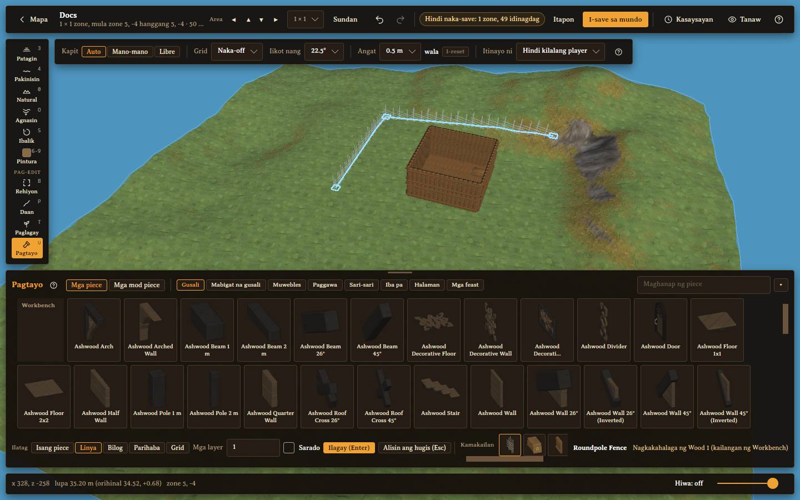
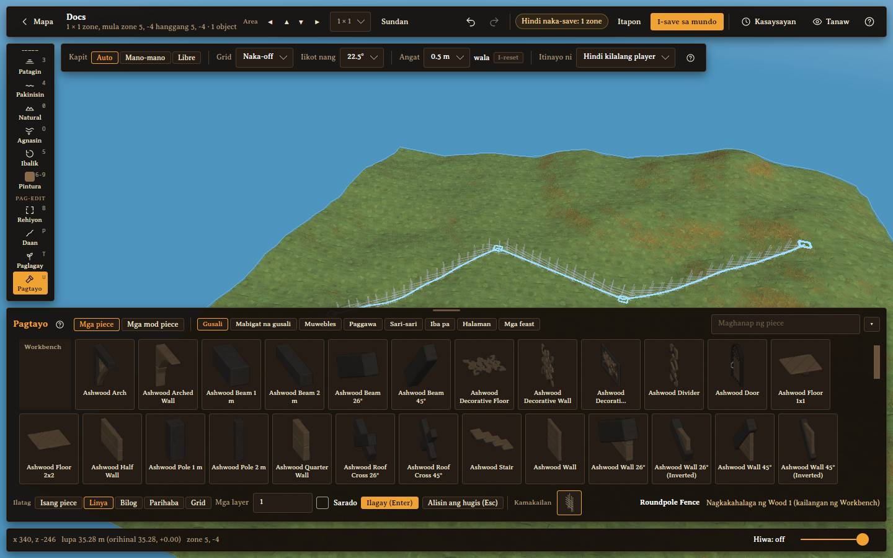
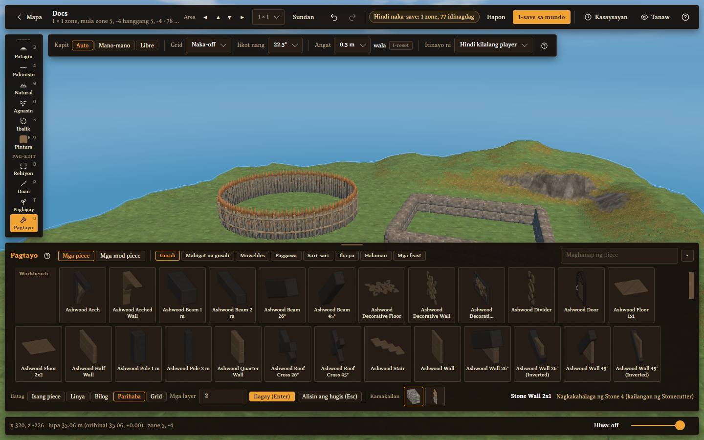
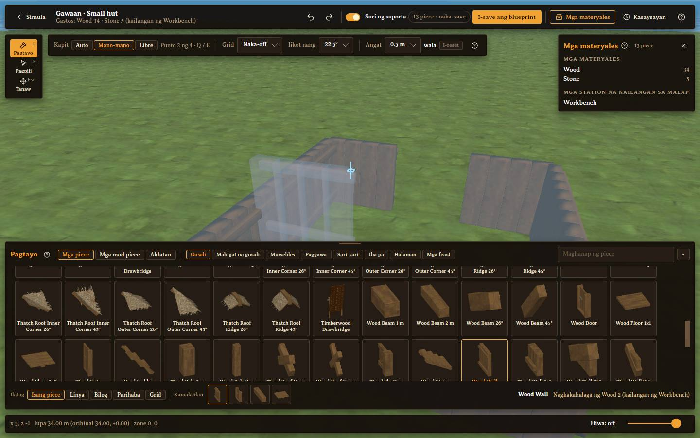

<!-- source: 1f261984 -->
# Pagtayo

Ilapag ang mga piece na itinatayo ng mga player (mga dingding, sahig, bubong, bakod, kasangkapan, crafting station),
isa-isa gaya ng hammer ng laro, o sa kahabaan ng linya, paikot sa bilog o parihaba, o sa isang grid.

**Saan:** tool rail, seksiyong **PAG-EDIT** · **Key:** `U` (sa Gawaan, `T` din) · **Gumagana sa:** mga naka-save na
mundo, live, ang [Gawaan](workshop.md), at mga silid ng dungeon gamit ang [Itayo rito](dungeons.md)

*Pagtayo sa isang mundo: isang kubong itinayo sa pinatag na lupa at isang bakod na roundpole na inilalatag sa linya ng
tatlong punto (**Ilatag** sa **Linya**, ipinapakita bago ang **Ilagay (Enter)**). Ibaba: ang dock ng Pagtayo kasama
ang mga piece ng tab na **Gusali** at ang hanay na **Ilatag**. Itaas: ang bar ng Pagtayo, kasama ang **Kapit**,
**Grid**, **Iikot nang**, **Angat** at **Itinayo ni**.*

## Gamitin ito

Para magtayo ng dingding at bakod sa isang mundo:

1. Pindutin ang `U`. Bubukas ang dock ng **Pagtayo** sa ibaba ng window, at
   [ang bar ng Pagtayo](#ang-bar-ng-pagtayo) katabi ng tool rail.
2. Sa dock, mag-click ng piece (hanapin ang `wall`). Sinusundan nito ang pointer, naaaninag, kung saan ito ilalagay ng
   hammer.
3. Tumuro sa lupa o sa isang piece: kumakapit ang piece sa mga piece na naroon na. Mag-click para ilapag ito.
4. Pindutin ang `,` o `.` para iikot ang susunod, `PgUp` o `PgDn` para iangat o ibaba ito.
5. Para sa bakod, piliin ito, saka sa paanan ng dock piliin ang **Ilatag** → **Linya**, mag-click ng mga punto sa lupa
   at pindutin ang `Enter`.

Isang hakbang ng undo (`Ctrl+Z`) ang bawat click, hanay o `Enter`. Walang naisusulat sa mundo hangga't hindi mo
pinipindot ang **I-save sa mundo** (o **I-apply nang live**). Para ilipat, iikot o burahin ang mga piece, gamitin ang
[Pagpili](select.md), na kahati sa bar ng Pagtayo.

Ang mga puno, bato, pananim nang buong bukid at mga spawn point ay inilalagay gamit ang [Paglagay](place.md), hindi
Pagtayo.

## Ang dock ng Pagtayo

Sakop ng dock ang ibaba ng window. Pareho saanman ang mga tab nito, ang paghahanap nito, ang **Kamakailan**, ang gastos
ng piece, at ang mabibilis na paraan (mag-drag ng hanay, `Shift` + right click para mag-alis ng piece, middle click
para magtayo gamit ang uri ng isang piece): tingnan ang [Ang dock ng Pagtayo](workshop.md#ang-dock-ng-pagtayo) sa pahina ng
Gawaan.

Ang nagbabago ayon sa lugar:

| Saan | Ang dock |
|---|---|
| Bukas na lupa ng isang mundo | **Mga piece** at **Mga mod piece**. Walang **Aklatan**: mag-paste ng blueprint gamit ang [panel na Blueprints](workshop.md#panel-na-blueprints). Hindi umiiral ang [Mask](masks.md) sa Pagtayo. |
| Ang Gawaan | **Mga piece**, **Mga mod piece** at **Aklatan**; binibilang ng **Mga materyales** ang gastos ng gusali. Walang **Itinayo ni**: walang iniingatang nagtayo ang blueprint. |
| Isang dungeon (**Itayo rito**) | **Mga piece** at **Mga mod piece**, isa-isang piece: iginuguhit sa lupa ang mga linya at grid ng **Ilatag**, malayo sa ilalim ng mga silid ng dungeon. |

Nagtatapos sa itaas ng dock ang rail at ang mga panel sa kanan; nag-i-scroll ang rail gamit ang wheel. Itiklop ang dock
gamit ang **▾** para mas maluwag.

## Maglatag ng mga piece sa kahabaan ng linya o sa grid

Pinipili ng **Ilatag**, sa paanan ng dock, kung paano ilalapag ang napiling piece. Iniingatan ito para sa susunod.

| Ilatag | Ang ginagawa nito |
|---|---|
| **Isang piece** | Isang piece kung saan ka nakaturo, gaya ng hammer. Mag-drag para maglatag ng hanay. |
| **Linya** | Mag-click ng mga punto sa lupa: inilalatag ang piece nang dulo sa dulo sa mga tuwid na bahagi sa pagitan nila, bawat isa ay sumasalubong sa huli sa mga punto ng kapit nito (isang bakod, dingding, daan ng mga sahig). Mag-drag ng punto para ilipat ito, i-drag ang linya para magdagdag ng isa, nag-aalis ng isa ang `Ctrl` + click, ng huli ang `Backspace`. Bumabalik ang **Sarado** sa unang punto, para bakuran ang isang bakuran. |
| **Bilog** | Pumindot sa gitna at mag-drag palabas. Ini-round ang laki para buong mga piece ang sumara sa bilog. |
| **Parihaba** | Pumindot sa isang sulok at mag-drag sa kabilang sulok. Napupuno ang mga gilid mula sa mga sulok para magtagpo ang mga sulok. |
| **Grid** | Pumindot sa isang sulok at mag-drag sa kabila: isang piece sa gitna ng bawat cell, magkalayo nang **Pagitan** (2 m para sa 2 m na sahig ng laro), kasindami ng buong cell na kasya. Iniikot ng `,` at `.` ang buong grid. |

| Setting | Ang ginagawa nito |
|---|---|
| **Mga layer** | Linya, Bilog at Parihaba: ang linya ay pinapatong nang 1 hanggang 20 piece ang taas (dingding na 3 ang taas, dobleng bakod). |
| **Pagitan** | Grid: ang layo sa pagitan ng mga piece, gitna sa gitna, 0.5 hanggang 30 m. |
| **Ilagay (Enter)** | Inilalapag ang ipinapakita ng naaaninag na preview, bilang isang hakbang ng undo. Ganoon din ang ginagawa ng pag-double-click sa huling punto ng linya. |
| **Alisin ang hugis (Esc)** | Inaalis ang iginuhit na linya, hugis o kahon. Nananatili ito pagkatapos maglagay, walang laman ang preview nito, hanggang alisin mo ito. |

*Isang bakod na inilatag nang dulo sa dulo sa linya ng apat na punto, naaaninag hanggang ilapag ito ng `Enter`.*

***Bilog** (isang bilog ng mga stake wall) at **Parihaba** (mga batong dingding, **Mga layer** 2), bawat isa ay
inilapag gamit ang `Enter`.*

- Ang linyang nagsisimula sa loob ng 1 m mula sa piece na naroon na ay nagpapatuloy dito, sa antas nito (kapag nasa
  **Auto** o **Mano-mano** ang **Kapit**).
- Sa dahilig, nananatiling pantay ang mga piece at humahakbang pataas o pababa kasabay ng lupa, gaya ng bakod na paakyat
  sa burol. Para sa isang pantay na dingding, patagin muna ang lupa sa kahabaan ng linya ([Daan](path.md), Patagin).
- Itinataas ng angat (`PgUp`, `PgDn`) ang buong linya o grid sa itaas ng lupa: bubong ang sahig na inilatag nang 2 m
  pataas.
- Hanggang 2000 piece bawat linya o grid.

## Ang bar ng Pagtayo

Hawak ng bar katabi ng tool rail ang mga setting ng pagtatayo. Iisang bar ito para sa **Pagtayo**, [Pagpili](select.md)
at [I-paste](area.md#kopyahin-at-i-paste): umiiral sa iba ang itinakda mo sa isa, at iniingatan ito para sa susunod.
Ipinapakita ng bawat tool ang mga bahaging ginagamit nito. Sa makitid na window, nahahati ang bar sa dalawang hanay.

| Setting | Pagtayo | Pagpili | I-paste |
|---|---|---|---|
| **Kapit** | **Auto** (ang default): kumakapit ang piece sa mga piece na naroon na, gaya ng hammer. **Mano-mano**: isa lang sa mga punto ng kapit nito ang sumasalubong sa iba, umaabot nang 1.5 m; pinipili ng `Q` at `E` kung alin, minarkahan sa piece (`Punto 2 ng 8 · Q / E`). **Libre**: nananatili ito kung saan ito dumidikit sa itinuturo mo. | **Auto**: kumakapit ang mga inilipat na piece sa mga piece sa paligid, sa loob ng 0.75 m. **Libre**: nananatili ang mga ito kung saan mo dinrag. | Hindi ginagamit. |
| **Grid** | **Naka-off** (gaya sa laro), **0.5 m**, **1 m** o **2 m**: ini-round ang isang punto sa lupa sa grid na ito, binibilang mula sa gitna ng area. Kumakapit gaya ng dati ang piece na nakaturo sa ibang piece. | Sumusunod sa grid ang mga piece na dinrag sa lupa na hindi kumakapit. | Sumusunod sa grid ang ipine-paste. |
| **Iikot nang** | Gaano kalayo iniikot ng `,` at `.` (o `Alt` + wheel) ang piece: **1°**, **15°**, **22.5°** (hakbang ng laro, ang default), **45°** o **90°**. | Iniikot ng parehong mga key ang pinili. | Iniikot ng parehong mga key ang ipine-paste. |
| **Angat** | Gaano kalayo iniaangat ng `PgUp`, `PgDn` o `Ctrl` + wheel ang piece: **0.1 m**, **0.25 m**, **0.5 m** (ang default) o **1 m**. Ipinapakita ng bar ang angat (`+1.5 m`); ibinabalik ito ng **I-reset** sa wala. | Iniaangat ng parehong mga key ang pinili. | Itinataas o ibinababa ng parehong mga key ang ipine-paste (ang **Taas** nito); ibinabalik ito ng **I-reset**. |
| **Itinayo ni** | Ang player na isinusulat bilang nagtayo ng mga piece na inilalapag mo. | Ang nagtayong isinusulat ng **Gawing itinayo ng player** at **Palitan**. | Ang nagtayo ng mga na-paste na piece. |

**Laging pinapapino ng `Shift` ang isang hakbang**, sa tatlong tool: iniikot nang 1° ng `,` at `.`, at ang angat ay
gumagalaw nang ikalimang bahagi ng hakbang nito (0.1 m sa 0.5 m). Iniikot ng `R` nang isang kapat na ikot sa tatlo,
anuman ang hakbang.

Pindutin nang matagal ang `Alt` habang nagtatayo para maglagay ng piece sa bawat kapat ng metro, nang hindi kumakapit,
anuman ang setting ng **Kapit** (gaya ng pagpindot nang matagal sa `Alt` sa laro, may hakbang). Tingnan ang
[Pagkapit](concepts/objects.md#pagkapit).

***Kapit** sa **Mano-mano**, pinindot nang isang beses ang `E`: nakasulat sa bar ang `Punto 2 ng 4 · Q / E`, at ang
naaaninag na dingding na sumusunod sa pointer ay sumasalubong sa dingding ng kubo sa itaas na sulok nito, minarkahan ng
ekis.*

### Itinayo ni

Inililista ng **Itinayo ni** ang mga player na nagtayo sa mundong ito (kasama ang bilang ng piece nila), ang mga player
na nakapangalan sa mga kama, ward at lapida, at ang mga character sa computer na ito, minarkahan ng "(itong computer)".
Sa simula, pinipili nito ang player na may pinakamaraming piece, kung wala ay ang sarili mong character, kung wala ay
ang isang player na nakapangalan sa mundo. Humihingi ang **Ibang player id…** ng kahit anong id (buong numero).
Inilalapag ng **Wala (hindi itinayo ng player)** ang mga piece nang walang nagtayo, bilang mga bahagi ng guho. Kapag
walang kilalang player, nakakakuha ang mga piece ng **Hindi kilalang player** (id 1): wala nang sinusunod na sinuman
ang mga ward at pribadong chest, kaya piliin ang sarili mong id kapag kaya mo. Inaalala ang pinili bawat mundo.

Wala ito sa bar sa Gawaan: walang iniingatang nagtayo ang blueprint, at nakukuha ng mga piece nito ang kanila kapag
na-paste ito. Kung bakit mahalaga ang nagtayo: tingnan ang
[Mga piece na itinayo ng player](concepts/objects.md#mga-piece-na-itinayo-ng-player).

## Mga shortcut

| Key o mouse | Ang ginagawa nito |
|---|---|
| `U` | Binubuksan ang Pagtayo (sa Gawaan, `T` din). |
| Click | Ilapag ang piece (**Isang piece**); magdagdag ng punto (**Linya**). |
| Drag | **Isang piece**: isang hanay ng piece. **Bilog**, **Parihaba**, **Grid**: iguhit ito. |
| `,` `.` o `Alt` + wheel | Iikot ang piece ayon sa **Iikot nang** ng bar (`Shift`: 1°). Sa **Grid**: ang buong grid. |
| `R` | Iikot ito nang isang kapat na ikot. |
| `PgUp` / `PgDn` o `Ctrl` + wheel | Iangat o ibaba ang piece ayon sa **Angat** ng bar (`Shift`: ikalimang bahagi nito). |
| `Alt` (pinindot nang matagal) | Maglagay sa bawat kapat ng metro, walang kapit. |
| `Q` / `E` | Kapit na **Mano-mano**: ang nakaraan / susunod na punto ng kapit ng piece. |
| `Shift` + right click | Alisin ang piece sa ilalim ng pointer. |
| Middle click | Magtayo gamit ang uri ng piece sa ilalim ng pointer. |
| `Enter` | Ilapag ang linya, hugis o grid. |
| `Backspace` | Alisin ang huling punto ng linya. |
| `Esc` | Alisin ang linya, hugis o grid; kapag walang nakaguhit, bumalik sa **Tanaw**. |
| `Ctrl+Z` | I-undo ang huling piece, hanay o linya. |

Nasa [Mga shortcut](help/shortcuts.md) ang lahat ng key ng editor.

## Mga tip at limitasyon

- **I-undo:** binabawi ng `Ctrl+Z` ang isang piece, hanay o buong linya, pati pagkatapos mag-save (saka mag-save
  ulit). Tingnan ang [I-undo ang mga pagbabago](guides/undo-changes.md).
- Sa loob lang ng bukas na area napupunta ang mga piece, hindi sa pinakalabas na linya ng mga punto nito.
- Hindi sinusuri ng editor kung tatayo ang mga piece sa isang mundo: gamitin ang
  [Suri ng suporta](workshop.md#suri-ng-suporta) ng Gawaan para sa gusaling balak mong panatilihin, o itayo ito roon at
  i-paste.
- Bago ang mga bagong piece: buong health, walang lamang chest. Para punuin ang chest, tingnan ang
  [Baguhin ang laman ng chest](guides/fill-a-chest.md).
- Hawak ng tab na **Halaman** ang mga sapling at pananim ng cultivator, isa-isa o sa **Grid**; mayroon din nito ang
  [Paglagay](place.md), gamit ang brush nito, at pinapanatili nito ang espasyong kailangan nila para tumubo.

## Kaugnay

- [Magdisenyo ng bahay at i-save ito bilang blueprint](start/first-build.md)
- [Gawaan](workshop.md): ang plot, ang Aklatan, Mga materyales, ang suri ng suporta
- [Pagpili](select.md) · [Paglagay](place.md) · [Rehiyon, kopyahin at i-paste](area.md)
- [Pagkapit](concepts/objects.md#pagkapit) · [Mga piece na itinayo ng player](concepts/objects.md#mga-piece-na-itinayo-ng-player)
