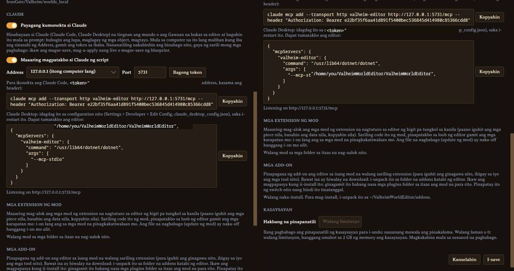
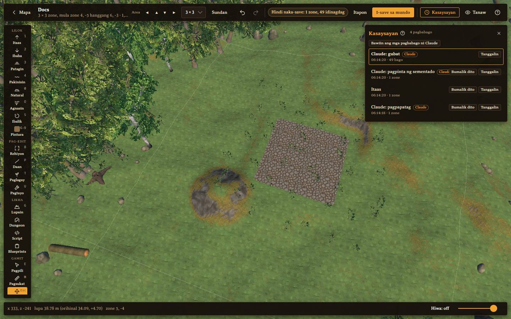

<!-- source: 3de08343 -->
# Claude

Hayaang hubugin ni Claude (sa Claude Code, Claude Desktop o ibang MCP client) ang lupa, magtanim, magtayo at bumuo ng
mga dungeon sa mundo o Gawaan na bukas sa iyo, mula sa isang prompt, habang pinapanood mo sa 3D view.

**Saan:** panimulang pahina, **Mga setting** → **Claude** · **Key:** wala · **Gumagana sa:** mga naka-save na mundo,
live (kapag naka-off ang **Auto**), ang Gawaan


*Kaliwa: naka-on at nakikinig ang seksiyong **Claude**; kopyahin ang command sa terminal (Claude Code) o ang mga linya sa
configuration ng Claude Desktop. Kanan: ang dulo ng Mga setting, kasama ang **I-save**. Nasa command mo ang sarili mong
token kung saan sinasabi ng larawang ito ang `<token>`, at nasa mga linya ang path ng sarili mong program.*

Anumang baguhin ni Claude ay nananatiling **nakabinbin**, gaya ng sarili mong mga pagbabago: isang hakbang ng
Kasaysayan bawat isa (binabawi ito ng `Ctrl+Z`), binibilang sa top bar. Hindi kailanman nagse-save si Claude ng
mundo at hindi kailanman nag-a-apply ng anuman sa live na laro: ikaw ang gumagawa nito, kapag gusto mo ang nakikita mo.
Para i-setup ito hakbang-hakbang, tingnan ang [Hayaang humubog o magtayo si Claude](guides/connect-claude.md).

## Gamitin ito

1. Sa **Mga setting** sa panimulang pahina, i-on ang **Payagang kumonekta si Claude** at pindutin ang **I-save**.
2. Idagdag ang editor kay Claude nang isang beses: patakbuhin ang command na ipinapakita ng Mga setting (Claude Code),
   o idagdag ang mga linya nito sa configuration ng Claude Desktop.
3. Magbukas ng area ng mundo o ng Gawaan (o hilingin kay Claude na magbukas).
4. Hilingin kay Claude ang gusto mo ([Paghiling](#paghiling)) at panoorin itong gumawa sa 3D view.
5. Panatilihin ang gusto mo: **I-save sa mundo**, **I-apply nang live** o **I-save ang blueprint**. Bawiin ang hindi mo
   gusto gamit ang `Ctrl+Z`, **Itapon**, o **Bawiin ang mga pagbabago ni Claude** sa Kasaysayan.

## Mga setting

Sa **Mga setting** (sa panimulang pahina), seksiyong **Claude**:

| Setting | Ano ang ginagawa nito |
|---|---|
| **Payagang kumonekta si Claude** | Naka-on: tinatanggap ng editor ang mga request ni Claude, mula sa computer na ito lang (maliban kung iba ang sinasabi ng **Address**), mula sa mga tumatawag na may token. Naka-off: walang makakakonekta. |
| **Maaaring magpatakbo si Claude ng script** | Naka-on: maaaring magpatakbo si Claude ng mga C# script, gaya ng ginagawa ng tool na [Script](scripting.md), bawat isa ay ipinapakita muna sa iyo para patakbuhin o tanggihan. Ang script ay program na may mga karapatan mo sa computer na ito, kasama ang mga file mo. Naka-off (ang default): tinatanggihan ang mga script ni Claude; gumagana pa rin ang iba nitong tool. |
| **Address** | Kung saan maaaring kumonekta si Claude: pumili ng isa sa listahan, o mag-type ng address. `127.0.0.1 (itong computer lang)`, ang default; `0.0.0.0 (lahat ng network)`; o isa sa mga network ng computer na ito kasama ang address nito (`192.168.1.20 (Ethernet)`): ang network na iyon lang. Kapag lahat ng network, ibinibigay ng isang linya sa ilalim ng command ang mga address na ginagamit ng ibang computer: ang pangalan ng computer na ito (`http://my-pc.local:5731/mcp`), kung saan sumasagot ang network sa mga pangalang `.local` (mDNS), at ang address nito sa bawat network (`http://192.168.1.20:5731/mcp`), na laging gumagana pero nagbabago kapag binigyan ito ng network ng iba. Tingnan ang [Kaligtasan](#kaligtasan). |
| **Port** | Ang port na kinokonektahan ni Claude: 5731 sa simula, 1024 hanggang 65535. Baguhin ito kung may ibang program na gumagamit ng 5731. |
| **Bagong token** | Gumagawa ng ibang token. Kapag pinindot mo ang **I-save**, hihinto sa paggana ang luma: idagdag ulit ang editor kay Claude gamit ang bagong command. |
| Command ng Claude Code, **Kopyahin** | Ang command na nagdadagdag ng editor sa Claude Code. Nasa loob nito ang token: huwag itong ibahagi. |
| Mga linya ng Claude Desktop, **Kopyahin** | Ang mga linyang idadagdag sa configuration ng Claude Desktop. |

Pagkatapos ng **I-save**, ipinapakita ng seksiyon ang "Listening on http://127.0.0.1:5731/mcp" (sa ibang address,
"Listening on 0.0.0.0:5731, from other computers too"), o kung bakit hindi ito nakapakinig ("Could not listen on
127.0.0.1:5731: …" kapag may gumagamit na ng port, o kapag hindi na sa computer na ito ang network address).

## Pagdaragdag ng editor kay Claude

**Claude Code:** patakbuhin ang command na ipinapakita ng Mga setting, nang isang beses, sa terminal. Ganito ang
itsura nito, kasama ang token mo:

```sh
claude mcp add --transport http valheim-editor http://127.0.0.1:5731/mcp --header "Authorization: Bearer <token>"
```

Sa Claude Code, inililista na ng `/mcp` ang **valheim-editor** bilang nakakonekta habang tumatakbo ang editor.

**Claude Desktop:** nagsisimula ito ng program sa halip na kumonekta sa address. Idagdag ang mga linyang ipinapakita ng
Mga setting sa configuration nito (Claude Desktop → Settings → Developer → Edit Config, `claude_desktop_config.json`),
saka i-restart ito:

```json
{
  "mcpServers": {
    "valheim-editor": { "command": "/path/to/ValheimWorldEditor", "args": ["--mcp-stdio"] }
  }
}
```

Walang binubuksang window ang `--mcp-stdio`: ipinapasa nito ang mga mensahe ni Claude sa tumatakbong editor (na naka-on
ang **Payagang kumonekta si Claude**), gamit ang token mula sa mga setting nito.

**Ibang MCP client:** kumokonekta sa address (streamable HTTP) gamit ang parehong header na `Authorization`.

Dapat tumatakbo ang editor para maabot ito ni Claude.

## Ang kayang gawin ni Claude

Tinatawag ng mga tool ni Claude ang parehong code ng sariling mga tool at button ng editor, kaya sinusunod ng ginagawa
nito ang parehong mga patakaran ng laro gaya ng mga edit mo: ang 8 m na hangganan ng lupa ng laro (sariling script lang
nito ang lumalampas dito), ang pagkapit ng mga piece ng gusali, mga zone, mga lokasyon.
Pinapangalanang "Claude: …" sa Kasaysayan ang bawat hakbang na ginagawa nito at may tag na **Claude**. Sinusuri nito ang
gawa nito gamit ang mga larawan ng 3D view at ng mapa, at gamit ang support check.

| Kaya ni Claude na | Mga tool nito |
|---|---|
| Tingnan kung ano ang bukas, ang mga mundo sa computer na ito, at ang mga taas, biome, tubig at object ng isang area; magbukas ng area na 1 hanggang 17 zone; hanapin sa buong mundo ang isang uri, item ng chest o teksto ng karatula; ilista ang simula, mga trader, altar at pasukan ng dungeon | `editor_state`, `list_worlds`, `open_world`, `open_area`, `describe_area`, `list_objects`, `ground_at`, `search_world`, `list_locations` |
| Tingnan ang gawa nito: mga larawan ng 3D view (anumang camera, o apat na tanaw ng isang lugar nang sabay) o ng mapa, mapa ng area mula sa itaas na may grid sa metro, ang support check (aling mga piece ang babagsak) | `screenshot`, `area_map`, `support_check` |
| Gamitin ang pinili mo, at ipakita sa iyo ang ibig nitong sabihin | `get_selection`, `select_objects` |
| Itakda ang anumang kontrol gaya ng gagawin mo (mga switch ng Tanaw, ang Cut ng status bar, mga setting ng tool, ang rail) | `list_controls`, `set_control` |
| Hanapin ang mga piece ng laro at kung paano sila nagkakabit | `find_prefabs`, `piece_info`, `building_guide`, `list_blueprints` |
| Tingnan ang mundo ng isang seed (mga biome, simula, trader, boss) at gumawa ng bagong mundo na may pangalan at seed | `preview_seed`, `create_world` |
| Patagin, pintahan, pakinisin, gawing natural, agnasin, ibalik, itaas o ibaba ang lupa; idiin ang isang stamp o larawan ng heightmap; maghukay ng ilog, moat o rampa sa kahabaan ng linya, o patagin, itaas, ibaba, pakinisin, gawing natural, agnasin o ibalik ang lupa sa kahabaan nito; maglatag ng kalsada; markahan ang mga zone para i-reset; patubuin ulit ang mga puno at bato ng laro | `flatten`, `paint_area`, `shape_ground`, `stamp`, `import_heightmap`, `dig_path`, `road`, `reset_zones`, `regrow_nature` (karamihan ay tumatanggap ng [Mask](masks.md)) |
| Magtanim ng mga puno o bato, maglapag ng mga piece at object (kumakapit sila gaya ng sa hammer), kopyahin ang mga object nang isang beses o sa hanay o bilog, palitan ang mga object ng ibang uri, tanggalin ang mga object | `forest`, `place_pieces`, `copy_objects`, `replace_objects`, `remove_objects` |
| Magtayo ng sahig, mga pader na may pinto at gable na bubong (26° o 45°, thatch o shingle) sa ibabaw ng parihaba; buksan ang Gawaan; magdagdag ng blueprint sa plot o sa area; i-save ang plot bilang blueprint | `build_floor`, `build_walls`, `build_roof`, `place_pieces`, `open_workshop`, `add_blueprint`, `save_blueprint` |
| Ilipat at iikot ang mga object bilang grupo, o ilagay, ihilig at sukatin nang eksakto ang bawat isa; punuin ang chest, bihisan ang armour stand o item stand, magsulat sa karatula, bigyan ng mga bituin ang creature; baguhin ang tag ng portal, ang nagtayo, ang mga pinapayagang player ng ward, health, gatong, level ng creature o kung paamo ito | `move_objects`, `set_transform`, `get_object`, `set_object_data`, `set_contents` |
| Bumuo ng dungeon sa plot o sa itaas ng isang punto ng mundo sa likod ng pasukan nito; ilista ang mga silid ng dungeon ng laro; magdagdag ng silid sa bukas na dulo, mag-alis ng isa, takpan ang bawat bukas na dulo, maglagay ng pinto | `generate_dungeon`, `list_dungeons`, `dungeon_rooms`, `add_dungeon_room`, `remove_dungeon_room`, `close_dungeon_ends`, `set_dungeon_door` |
| Magpatakbo ng script (nang may pahintulot mo) | `run_script`, `script_reference` |
| Mag-undo at mag-redo | `undo`, `redo` |

Ilang patakarang mabuting malaman:

- Tinatanggihan ang `open_world` habang may hindi naka-save na pagbabago ang bukas na mundo o ang Gawaan.
- Sine-save lang ng `save_blueprint` ang gusali ng Gawaan kapag hiniling, at hindi kailanman pinapalitan ang blueprint
  maliban kung sinabihan. Pinapanatili ng muling pag-save ng blueprint ang paglalarawan at mga tag nito.
- Tinatanggihan ng `generate_dungeon` ang biome, estilo o materyales ng pader na hindi nito kilala, at inililista ang
  mga kilala nito.
- Pinapanatili ng `move_objects` ang hugis ng gusali, at dinadala ng bahagi ng magkakabit na grupo ng mod (barko at mga
  piece nito) ang buong grupo nito, pati sa mga kopya at pagtanggal.
- Ang dungeon na binuo ni Claude sa plot ng Gawaan ay bahagi ng gusali ng plot, nakabinbin gaya ng iba; hindi ito
  idinadagdag sa aklatan mo.
- Kapag kumonekta si Claude, binibigyan ito ng editor ng maikling gabay sa paggawa rito, at dalawang handang prompt:
  *build_in_workshop* at *shape_area*.

## Paghiling

Ikaw mismo ang magbukas ng mundo o ng Gawaan, o hilingin kay Claude. Saka, halimbawa:

- "Buksan ang area sa paligid ng 1200, -340 at gumawa ng lambak na may ilog na umaagos pahilaga, may mga birch sa
  tabi nito."
- "Patagin ang 40 m na parisukat sa gitna ng area, sementuhin ito, at maglagay ng bilog ng mga sulo sa paligid nito."
- "Sa Gawaan, magtayo ng maliit na longhouse: batong sahig, kahoy na pader na may dalawang pinto, 45° na thatch na
  bubong. Tingnan kung nakatayo ito."
- "Buksan ang area sa paligid ng 800, 950 at bumuo ng dalawang-palapag na Swamp crypt sa itaas nito."
- "Itong mga punong pinili ko: palitan ng mga beech." (Piliin muna ang mga ito; binabasa ni Claude ang pinili mo.)

Pinakamadaling hilingin ang gawain sa lupa, mga gubat at mga dungeon. Ang mga detalyadong gusaling inilalagay nang
piece-piece ay maaaring umabot ng ilang ikot ("lumalampas ang bubong sa silangang gilid, ayusin mo"), o magsimula sa
isa sa mga blueprint mo.


*Pinapangalanang "Claude: …" ang mga hakbang ni Claude at may tag na **Claude**; nasa pagitan nila ang sarili mong **Itaas**. Tinatanggal ng **Bawiin ang mga pagbabago ni Claude** sa itaas ang mga hakbang ni Claude at pinapanatili ang sa iyo.*

## Pagbawi sa mga pagbabago ni Claude

- Binabawi ng `Ctrl+Z` ang huling hakbang, kay Claude man o sa iyo.
- Sa **Kasaysayan**, inaalis ng **Tanggalin** sa hakbang na may tag na **Claude** ang hakbang na iyon at pinapanatili
  ang lahat ng ginawa pagkatapos nito.
- Tinatanggal ng **Bawiin ang mga pagbabago ni Claude** (sa itaas ng Kasaysayan, habang may pagbabago si Claude) ang
  bawat hakbang na ginawa ni Claude sa kasaysayan ng bukas na area, pinakabago muna, at pinapanatili ang sa iyo, kahit
  ang mga ginawa pagkatapos ng kay Claude. Sinasabi ng status bar kung ilan ang nabawi, at ilan sa mga hakbang ni Claude
  na ginawa sa ibang area ang pinanatili: buksan ang mga area na iyon para bawiin din ang mga iyon (tingnan ang
  [Pag-aari ng mundo ang kasaysayan](concepts/saving-and-history.md#pag-aari-ng-mundo-ang-kasaysayan)).
- Itinatapon ng **Itapon** ang lahat ng hindi naka-save, pati ang sa iyo.

Gumagana rin ito pagkatapos mag-save o mag-apply: isinusulat ito ng susunod na **I-save sa mundo** o **I-apply nang
live**. Tingnan ang [Mag-undo ng hakbang, bawiin ang isang pagbabago, o itapon ang lahat](guides/undo-changes.md).

## Kaligtasan

- **Ang computer na ito lang.** Nakikinig ang editor sa `127.0.0.1` (o ibang loopback address na i-type mo, gaya ng
  `::1`) at tinatanggihan ang anumang request na naka-address sa ibang pangalan, kaya hindi ito maaabot ng web page na
  binibisita mo. Kapag ibang **Address**, maaabot din ito ng mga computer sa network na iyon, sa alinmang pangalan ng
  computer na ito, gamit ang token. Mga sariling network lang ng computer na ito: tinatanggihan ang computer na ang
  address ay hindi lokal (`10.x`, `172.16`–`172.31`, `192.168.x`, link-local, IPv6 `fc00::/7`) o wala sa network na
  pinakikinggan ng editor, kaya hindi ito kailanman naaabot ng internet, kahit sa IPv6. Kapag `0.0.0.0`, ang mga
  network na iyon ay ang mga may gateway (hindi ang sariling network ng Docker, WSL o Hyper-V, o VPN tunnel). Tinatanggap
  din ang VPN gaya ng Tailscale, na ang mga address ay `100.64.x.x` hanggang `100.127.x.x`, kapag nasa VPN ang computer
  na ito: makinig sa Tailscale address nito o sa `0.0.0.0`, at kokonekta ang ibang computer sa address na iyon.
  Ine-encrypt ng VPN ang daan, kaya hindi nababasa ang token sa network.
- **Mga script mula sa computer na ito lang.** Hindi pinapayagang magpatakbo ng script ang Claude sa ibang computer
  (`run_script`, ang Run ng tool na Script) kahit naka-on ang **Maaaring magpatakbo si Claude ng script**: kung hindi, ang sinumang
  makabasa ng token sa network ay makapagpapatakbo ng mga program gamit ang mga karapatan mo. Gumagana gaya rito ang
  iba nitong tool.
- **Hindi naka-encrypt palabas ng computer na ito.** Plain HTTP ang koneksiyon: kapag ibang **Address**, mababasa ng
  sinuman sa network na iyon ang token at lahat ng ipinapadala ng editor at ni Claude sa isa't isa, at magagamit nila
  ang editor gamit ang token. Makatwiran iyon sa home network na pinagkakatiwalaan mo, at sinasabi ito ng Mga setting
  sa ilalim ng address sa sandaling pumili ka ng isa. Sa ibang lugar, panatilihin ang `127.0.0.1` at abutin ito mula sa ibang
  computer sa pamamagitan ng SSH tunnel, na nag-e-encrypt dito:
  `ssh -L 5731:127.0.0.1:5731 you@this-computer`.
- **Ang token.** Dapat may dalang token ang bawat request (48 random na character na ginawa para sa editor mo).
  Gumagawa ng iba ang **Bagong token**.
- **Nakabinbin lang.** Hindi kailanman nagse-save, nag-a-apply nang live, nagtatapon, nagre-reload, nagsusulat o
  nagbubura ng mga file mo si Claude, o kumokonekta sa live na laro: walang tool na gumagawa nito, at tinatanggihan ng
  `set_control` ang mga kontrol na iyon.
- **Kailangan ng pahintulot mo ang mga script, bawat isa.** Tinatanggihan ang `run_script` (pati mga dry run) at ang
  **Patakbuhin** ng tool na Script hangga't hindi mo ino-on ang **Maaaring magpatakbo si Claude ng script**. Pagkatapos,
  ipinapakita sa iyo ang bawat script na isinusulat ni Claude bago ito tumakbo: **Patakbuhin ito** o **Tanggihan**
  (tumatanggi ang Enter at Esc). Isang beses lang nagtatanong ang dry run at ang pagpapatakbo pagkatapos ng parehong
  script sa parehong area; nagtatanong ulit ang bawat ibang pagpapatakbo. Ang
  iba pang tool ni Claude (`flatten`, `road`, `forest`…) ay nagpapatakbo ng sariling code ng editor at hindi tinatanong.
- **Hindi utos ang sinasabi ng mundo.** Isinusulat ng mga player ang mga karatula, tag ng portal at pangalan, at ng iba
  ang blueprint o data ng mod: sinabihan si Claude na ituring ang mga ito bilang data. Hindi makapagpapatakbo ng script
  ang karatulang sumusubok mag-utos kay Claude nang hindi mo muna ito nakikita.
- **Live na naka-on ang Auto: wala.** Habang live ang bukas na mundo na naka-on ang **Auto**, aabot agad sa laro ang
  bawat pagbabago, kaya walang binabago si Claude kundi ang panel na Tanaw at hinihiling sa iyong i-off ang Auto.
- **Ang naka-off ay naka-off.** I-off ang **Payagang kumonekta si Claude** at walang makakakonekta.

Higit pa sa [Mga script at Claude](concepts/safety.md#mga-script-at-si-claude).

## Mga shortcut

Walang idinadagdag na key si Claude. Ina-undo at ire-redo ng `Ctrl+Z` at `Ctrl+Y` ang mga hakbang nito gaya ng sa iyo.

## Mga tip at limitasyon

- Dapat tumatakbo ang editor, na naka-on ang **Payagang kumonekta si Claude**, para maabot ito ni Claude. Kung hindi
  nito maabot, tingnan ang [Hindi makakonekta si Claude](help/troubleshooting.md#hindi-makakonekta-si-claude).
- Pagkatapos ng **Bagong token** at **I-save**, patakbuhin ulit ang bagong command ng Claude Code (hihinto sa paggana
  ang lumang token). Kusang binabasa ng Claude Desktop ang bagong token.
- Ang bukas na area lang ang nakikita ni Claude. Hilingin dito na magbukas ng ibang area, o mas malaki, para sa mas
  malalaking gawa.

### Ang building skill (Claude Code)

Opsiyonal, para sa mga gusaling dapat mukhang gawa-kamay: may Claude Code skill ang repository ng editor,
[`.claude/skills/valheim-build`](../../.claude/skills/valheim-build/SKILL.md). Gamit ito, naghahanap si Claude ng mga
tunay na build sa Valheim para sa mga ideya, nagsusulat ng maikling design brief, hinuhubog ang lupa, sinusubukan ang
mga hindi pamilyar na piece sa maliit na mock-up, nagtatayo nang paisa-isang yugto gamit ang mga subok nang helper
(mga arkong bintana, cornice, battlement, bilog na tore, tile na bubong, timber-framed na bulwagan), saka sinusuri ang
sarili nitong gawa para sa mga harang na bintana, dobleng piece at pangit na dugtungan. Nagkakaroon ng balangkas, ilaw
at kasangkapan ang loob; nagkakaroon ng mga daan, ilaw at tanim ang labas.

Kusa itong nilo-load ng Claude Code kapag nagtatrabaho ka sa repository. Para magamit ito kahit saan, kopyahin ang
folder sa sarili mong mga skill: `cp -r .claude/skills/valheim-build ~/.claude/skills/`. Saka humiling gaya ng dati,
halimbawa "Magtayo ng Gothic na kastilyo na may moat sa Gawaan". Nasa `references/pieces.md` nito ang alam nito tungkol
sa mga piece; malugod na tinatanggap doon ang mga pagwawasto.

## Kaugnay

- [Hayaang humubog o magtayo si Claude](guides/connect-claude.md)
- [Mag-undo ng hakbang, bawiin ang isang pagbabago, o itapon ang lahat](guides/undo-changes.md)
- [Kaligtasan](concepts/safety.md#mga-script-at-si-claude): mga script at Claude
- [Script](scripting.md): ang pinapatakbo ng `run_script`
