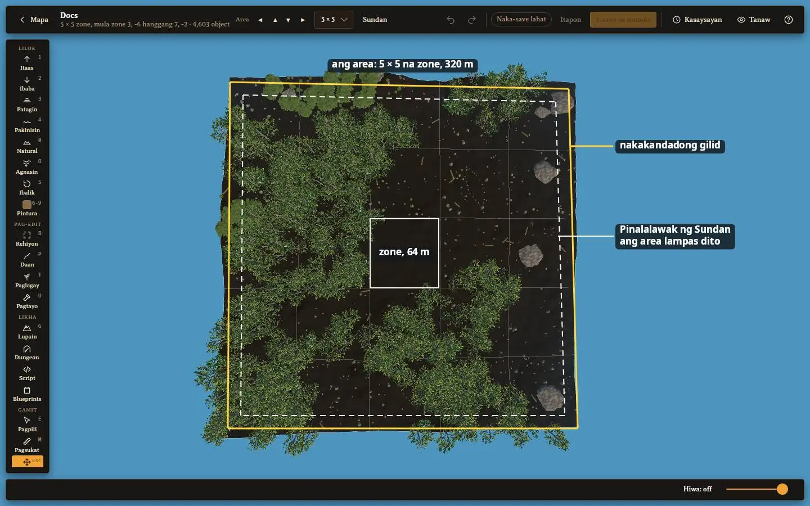

<!-- source: 24741409 -->
# Mga area at zone

Hinahati ng Valheim ang mundo nito sa mga parisukat na **zone** na 64 m, at binubuksan ng editor ang isang bloke ng mga
ito nang sabay, ang **area**. Ipinapaliwanag dito kung bakit hindi pa mase-save ang ilang lugar, kung bakit hindi
kailanman gumagalaw ang gilid ng area, at kung bakit mabagal ang malaking area.


*Isang bloke ng mga zone ang area. Hindi kailanman nagbabago ang pinakalabas na hanay ng mga punto ng lupa nito
(dilaw); kapag naka-on ang **Sundan**, nadadagdagan ng mga zone kapag lumampas ang puntong tinitingnan mo sa putol-putol
na linya, 12 m papasok.*

## Mga zone

Ang zone ay isang parisukat na 64 × 64 m. Pinapangalanan ng status bar ang zone sa ilalim ng mouse (`zone 20, -6`),
iginuguhit ng **Tanaw → Hangganan ng zone** ang mga linya nito sa 3D, at iginuguhit ng **Grid ng zone** ng mapa ang mga
ito sa mapa.

Ginagawa ng laro ang isang zone sa unang pagkakataong lumapit dito ang isang player: ang mga puno, bato at ore nito, at
ang lokasyong hawak nito (isang nayon, isang pasukan ng dungeon). Ang tawag dito ay **pagbuo** ng zone. Hanggang doon,
walang laman doon ang mga file ng mundo, kahit ang lupa. Para sa iyo, ibig sabihin nito:

- **Hindi mase-save ang mga edit sa zone na hindi pa napupuntahan ninuman.** Inililista sila ng mensahe ng pag-save.
  Daanan muna ang lugar sa laro, saka ito i-edit.
- **Walang laman ang bagong mundo.** Kayang ipakita ng editor ang kalupaan ng isang seed bago pa ito laruin ninuman,
  pero walang mae-edit hangga't hindi pa nagagawa ng laro ang mga zone (tingnan ang [Isang bagong mundo](../new-world.md)).
- **Kada zone nagpapasya ang laro.** Naglalatag ito ng isang dungeon kada zone, nire-reset nito ang buong mga zone (sa
  ibaba), at binibilang ng linya ng nakabinbin ang mga zone na binago mo ang lupa.

Bawat zone ay may 65 × 65 na punto ng lupa, isa kada metro; pinaghahatian ng magkakatabing zone ang mga punto sa
kahabaan ng magkasanib nilang gilid. Tingnan ang [Paano iniimbak ang lupa](ground-limits.md#paano-iniingatan-ang-lupa).

## Ang area

Ang area ay ang bloke ng mga zone na bukas sa 3D editor: mula 3 × 3 hanggang 17 × 17 na zone sa paligid ng lugar na
pinili mo sa [mapa](../map.md).

| Laki | Lapad | Mainam para sa |
|---|---|---|
| 3 × 3 | 192 m | Bahay, bukid, mabibilis na edit; ang pinakamabilis buksan. |
| 5 × 5 (ang default) | 320 m | Isang base at ang paligid nito. |
| 7 × 7, 9 × 9 | 448 m, 576 m | Isang nayon, mahabang daan, pag-paste ng isang bayan. |
| 13 × 13, 17 × 17 | 832 m, 1088 m | Hanay ng bundok, baybayin. Mabagal buksan at iguhit. |

Iginuguhit ng editor ang bawat object at punto ng lupa ng area, kaya isang bloke ang binubuksan nito at hindi ang buong
mundo. Nangyayari sa loob nito ang lahat ng ginagawa mo: dapat magkasya sa bukas na area ang isang paste, bundok o
script, kaya magbukas ng mas malaki bago ang malaking trabaho.

**Sa mundo nakalakip ang mga pagbabago mo, hindi sa area.** Iisang hanay ng nakabinbing pagbabago ang iniingatan ng
editor para sa buong mundo. Ilipat ang area, baguhin ang laki nito, o bumalik sa mapa at magbukas ng ibang lugar:
naghihintay pa rin ang ginawa mo sa ibang lugar at nase-save kasama ng iba. Sumasama rin ang kasaysayan (tingnan ang
[Kasaysayan](saving-and-history.md#kasaysayan)).

Inililipat ng mga arrow ng top bar ang area nang isang zone (64 m) bawat pagkakataon, at nananatili ang camera kung
nasaan ito sa mundo. Binubuksan ulit ng listahan ng laki ang area sa ibang laki sa paligid ng parehong gitnang zone.
Pareho silang naghihintay sa hinihintay ng Sundan, at inaalis ang inaalis nito (tingnan ang [Sundan](#sundan)).
Ipinapakita ulit ng pagbubukas ng ibang area ang mga nakatagong object.

## Ang naka-lock na gilid

Hindi kailanman nagbabago ang pinakalabas na hanay ng mga punto ng lupa ng area. Walang brush, daan, aksiyon ng
Rehiyon, paste o script na gumagalaw dito, at walang inilalagay dito ang tool na Paglagay.

Ang dahilan: pinaghahatian ang mga puntong iyon ng mga zone na nasa labas lang ng area, na hindi pa nilo-load ng
editor. Kung gagalawin sila ng editor, sasalubungin ng lupa sa labas ang isang baitang o bangin na hindi nito nakikita.
Dahil naka-lock ang gilid, laging dumudugtong ang area sa kalupaan sa paligid nito nang walang tahi. Hindi pinipigilan
ang script na sumusulat doon: basta iniiwan ang pagbabago.

```text
 labas     │ naka-lock │      ang maaari mong i-edit      │ naka-lock │   labas
 ──────────┼───────────┼──────────────────────────────────┼───────────┼──────────
           │    1 m    │  lahat ng iba pa sa area         │    1 m    │
```

Para magtrabaho malapit sa gilid, ilipat ang area gamit ang mga arrow, pumili ng mas malaking laki, o i-on ang
**Sundan**.

## Sundan

Kapag naka-on ang **Sundan** (sa top bar), kusang lumalaki ang area habang papalapit ang trabaho mo sa gilid nito.
Kapag ang puntong tinitingnan mo ay napunta sa loob ng 12 m mula sa gilid, nadadagdagan ng isang hanay ng mga zone ang
panig na iyon, o ang dalawang panig malapit sa isang sulok. Ang 3 × 3 na area ay nagiging 4 × 3, saka 4 × 4, at
iba pa.

Nagdadagdag lang ng mga zone ang Sundan, hindi kailanman nag-aalis, kaya walang umaalis sa area sa mga ginagawa mo.
Humihinto ito sa 17 zone sa bawat direksiyon (mga 1 km) at sinasabi ito; pagkatapos, ilipat ang area gamit ang mga
arrow, o magbukas ng ibang lugar mula sa mapa.

Naghihintay ang Sundan, at sinasabi ng status bar kung bakit, habang may mawawala kung lalaki ito: sine-save o binabasa
ang mundo, may mga napiling object, may brush stroke na ginagawa, may daang naiguhit at hindi pa na-apply, o may mga
pagbabagong ipinapadala pa sa live na laro. Hindi ito naghihintay para sa kahon ng Rehiyon, linya, grid o polygon ng
Paglagay, o isang sukat: inaalis sila ng paglaki.

## Pag-reset ng mga zone

Ipinapabuo ulit ng reset sa laro ang isang zone, na parang wala pang nakapunta roon. Gamitin ito para makuha ang bagong
content ng isang update ng Valheim sa mga lugar na walang nagtayo, o para ibalik ang isang gubat o dungeon. Minamarkahan
mo ang mga zone gamit ang tool na [Rehiyon](../area.md) o sa buong mundo mula sa [mapa](../map.md); walang nangyayari
hangga't hindi ka nagse-save o nag-a-apply nang live.

Kapag naisulat ang reset:

- **Nawawala ang lahat ng nasa zone**: mga puno, bato, ore, mapipitas, guho, pasukan ng dungeon at ang mga silid nito,
  spawner, mga item na nakakalat at mga creature, kasama ang mga paamong hayop (ilabas muna sila).
- **May mga natitira**: laging ang mga lapida ng mga player; ang mga piece na itinayo ng player kapag naka-on ang
  **Panatilihin ang mga gusali ko** (sa mapa, tuluyang hindi isinasama ang mga zone na may kahit isa; kapag naka-off,
  sumasama sa iba ang mga gusali); ang mga edit sa lupa, maliban kung pinili mong i-undo rin ang mga ito.
- **Ginagawa itong muli ng laro** sa susunod na lumapit ang isang player: bagong halaman, at muling itinatayo ang
  lokasyon nito sa puwesto nito, na may bagong loot at mga creature. Kapag live, agad na ginagawang muli ang zone na may
  player sa malapit.

Itinuturing na napili ang isang zone kapag sakop ng balangkas ng pinili ang kahit isa sa mga punto ng lupa nito, anuman
ang malambot na gilid, kaya nire-reset nito ang zone na pinasok ng pinili kahit kaunti.

Hindi na maa-undo ang reset kapag na-save o na-apply na; bago iyon, kanselahin o i-undo ang pagmamarka. Pagkatapos
maisulat ang reset, binabasa ulit ng editor ang mundo, at sumasama ang kasaysayan nang wala ang ginawa nito sa mga
na-reset na zone (tingnan ang [Ang hindi kayang bawiin ng isang hakbang](saving-and-history.md#ang-hindi-mababawi-ng-isang-hakbang)).
