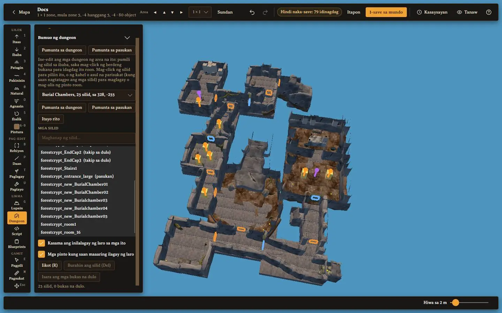

<!-- source: 5e6370cb -->
# Mga dungeon

Kakaiba ang paraan ng Valheim sa pag-iingat ng mga dungeon nito: mataas sa langit, bilang listahan ng mga silid na
itinatayo ng laro kapag may lumapit. Kapag alam mo ito, maiintindihan mo kung bakit mukhang walang laman sa editor ang
dungeon na wala pang nakapunta, kung paano gumagana nang walang mod ang na-edit na dungeon, at kung paano nananatili
5000 m sa itaas ang dungeon na gawa sa mga piece ng gusali. Nakabatay rito ang tool na [Dungeon](../dungeons.md).

## Paano iniingatan ng laro ang mga dungeon

**Hindi hinuhukay sa lupa ang mga dungeon.** Bawat isa ay isang **lokasyon** sa ibabaw (ang punso ng isang burial
chamber, ang bunganga ng isang Frost Cave) na ang pinto ay nagte-teleport sa iyo sa mismong dungeon, **5000 m sa
itaas** nito, kung saan itinuturing ng laro na nasa loob ang lahat. Sa editor, hindi na sinusundan ng camera ang lupa
doon sa itaas, at ipinapakita o itinatago ng **Tanaw → Mga silid ng dungeon** ang mga silid.

```text
   5000 m  ┌───────────────┐  ang mga silid ng dungeon
           │ ▢─▢─▢─▢       │  ◄── pababa ang balik ng pinto nito
           └───────────────┘
              ▲  teleport
   lupa    ───┴─── ang pasukan (isang lokasyon: punso, bunganga ng kuweba, minahan)
```

**Listahan ng mga silid ang dungeon ng laro.** Itinatayo ng laro ang mga dungeon nito mula sa mga yari nang silid. Sa
save, ang dungeon ay isang object na may hawak na **listahan ng mga silid**: aling silid, saan, nakaharap saan. Kapag
lumapit ang isang player, itinatayo ng laro ang mga silid mula sa listahang iyon, anuman ang laman nito, nang hindi ito
sinusuri laban sa sarili nitong mga patakaran. Kaya gumagana ang na-edit na dungeon sa laro ng bawat player nang walang
mod: ang listahan lang ang binabago ng editor.

**Hangga't wala pang player na nakalapit, walang laman ang listahan.** Inilalatag ng laro ang dungeon sa unang
pagkakataong may dumating, kaya walang silid na maipapakita o mae-edit ang editor bago iyon. Puntahan ito sa laro, saka
buksan ulit ang area. Ganoon din inilalatag ang mga nayon ng Fuling at ang mga bukid sa Meadows, sa lupa.

### Mga silid, bukana at takip sa dulo


*Isang dungeon ng laro 5000 m sa itaas, tinanggal ang mga bubong: isang entry ng listahan ang bawat silid. Minamarkahan
ng mga parisukat kung saan nagtatagpo ang dalawang silid: asul kung may pinto, kahel kung wala.*

Bawat silid ay may mga **bukana**, ang mga daanan kung saan ito nakadugtong sa kasunod, at may uri ang bawat bukana: may
karaniwang bukana ng kuweba, bukana ng yelo, bukana ng dambana at iba pa ang Frost Cave. Pinagdudugtong lang ng laro
ang mga bukanang magkauri, bagaman may mga silid (isang pasilyo ng yelo) na nagdudugtong ng isang uri sa iba. Ang
**takip sa dulo** ay maliit na silid na nagsasara ng isang bukana, para walang palabas ng dungeon.

Pinipigilan ng laro na magpatong ang mga silid nito at pinananatili sila sa loob ng espasyo ng dungeon (para sa
karamihan ng uri, 64 × 64 m sa paligid ng gitna ng zone nito). Itinatayo pa rin ang listahang isinusulat ng editor,
kaya nagbababala lang ang editor kapag lumalabag ang isang silid sa mga patakarang iyon.

**Ang laman ng mga silid.** Sa unang paglalatag ng laro sa isang dungeon, binubunot nito ang ilalagay sa bawat silid:
mga chest, spawner ng creature, sulo, brazier, yelo, dekorasyon. May sariling tsansa ang bawat bahagi, mula sa seed ng
mundo, sa puwesto ng silid, sa tema ng dungeon at sa taas ng silid. Ganoon din ang pagbunot ng editor, kaya kasama ng
silid na idinadagdag nito ang ilalagay sana roon ng laro. Ang ilang bagay (icicle, kristal, isda) ay lumalapag sa
pinakamalapit na ibabaw sa laro, kaya maaaring medyo iba ang puwesto nila sa ipinapakita ng editor.

**Mga pinto.** Kung saan nagtatagpo ang dalawang silid, kung minsan ay naglalagay ang laro ng pinto, ayon sa sarili
nitong tsansa: ang mga kurtinang tela at pader na yelo ng Frost Cave, ang mga tarangkahan ng crypt, ang mga pinto ng
minahan. May sarili ang bawat uri ng dungeon para sa bawat uri ng bukana, at nakatayo ang pinto sa bukana ng silid na
naunang naroon.

### Mga pasukan, isa kada zone

Naglalatag ang laro ng **isang dungeon kada zone**, at pinananatiling bakante ang espasyo sa itaas ng pasukan kahit bago
pa mailatag ang dungeon. Kaya naglalagay lang ang editor ng dungeon sa likod ng pasukan ng laro kung saan wala pang
nakalagay sa itaas; kung hindi, ilagay ang pasukan sa ibang zone. Ang dungeon ng Plains, na naaabot sa pamamagitan ng
portal sa halip, ay isinasalansan nang mas mataas nang tig-50 m kapag okupado na ang espasyo.

Ang pasukan ng inilagay na dungeon ay ang sariling lokasyon ng laro para sa biome, isinulat gaya ng pagsulat ng laro sa
isang lokasyon, kaya ginagawa ng laro ang pinto nito, ang mga bato nito at ang daan papasok tuwing nilo-load ang zone.
Napupunta ang dungeon kung saan inilalatag ng laro ang sa pasukang iyon (ang sa Frost Cave, sa gitna ng zone nito),
nakaikot para nakaharap papasok ang player na dumarating sa pinto. Walang sariling dungeon ang Plains: doon, isang pares
ng magkakabit na portal ang pumapalit sa pasukan, isa sa lupa, ang kakambal nito kung saan dumarating ang mga player.

Madilim na iginuguhit ng laro ang mga dungeon, naiilawan lang ng mga sulo nito. Iniilawan sila ng editor gaya ng sa
labas, para makita mo ang ine-edit mo.

## Paano naglalatag ng dungeon ang generator

Kayang gumawa ng generator ng dungeon mula sa dalawang bagay: **sariling mga silid ng laro**, o **mga piece ng gusali**.

**Gamit ang sariling mga silid ng laro**, pinagdudugtong nito ang mga ito sa paraan ng laro. Pinipili nito ang dungeon
ng biome (burial chamber sa Meadows at Black Forest, sunken crypt sa Swamp, Frost Cave sa Mountain at Deep North,
infested mine sa Mistlands), nagsisimula sa isa sa mga silid-pasukan nito, at nagdadagdag ng mga silid sa mga bukas na
bukana, ayon sa timbang na ibinibigay ng laro, kung saan kasya, hanggang magkaroon ito ng mga 8, 14, 20 o 26 na silid
depende sa laki. Tinatakpan nito ang bawat bukas na dulo, nilalagyan ang bawat silid gaya ng gagawin ng laro, at
naglalagay ng mga pinto kung saan nagtatagpo ang mga silid ayon sa tsansa ng laro. Ang resulta ay isang object ng
dungeon na may listahan ng mga silid, eksaktong gaya ng sa laro. Kapag inilagay sa mundo, inilalatag ang mga silid mula
sa object ng dungeon kung saan ito inilalagay ng pasukan at pinananatili sa loob ng espasyo ng zone na iyon, gaya ng
ginagawa ng laro: binabago ng puwesto ng pasukan sa zone nito at ng direksiyong hinaharap nito kung aling mga silid ang
kasya.

**Gamit ang mga piece ng gusali**, pinaplano nito ang dungeon sa grid ng mga tile na 2 m, isang palapag bawat
pagkakataon, saka itinatayo at nilalagyan ng muwebles. Laging pareho ang dungeon na nagagawa ng parehong mga pagpipilian
at seed. Inilalatag ang bawat palapag sa ganitong pagkakasunod:

| | Ang inilalatag |
|---|---|
| **Bulwagang pasukan** | Binubuksan ang unang palapag. Dumarating ang mga player sa harap ng likurang pader nito, may karatula sa tabi nila na may pangalan ng dungeon. |
| **Ang daan papasok** | Mga dalawa sa bawat limang silid ay ang mga pangunahing silid ng istilo nang sunud-sunod (ang malaking bulwagan, sangandaan, galeriya at kapilya ng isang crypt), bawat isa nakadugtong sa nauna, karamihan diretso sa harap. |
| **Pababa, o ang boss** | Bawat palapag maliban sa huli ay nagtatapos sa hagdanang pababa (8 × 24 m) papunta sa palapag sa ibaba, 6 m na mas mababa. Nagtatapos ang huli sa isang antechamber, sa arena ng boss (24 × 24 m) at sa kabang-yaman sa kabila nito. |
| **Mga gilid na silid at pakpak** | Sumasanga ang mga gilid na silid, kadalasan mula sa mga sangandaan at mahahabang bulwagan, pinili ayon sa timbang ng istilo. Madalas tumubo ang gilid na silid mula sa huli, at may hilig itong bumagay rito: kusina sa tabi ng bulwagan ng piging, mga selda sa tabi ng silid ng bantay, pandayan sa tabi ng talyer. |
| **Mga kakambal** | Madalas magkaroon ang mga gilid na silid ng kakambal na nakasalamin sa kabila ng bulwagan nila (halos palagi sa templo, bihira sa lungga ng goblin), kaya mukhang gusali ang plano, nakahanay sa mga axis. |
| **Mga paikot na daan** | Pinagdudugtong ang mga silid na tatlo o higit pa ang layo sa daan pero nagkataong malapit sa isa't isa, kaya may higit sa isang paikot na daan. |
| **Mga dead end at imbakan** | Isa o dalawang pasilyo ang walang patutunguhan kundi isang imbakan. Isang nakatagong imbakan (dalawa kapag lampas 20 silid) ang nasa gilid ng isang gilid na silid, sa likod ng pader na may lamat o ng tapiserya. |
| **Ang susi** | Kapag nasa likod ng tarangkahan ang boss, nasa chest ang susi sa gilid na silid na pinakamalayo sa arena. |
| **Mga pinto** | Susi ang kailangan ng tarangkahan ng boss; nasa likod ng tarangkahan ang kabang-yaman; mas madalas magkaroon ng tarangkahan ang mga selda; kung minsan ay may malaking dobleng tarangkahan ang mga engrandeng silid; sumusunod sa istilo ang iba. Kung saan pababa ang hagdan, nagiging tarangkahan ang bukas na daanan, para manatili sa ibaba ang nakatira sa ibaba. |

Nag-iiba-iba ang mga silid sa loob nito. Sumusunod sa uri nila ang **laki** nila (maaaring 8 × 8 m ang imbakan, 12–20 m
ang lapad at 20–32 m ang haba ng malaking bulwagan). May mga may tapyas na sulok, apse sa dulo, o nawawalang sulok.
Diretso o may liko ang mga **pasilyo**, at may mga silid na pader sa pader ang tagpuan. 4 m ang taas ng mga silid, pero
ang malalaking bulwagan, kapilya, silid ng trono at ang arena ay maaaring umabot nang 10 m, lagos sa palapag sa itaas.
Maaaring magkaroon ng mga **alcove** sa gilid ang mahahabang silid.

### Bakit ito nananatili 5000 m sa itaas

Kailangan ng bawat piece ng gusali ng suporta mula sa lupa sa laro, at walang lupa roon sa itaas. Kaya nakatayo ang
dungeon na gawa sa mga piece sa mga **black marble floor slab** (8 × 8 m), ang sahig at bubong ng bawat bahaging
ginagamit: ang tanging piece na hindi kailanman sinusuri ng laro para sa suporta (tingnan ang
[Ang suri ng suporta](objects.md#ang-suri-ng-suporta)). Nakatayo sa mga ito ang lahat ng iba pa. Iniaangat nang
5 cm ang mga bagay na nakatayo sa sahig, dahil walang suportang nakukuha ang piece na ang gitna ay mismong nasa ibabaw.
Para gumawa ng sarili mong dungeon ng mga piece, gawin din ito: mga sahig na black marble, at lahat ng iba pa sa ibabaw
nila.

Walang nagtayo ang lahat ng inilalagay ng generator, gaya ng sa sariling mga dungeon ng laro, kaya itinuturing ito ng
laro na guho (tingnan ang [Mga piece na itinayo ng player](objects.md#mga-piece-na-itinayo-ng-player)).

## Muwebles, ilaw at mga bantay

Inaayusan nang silid-silid ang dungeon na gawa sa mga piece ng gusali. May sariling random na numero ang **Ilaw** at
**Pagkasira**, kaya walang ibang nababago sa dungeon kapag binago sila.

**Nilalagyan ng muwebles ang bawat silid ayon sa gamit nito**, sa isa sa dalawa hanggang apat na paraang pinipili ng
seed:

| Silid | Ilan sa mga muwebles nito |
|---|---|
| Mga bulwagan | Mga hanay ng haligi na may altar; mead hall sa paligid ng apoy na may mahahabang mesa; bulwagan ng mga patay na may sarkopago sa entablado; hubad na bulwagan ng mga bumagsak na haligi. |
| Mga kapilya | Mga upuang nakaharap sa altar sa pagitan ng mga estatwa; nakataas na altar sa loob ng bilog ng mga brazier; nave ng mga alpombra at kandila. |
| Mga burial chamber, ossuary, galeriya | Mga hanay ng sarkopago o iisang libingan sa entablado; mga buto sa kahabaan ng pader o nakatambak; mga niche, estatwa, sapot. |
| Mga kuwartel, imbakan, silid-aralan | Mga kama o bedroll sa paligid ng apoy; mga suplay sa kahabaan ng pader o mga istante nang nakahanay; mga mesa at istante. |
| Mga bulwagan ng piging, silid ng trono | Mahahabang mesa, o mataas na mesa sa entablado; mga hanay ng haligi, silid-digmaan, mga bumagsak na haligi sa paligid ng entablado. |
| Mga arena, dambana | Bilog ng mga haligi sa paligid ng boss, trono sa ibabaw ng mga bungo, o hukay na nakababa sa ilalim ng mga gilid. |
| Mga kusina, pandayan, talyer | Ang tunay na mga station ng laro: oven, cauldron, fermenter, smelter, ang black forge. |

**Higit pa sa loob.** Maaaring may loft sa mga poste sa ibabaw ng daan papasok ang engrandeng silid na bato; maaaring
may panloob na vault ang burial chamber; may sarkopago, estatwa o bariles ang mga alcove at niche. Nagkakaroon ang mga
sulok ng maliliit na grupong bagay sa silid (isang kampo, isang pagkain, mesa ng eskriba, taguan ng armas), at maaaring
magkaroon ang malalaking silid ng **pangunahing piece** na isang beses lang makikita sa buong dungeon: isang dolmen, bungo
ng higante, wisp fountain. Nagdadagdag ang bawat biome ng sarili nitong mga bagay (mga ugat sa gubat, guck at tar sa
swamp, mga icicle sa bundok, seeker creep sa mga minahan, mga tulis sa Ashlands), at nag-iiba-iba ang mga pasilyo:
kalahating gumuho, may mga buto sa gilid, may alpombra, sarado ng tarangkahan sa gitna, o may patibong. Mga isa sa bawat
labindalawang payak na silid ang halos walang laman, isang piece at isang ilaw sa dilim. Kapag nasa May muwebles o
Marangya ang **Muwebles**, nagkakaroon ng black marble na tile ang mga engrandeng silid na bato at ng mga tablang kahoy
ang mga tirahan, tig-kalahati ng pagkakataon.

**Ilaw ayon sa gamit.** Iniilawan ang mga silid ng mga sulo, sconce o brazier sa sariling mga ilaw ng biome: isa kada
5 m ng pader kapag **Maliwanag**, 8 m kapag **Malamlam**, 12 m kapag **Madilim** (at doon, sa mga silid lang na
mahalaga). Mas magkakalapit ang ilaw sa mga engrandeng silid; mas magkakalayo sa mga silid ng patay, selda, imbakan at
taguan. Sa mga catacomb at bilangguan, nananatiling madilim ang ilang pasilyo sa pagitan ng mga silid na may ilaw.

**Mas malalim, mas mayaman at mas mapanganib.** Bawat palapag pababa ay may ikalimang bahagi pang dagdag sa mga halimaw
at loot ng pinakamataas na palapag: 1.2 beses ng pinakamataas ang ikalawang palapag, doble ang ikaanim, apat na beses
ang ikalabing-anim.

**Mga bantay.** Nagkakaroon ang silid ng mga isang halimaw sa bawat 75 m² ng sahig sa karaniwang bilis ng uri nito,
beses ang **Halimaw**, beses ang lalim nito, nakatayo palayo sa daan papasok at nakaharap dito. Binabantayan ang chest
ng susi ng isa sa mga elite ng biome, may isa ang mga libingan, dalawa ang silid ng trono. Laging inilalagay nang isang
beses ang **boss** sa arena, bilang mismong creature: walang bituin kapag wala ang **Halimaw**, isang bituin sa × 1,
dalawang bituin sa × 2 o higit pa. Kapag naka-on ang **Bumabalik ang mga halimaw**, galing ang iba sa mga spawner ng
laro at bumabalik ilang sandali matapos mapatay (tingnan ang [Mga spawn point](objects.md#mga-spawn-point)); laging may
dalang mga spawner ang sariling mga silid ng laro.

**Loot.** Lumalaki kasabay ng **Loot** at ng lalim ang mga chest, ang mga kayamanang nakakalat at ang mga barya at bar
ng metal ng biome sa kabang-yaman. Nasa chest ng susi ang crypt key at ilang mahalagang bagay, isinulat sa chest para
hindi ito punuin ng laro ng sarili nitong loot, at may karatula ang tarangkahan ng susi: *Selyado. Nasa loob ng mga
bulwagang ito ang susi.*

Kapag itinayo sa laro gamit ang Homestead, mga piece lang nito ang blueprint ng dungeon: walang susi sa chest, walang
boss.
