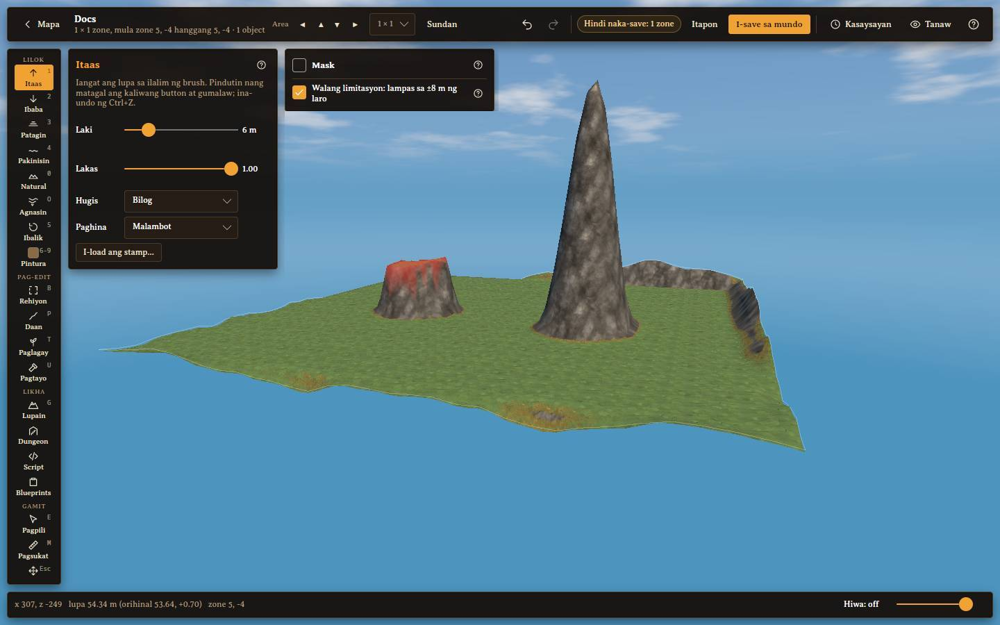
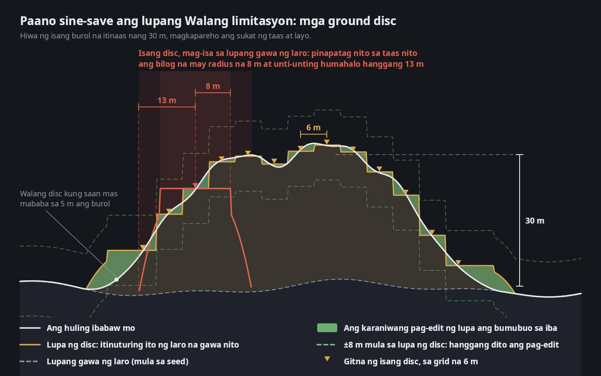
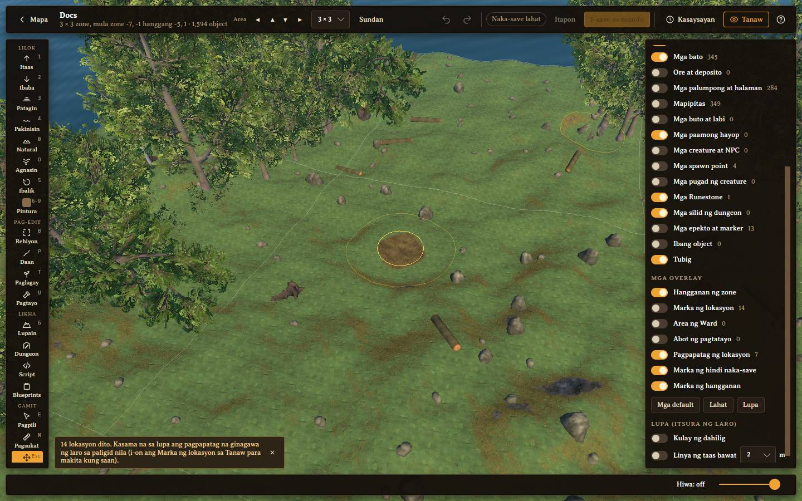

<!-- source: d97e56fa -->
# Mga hangganan ng lupa

Hinahayaan ng laro na gumalaw ang lupa nang hanggang 8 m pataas o pababa lang mula sa kung saan ito binuo ng mundo.
Sinusunod ng editor ang patakarang iyon, kaya bawat mundong sine-save nito ay naglo-load sa laro ng bawat player, kasama
ang mga console player, nang walang mod. Lumalampas dito ang **Walang limitasyon** sa paraang naiintindihan ng laro
mismo. Ipinapaliwanag ng pahinang ito ang hangganan, kung paano ito nilalampasan ng Walang limitasyon, at kung paano
hinuhubog ng mga lokasyon ng laro ang lupa.

## Ang 8 m na hangganan ng laro

Hindi iniingatan ng laro ang taas ng lupa. Iniingatan nito ang **seed** ng mundo, kinakalkula mula rito ang binuong
lupa, at sine-save lang ang mga **pagbabago** mo rito: para sa bawat punto ng lupa, gaano ito itinaas o hinukay. Ang
pagbabagong iyon ay hanggang **±8 m** lang (dagdag ang pagbabagong pampakinis na hanggang ±1 m, na ginagawa ng hoe ng
laro). Itinatapon ang anumang lampas pa rito kapag nilo-load ng laro ang zone. Ganoon din ang patakarang ina-apply ng
editor, kaya humihinto roon ang puntong umabot sa hangganan.

Ang ibig sabihin nito sa praktika:

- **Sinusukat ito mula sa binuong lupa, hindi mula sa kung nasaan ang lupa ngayon.** Hindi na maitataas pa ang burol na
  itinaas nang 8 m, at hindi na mahuhukay pa nang mas malalim ang lupang hinukay nang 8 m, paano ka man nakarating
  doon. Ipinapakita ng status bar ang dalawang taas sa ilalim ng mouse:
  `lupa 41.20 m (orihinal 35.00, +6.20)`.
- **Ang malalaking gawain ang unang tumatama rito**: isang patag na puwesto ng gusali na inukit sa gilid ng burol,
  isang ilog sa mataas na lupa (kailangang nasa ilalim ng dagat ang sahig nito, tingnan ang
  [Paano iniingatan ang lupa](#paano-iniingatan-ang-lupa)), isang bundok.
- **Sinusunod din ito ng sariling mga kasangkapan ng laro.** Gumagana ang hoe at pickaxe ng player sa loob ng ±8 m ng
  binuong lupa, sa laro gaya sa editor.

```text
        ┌──────────────────────── +8 m: pinakamataas na iniingatan ng laro
        │      ╭──╮  dito humihinto ang itinaas na lupa
  ──────┼─────╯    ╰──────────── binuong lupa (ang "orihinal" na taas)
        │
        └──────────────────────── −8 m: pinakamalalim na iniingatan ng laro
```

## Walang limitasyon

Hinahayaan ng switch na **Walang limitasyon: lampas sa ±8 m ng laro** ang mga tool sa lupa na igalaw ang lupa nang
hanggang 400 m mula sa binuong lupa: mga bundok, bangin, kanyon, malalalim na hukay. Iisang switch ito, sa card na
**Mask** katabi ng panel ng bawat tool na saklaw nito (ang mga brush ng paglilok, ang mga pormula at larawan ng Lupain,
Daan at Rehiyon), at naka-off ito tuwing nagsisimula ang editor. Laging lumalampas sa hangganan ang mga bundok ng tool
na [Lupain](../landform.md) at ang pag-paste ng kopya kapag kailangan nila, at ang mga script din maliban kung sasabihang
huwag.

Habang nagtatrabaho ka, iniingatan ang bahaging lampas sa ±8 m bilang hiwalay na angat sa ibabaw ng lupa; itinuturing
ito ng undo, Kasaysayan at **Ibalik** gaya ng anumang ibang pagbabago. Sinasabi ng status bar kung naka-on o naka-off
ang switch tuwing ginagalaw mo ito.


*Ang parehong stroke nang wala at may Walang limitasyon. Kaliwa, humihinto ang lupa sa 8 m pataas at nagiging pula ang
tuktok nito; kanan, patuloy itong tumataas. Nasa card na Mask ang switch.*

### Paano ito sine-save: mga ground disc

Hindi kailanman iniingatan ng laro ang mga edit ng lupa na lampas sa 8 m, pero pinapatag nito ang lupa sa ilalim ng mga
**lokasyon** nito (mga nayon, ang kampo ng trader) nang walang anumang hangganan, at itinuturing nitong binuo ang
pinatag na lupang iyon (tingnan ang [Pinapatag ng mga lokasyon ang lupa](#pinapatag-ng-mga-lokasyon-ang-lupa)). Ginagamit ito
ng editor. Kapag nag-save o nag-apply ka nang live, ginagawa nitong **mga ground disc** ang lupang lampas sa hangganan:
mga di-nakikitang lokasyon na sariling uri ng laro, walang model. Pinapatag ng bawat disc ang isang bilog na 8 m ang
radius sa taas nito at hinahalo ang lupa sa paligid nito hanggang mga 13 m: sa labas lang ng bilog, umaabot ang lupa
sa mga tatlong-kapat ng daan papunta sa taas ng disc (binibilang ng laro ang paghahalo mula sa gitna ng disc, kaya
nagsisimula ito sa maliit na baitang), saka pakaunti nang pakaunti, hanggang wala na sa 13 m.

1. Inilalagay ang mga disc sa 6 m na grid, kung saan lang lumalayo nang higit sa 5 m ang lupa mo mula sa magiging lupa
   kung wala sila.
2. Kinakalkula ng editor ang lupa nang eksakto gaya ng pagbuo rito ng laro mula sa mga disc, sa pagkakasunod ng laro,
   at inaayos ang mga taas nila sa ilang round para mapalapit hangga't kaya sa hugis mo. Kung saan malayo pa rin,
   nagdadagdag ito ng disc at sumusubok ulit.
3. Ang mga karaniwang edit ng lupa, sa loob ng ±8 m ng bagong lupa, ang bumubuo sa natitira.

Bumubuo ang laro ng bawat player ng parehong lupa mula sa mga disc, kasama ang mga console player, nang walang mod.


*Isang burol na itinaas nang 30 m, gaya ng pagka-save nito. Paakyat sa burol ang mga patag na tuktok ng mga disc
(kahel) sa 6 m na grid, sa ilalim ng ibabaw mo (puti); pinapatag ng isang disc, nakapula, ang 8 m sa paligid ng gitna
nito at hinahalo ang lupa hanggang 13 m. Ang mga karaniwang edit (berde) ang bumubuo sa natitira, sa loob ng ±8 m ng
lupa ng disc. Kung saan mas mababa sa 5 m ang taas ng burol, walang disc.*

### Ang ibig sabihin nito para sa iyo

| | |
|---|---|
| **Ang mensahe ng pag-save** | Sinasabi kung ilang disc ang nagawa (at ilang luma ang pinalitan nila), ilang puno at bato ang inalis, at gaano pa kalayo ang pinakamatarik na lupa: "Lupang walang limitasyon: 312 ground disc, 40 puno/bato ang inalis; may lupang hanggang 2.5 m ang layo (masyadong matarik)". |
| **Nananatili ang Kasaysayan** | Iniingatan ng editor ang lupa mong Walang limitasyon at kinakalkula ang mga disc mula rito: i-undo ang isang paste o stroke, mag-save o mag-apply ulit, at nawawala ang mga disc nito, bumabalik din sa dati ang lupa sa paligid nila. Totoo pa rin iyon pagkatapos buksan ulit ang mundo (tingnan ang [Ang hindi kayang bawiin ng isang hakbang](saving-and-history.md#ang-hindi-mababawi-ng-isang-hakbang)). |
| **Itinuturing na binuo ang bagong lupa** | Sa laro, gumagana ang hoe at pickaxe nang ±8 m mula sa lupa ng disc. Kapag binuksan ulit ang mundo, lupa ng disc na rin ang "orihinal" na taas sa status bar. Ibinabalik pa rin ng **Ibalik** ang lupa sa unang lupa ng mundo, pati sa ilalim ng mga disc. Para alisin ang naka-save na hugis, ibalik ito, i-undo ito sa Kasaysayan, o ibaba ulit ito nang naka-on ang Walang limitasyon: kinakalkula ulit ang mga disc sa susunod na pag-save, at nawawala kung saan hindi na kailangan. |
| **Inaalis ang mga puno at bato** | Ang mga puno, bato, ore, palumpong at mapipitas kung saan gumalaw ang lupa nang higit sa 2 m ay matatabunan o lulutang, kaya inaalis ang mga ito. Nananatili ang mga piece ng gusali. |
| **Lumalambot ang napakatarik na mga pader** | Hindi kayang sundan ng disc ang hiwang mas makitid kaysa rito. |
| **Mga zone na wala pang bumisita** | Pinapanatili ang dati nilang lupa: tinatanggal ang angat nila, at sinasabi ng mensahe kung ilan. Puntahan muna ang mga ito sa laro. |
| **Unang naglo-load ang mga disc** | Ginagawa ng laro ng player ang mga disc bago ang mga piece at puno sa paligid nila, kaya tapos na ang lupa sa unang mga sandali ng pagbisita. Sa server, pinapanatili iyon ng plugin na WorldEditorBridge. |
| **Mula sa malayo** | Lumalabas ang bagong hugis habang lumalapit ka, gaya ng pinatag na lupa ng isang nayon. |
| **Ang mapa sa laro** | Iginuguhit mula sa seed, kaya hindi nito ipinapakita ang bagong hugis. |
| **Hubad na lupa** | Pinipintahan ng laro bilang hubad na lupa ang lupa ng disc; pinipintahan ulit ng editor ang mga puntong iyon ng sariling lupa ng biome, kaya hindi lumalabas ang mga disc. |

Itinatago ng editor ang mga disc: hindi sila lumalabas bilang lokasyon, marka o object.

## Pinapatag ng mga lokasyon ang lupa

Pinapatag ng mga nayon, ang trader, mga pasukan ng dungeon, mga altar ng boss at ang iba pang **lokasyon** ng laro ang
lupa sa paligid nila. Hindi iniingatan sa save ang patag na lupa: pinapatag ito ulit ng laro tuwing nilo-load nito ang
zone, bago nito i-apply ang mga pagbabago ng sinuman. Saka nito idinadagdag sa ibabaw ang mga naka-save na edit ng
lupa.

Ipinapakita ng editor ang lupa nang tapos na ang pagpapatag na iyon, at napupunta sa ibabaw nito ang mga edit mo, gaya
sa laro. Binibilang ng isang tala sa ibabang kaliwa ng 3D view ang mga lokasyon sa area (at sa loob ng 40 m nito), at
iginuguhit ng **Tanaw → Pagpapatag ng lokasyon** kung saan sila nagpapatag: isang bilog para sa patag na bahagi, isang
mas malabo kung saan ito humahalo sa kalupaan.


*Naka-on ang Tanaw → **Pagpapatag ng lokasyon**, sa paligid ng altar ng Eikthyr: ang buong bilog ang patag na bahaging
pinapatag ng laro, ang mas malabong bilog kung saan ito humahalo pabalik sa kalupaan. Binibilang ng tala sa ibabang
kaliwa ang mga lokasyon sa area.*

Kung bakit mahalaga ito:

- **Binibilang ang ±8 m mula sa pinatag na lupa**, dahil itinuturing ito ng laro na binuo.
- **Tinatanggal ng pagtanggal sa lokasyon ang pagpapatag nito.** Tuluyang inaalis ng pagbura sa Runestone ang lokasyon
  nito, at kasama nito ang maliit na pagpapatag sa paligid nito. Inilalagay ulit ng pag-reset ng zone ang lokasyon, at
  bumabalik ang pagpapatag nito.
- **Hindi mga object ang mga bahagi ng lokasyon.** Ang mga bato ng pasukan ng crypt, ang kampo ng trader, ang altar ng
  boss o ang mga pader ng troll cave ay ginagawa ulit mula sa lokasyon tuwing naglo-load ang zone, kaya iginuguhit ng
  editor ang mga ito (sa ilalim ng **Mga guho at istruktura**) pero hindi mapipili o mababago.
- **Pinananatiling malinis ng ilang lokasyon ang lupa nila.** Walang tumutubo sa parisukat sa paligid ng lokasyong ang
  uri ay naglilinis ng lupa nito, at pinapanatili iyon ng Muling patubuin, gaya ng ginagawa ng laro (tingnan ang
  [Mga patakaran sa pagtubo](objects.md#mga-patakaran-sa-pagtubo)).
- **Ang mga ground disc** ay ang parehong mekanismong ito, ginamit nang sadya (tingnan ang
  [Walang limitasyon](#walang-limitasyon)).

## Marka ng hangganan

Nagiging **pula** sa 3D view ang lupang umabot sa ±8 m na hangganan (sa Itsura ng laro; **Tanaw → Marka ng
hangganan**, naka-on sa simula), at idinadagdag ng status bar ang ", nasa hangganang ±8 m" sa ilalim ng mouse.
Pagkatapos ng stroke na tumama rito, sinasabi nito ang "Naabot ang hangganan ng laro: hanggang 8 m lang mula sa
orihinal nitong taas maaaring gumalaw ang lupa (mga pulang punto)."

Sinasabi ito ng ibang mga tool sa sarili nilang paraan:

| Tool | Paano nito ipinapakita ang hangganan |
|---|---|
| [Daan](../path.md) | Nagiging pula ang mga punto ng lupa na umabot dito, at sinasabi iyon ng status bar. |
| [Rehiyon](../area.md): Patagin | Sinasabi ng linya ng hukay-at-tambak kung gaano karami ang hindi maabot: "(40 m³ hindi maabot: ±8 m na hangganan)". Para sa Itaas at Ibaba, binibilang lang ng linya ang lupang hinahayaang gumalaw ng hangganan. |
| Rehiyon: Heightmap | Nagiging pula ang mga puntong hindi maabot ang taas nila, at binibilang sila ng status bar. |
| [Script](../scripting.md) | Kapag `Ground.NoLimit = false`, binibilang ng linya ng resulta ang mga puntong huminto. |

Hindi error ang pulang lupa: lupa ito na hindi na hahayaan ng laro na lumampas pa. Para magpatuloy, i-on ang
**Walang limitasyon**, o baguhin ang plano (isang ilog na sumusunod sa mababang lupa, isang patag na puwestong inukit
nang medyo mas mataas).

## Paano iniingatan ang lupa

**Isang taas bawat metro.** May isang punto ng taas bawat metro ang lupa: 65 × 65 punto sa isang 64 m na zone, at
magkahati sa mga punto sa gilid ang magkakatabing zone. Kaya laging mga isang metro ang saklaw ng pader ng lupa: hindi
ito maaaring mas tuwid pa roon, sa editor man o sa laro, at hindi kailanman makakausli ang lupa. Ang tunay na tunnel o
kuweba sa ilalim ng lupa ay nangangailangan ng mod na humuhukay ng mga ito, gaya ng Tunnelheim (tingnan ang
[I-edit ang mundong ginawa gamit ang Expand World, Riverheim o Tunnelheim](../guides/use-mods-worlds.md)).

**Dalawang tatsulok bawat metro kuwadrado.** Iginuguhit ang bawat metro kuwadrado bilang dalawang tatsulok na hinati sa
parehong dayagonal gaya sa laro, mula sa timog-silangan hanggang sa hilagang-kanlurang sulok nito. Malinis ang gilid na
tumatakbo mula hilagang-kanluran hanggang timog-silangan; may maliit na lagaring hugis ang tumatakbo mula
hilagang-silangan hanggang timog-kanluran, sa laro rin.

**Ang mga taas ay ang sa laro.** Nasa 30 m ang dagat. Walang umaagos na tubig ang Valheim: ang tubig sa mga ilog at
lawa ay ang dagat, nasa parehong antas saanman, kaya may tubig lang ang lupa kung saan ito nasa ibaba ng 30 m.
Kailangan ng malalim na hiwa ang ilog sa mataas na lupa.

**Pintura.** May halaga rin ng pintura ang bawat punto ng lupa: bahagi ng hubad na lupa, ng binungkal na lupa at ng
sementadong bato, at isang markang nagsasabing pininturahan ito. Ipinapakita ng puntong hindi kailanman pininturahan
ang pinturang binuo ng mundo (ang lupa ng biome, at hubad na lupa kung saan ito inilagay ng mundo). Inililipat ng brush
ng pintura nang kaunti ang mga bahagi ng punto papunta sa kulay nito bawat sandali, kaya halo ang ibinibigay ng magaan
na stroke o ng malambot na gilid ng brush. Kaya rin magkaiba ang **Alisin pintura** at **Ibalik**:

| | Ang ginagawa nito sa isang punto |
|---|---|
| **Alisin pintura** | Pinipintahan ng payak na lupa ng biome. Nananatiling pininturahan ang punto, kaya itinatago rin nito ang hubad na lupang binuo roon ng mundo. |
| **Ibalik** | Tinatanggal ang marka ng pintura, kaya ipinapakita ulit ng punto ang binuo ng mundo. |

**Biome.** Galing sa seed ang biome sa isang punto. Hindi ito kailanman binabago ng pag-edit sa lupa.

## Paano hinuhusgahan ng Mask ang lupa

Nililimitahan ng [Mask](../masks.md) ang isang tool sa lupang tugma sa lahat ng setting nito. Hinuhusgahan nito ang
bawat punto ng lupa nang hiwalay, at walang paghahalo: kung saan nito iniiwan ang lupa, walang ginagawa ang tool; kung
saan nito pinadadaan ang lupa, gumagana ang tool gaya ng dati.

| Setting | Ang inihahambing |
|---|---|
| **Biome** | Ang biome na binuo ng mundo sa puntong iyon. Hindi ito binabago ng pag-edit sa lupa. |
| **Taas** | Ang taas ng lupa roon, gaya ng pagbilang ng laro (nasa 30 m ang dagat). |
| **Dahilig** | Kinakalkula mula sa mga taas 1 m sa magkabilang gilid ng punto, silangan–kanluran at hilaga–timog. |
| **Pintura** | Itinuturing na pininturahan ang punto kapag pininturahan ito at may kaunting kulay, kaya iniiwan itong hindi pininturahan ng **Alisin pintura** para sa Mask. Kailangan ng **Hubad na lupa lang**, **Binungkal lang** at **Sementado lang** na kalahati man lang ng pintura ang kulay na iyon. |

**Hinuhusgahan ang stroke ng brush sa lupa gaya ng dati nitong anyo noong magsimula ang stroke.** Kaya ang stroke ng
Itaas sa lupang mas mababa sa taas ng Mask ay patuloy na tumataas lampas dito hanggang bitawan mo, at hindi kusang
namamatay sa kalagitnaan ang stroke na nagbabago ng dahilig. Ang mga edit na ginagawa nang sabay-sabay (Lupain, isang
paste, Daan, ang mga aksiyon ng tool na Rehiyon) ay hinuhusgahan bawat isa sa lupa bago ang mga ito.

Dahil walang malambot na gilid, maaaring mag-iwan ng baitang ang paglilok gamit ang Mask kung saan nagtatagpo ang
tugmang lupa at ang lupang hindi isinama, lalo na sa Itaas, Ibaba at Lupain. Pakinisin ito pagkatapos nang naka-off ang
Mask.

## Paano hinuhubog ng mga tool ang lupa

Karamihan sa mga tool ay basta nagtataas, naghuhukay o nagpapatag. May ilan na sumusunod sa isang pattern o model na
mabuting malaman, dahil ipinapaliwanag nito ang ibinibigay nila at ang hindi nila kaya.

### Gaano kabilis gumagana ang brush

Sa **Lakas** 1, iginagalaw ng Itaas at Ibaba ang gitna ng brush nang hanggang 6 m bawat segundo (2.4 m bawat segundo sa
default na 0.40). Walang nakatakdang dami ang idinadagdag ng Patagin, Pakinisin, Natural at Ibalik: bawat sandali,
iginagalaw nila ang bawat punto nang bahagi ng daan papunta sa layunin nila, kaya tumatahan ang lupa sa layunin at hindi
kailanman lumalampas dito. Inililipat ng Pakinisin ang bawat punto papunta sa average nito at ng 8 katabi nito, kaya mas
napapakinis ang isang lugar kapag dinaanan ulit. Inaalis ng Ibalik ang bahagi ng pagbabago bawat sandali, at itinuturing
ulit na hindi nabago ang puntong nasa loob ng 1 cm ng binuo nitong taas; inaalis lang nito ang pintura kung saan
gumagana ang brush nang higit sa kalahating lakas, para hindi magusot ang gilid ng pintura.

### Ang pattern ng Natural

Kinakalkula muna ng **Natural** ang malawak na hugis ng lupa: ang lupang pinalabo sa ilang metro, gaya ng dati nitong
anyo noong magsimula ang stroke. Nagdadagdag ito sa hugis na iyon ng mga umbok mula sa isang noise pattern, **Mga
umbok** ang taas at **Lawak** ang lapad, at hinihila ang lupa papunta sa resulta. Dahil nananatiling pareho ang
layunin, hindi nagpapatong-patong ng mas maraming umbok ang ikalawang stroke sa parehong lugar: lumalapit lang ito sa
parehong lupa.

Nakatakda ang pattern sa mundo, hindi sa brush, kaya nagdudugtong nang walang tahi ang magkakatabing stroke at area.
Ginagamit ng natural na itsura ng tool na Daan, ng Natural ng tool na Rehiyon at ng `n(x, z)` ng tool na Lupain sa isang
pormula ang parehong pattern; binabago ito ng **Bagong pattern** para sa lahat ng iyon.

### Pagkaagnas

Inililipat ng pagkaagnas na **Thermal** ang lupa saanman mas matarik ang dalawang magkatabing punto kaysa sa **Anggulo
ng tambak**: dumudulas ang materyal mula sa mas mataas na punto papunta sa mga mas mababang katabi nito, kalahati ng
sobra bawat pagkakataon, kaya tumatahan ang mga dahilig sa halip na umindayog. Inililipat lang ang lupa, hindi kailanman
nawawala, kaya nabubuo ang mga tambak ng bato sa ibaba ng mga bangin. Ulan ang pagkaagnas na **Tubig**: bumabagsak ang
mga patak sa mga random na punto at umaagos pababa nang hanggang 40 hakbang, kumukuha ng lupa kung saan mabilis ang agos
at ibinababa ito kung saan bumabagal o pinupuno ang isang hukay. Umuukit ng mga bangin pababa sa dahilig ang maraming
patak at nag-iiwan ng mga pamaypay ng materyal sa paanan nila. Maaaring tumanggap ang lupa sa labas lang ng brush ng
dumudulas o naaanod mula rito.

### Paano ginagawa ang bundok

Natural na profile ang katawan ng bundok, mas matarik sa itaas at lumuluwag sa paanan, at binabaluktot ng noise ang
balangkas nito kaya hindi ito kailanman perpektong bilog (hanggang 15 % lampas sa radius). Nagdadagdag ang **Gaspang**
ng malalawak na umbok at tagaytay na may mga bangin sa pagitan nila pababa sa mga dahilig, ayon sa laki ng bundok, at
kaunting pinong detalye na hanggang ilang metro lang: magmumukhang punit ang malalalim at makikitid na hiwa, at hindi
masusundan ng mga ground disc. Sa gilid nito, humahalo ito pabalik sa kalupaan, at idinadagdag ito sa lupang naroon,
kaya pinapanatili nito ang sariling hilig ng kalupaan. Galing ang bawat bundok sa isang **seed**: gumagawa ulit ng
parehong bundok ang parehong preset, mga halaga at seed. Pinapanatili ng banayad na dahilig ang damo at mga puno;
nagpapakita ng hubad na bato ang matatarik, gaya ng pagguhit ng laro sa mga ito. Laging lumalampas sa ±8 m ang bundok,
at ginagawa ito ng pag-save na [mga ground disc](#paano-ito-sine-save-mga-ground-disc).

### Paano humihina ang gilid ng daan

Sinusukat ang bawat punto ng lupa malapit sa daan mula sa pinakamalapit na punto ng linya nito. Sa loob ng kalahati ng
**Lapad**, buo ang gumagana ang aksiyon; sa kabuuan ng **Lambot**, humihina ito nang pa-S na kurba, kaya
humahalo ang kalsada sa dahilig sa itaas at ibaba nito. Kapag 0 ang malambot na gilid, nakakakuha ang mga puntong
tinatawid ng gilid ng bahagi ng pagbabago ayon sa layo ng linya sa kanila, kaya sumusunod nang tuwid ang gilid sa linya
sa halip na humakbang mula punto hanggang punto. Kapag may **Natural na itsura**, nag-iiba ang lapad nang hanggang 45 %
sa alinmang direksiyon at magaspang ang mga gilid, mula sa pattern ng Natural. Hugis-U sa ilalim ng antas ng dagat ang
sahig ng ilog na naghuhukay lang, kaya maaari itong dumaloy papunta sa lawa o dagat.
