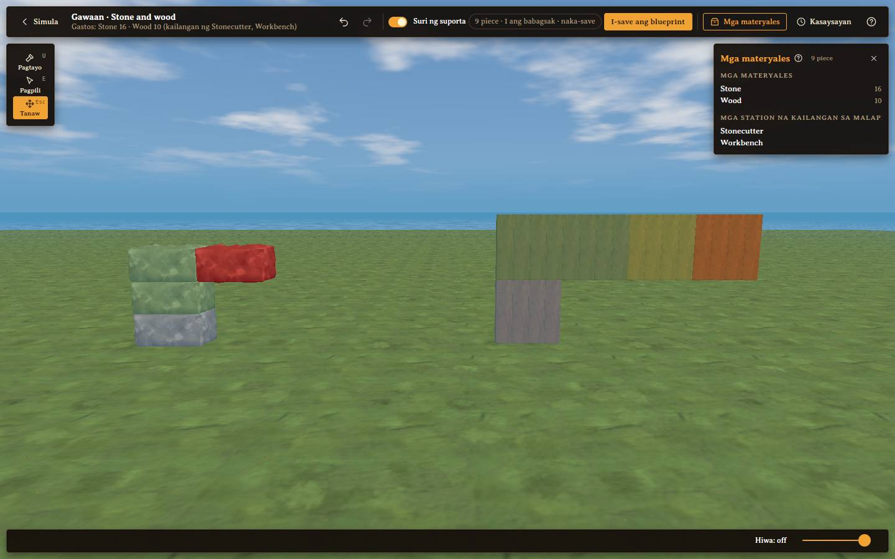
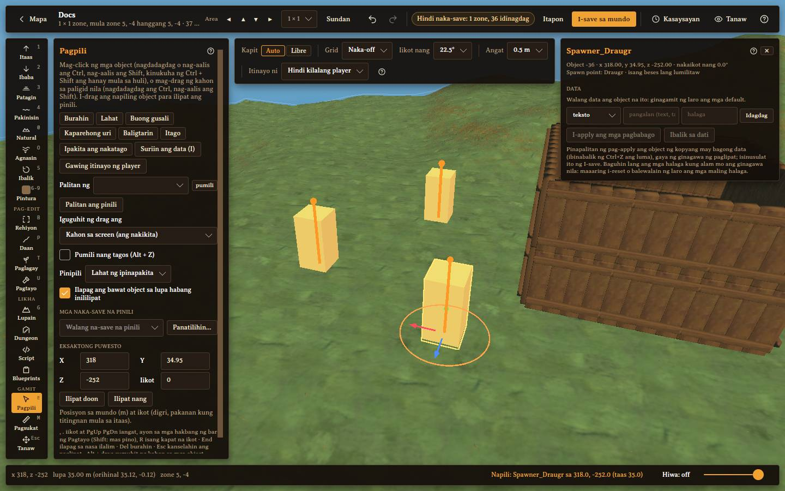
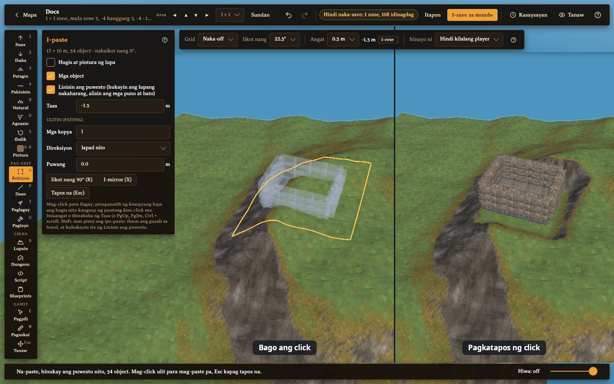

<!-- source: 551a19e3 -->
# Mga object

Lahat ng nasa mundo ng Valheim na hindi lupa ay isang **object**: isang puno, bato, dingding, chest, creature, isang
di-nakikitang spawn point. Ipinapaliwanag ng pahinang ito kung ano ang iniingatan ng laro sa bawat isa, kung sino ang
itinuturing nitong nagtayo, kung paano kumakapit at tumatayo ang mga piece ng gusali, ang mga patakaran sa pagtubo ng
mga halaman, at ang ginagawa ng mga spawn point.

## Ano ang object

Sa save, maikling tala ang bawat object:

| Bahagi | Halimbawa |
|---|---|
| Ang **uri** nito, ang pangalan ng laro para rito (ang *prefab* nito) | `Beech1`, `rock4_forest`, `piece_chest_wood`, `Spawner_Boar` |
| Ang **puwesto**, **ikot**, hilig at laki nito | x 1250, z −380, taas 32.4 m, nakaharap sa 90° |
| Ang **data** nito: mga halagang iniingatan ng laro para rito | Teksto ng karatula, laman ng chest, sino ang nagtayo nito, health nito, kailan ito itinanim, tag ng portal |

Ipinapakita ng [Inspector](../select.md) ang lahat ng ito. Galing ang mga pangalan ng mga halaga sa code ng laro at sa
code ng mga mod mo, na binabasa ng editor mula sa mga file nila pero hindi kailanman pinapatakbo. Baguhin lang ang isang
halaga kapag alam mo ang ginagawa nito: maaaring i-reset o hindi pansinin ng laro ang mga halagang hindi nito inaasahan.

**Nagbabago ang mga id; hindi ang uri at puwesto.** May id din ang bawat object, pero binibigyan ng laro ng bagong id ang
mga object kapag nagse-save ito, at isinusulat ng editor ang inilipat na object bilang kopya sa bago nitong puwesto.
Kaya saanman kailangang hanapin ulit ng editor ang isang object sa ibang pagkakataon, hinahanap nito ang parehong uri sa
parehong puwesto: isang naka-save na pinili (sa loob ng 5 cm pahalang at 20 cm sa taas), ang mga pagbabago mong dinala
sa mas bagong save, isang pagbabalik mula sa backup, isang undo pagkatapos mag-apply nang live. Itinuturing na nawawala
ang object na lumipat o nawala mula noon.

**Bago ang mga bagong object.** Ang inilagay na object ay malinis na kopya ng isa sa uri nito sa mundo, walang
iniingatang natatangi (walang laman, walang health), o isang bagong object na eksaktong gaya ng paggawa ng laro. Bago
rin ang pinalitang object: walang laman ang chest na pinalitan ng ibang uri ng chest. Ang na-paste na kopya o blueprint
naman ay pinapanatili ang lahat ng hawak ng mga object nito: ang laman ng chest, ang teksto ng karatula. Hindi isinasama
ang mga uring hindi kayang gawin ng mundo (mula sa mod na hindi naka-install), at sinasabi ng editor kung alin.

**Sa iyo ang lamang itinakda mo.** Ang chest na hindi pa kailanman binuksan ng laro ay pinupuno ang sarili nito ng loot
ng laro sa unang pag-load nito. Kapag binago mo ang laman ng chest, minamarkahan ito ng editor bilang sariling laman ng
chest, kaya iniiwan ito ng laro. Sine-save nang buo ang item na inilagay sa stand, bago at buo ang durability para sa
quality nito.

**Hindi object ang lahat ng nakikita mo.** Ang mga bahagi ng mga lokasyon ng laro (mga bato ng pasukan ng crypt, ang
kampo ng trader, ang altar ng boss) ay ginagawa ulit mula sa lokasyon tuwing naglo-load ang zone, kaya hindi sila
mapipili o mababago (tingnan ang [Pinapatag ng mga lokasyon ang lupa](ground-limits.md#pinapatag-ng-mga-lokasyon-ang-lupa)).
Ganoon din ang Runestone: mabubura mo ito, na tuluyang nag-aalis sa lokasyon nito, pero hindi mo ito maililipat,
makokopya o masusuri.

**Nagtatago ng mga object nang malalim sa ilalim ng lupa ang ilang mod**, gaya ng mga crafting station na 10 km sa
ilalim ng isang bahay. Hindi isinasama ng mga kahon, balangkas, **Lahat** at **Buong gusali** ang nasa higit 10 m sa
ilalim ng lupa, kaya hindi sila nadadala kasama ng nakatayo sa itaas.

### Magkakabit na grupo: mga barko at sasakyan

Ang ilang mod ay bumubuo ng isang bagay mula sa maraming object: ang sasakyang-dagat ng isang mod ng barko ay isang ugat
na object na may mga piece na nakatayo rito. Sine-save ang bawat piece kasama ang id ng kinakabitan nito at ang offset
nito mula roon, at inilalagay ito roon ng mod kapag naglo-load ang grupo. Sinasabi ito ng mod sa editor sa
`worldeditor.json` file na kasama nito; walang mod na kusang kilala ang editor. Pagkatapos, iginuguhit ng editor ang
grupo gaya ng pagbuo ng mod, at inililipat, kinokopya at binubura ito nang buo, hindi kailanman ang isang bahagi lang.
Binibigyan ng bawat paste ng bagong mga id ang grupo, dahil maghahati sa mga bahagi nila sa laro ang dalawang grupong
magkahati sa mga id.

### Tumatayo ang mga creature sa mga piece

Ang creature na ang puwesto ay nasa loob ng isang piece ng gusali (boss ng dungeon, alagang boar sa kulungan) ay itinatayo
sa ibabaw ng pinakamataas na piece sa ilalim nito tuwing pinupuwesto ng editor ang mga object: pagbukas o pagdagdag ng
blueprint, paglipat, paste, script, mga tool ni Claude. Hindi piece ang lupa: nananatili kung saan inilagay ang creature
na nasa lupa.

## Mga piece na itinayo ng player

Lahat ng kayang ilagay ng player gamit ang hammer, hoe, cultivator o serving tray ay **itinayo ng player** sa laro:
iniingatan nito kung **sino ang nagtayo nito**, bilang player id. Mas mahalaga iyon kaysa sa inaakala. Kung walang
nagtayo, itinuturing ng laro ang piece na bahagi ng guho:

| | Itinayo ng player | Walang nagtayo (guho) |
|---|---|---|
| Pagbaklas dito | Ibinabalik ang lahat ng materyal nito | Ibinabalik ang ikatlong bahagi ng mga ito |
| Apoy sa tabi nito | Gumagawa ng base: hindi lumilitaw doon ang mga halimaw | Hindi base |
| Mga raid | Tinatarget ito | Hindi ito pinapansin |
| Ward o pribadong chest | Sumusunod sa nagtayo nito | Walang sinusunod |

Kaya nagsusulat ang editor ng nagtayo sa bawat piece na inilalagay, ipine-paste o itinatayo nito: ang player na napili
sa **Itinayo ni** sa [bar ng Pagtayo](../build.md#ang-bar-ng-pagtayo). Inaalok ng listahang iyon ang mga player na nagtayo
sa mundong ito (kasama ang bilang ng piece nila), ang mga player na nakapangalan sa mga kama, ward at lapida, at ang mga
character sa computer na ito. Nagsisimula ito sa player na may pinakamaraming piece, kung wala ay ang sarili mong
character. Sadyang inilalagay ng **Wala (hindi itinayo ng player)** ang mga piece bilang bahagi ng guho. Kapag walang
kilalang player, nakakakuha ang mga piece ng **Hindi kilalang player**: itinuturing silang itinayo, pero walang
sinusunod na sinuman ang mga ward at pribadong chest, kaya piliin ang sarili mong id kapag kaya mo.

Sadyang pinapanatili o tinatanggal ng ilang bagay ang nagtayo:

- Pinapanatili ng paglipat o pag-edit sa isang object ang nagtayo nito.
- Walang iniingatang nagtayo ang blueprint: sinumang magtayo nito sa laro ang nagiging nagtayo nito. Ang na-save mula sa
  guho ay naaalalang guho ito.
- Walang nagtayo ang binuong dungeon, gaya ng sa laro: hindi ito pinapansin ng mga raid at ibinabalik nito ang ikatlong
  bahagi ng mga materyal nito.
- Binibigyan ng **Gawing itinayo ng player** (ang tool na [Pagpili](../select.md)) ng nagtayo ang mga piece na wala
  nito: isang guhong gusto mong ayusin at panatilihin, o mga piece na inilagay ng mga lumang bersiyon ng editor.

Itinuturing na gusali mo ang guhong dinagdagan mo (isang batong tore na tinagpian ng kahoy): ang mga piece nitong
dumidikit sa iyo, at ang mga dumidikit sa mga iyon, ay lumalabas kasama ng mga gusali mo sa Tanaw at sa mapa.

## Pagkapit

Nagdudugtong ang mga piece ng gusali gaya ng pagdugtong sa kanila ng hammer ng laro. May **mga punto ng kapit** ang
bawat piece, sa mga sulok at dulo nito, na binabasa ng editor mula sa Valheim mo kasama ang tunay na hugis ng bawat
piece (ang mga collider nito) at ang mga patakaran nito sa paglalagay. Kapag nagkalapit ang dalawang punto ng kapit,
gumagalaw ang piece para eksaktong magtagpo sila: magkadugtong sa dulo ang mga dingding, magkadugtong sa gilid ang mga
sahig, nakapatong ang dingding sa sahig.

**Paano naglalagay ng piece ang hammer**, na sinusunod ng [Pagtayo](../build.md) nang hakbang-hakbang sa isang mundo,
sa Gawaan at sa isang dungeon (ang pagkapit nitong **Auto**):

1. Tumatama ang linya ng cursor sa pinakamalapit na bagay: ang lupa, o ang tunay na hugis ng isang piece (hindi ang
   kahon nito).
2. Ang piece, nakaikot ayon sa itinakda mo, ay inililipat para dumikit sa tinamaan ang punto ng hugis nito na
   pinakamalapit doon. Ang mga rug at iba pang piece sa lupa, at ang mga piece na pinapayagan ng larong lumubog sa mga
   bagay, ay ayon sa gitna nila sa halip.
3. Sa lahat ng punto ng kapit ng piece at ng mga piece sa loob ng 10 m, nagtatagpo ang pinakamalapit na pares sa loob ng
   kalahating metro. Tumuro sa itaas ng dingding para ilagay ang susunod sa ibabaw nito, malapit sa dulo nito para
   maglagay ng isa sa tabi nito.
4. Nilalaktawan ang pagkapit na maglalagay sa piece nang eksakto kung saan nakatayo na ang parehong piece.

Idinadagdag ang angat (`PgUp`, `PgDn` o `Ctrl` + wheel) bago ang pagkapit, kaya kumakapit ang iniangat na piece sa mga
puntong malapit sa bago nitong taas. Ang mga punto lang sa lupa ang ini-round ng grid: kumakapit gaya ng dati ang piece
na nakaturo sa ibang piece.

May dalawa pang paraan ang bar ng Pagtayo. Nililimitahan ng **Mano-mano** ang hakbang 3 sa isang punto ng kapit ng
piece, ang pinipili ng `Q` at `E` (minarkahan sa piece), at hinahayaan itong umabot nang 1.5 m: sa masikip na sulok,
kung saan maling gilid ang pinakamalapit na pares, piliin ang puntong dapat magtagpo. Nilalaktawan ng **Libre**, o ng
pagpindot nang matagal sa `Alt` sa kahit anong mode, ang hakbang 3: nananatili ang piece kung saan ito dumidikit, at
kapag may `Alt`, ini-round ang pahalang na puwesto nito sa kapat ng metro mula sa gitna ng area.

Kumakapit ang ibang mga tool sa parehong mga punto ng kapit, bawat isa sa sarili nitong paraan:

| Saan | Paano ito kumakapit |
|---|---|
| [Paglagay](../place.md), **Kumapit sa mga piece na naroon na** (mga bahagi ng guho: inilalapag gamit ang Pagtayo ang mga piece na itinatayo ng mga player) | Isa-isang piece sa ilalim ng cursor. **Katabi**: dulo sa dulo sa piece na katabi ng cursor, sa antas nito, kung saan nagtatagpo ang isang pares ng punto ng kapit sa loob ng 1 m. **Sa ibabaw**: ang ilalim nito sa itaas ng piece sa ilalim ng cursor. Humaharap ang kumapit na piece gaya ng piece na dinudugtungan nito. |
| [Pagtayo](../build.md), **Ilatag** sa Linya, Bilog o Parihaba (at ang Linya ng [Paglagay](../place.md) na **Dulo sa dulo**, para sa mga bahagi ng guho) | Nagsisimula ang bawat piece kung saan nagtatapos ang huli. Ang dalawang dulo ng piece ay ang mga gitna ng dalawang maikling gilid nito, hinanap mula sa mga punto ng kapit nito (ginagamit ng mga uring walang punto ng kapit ang kahon ng model nila). Ang linyang nagsisimula sa loob ng 1 m ng isang piece ay nagpapatuloy dito. |
| [Pagpili](../select.md), nasa **Auto** ang **Kapit** ng bar ng Pagtayo | Habang naglilipat ka, nagkakandado ang pinakamalapit na pares ng punto ng kapit (isa sa inilipat na piece, isa sa piece sa paligid) sa loob ng 0.75 m, at umuusog ang buong pinili para magtagpo sila. |
| [Script](../scripting.md), `snap: true` | Nagtatagpo ang inilagay na piece at ang mga punto ng kapit ng mga piece roon sa loob ng 0.5 m. |

Hindi kailanman kumakapit ang mga tinype na posisyon (ang **EKSAKTONG PUWESTO** ng tool na Pagpili): eksakto ang mga ito.

## Ang suri ng suporta

Sa laro, kailangan ng bawat piece ng gusali ng **suporta**, na umaakyat mula sa lupa sa mga piece na nagdidikit. Ang
piece na masyadong kaunti ang suporta ay nasisira at bumabagsak sa sandaling lumapit ang isang player. Kinakalkula ito
ng **Suri ng suporta** ng Gawaan sa paraan ng laro, mula sa data na binabasa nito sa Valheim mo (ang hugis, materyal at
center of mass ng bawat piece), at kinukulayan ang bawat piece ng mga kulay ng build mode ng laro:

| Kulay | Kahulugan |
|---|---|
| Mapusyaw na asul | Buong suporta: nakatayo ito sa lupa. |
| Berde | Matibay: kalahati o higit pa ng pinakamataas na suporta ng materyal nito. |
| Dilaw, kahel | Mas mahina. |
| Pula | Malapit nang masira, o nasisira na: sa laro, babagsak ito sa sandaling lumapit ang isang player. |

**Paano kinakalkula ang suporta.**

- Buong suporta ang piece na ang hugis, pinalaki nang 0.15 m sa bawat gilid, ay umaabot sa lupa.
- Kinukuha ng anumang ibang piece ang pinakamahusay na suporta ng mga piece na dinidikitan nito, bawas ang kawala para
  sa layo sa pagitan ng mga center of mass nila: ang bilis na "pataas" kapag sinusuportahan nang diretso mula sa ibaba,
  ang bilis na "patagilid" kapag sinusuportahan mula sa gilid, isang halo sa pagitan. Kapag sinusuportahan mula sa
  dalawang gilid na hindi bababa sa 100° ang pagitan (tinitingnan mula sa itaas), nakukuha nito ang average ng dalawa
  kapag mas mahusay iyon.
- Inuulit ito hanggang walang nagbabago. Nasisira ang mga piece na mas mababa sa minimum ng materyal nila; saka
  kinakalkula ulit ang lahat nang wala sila, kaya kumakalat ang pagguho gaya sa laro.

| Materyal | Pinakamataas | Minimum | Nawawala bawat metro patagilid | Nawawala bawat metro pataas |
|---|---|---|---|---|
| Wood | 100 | 10 | 20 % | 12.5 % |
| Core wood | 140 | 10 | 17 % | 10 % |
| Timber | 200 | 10 | 20 % | 8 % |
| Stone | 1000 | 100 | 100 % | 12.5 % |
| Ice | 1000 | 100 | 33 % | 12.5 % |
| Iron | 1500 | 20 | 8 % | 8 % |
| Black marble | 1500 | 100 | 50 % | 12.5 % |
| Grausten | 2000 | 100 | 33 % | 10 % |
| Ancient | 5000 | 100 | 25 % | 7 % |


*Kaliwa, tatlong batong dingding na nakapatong: mapusyaw na asul sa lupa, berde sa itaas, at pula ang isang dingding na
umuusli nang 2 m mula sa itaas, ang "1 ang babagsak" sa top bar. Kanan, mga dingding na kahoy na nakausli nang 6 m mula
sa isang poste: berde, saka dilaw, saka kahel.*

Kaya kayang tumayo nang mataas ng bato pero hindi ito makakausli (inuubos ng isang metro patagilid ang lahat ng suporta
nito), at kaya mas malayo ang naaabot na usli ng kahoy kaysa sa bato pero hindi kasingtaas.

**Mga eksepsiyon, gaya sa laro.** May ilang piece na hindi kailanman sinusuri: mga black marble floor slab, ward stone,
barko at kariton. Nananatili silang nakatayo saanman sila naroon, at ibinibigay ng slab ang buong suporta ng materyal
nito sa nakapatong dito; ganoon tumatayo nang 5000 m pataas ang dungeon na gawa sa mga piece ng gusali (tingnan ang
[Bakit ito tumatayo nang 5000 m pataas](dungeons.md#bakit-ito-nananatili-5000-m-sa-itaas)). Walang halaga ang mga bahaging kusang
gumagalaw (ang umiikot na pinto, ang katawan ng barko): walang nakapatong sa kanila. Sa dungeon ng laro, itinuturing na
lupa ang mga sahig at dingding ng mga silid, kaya tumatayo ang mga piece na nakapatong sa kanila.

**Ang hindi isinasama ng pagsusuri**: mga bato at puno (itinuturing sila ng laro na buong suporta; wala nito ang plot ng
Gawaan), ang eksaktong hugis ng mga kurbadong collider (ang kahon nila ang binibilang), at mga piece na hindi binibigyan
ng laro ng anumang suporta (hindi sila kinukulayan). Para sa blueprint na itinayo sa hindi pantay na lupa, itinuturing ng
pagsusuri na nasa kung saan dumikit ang gusali ang lupa: sa mga terrain contact point na itinala ng Homestead, kung wala
ay sa ilalim ng pinakamababang piece ng bawat puwesto.

## Mga patakaran sa pagtubo

Sinusunod ng mga sapling, pananim at ligaw na halaman ang sariling mga patakaran ng laro, at sinusunod din ito ng mga
tool ng editor na [Paglagay](../place.md) at Muling patubuin, kaya tumutubo sa laro ang itinatanim mo.

**Puwang para lumaki.** Lumalaki lang ang sapling o pananim kapag walang nakatayo sa loob ng **grow radius** nito,
binabasa mula sa laro mo: 0.5 m para sa karamihan ng pananim, 2 hanggang 3 m para sa mga sapling ng puno. Kapag naka-on
ang **Bigyan ng puwang lumaki ang mga sapling at pananim** (ang default):

- lumalayo ang mga sapling at pananim nang hindi bababa sa grow radius nila mula sa lahat, kasama ang isa't isa;
- pinapanatili ng mga lumaking pananim (`Pickable_Carrot`) at mga punong tumutubo mula sa sapling (`Beech1`, `Oak1`) ang
  puwang na kailangan ng sapling nila, gaya ng tunay na bukid o taniman;
- hindi tumutubo mula sa anuman sa laro ang mga palumpong, kaya **Pagitan** lang ang umiiral sa kanila.

Kapag naka-off, makakapagtanim ka nang kasinsiksik ng gusto mo, pero maaaring hindi kailanman lumaki ang mga halamang
iyon.

**Kailangan ng mga pananim ng binungkal na lupa.** Sa binungkal na lupa lang pinapalaki ng laro ang mga pananim, kaya
pintahan muna ito (ang **Bungkalin** ng brush na Pintura o ang Pintura ng tool na Rehiyon). Nagbababala ang panel ng
Paglagay kapag kailangan ito ng isang naka-tsek na pananim.

**Tubig.** Hindi isinasama ang object na inilagay sa lupa kung saan higit 0.3 m sa ilalim ng tubig ang lupa, maliban sa
kelp at seaweed.

**Kumpol.** Tumutubo ang tunay na kakahuyan nang pa-grupo na may mga bakanteng lugar sa pagitan. Naglalatag ang
**Kumpol** ng noise pattern sa mundo, **Saklaw** ang lapad ng mga patak nito: kung saan mababa ang pattern,
pinaninipis ang mga puwesto, at habang mas mataas ang Kumpol, mas marami ang lupang nalilinis. Nakatakda ang
pattern sa mundo, hindi sa brush, kaya nagtutugma ang magkakatabing stroke.

### Paano pinipili ng Muling patubuin ang tutubo

Ibinabalik ng **Muling patubuin ang kalikasan** ng tool na Rehiyon ang patutubuin ng laro mismo, sa pamamagitan ng
pagkalkula sa bawat zone gaya ng ginagawa ng laro kapag una nitong ginagawa ito:

- **Ang sariling mga patakaran ng laro.** Binabasa nito ang mga patakaran ng laro sa halaman mula sa Valheim mo at
  ginagamit ang parehong mga random na numero, na may seed mula sa seed ng mundo, sa zone at sa uri. Sa lupang gaya pa
  rin ng pagkabuo, nakukuha mo ulit ang parehong mga puno sa parehong mga puwesto na unang mayroon ang mundo.
- **Ang mga kondisyon ng laro**: ang biome (at kung tumutubo ang isang uri sa gilid o sa gitna nito), ang taas sa ibabaw
  ng tubig, ang dahilig, ang forest factor (mga kakahuyan at bakanteng lugar), gaano kagaspang ang lupa sa paligid ng
  puwesto, ang layo mula sa gitna ng mundo, ilang grupo bawat zone at ilang object bawat grupo.
- **Ang lupa gaya ng anyo nito ngayon.** Nakukuha ng burol na itinaas mo ang tumutubo sa bago nitong taas at dahilig;
  nakukuha ng patag na puwestong pinatag mo ang tumutubo sa patag na lupa.
- **Hindi sa ibabaw ng mga bagay.** Nilalaktawan ang puwesto kapag may nakatayo sa loob ng 1 m, object ng parehong uri sa
  loob ng 3 m (hindi dinodoble ang punong nakatayo pa), o piece ng gusali sa loob ng 4 m.
- **Ang mga alt biome** (Dark Meadows, Rock Black Forest…) ay nasa kung saan sila inilalagay ng laro, mula sa seed,
  kasama ang idinadagdag nila at wala ang hinaharangan nila.
- **Pinapanatiling malinis ng mga lokasyon** ang lupa nila, gaya noong unang ginawa ng laro ang zone.

Ang hindi nito malalaman: ang mga pagsusuri ng physics ng laro laban sa mga object na nakatayo na. Gumagana ito sa
hanggang 16 na zone nang sabay. Ginagamit ng **Patubuin dito ang mga puno at bato ng biome** ng tool na Lupain, para sa
mga bundok nito, ang parehong mga patakaran sa mga dahilig na itinaas nito.

## Mga spawn point

Naglalagay ang laro ng mga creature sa mga kampo, nayon at dungeon nito gamit ang **mga spawn point**: mga
di-nakikitang object (`Spawner_Boar`, `Spawner_Draugr`…), bawat isa ay nagpapalitaw ng creature nito kung saan ito
nakatayo. Itinatakda ng uri ng spawn point kung aling creature, ilang bituin at kung bumabalik ito, kaya para makakuha ng
ibang creature, ibang uri ang ilalagay mo.

| Paano ito nagpapalitaw | Alin |
|---|---|
| **Isang beses lang lumilitaw**: sa unang paglapit ng player, hindi na ulit kapag namatay ito | Karamihan sa mga spawn point ng laro. |
| **Bumabalik N min matapos itong mamatay** | Ang mga `*_respawn_*`, `Spawner_Location_*`, `Spawner_imp_respawn`, `Spawner_Fish4`; madalas 60 min. |
| **Sa gabi lang** o **sa araw lang** | Ilang naghihintay. |
| **Kapag ginising ito ng isang event** | Ang mga `TriggerSpawner_`. |

**Mga pugad ng creature** ang nakikitang uri: mga pugad ng greydwarf, mga tumpok ng buto at mga katulad nito.
Patuloy silang nagpapalitaw ng mga creature sa paligid nila hanggang masira ("Greydwarf, Greydwarf_Elite · hanggang 3
sa paligid, sa loob ng 5 m").


*Mga spawn point sa tabi ng kubo: isang payak na kahon para sa bawat isa, may kahel na marka sa itaas nito. Nakabukas sa
Inspector ang napiling spawn point ng draugr, na ang linya ay nagsasabi kung ano ang pinalilitaw nito.*

Ipinapakita ng tool na Paglagay at ng Inspector ang linyang ito para sa bawat uri, binabasa mula sa laro mo
(`Spawn point: Boar · 0–2 ★ · isang beses lang lumilitaw`). Sa 3D, lumalabas ang bawat spawn point at pugad bilang
payak na kahon na may marka sa itaas nito, nakikita kahit may nakaharang sa harap: kahel para sa spawn point (pula kapag
bumabalik ang creature nito), lila para sa pugad. Nakatago ang dalawa sa simula, dahil ibinubunyag nila kung nasaan ang
mga bagay; i-on sila sa panel na Tanaw.

## Paano nililinis ng paste ang puwesto nito

Ang kopya (mula sa tool na Rehiyon o isang blueprint) ay may hawak na:

- **Ang mga object**, kasama ang lahat ng hawak nila: puno ang na-paste na chest gaya ng orihinal.
- **Ang lupa sa ilalim lang ng mga gusali**: sa ilalim ng bawat piece ng gusali (ayon sa tunay nitong hugis) at 1 m sa
  paligid nito, humahalo sa lupa kung saan ito lumapag sa loob ng 3 pang metro. Naiiwan ang natitirang lupa ng pinili,
  kaya nakaupo sa kalupaan kung saan ito lumapag ang na-paste na bayan, sa halip na magdala ng parisukat ng banyagang
  lupa. Walang hawak na lupa ang mga blueprint.
- **Mga taas**: pinapanatili ng mga piece ng gusali ang hugis ng gusali, sinusukat mula sa average na taas ng lupa ng
  kopya, na napupunta sa taas ng lupa kung saan ka nag-click. Pinapanatili ng mga puno, bato at mga katulad nito ang
  taas nila sa ibabaw ng lupa, kaya lumalapag ang bawat isa sa lupa kung saan ito napupunta.

Ganoon din inilalagay ang kopya ng tool na Pagpili.


*Bago ang click (kaliwa), tumatagos sa punso ang balangkas ng paste; pagkatapos nito (kanan), hinukay ang lupang
nakaharang sa kubo pababa sa sahig nito, sa parehong hakbang ng undo.*

Kapag naka-on ang **Linisin ang puwesto**, gumagawa rin ng puwang para sa sarili nito ang bawat paste, sa parehong
hakbang ng undo:

- Kung saan nakatayo ang na-paste na piece ng gusali (ayon sa tunay nitong hugis, at 1 m sa paligid nito),
  **hinuhukay pababa** ang lupang nakaharang hanggang sa ilalim ng pinakamababang piece, lampas sa ±8 m kung kailangan.
  Hindi nababaon ang gusaling na-paste sa isang burol. Hindi kailanman itinataas ang mas mababang lupa.
- Kung saan buong pumasok ang kinopyang lupa, walang hinuhukay: nakatayo rito ang gusali gaya ng pagtayo nito sa
  orihinal.
- Hindi pinapansin ang mga piece na higit 100 m sa ilalim ng lupa (iniingatan doon ng ilang mod ang mga crafting
  station), at walang hinuhukay sa ilalim ng magkakabit na grupo gaya ng barko.
- **Ang mga puno, bato, ore, palumpong at mapipitas** sa bakas na iyon ay inaalis. Nananatili ang mga gusali, creature
  at alagang hayop.

Mga bagong object na ginawa mula sa kopya ang mga na-paste na object, kaya gumagana rin ang paste sa ibang mundo. Nang
live, inililipat ng **Gupitin** na pagkatapos ay ini-paste ang mga object sa laro sa ilalim ng sarili nilang mga id kapag
kaya nito (tingnan ang
[Ang paglipat ng object ay pinapanatili itong parehong object](live-editing.md#hindi-nagbabago-ang-object-kapag-inilipat)).

## Mga file ng blueprint

Ang blueprint ay isang gusaling iniingatan bilang file, sa format ng
[Homestead](https://thunderstore.io/c/valheim/p/sighsorry/Homestead/), ang mod sa pagtatayo sa laro: lumalabas ang
parehong file sa hammer tab ng Homestead, handang itayo sa laro, at nai-paste sa kahit anong mundo mula sa editor. Ang
pagbabahagi ng gusali ay ang pagbabahagi ng `.blueprint` file nito at ng `.png` na larawan sa tabi nito.

**Ang iniingatan nito.** Mga piece lang ng gusali: hindi iniingatan ang mga puno, bato at mga item na nakakalat, at hindi
rin ang lupa. Isang linya ang bawat piece na may uri nito, puwesto nito sa metro mula sa **angkla** (ang gitna ng
gusali sa antas ng lupa), ikot nito at laki nito, mula sa pinakamababang mga piece:

```text
#Name:Small hut
#Creator:Valheim World Editor
#Description:A hut with a fire pit
#Tags:house, wood
#Pieces
woodwall;Building;-3;1;-2;0;0;0;1;"";1;1;1
```

Nagdadagdag ang editor ng sarili nitong mga linya na nilalaktawan ng Homestead at PlanBuild, kaya naitatayo pa rin sa
laro ang parehong file: ang mga tag, ang hawak ng mga object (laman ng chest, teksto ng karatula, mga bituin ng boss),
kung guho ang gusali, at kung aling mga piece ang editor lang ang makapaglalagay (mga estatwa, barko, creature:
nilalaktawan sila ng hammer ng Homestead, at hindi sila isinasama sa ipinapakitang gastos). Hindi kailanman isinusulat
ang nagtayo: sinumang magtayo nito sa laro ang nagiging nagtayo nito.

**Ang bumabalik.** Kapag na-paste mula sa editor, bumabalik ang mga object ng blueprint na hawak ang dati nilang hawak.
Kapag itinayo sa laro gamit ang Homestead, mga piece lang: walang laman ang mga chest na ginagawa ng laro at walang
inilalagay na creature.

**Ang taas nito.** Kapag binuksan sa Gawaan, inililipat ang blueprint bilang isa para nasa plot ang ilalim ng
pinakamababang piece ng gusali nito (hindi binibilang ang mga bato at ibang bagay na inilalagay ng hoe). Inaalala ng
editor ang angat na iyon at inaalis ito ulit kapag nagse-save, kaya pinapanatili ng angkla ang taas nito at tatayo ang
gusali gaya ng dati kapag itinayo ito ng Homestead.

**Ibang mga file.** Binabasa rin ng editor ang mga PlanBuild `.blueprint` file at `.vbuild` file (BuildShare at mas
lumang mga tool, isang piece bawat linya), at kayang magsulat ng `.vbuild`. Sumusukat ang mga ito mula sa isang sulok,
kaya igingitna sila sa plot. Hindi iniingatan ang mga marka ng lupa nila, hindi isinasama ang mga piece ng mga mod na
wala sa iyo, at sinasabi ng mensahe kung ilan.
