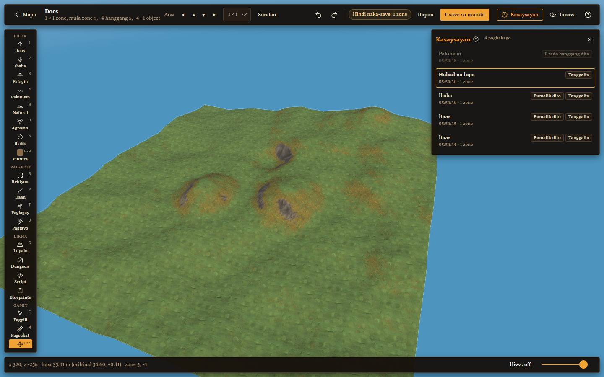

<!-- source: 752963cc -->
# Pag-save at kasaysayan

Walang ginagawa mo sa editor ang gumagalaw sa mundo hangga't hindi mo sinasabi. Naghihintay ang mga pagbabago mo bilang
mga **nakabinbing** pagbabago, saka pumapasok sa mga file ng mundo kapag **I-save sa mundo** mo, o sa tumatakbong laro
kapag **I-apply nang live** mo. Pinapanatili ng **Kasaysayan** ang bawat hakbang, kahit nakasara na ang editor, para
mabawi mo ang isang pagbabago sa ibang pagkakataon.

```text
  edit mo ──► nakabinbin ──► I-save sa mundo ──► bagong save sa folder ng mundo            (offline)
                   │
                   └───────► I-apply nang live ──► ang tumatakbong laro, na nagse-save nito  (live)
```

## Mga nakabinbing pagbabago

Bawat stroke, click, paste o pagpapatakbo ng script ay isang **hakbang**, at nananatili itong nakabinbin hanggang ma-save
o ma-apply. Binibilang ng top bar ang nakabinbin, kulay amber ("Hindi naka-save: 3 na zone, 1 binura, 12 idinagdag, 1
ire-reset", o "Hindi na-apply: …" kapag live), at nakasulat ang "Naka-save lahat" o "Na-apply lahat" na kulay abo kapag
walang naghihintay:

| Bilang | Ano ito |
|---|---|
| **zone** | Mga zone na ang lupa (taas o pintura) ay talagang iba sa save. Walang binibilang ang pagtaas saka pagbaba pabalik sa parehong taas. |
| **binura** | Mga object ng mundo na tatanggalin. |
| **idinagdag** | Mga bagong object: inilagay, na-paste, kinopya o ginawa ng isang tool. |
| **ire-reset** | Mga zone na minarkahan para gawin ulit ng laro (tingnan ang [Pag-reset ng mga zone](areas-and-zones.md#pag-reset-ng-mga-zone)). |

Kapag nakapag-save ka na, ang mga bilang ay ang naiiba sa save na iyon, kaya ang pag-undo ng na-save na hakbang ay
ginagawa itong nakabinbin ulit. Sa 3D na tanaw, may berdeng tuldok ang bawat bagong object na hindi pa naka-save
(itinatago sila ng **Tanaw → Marka ng hindi naka-save**).

**Pag-aari ng mundo ang mga nakabinbing pagbabago.** Nananatili sila kapag inilipat mo ang area, bumalik sa mapa o
nagbukas ng ibang lugar, at sabay-sabay silang sine-save (tingnan ang [Ang area](areas-and-zones.md#ang-area)).
Nawawala lang sila kapag isinara mo nang hindi nagse-save (nagtatanong muna ang editor), itinapon mo sila, o
**I-reload** mo ang isang live na mundo (nagtatanong din muna ito).

Itinatapon ng **Itapon** ang hindi pa na-save o na-apply: ina-undo nito ang mga hindi naka-save na hakbang sa dulo ng
kasaysayan, pinakabago muna, nire-redo ang mga na-save o na-apply na hakbang na in-undo mo mula noon, at inaalis ang
natitira sa listahan ng redo. Nananatili ang mga na-save at na-apply na hakbang.

Walang hakbang sa kasaysayan ng bukas na area ang ilang nakabinbing pagbabago (ginawa sa ibang area, o bago binasa
muli ang mundo). Maaalis lang sila sa muling pagbasa ng buong mundo mula sa mga file nito o mula sa laro, na nag-aalis
sa bawat nakabinbing pagbabago, kaya nagtatanong ulit ang Itapon bago nito gawin iyon.

Kapag binasa muli, nananatili ang kasaysayan gaya ng hawak ng mundo: mula sa mga file, ang kasaysayang itinabi sa
huling pag-save; kapag live (**Itapon** o **I-reload**), ang bawat hakbang na hawak ng laro, na-apply at maa-undo pa,
habang sumasama sa mga pagbabago nila ang mga hakbang na hindi na-apply.

## Pag-save ng mundo

Iniingatan ng laro ang isang mundo bilang folder ng **mga save na may numero**: bawat save ay isang set ng mga file
(`_main.<n>.chunks`, `.db2`, `.fwl2`, at isang maliit na marker na `.ok`) at mga chunk file na may hawak ng mga object
at ng lupa. Gumagana ang **I-save sa mundo** gaya ng ginagawa ng laro, kaya bumubukas sa laro ang mundong na-save nito
gaya ng iba:

1. **Sumusulat ito ng bagong save** gamit ang susunod na numero. Ang mga chunk file lang na nagbago ang isinusulat
   ulit; kinokopya byte kada byte ang mga object na hindi ginalaw. Huling dumarating ang marker na `.ok`, dahil ang save
   lang na mayroon nito ang pinagkakatiwalaan ng laro, kaya hindi kailanman napagkakamalang maayos ang save na naputol.
   Pinapanatili ng bawat file ang format ng save kung saan ito binasa, kaya parehong nase-save ang mga mundo mula sa
   Valheim 1.0.20 pataas at mula sa mas lumang bersiyon, at bumubukas sa larong gumawa sa kanila.
2. **Binabasa nito pabalik ang bagong save** at ikinukumpara ito sa balak nitong isulat: ang lupa ng mga binagong zone,
   ang lupa ng bawat iba pang zone, ang bilang ng mga object, ang mga na-reset na zone. Kung may naiiba o pumalya,
   tinatanggal ang mga bagong file at nagtatapos ang mensahe sa "Walang nagbago". Hindi pa nagagalaw ang lumang save
   sa puntong iyon.
3. **Nagliligpit ito.** Pinapanatili ang save na pinagbuksan mo ng mundo habang bukas ang mundo, dahil mula rito
   ginagawa ang bawat save. Tinatanggal ang save na ginawa mo kanina sa parehong session kapag nag-save ka ulit. Kapag
   umalis ka sa mundo, ang pinakabagong save lang ang natitira.
4. **Isinusulat nito ang kasaysayan** kasama ng mundo (tingnan ang [Kasaysayan](#kasaysayan)).

**Isara muna ang laro.** Iniingatan ng tumatakbong laro o server ang mundo sa memory at sinusulatan ang save mo sa
susunod na pag-save nito. Para baguhin ang mundo habang tumatakbo ito, gamitin ang [live mode](live-editing.md).

**Ang hindi mase-save** ay inililista kasama ang dahilan: mga edit sa zone na wala pang player na nakalapit (wala pang
data ang mundo roon: tingnan ang [Mga zone](areas-and-zones.md#mga-zone)), at bagong lupa sa mundong wala pang naghukay o
nagpatag sa laro (ginagawa ng editor ang mga edit sa lupa sa pamamagitan ng pagkopya sa isang ginawa ng laro, kaya
humukay muna nang isang beses kahit saan sa laro).

### Nag-save ang laro mula nang buksan mo ito

Kung na-save ng laro ang mundo matapos itong basahin ng editor (naglaro ka sa pagitan ng dalawang save), matatapon ng
pag-save ang nangyari sa laro, kaya walang sine-save ang editor. Sa halip, iniaalok nitong **dalhin ang mga pagbabago
mo** sa save ng laro: ginagawa nito ulit ang bawat nakabinbing pagbabago mo sa save na iyon, hinahanap ang mga object
ayon sa uri at puwesto nila, dahil nagbabago ang mga id nila sa bawat save (tingnan ang
[Ano ang object](objects.md#ano-ang-object)).

Kung saan binago ng laro ang parehong bagay, nagtatanong ito nang isang beses bawat uri, **Panatilihin ang akin** o
**Panatilihin ang sa laro**:

| Ang nagbabanggaan | Panatilihin ang akin |
|---|---|
| Mga zone na pareho ninyong binago ang lupa | Papatong ang mga binago mong punto at pintura sa bersiyon ng laro; nananatili ang lupa ng laro sa lahat ng iba pang bahagi ng mga zone na iyon. |
| Mga object na binago ng laro (nagamit na chest, karatula, halamang lumalaki) na binura, inilipat o in-edit mo | Binubura, inililipat o ine-edit sila gaya ng ginawa mo. |
| Mga object na tinanggal ng laro (kinuha, sinira, o creature o barkong lumayo) na inilipat o in-edit mo | Bumabalik sila kung saan mo sila inilagay. Dalawa na ito roon kung lumipat lang ito. |

Wala pang isinusulat: ang mundo ngayon ay ang save ng laro na nakabinbin dito ang mga pagbabago mo. Tingnan sila, saka
mag-save. Hindi na maa-undo ang mga hakbang sa Kasaysayan na gumalaw sa anumang ibinigay mo sa bersiyon ng laro, pati
ang mga hakbang bago nila; sinasabi ng mensahe kung ilan ang itinapon.

## Pag-apply nang live

Sa [live mode](live-editing.md), **I-apply nang live** ang parehong button. Ipinapadala nito ang nakabinbing lupa,
mga object at pag-reset ng zone sa tumatakbong laro, na ibinabahagi ang mga ito sa bawat player doon at sine-save ang
mga ito mismo, gaya ng anumang itinatayo ng mga player. Minamarkahang **na-apply** sa Kasaysayan ang mga ipinadalang
hakbang; kapag naka-on ang **Auto**, ina-apply ang bawat hakbang sa sandaling matapos mo ito.

Maaari pa ring i-undo ang mga na-apply na hakbang: mag-undo (o **Tanggalin** sa Kasaysayan), saka mag-apply ulit.

- Bumabalik ang isang **binurang** object bilang kopya ng kung ano ito noong binasa ang mundo, kasama ang data nito
  (isang chest na may laman gaya ng dati). Para sa laro, bagong object ito.
- Tinatanggal ulit ang isang **inilagay** na object, kahit ginawa itong muli ng ibang mod sa ilalim ng bagong id sa
  pagitan: hinahanap ito ng plugin ayon sa uri at puwesto nito.
- Bumabalik ang isang **inilipat** na object.
- Hindi maa-undo ang **pag-reset ng zone** kapag na-apply na.

## Kasaysayan

Inililista ng **Kasaysayan** (`L`) ang bawat hakbang, pinakabago muna: ang pangalan nito ("Itaas", "Pag-paste ×3",
"Tinanggal: Paglagay"), ang oras nito at ang ginalaw nito. Sinasabi ng mga tag kung ang isang hakbang ay **na-apply**
(na-save o ipinadala sa laro), ginawa ni **Claude**, o mula sa **naunang session**. Pinapanatili nito ang bawat hakbang
bilang default, basta't kumukuha sila ng mas mababa sa 2 GB ng memory (lampas doon, nauunang mawala ang pinakaluma);
ganoong dami lang ang pinapanatili kapag itinakda ang **Mga setting → Kasaysayan → Hakbang na pinapanatili**.


*Na-undo ang huling hakbang gamit ang **Bumalik dito**: kulay abo ito at iniaalok ang **I-redo hanggang dito**.*

May dalawang paraan pabalik:

| | Ano ang ginagawa | Halimbawa |
|---|---|---|
| **Bumalik dito** | Ina-undo ang bawat hakbang pagkatapos nito, gaya ng maraming `Ctrl+Z`. Nananatiling kulay abo ang mga sumunod na hakbang, para i-redo. Inaalis sila ng bagong pagbabago. | Sumubok ka ng tatlong bagay at gusto mong ibalik ang mundo gaya ng bago sila. |
| **Tanggalin** | Tinatanggal lang ang hakbang na ito at pinapanatili ang lahat ng ginawa pagkatapos nito: natatanggal ang pagbabago nito sa taas sa mga puntong ginalaw nito, nawawala ang pintura nito kung saan walang muling nagpinta mula noon, nawawala ang mga object nito at bumabalik ang mga binura nito, kinakansela ang mga pag-reset nito. Bagong hakbang ang pagtanggal, kaya ibinabalik ito ng `Ctrl+Z`. | Tanggalin ang hanay ng mga punong itinanim isang oras na ang nakalipas nang hindi nawawala ang trabaho sa lupa na ginawa mula noon. |

Gumagawa ang **Bawiin ang mga pagbabago ni Claude** ng **Tanggalin** para sa bawat hakbang na ginawa ni Claude sa
kasaysayan ng bukas na area, at pinapanatili ang sa iyo. Itinatabi ang mga hakbang ni Claude na ginawa sa ibang area
(tingnan sa ibaba): buksan ang mga area na iyon para bawiin din sila.

### Pag-aari ng mundo ang kasaysayan

Sumasama ang kasaysayan kapag inilipat mo o binago ang laki ng area, kapag pinalaki ito ng Sundan, at sa pagdaan sa
mapa. Itinatabi ang hakbang na buong ginawa sa ibang area habang bukas ang area na ito ("Nananatili ang N hakbang na
ginawa sa ibang area"); bumabalik ito, handang i-undo, kapag nagbukas ka ng area na may hawak nito. Hindi maa-undo mula
rito ang hakbang na bahagya lang nasa bukas na area, pati ang mga hakbang bago nito. Ang pag-save o pag-apply mula sa
anumang area ay nagmamarka sa mga hakbang ng bawat area bilang na-save.

### Itinatabi pagkasara ng editor

Pagkatapos ng bawat **I-save sa mundo** o **I-apply nang live**, isinusulat ang kasaysayan sa data folder ng editor
(`history/`, isang file bawat folder ng mundo; kapag live, isa bawat koneksiyon at mundo). Buksan ulit ang mundo, kahit
ilang araw pa ang lumipas, at bumabalik ang mga hakbang, may tag na **naunang session**. Ibinabalik ng undo ang lupa,
ibinabalik ang binurang object kasama ang laman nito, at inaalis ang inilagay. Hindi itinatabi ang mga pagbabagong
hindi mo na-save o na-apply.

Maaaring nagbago ang mundo mula noon (nagtayo at naghukay ang mga player, o na-save ulit ito ng laro), kaya nagtatanong
nang isang beses ang editor bago i-undo o i-redo ang unang hakbang mula sa naunang session: ibinabalik ng paggawa nito
ang mga bagay gaya ng dati, sa ibabaw ng nagbago mula noon. Hindi tinatanong ang mundong ang editor lang ang nag-save
mula noon.

### Ang hindi mababawi ng isang hakbang

Pinapanatili ang kasaysayan sa bawat save at apply, kasama ang mga pag-reset ng zone at ang lupang
[Walang limitasyon](ground-limits.md#walang-limitasyon) na ginawang mga ground disc. Iilang bagay ang hindi nito naaabot:

- **Pag-reset ng zone, kapag na-save o na-apply na.** Ginagawa ulit ng laro ang zone: inaalis sa mga hakbang ang ginawa
  nila roon (nawawala ang hakbang na buong naroon), pati ang hakbang na nagmarka sa pag-reset. Nananatili ang mga
  hakbang sa ibang lugar.
- **Mga puno at batong inalis sa ilalim ng lupang Walang limitasyon**, kapag na-apply na nang live o kapag binuksan
  ulit ang mundo: hindi sila ibinabalik ng undo. Gamitin ang
  [Muling patubuin ang kalikasan](../area.md#muling-patubuin-ang-kalikasan).
- **Lupang binago ng mga player mula noon.** Kapag binuksan ulit, bumabalik kasama ng kasaysayan ang lupang Walang
  limitasyon ng zone na na-save bilang mga ground disc, kaya ibinabalik ng undo ang lahat ng lupang binago nito, pati
  sa paligid ng mga disc. Kung saan naghukay ang mga player sa zone na iyon mula noon, pinapanatili ng zone ang hawak
  ng laro: ang sariling lupa lang ng hakbang ang ibinabalik ng undo.

## Mga backup

Walang sariling backup folder na ginagawa ang editor: hindi nito kailanman ginagalaw ang lumang save hangga't hindi
nababasa nang tama pabalik ang bago, at nananatili ang save na pinagbuksan mo hanggang umalis ka sa mundo.
Pinoprotektahan ka nito mula sa save na nagkamali, hindi mula sa edit na pinagsisihan mo pagkaalis. Para doon, magtabi
ng sarili mong kopya ng anumang mundong mahalaga sa iyo (tingnan ang
[Mag-backup ng mundo bago mag-edit](../guides/back-up-a-world.md)).

Iniingatan ng laro ang sarili nitong mga backup sa tabi ng folder ng mundo (`<World>_backup_auto-<date>`), at
iningatan ng mga naunang bersiyon ng editor ang sa kanila bilang `<World>_backup_terraineditor-<date>`. Ibinabalik ng
**Balik sa isang backup** ng tool na Rehiyon ang isang pinili gaya ng dati sa ganoong kopya, nang hindi ibinabalik ang
buong mundo (tingnan ang [Ibalik ang isang area mula sa backup](../guides/restore-from-backup.md)). Ganito nito
itinutugma ang mga object:

- Hindi ginagalaw ang object na nasa pinili ngayon at nasa backup, na kaparehong uri, nasa parehong puwesto (sa loob ng
  1 cm) at nakaharap sa parehong direksiyon.
- Tinatanggal ang bawat iba pang object ng mga piniling uri na nasa pinili ngayon, kahit nakatago ang uri nito sa
  Tanaw.
- Bumabalik ang bawat object ng backup na walang katugma, kasama ang lahat ng data nito: chest na may laman, karatula na
  may teksto.
- Hindi kailanman ginagalaw ang mga Runestone.

Bumabalik ang lupa nang eksaktong gaya sa backup, kasama ang lupang Walang limitasyon. Tinatanggihan ang kopya ng ibang
mundo (ibang seed).
