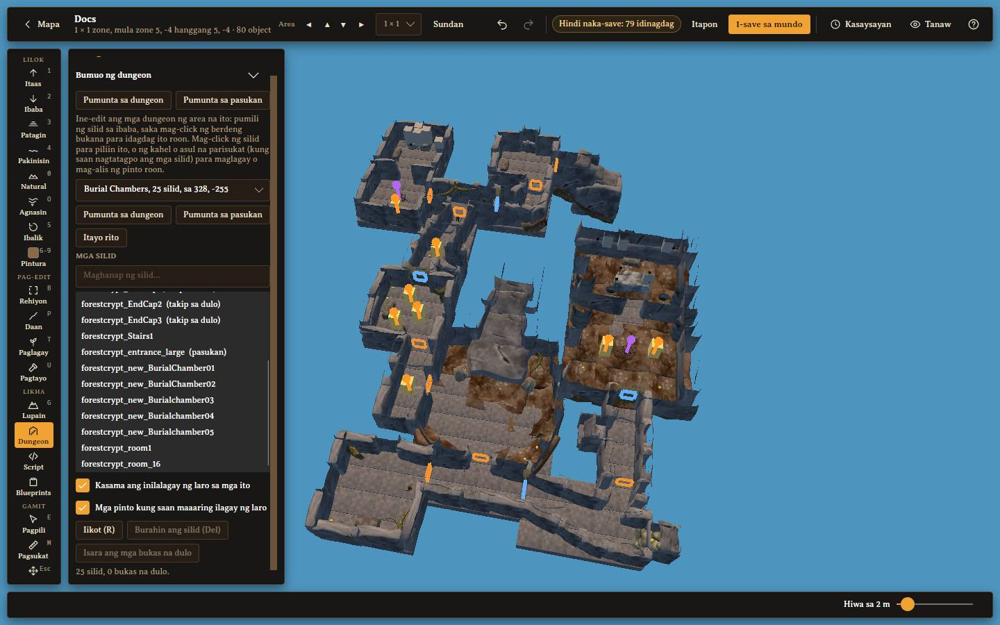
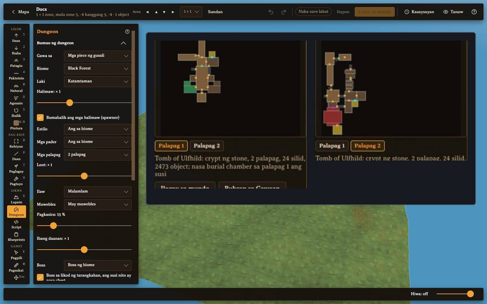
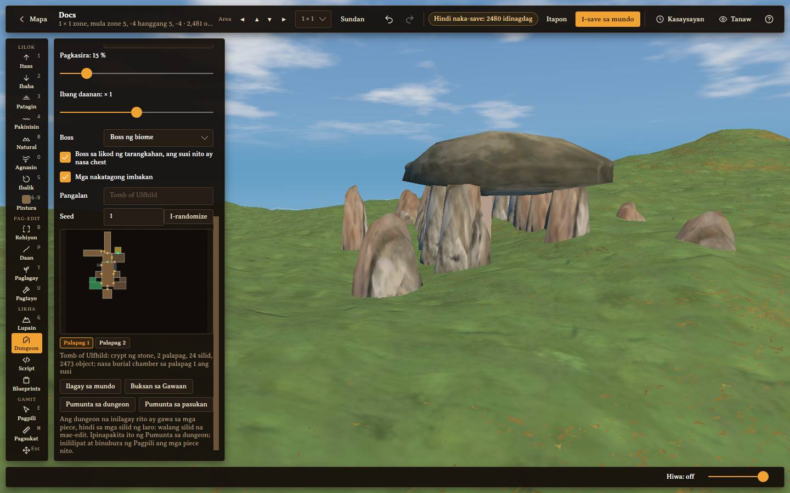
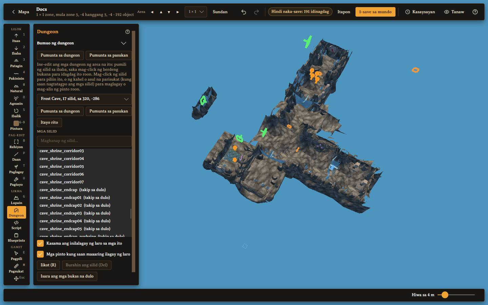
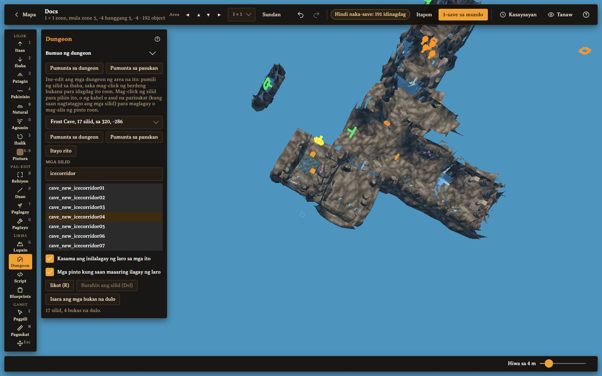
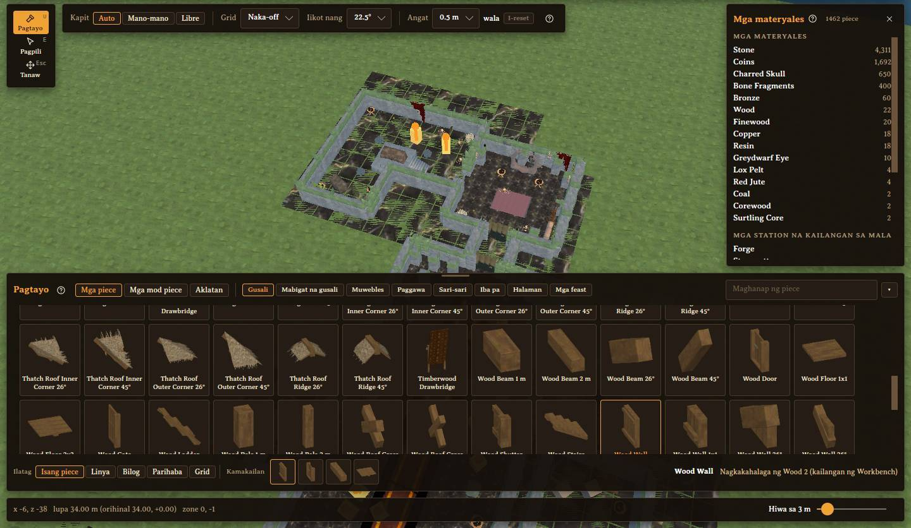

<!-- source: 16125394 -->
# Dungeon

Bumuo ng buong dungeon at ilagay ito sa mundo mo sa likod ng isang pasukan, i-edit ang sariling mga dungeon ng laro
nang silid kada silid, at magtayo sa loob nila.

**Saan:** tool rail, seksiyong **LIKHA** · **Key:** wala · **Gumagana sa:** mga naka-save na mundo, live; ang
generator, pati sa Gawaan (**Aklatan** → **Bumuo ng dungeon…**)

*Isang dungeon na gawa sa sariling mga silid ng laro (Burial Chambers, 25 silid), 5000 m pataas at nakahiwa nang 2 m
sa itaas ng sahig. Minamarkahan ng mga orange at asul na parisukat kung saan nagtatagpo ang mga silid. Kulay abo ang
**Burahin ang silid (Del)** hangga't walang napiling silid.*

Ang dungeon ng Valheim ay isang lokasyon sa lupa (isang punso, bunganga ng kuweba) na ang pinto ay papunta sa mga silid
na nakatabi 5000 m sa itaas nito. Tingnan ang
[Paano iniingatan ng laro ang mga dungeon](concepts/dungeons.md#paano-iniingatan-ng-laro-ang-mga-dungeon).

## Gamitin ito

Para bumuo ng dungeon at ilagay ito sa mundo:

1. Magbukas ng area ng isang mundo, saka i-click ang **Dungeon** sa tool rail.
2. Sa ilalim ng **Bumuo ng dungeon**, piliin ang **Biome**, **Laki** at **Mga palapag**. Iginuguhit muli ang plano
   ilang sandali pagkatapos ng bawat pagbabago.
3. Opsiyonal: i-click ang **I-randomize** hanggang magustuhan mo ang plano; tingnan ang bawat palapag gamit ang mga
   button na **Palapag 1**, **Palapag 2**... sa ilalim nito.
4. Iikot ang tanaw para humarap sa lugar na dapat paglagyan ng pasukan, nakagitna rito.
5. I-click ang **Ilagay sa mundo**.
6. I-click ang **Pumunta sa dungeon** para silipin ang loob; ibinabalik ng **Pumunta sa pasukan** ang tanaw pababa.
7. I-click ang **I-save sa mundo** (o **I-apply nang live**).

Iisang hakbang ng undo ang buong paglalagay: binabawi lahat ng `Ctrl+Z`. Laging iisang dungeon na gawa sa mga piece ng
gusali ang nagagawa ng parehong mga pinili at seed; ang dungeon na gawa sa
[sariling mga silid ng laro](#gawa-sa-sariling-mga-silid-ng-laro) ay nakadepende rin sa kinatatayuan ng pasukan nito at sa
direksiyong hinaharap nito. Para sa buong gabay, tingnan ang
[Bumuo ng dungeon at ilagay ito sa mundo](guides/make-a-dungeon.md).

***Bumuo ng dungeon** para sa dungeon ng Black Forest, Katamtaman, 2 palapag, boss sa likod ng tarangkahan. Sa tabi ng
panel, ang plano nito na iginuhit nang mas malaki, isang palapag bawat isa: ang berdeng silid ng susi sa palapag 1, ang
pulang arena kasama ang magenta na tuldok ng tarangkahan nito at ang gintong taguan ng kayamanan sa palapag 2, at ang
buod sa ilalim nila.*

## Mga setting

### Bumuo ng dungeon

Nasa itaas ng panel na Dungeon ang **Bumuo ng dungeon**: bukas kapag walang dungeon ang area, nakatiklop kapag mayroon.

| Setting | Ano ang ginagawa |
|---|---|
| **Gawa sa** | **Mga piece ng gusali**: mga silid na itinayo gaya ng pagtatayo ng isang player, may muwebles ayon sa gamit nila. **Sariling mga silid ng laro**: ang mga silid ng dungeon ng biome, pinagdugtong gaya ng pagdudugtong ng laro (tingnan ang [Gawa sa sariling mga silid ng laro](#gawa-sa-sariling-mga-silid-ng-laro)). Hindi ipinapakita sa Gawaan, na mga piece ng gusali lang ang tinatanggap. |
| **Biome** | **Meadows**, **Black Forest** (ang default), **Swamp**, **Mountain**, **Plains**, **Mistlands**, **Ashlands**, **Deep North**. Itinatakda nito ang mga halimaw, loot, ilaw, ang pasukan sa lupa, at ang estilo at mga pader maliban kung pipiliin mo sila. |
| **Laki** | **Maliit**, **Katamtaman** (ang default), **Malaki**, **Napakalaki**: mga 5, 8, 12 o 17 silid sa bawat palapag. |
| **Halimaw: × 1** | **wala** hanggang 3 beses ng karaniwan, nang 0.25 bawat hakbang. |
| **Bumabalik ang mga halimaw (spawner)** | Naka-on: ang mga spawner ng laro, na ang mga halimaw ay bumabalik ilang sandali matapos mapatay. Naka-off: ang mga halimaw mismo, inilagay nang isang beses. Laging inilalagay nang isang beses ang boss. |
| **Estilo** | **Ang sa biome**, o **Crypt**, **Catacombs**, **Temple**, **Fortress**, **Prison**, **Dvergr hold**, **Goblin warren**, **Ruins**: kung aling mga silid ang mayroon ito at kung paano sila nakalatag. |
| **Mga pader** | **Ang sa biome**, o **Stone**, **Marble**, **Wood**, **Stave**, **Grausten**, **Dvergr**, **Goblin**. |
| **Mga palapag** | **1 palapag** hanggang **16 palapag** (2 bilang default), pinagdudugtong ng hagdan. Naghihintay ang boss sa huli. |
| **Loot: × 1** | Mga chest at kayamanan: **wala** hanggang dalawang beses ng karaniwan. Mas marami ang hawak ng mas malalalim na palapag. Sa sariling mga silid ng laro, pinapanatili o dinodoble nito ang mga chest ng mga silid. |
| **Ilaw** | **Madilim**, **Malamlam** (ang default) o **Maliwanag**: kung ilang sulo at brazier. |
| **Muwebles** | **Payak**, **May muwebles** (ang default) o **Marangya**. |
| **Pagkasira: 15 %** | Gaano ito kasira, 0 hanggang 100 % nang 5 bawat hakbang: guho, bumagsak na haligi, mga sulong namatay. Nagtatakda ng sariling halaga ang pagpili ng estilo, at ganoon din ang pagpili ng biome habang **Ang sa biome** ang **Estilo**. |
| **Ibang daanan: × 1** | Gaano kadalas pinagdudugtong ang mga silid na magkalayo sa daan, para may higit sa isang daan paikot: **wala (parang puno)** hanggang dalawang beses ng karaniwan. |
| **Boss** | **Boss ng biome**, **Walang boss**, o ang boss o elite ng anumang biome ayon sa pangalan (`Troll`, `Draugr_Elite`, `StoneGolem`...). |
| **Boss sa likod ng tarangkahan, ang susi nito ay nasa chest** | Bumubukas ang tarangkahan ng arena gamit ang crypt key, na nasa chest na malayo rito (nabubuksan din ito ng mga player na may hawak na susi mula sa Elder). Naka-off: malalaking dobleng tarangkahan, bukas sa lahat. |
| **Mga nakatagong imbakan** | Maliliit na silid ng kayamanan sa likod ng basag na pader na sisirain o ng tapestry. |
| **Pangalan** | Nakasulat sa karatula sa bulwagan ng pasukan. Walang laman: pangalang ginawa mula sa seed, ipinapakitang kulay abo (`Barrow of Sigrun`). |
| **Seed** at **I-randomize** | Ang sariling numero ng dungeon; anumang buong numero ay gumagawa ng ibang dungeon sa parehong mga pinili. |

Walang ibang binabago sa dungeon ang pagbabago ng **Ilaw** o **Pagkasira**. Sa **Sariling mga silid ng laro**, ang
**Biome**, **Laki**, **Halimaw**, **Loot** at ang seed lang ang ginagamit; nakatago ang ibang row, at ang plano. Kung
ano ang inilalagay ng generator at saan, nasa
[Paano inilalatag ng generator ang isang dungeon](concepts/dungeons.md#paano-naglalatag-ng-dungeon-ang-generator) at
[Muwebles, ilaw at mga bantay](concepts/dungeons.md#muwebles-ilaw-at-mga-bantay).

Ang dala ng bawat biome kapag walang ibang pinili:

| Biome | Estilo | Mga pader | Boss | Pasukan sa lupa |
|---|---|---|---|---|
| Meadows | Crypt | Stone | `Skeleton_Hildir` | Punso ng isang burial chamber |
| Black Forest | Crypt | Stone | `Troll` | Punso ng isang burial chamber |
| Swamp | Crypt | Stone | `Draugr_Elite` | Pinto ng isang sunken crypt |
| Mountain | Fortress | Stone | `StoneGolem` | Bunganga ng isang Frost Cave |
| Plains | Goblin warren | Goblin | `GoblinBrute` | Walang sariling pasukan: isang pares ng magkaugnay na portal |
| Mistlands | Dvergr hold | Dvergr | `SeekerBrute` | Pasukan ng isang infested mine |
| Ashlands | Fortress | Grausten | `Charred_Melee_Dyrnwyn` | Isang Morgen hole |
| Deep North | Temple | Stave | `JotunWarrior` | Bunganga ng isang Frost Cave |

Iginuguhit ng **plano** ang ipinapakitang palapag mula sa itaas: mapusyaw na kayumanggi ang mga silid sa daang
dinaraanan, mas madilim na kayumanggi ang mga silid sa gilid, madilim na abo ang mga pasilyo; pula ang arena ng boss,
ginto ang taguan ng kayamanan at ang mga nakatagong imbakan, berde ang silid ng susi. Mga tuldok ang mga pintuan:
magenta ang nakakandadong tarangkahan, cyan ang mga nakatagong daan, berde ang mga bukas na arko, orange ang mga pinto
at tarangkahan. Ituro ang isang silid para sa pangalan nito. Sinasabi ng buod sa ilalim nito kung ano ang nagawa
(`Barrow of Sigrun: crypt of stone, 2 level(s), 15 rooms, 2140 objects; the key is in the ossuary on level 2`) at
kung ano ang hindi (`no room for stairs down from level 3; the levels below are left out`).

| Button | Ano ang ginagawa |
|---|---|
| **Ilagay sa mundo** | Inilalagay ang pasukan sa lupa sa gitna ng tanaw, nakaharap sa iyo ang pinto nito, at ang dungeon 5000 m sa itaas nito. |
| **Buksan sa Gawaan** | Isinusulat ang dungeon (mga piece ng gusali) bilang blueprint at binubuksan ito sa [Gawaan](workshop.md) para baguhin: tingnan ang [Buksan ito sa Gawaan](#buksan-ito-sa-gawaan). Hindi ipinapakita sa **Sariling mga silid ng laro**. |
| **Pumunta sa dungeon** / **Pumunta sa pasukan** | Ipinapakita kapag nailagay na ang dungeon (at hanggang bawiin ito ng `Ctrl+Z`): dinadala ang tanaw pataas sa unang palapag na tinanggalan ng bubong, at pabalik pababa. |

*Punso ng isang burial chamber na inilagay ng **Ilagay sa mundo**, nakaharap sa camera ang pinto nito. Sa ilalim ng
buod, ipinapakita na ngayon ang **Pumunta sa dungeon** at **Pumunta sa pasukan**.*

### Mga silid ng dungeon

Sa ibaba ng generator, kapag may dungeon sa area, inililista ng panel ang mga dungeon nito at ine-edit ang mga silid
nila.

| Setting | Ano ang ginagawa |
|---|---|
| Listahan ng dungeon | Ang mga dungeon ng area, bawat isa kasama ang uri, mga silid at lugar nito (`Frost Cave, 34 room(s), at 1520, -2240`). Lumalabas din ang mga nayon ng Fuling at mga bukid sa Meadows, na ganoon din ang pagkakalatag sa lupa. |
| **Pumunta sa dungeon** | Dinadala ang tanaw pataas sa gitna ng mga silid ng dungeon at tinatanggal ang mga bubong nila (sa 4 m sa itaas ng sahig kapag naka-off ang hiwa). |
| **Pumunta sa pasukan** | Ibinabalik ang tanaw pababa sa pasukan sa lupa, walang hiwa. |
| **Itayo rito** | Ino-on ang [Pagtayo](build.md) sa ibabaw ng dungeon, kasama ang dock nito sa ibaba: tingnan ang [Magtayo sa loob ng dungeon](#magtayo-sa-loob-ng-dungeon). |
| **MGA SILID** + **Maghanap ng silid…** | Ang mga silid na tinatanggap ng ganitong uri ng dungeon; mag-type para paliitin ayon sa pangalan. Minamarkahang `(end cap)` at `(entrance)` ang mga takip sa dulo at mga silid ng pasukan. |
| **Kasama ang inilalagay ng laro sa mga ito** | Naka-on (ang default): may kasamang ilalagay sana ng laro roon ang idinagdag na silid (mga chest, spawner, sulo, dekorasyon). Naka-off: payak na mga silid. |
| **Mga pinto kung saan maaaring ilagay ng laro** | Naka-on (ang default): nagkakaroon ng pinto ang idinagdag na silid kung saan ito dumudugtong, ayon sa sariling tsansa ng laro. |
| **Iikot (R)** | Idinudugtong ang ipinapakitang silid gamit ang susunod nitong bukana na kaparehong uri. |
| **Burahin ang silid (Del)** | Tinatanggal ang napiling silid. |
| **Isara ang mga bukas na dulo** | Inilalagay ang takip sa dulo ng laro sa bawat bukas na dulo, para walang papalabas. Sinasabi ng mensahe kung ilang bukas na dulo ang walang takip sa dulo na kauri nila. |

Tinatanggal ang mga bubong gamit ang slider na **Hiwa** sa status bar, kapareho ng nasa mundo at sa Gawaan. Habang
ginagamit ang tool na Dungeon (o **Itayo rito**) na may bukas na dungeon, binibilang ang mga metro nito mula halos sa
sahig ng pasukan ng dungeon, 0 hanggang 29 m: humihiwa sa sahig ang kaliwang dulo, ipinapakita ng kanang dulo
(**Hiwa: off**) ang mga bubong. Ibinabalik ng pag-alis sa tool ang sariling hiwa ng mundo, at itinatabi ang sa dungeon
para sa pagbalik mo. Tingnan ang [Hiwa](editor-basics.md#hiwa).

Binibilang ng linya sa ibaba ang mga silid, bukas na dulo at nagpapatong na pares (`24 room(s), 3 open end(s). 1
overlapping pair(s).`).

## Magbukas ng dungeon

1. Buksan ang area sa ibabaw ng pasukan ng isang dungeon (ipinapakita ng mga marka ng lokasyon sa mapa ang mga
   pasukan).
2. I-click ang **Dungeon** sa tool rail: ipinapakita ng listahan ang mga dungeon ng area.
3. I-click ang **Pumunta sa dungeon** sa ilalim ng listahan.
4. Opsiyonal: igalaw ang slider na **Hiwa** sa status bar para makita ang mas marami o mas kaunti sa mga pader.

Doon sa itaas, hindi na sumusunod sa lupa ang camera: umikot, gumalaw at lumipad sa paligid ng mga silid gaya ng
dati. Ipinapakita o itinatago sila ng **Mga silid ng dungeon** sa [panel na Tanaw](editor-basics.md).

Walang silid pa ang dungeon na wala pang nakalapit: sinasabi ng panel na *Hindi pa nailalatag ng laro ang dungeon na
ito (wala pang nakalapit dito).* Puntahan ito sa laro, saka buksan ulit ang area.

*Isang Frost Cave matapos ang **Pumunta sa dungeon**, nakahiwa ang mga bubong nito nang 4 m sa itaas ng sahig:
inililista ito ng panel (`Frost Cave, 17 room(s), at -640, -350`). Minamarkahan ng mga berdeng frame ang mga bukas na
dulo (may binurang silid), ng mga orange na parisukat kung saan nagtatagpo ang mga silid nang walang pinto.*

## Magdagdag ng mga silid

May mga **bukana** ang bawat silid, ang mga pintuan kung saan ito nagtatagpo sa susunod na silid. Mga bukanang
kaparehong uri lang ang pinagdudugtong ng laro.

1. Maghanap ng berdeng frame: minamarkahan nito ang isang **bukas na dulo**, isang bukanang wala pang silid na
   nakadugtong.
2. Pumili ng silid sa listahan sa ilalim ng **MGA SILID**.
3. Ituro ang isang bukas na dulo (sa loob ng 1.5 m): lumalabas doon ang silid, aninag, nakadugtong gaya ng
   pagdudugtong ng laro sa mga silid.
4. Opsiyonal: pindutin ang `R` (**Iikot (R)**) para idugtong ito gamit ang isa pa sa mga bukana nito.
5. Mag-click para idagdag ito. Nananatili itong napili, kaya tinatanggal ulit ito ng `Del`.

Nagiging pula ang silid na magpapatong sa iba, o lalampas sa espasyo ng dungeon (64 × 64 m sa paligid ng gitna ng zone
nito para sa karamihan ng uri), at nagbababala ang linya. Itinatayo pa rin ito ng laro: babala lang ito.

*Pinili ang `cave_new_icecorridor01` sa ilalim ng **MGA SILID** (pinaliit gamit ang "icecorridor") at itinuro sa
isang bukas na dulo: lumalabas ito roon nang aninag, nakadugtong sa paraan ng laro. Nakasulat sa linya sa ibaba ang
`17 room(s), 4 open end(s).`*

## Mga pinto

Minamarkahan ng parisukat ang bawat lugar kung saan nagtatagpo ang dalawang silid at puwedeng tumayo ang isang pinto:
**asul** kapag may pinto, **orange** kapag wala. I-click ito para ilagay roon ang pinto ng dungeon o tanggalin ito.
Iisang hakbang ng undo ang bawat click.

## Magbura ng silid

Mag-click ng silid para piliin ito (lumalabas ang kahon nito), saka i-click ang **Burahin ang silid (Del)**. Sumasama
rito ang nakatayo sa silid (mga chest, spawner...), pati ang mga pinto kung saan ito nagtatagpo sa ibang silid.
Nagkakaroon ulit ng mga bukas na dulo ang mga katabing silid: tinatakpan sila ng **Isara ang mga bukas na dulo**.

## Magtayo sa loob ng dungeon

Ino-on ng **Itayo rito** ang [Pagtayo](build.md) sa ibabaw ng dungeon, kasama ang [dock](workshop.md#ang-dock-ng-pagtayo)
nito at ang bar ng Pagtayo: ang mga tab na **Mga piece** at **Mga mod piece** lang (napupunta sa plot ng Gawaan ang mga
blueprint ng **Aklatan**), isang piece sa bawat pagkakataon (iginuguhit ang mga linya ng **Ilatag** sa lupa, malayo sa
ibaba): pumili ng piece, saka mag-click sa sahig o pader ng isang silid, o sa isang piece na naroon na. Kumakapit ang
mga piece gaya ng sa hammer, at tumatagos ang cursor sa itinatago ng hiwa. Pumili ng ibang tool para huminto sa
pagtatayo.

Binibilang na lupa sa laro ang mga sahig at pader ng isang silid, kaya hindi bumabagsak ang mga piece na nakapatong sa
kanila. Nasisira ang mga piece na nakabitin sa hangin, malayo sa mga silid, sa sandaling lumapit ang isang player.

## Gawa sa sariling mga silid ng laro

Kapag **Sariling mga silid ng laro** ang **Gawa sa**, pinagdudugtong ng editor ang mga silid ng dungeon ng biome sa
paraan ng laro: burial chamber sa Meadows at Black Forest, sunken crypt sa Swamp, Frost Cave sa Mountain at Deep North,
infested mine sa Mistlands, at ang sariling dungeon ng Ashlands at Plains. Nagdadagdag ito ng mga silid hanggang
umabot sa mga 8, 14, 20 o 26 (ayon sa **Laki**), nang walang pagpapatong, isinasara ang bawat bukas na dulo, pinupuno
ang bawat silid ng ilalagay sana ng laro roon, at naglalagay ng mga pinto kung saan ilalagay ng laro. Kinokopya ng
**Halimaw** ang bawat spawner nang mga ganoong karaming beses; pinapanatili ng **Loot** ang bawat chest ayon sa
tsansang iyon sa ilalim ng × 1 at nagdadagdag ng pangalawa sa tabi nito ayon sa tsansang lampas doon. Nagiging Frost
Cave ang uri ng dungeon na walang silid na madudugtungan (isang kampo, isang nayon), at sinasabi iyon ng buod.

Kapag nailagay sa mundo, iisang dungeon ito ng mga silid, eksaktong gaya ng pag-iingat ng laro sa sarili nito:
lumalabas ito sa listahan ng dungeon, para i-edit nang silid kada silid. Inilalatag muli ang mga silid nito mula sa
pasukan, gaya ng paglalatag ng laro sa sarili nito: mula sa kung saan inilalagay ng pasukan ang dungeon, sa loob ng
espasyo ng zone na iyon. Kaya hindi ang nasa buod ang mga silid na nailagay, at ang paglalagay nito sa ibang bahagi ng
zone, o nakaharap sa ibang direksiyon, ay nagbibigay ng ibang mga silid; muling nagbibigay ng parehong mga silid ang
parehong lugar at direksiyon. Kapag naka-on ang mga room at dungeon file ng Expand World Data, sinusunod sila ng
generator, ng listahan ng silid at ng mga silid na iginuguhit: tingnan ang
[I-edit ang mundong ginawa gamit ang Expand World, Riverheim o Tunnelheim](guides/use-mods-worlds.md).

## Buksan ito sa Gawaan

*Isang nabuong dungeon (isang palapag) na binuksan sa plot ng Gawaan at nakahiwa sa 3 m, nakabalik sa tab na **Mga
piece** ang dock ng Pagtayo: sa itaas, ang bulwagan ng pasukan kasama ang portal nito kung saan dumarating ang mga
player; sa ibaba nito, ang arena ng boss.*

Isinusulat ng **Buksan sa Gawaan** ang dungeon bilang blueprint sa folder ng Homestead at binubuksan ito, para
baguhin: magbukas ng chest, ilipat ang muwebles, idagdag ang sarili mong mga detalye, saka **I-save ang blueprint**.
Pumapalit ang Gawaan sa mundo: kapag may mga pagbabagong hindi naka-save (o hindi na-apply), nagtatanong muna ito.
Para ilagay ang dungeon sa isang mundo pagkatapos, buksan ulit ang mundo at i-paste ang blueprint (tingnan ang
[Mga dungeon mula sa mga blueprint](#mga-dungeon-mula-sa-mga-blueprint)). Ang blueprint:

- pinapanatili ang hawak ng mga object nito (ang susi sa chest nito, ang mga karatula, ang boss at ang mga bituin
  nito) at na guho ito;
- may tag na `dungeon` at `generated`, at ibinibigay ng paglalarawan nito ang seed at ang buod;
- may **portal** sa bulwagan ng pasukan kung saan dumarating ang mga player.

Pinapanatili ang blueprint na may ganoon nang pangalan; may numero ang bago. Kapag itinayo sa laro gamit ang
Homestead, ang mga piece lang ito: walang susi sa chest, walang boss.

## Mga dungeon mula sa mga blueprint

Puwedeng maging dungeon ang anumang blueprint: i-on ang **Isang dungeon** kapag sine-save mo ito sa Gawaan (o sa
**Mga detalye** ng panel na Blueprints). Kapag na-paste sa mundo mula sa panel na Blueprints, hindi ito napupunta sa
lupa:

- Napupunta ang pasukan ng dungeon ng biome kung saan ka nag-click, nakaharap sa iyo, at ang gusali 5000 m sa itaas
  nito.
- Gumagana ang ikot at mirror ng tool sa pag-paste (`R`, `X`, `,` `.`); hindi ang **Taas** at **Mga kopya** nito,
  kahit ipinapakita sila ng panel.
- Maglagay ng **portal** (`portal_wood`) sa gusali kung saan dapat dumating ang mga player, nakaharap sa direksiyong
  dapat nilang tingnan: bumubukas doon ang pinto ng pasukan, at hindi isinasama ang portal na iyon. Kung wala nito,
  dumarating ang mga player sa gitna ng gusali, nakaharap sa hilaga.
- Sa Plains, isang pares ng magkaugnay na portal ang pumapalit sa pasukan.

Hindi bumabagsak ang mga piece sa langit kung nakapatong lang sa hindi kailanman sinusuri ng laro para sa suporta:
gawing black marble ang mga sahig (`blackmarble_floor_large`) at ipatong ang lahat ng iba pa sa kanila.

## Mga shortcut

| Key o mouse | Ano ang ginagawa |
|---|---|
| Mag-click ng berdeng frame | Idagdag ang silid na ipinapakita roon. |
| Mag-click ng silid | Piliin ito. |
| Mag-click ng parisukat | Maglagay ng pinto roon o tanggalin ito. |
| `R` | Idugtong ang ipinapakitang silid gamit ang susunod nitong bukana. |
| `Del` | Burahin ang napiling silid. |
| `Ctrl+Z` | I-undo ang huling pagbabago (isang paglalagay, isang silid, isang pinto). |

Nasa [Mga shortcut](help/shortcuts.md) ang lahat ng key ng editor.

## Mga tip at limitasyon

- **Pagbawi:** iisang hakbang ng undo ang bawat paglalagay, silid o pinto (`Ctrl+Z`). Nawala ang layout na nagustuhan
  mo? Muling ginagawa ng parehong mga pinili at seed ang parehong dungeon na gawa sa mga piece ng gusali (kailangan din
  ng dungeon na gawa sa sariling mga silid ng laro ang parehong lugar at direksiyon). Walang isinusulat hanggang
  **I-save sa mundo** o **I-apply nang live**.
- **Isang dungeon bawat zone** (64 × 64 m): sa likod ng sariling pasukan ng laro, kapag may nakalagay na roon sa itaas,
  sinasabi iyon ng editor at walang inilalagay; ilagay ang pasukan sa ibang zone. Sa Plains (portal ang pasukan), mas
  mataas na lang ito napupunta, tingnan sa ibaba.
- Mga karaniwang object ang dungeon na gawa sa mga piece ng gusali, hindi dungeon ng mga silid: inililipat at
  binubura ng [Pagpili](select.md) ang mga piece nito, at hindi ito ipinapakita ng listahan ng dungeon (sinasabi ng
  panel na gawa ito sa mga piece, walang silid na mae-edit). Gamitin ang **Pumunta sa dungeon**.
- Walang nagtayo ang lahat ng inilalagay ng nabuong dungeon, gaya ng sa laro: binabalewala ito ng mga raid, hindi ito
  base para sa apoy, at ikatlo lang ng mga materyales ang naibabalik kapag binaklas. Tingnan ang
  [Mga piece na itinayo ng player](concepts/objects.md#mga-piece-na-itinayo-ng-player).
- Ang pasukan ay ang sariling lokasyon ng laro para sa biome: ginagawa ng laro ang pinto at mga bato nito tuwing
  nilo-load ang zone. Napupunta ang dungeon kung saan inilalagay ng laro ang sariling dungeon ng pasukang iyon (ang sa
  Frost Cave ay sa itaas ng gitna ng zone), nakaikot para dumating ang mga player na papasok sa pinto sa bulwagan ng
  pasukan na nakaharap sa loob. Nananatili ang tanaw sa pasukan.
- Sa Plains, isang portal sa lupa (3 m mula sa punto) ang papasok at ang kakambal nito sa bulwagan ng pasukan ang
  pabalik, magkaugnay sa ilalim ng tag gaya ng `dg123`. Dahil walang pasukang humahadlang, tumataas ang dungeon nang
  50 m bawat hakbang kapag may nakalagay na roon sa itaas.
- Ang ilan sa inilalagay ng laro sa mga silid (icicle, kristal, isda) ay lumalapag sa pinakamalapit na ibabaw sa laro,
  kaya maaaring medyo iba ang puwesto nito sa ipinapakita ng editor.
- Madilim na iginuguhit ng laro ang mga dungeon; iniilawan sila ng editor gaya ng labas, para makita mo ang ine-edit
  mo.
- Kayang bumuo ni **Claude** ng mga dungeon at mag-edit ng mga silid: tingnan ang [Claude](claude.md).

## Kaugnay

- [Bumuo ng dungeon at ilagay ito sa mundo](guides/make-a-dungeon.md)
- [I-paste ang blueprint sa isang mundo](guides/paste-a-blueprint.md)
- [Paano iniingatan ng laro ang mga dungeon](concepts/dungeons.md#paano-iniingatan-ng-laro-ang-mga-dungeon)
- [Gawaan](workshop.md) · [Pagpili](select.md)
